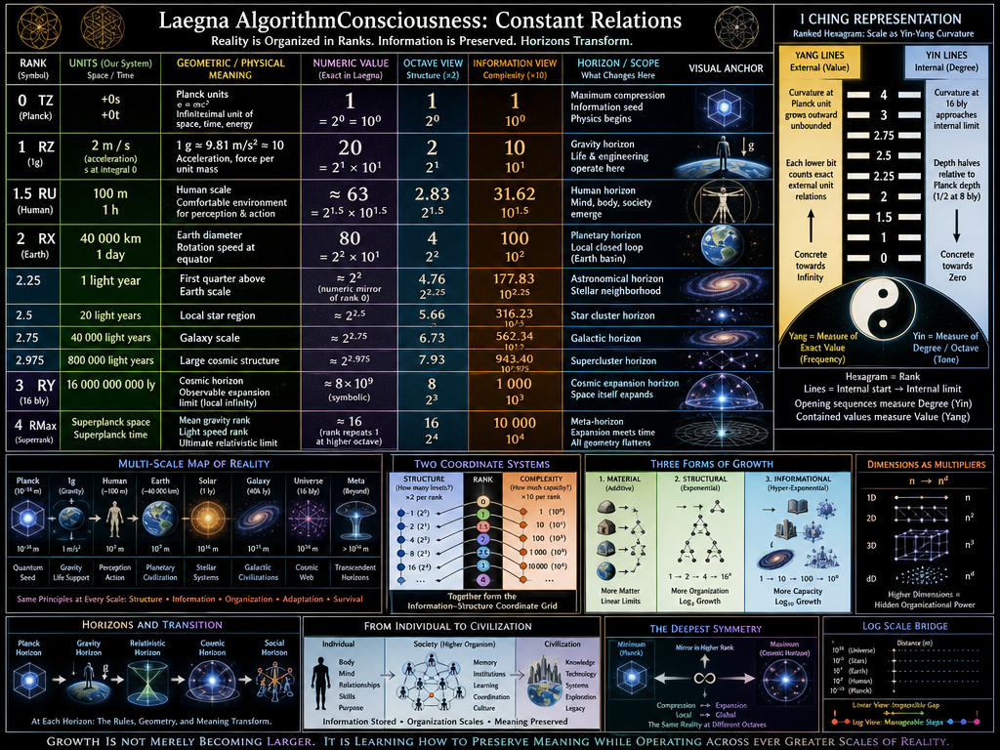

<br>

# Laegna AlgorithmConsciousness: Constant Relations

Which are the most critical physical constants we want?

## Rank 0; ***TZ***

Planck units:
- 1 planck time = +0t
- 1 planck space = +0s
- 1 planck energy = +0e
- 1 infinitesimal = +0

We know about this:
- $e = mc^2$
- e is energy in e; space s is in m; speed c is in t.

At rank 0 our physical constants are infinitesimals and planck units.

### Evaluation

This constant is exactly 1.
- 1 is rank 0 unit:
  - 2^0 = 1
  - 1 with 0*0 zeroes = 1
  - 1 * 1 = 1

## Rank 1; ***RZ*** / ***TX***

Geo units:
- $1 g$

$1 g$ ≈ $9.81 m/s²$ ≈ $9.80665 m/s²$

It measures acceleration and the resulting force per unit mass, not gravity as a standalone pull.

When an object is in free fall near Earth, it accelerates downward at roughly 1g. Standing still on solid ground, you experience a normal force of 1g pushing back up against you.

We are going to round this:
- We use m as one unit; m is linear, relative to velocity.
- We use s as other unit; s^2 is exponent, relative to acceleration.
- We might round it up to exactly 10.

### Evaluation

This constant is exactly 20.
- 1 is rank 0 unit:
  - 2^1 = 2
  - 1 with 1*1 zeroes = 10
  - 2 * 10 = 20

We use 2 $m / s$ - funnily, in Laegna units, the first step could be linear.
- In our Laegna numbers, we take right to next octave to remove division by square in units, if unit rank goes 1 up, number goes 1 up.
- We now have exactly m / s, basic space divided by basic time which is not accelerated.
  - Put s^2 at integral 1; read s at integral 0 - this is the laegna s.

## Rank 1.5; ***RU*** / ***T⋂***

Geo:
- 100 m
- 1h

This is roughly where human stands - because we already have 1m, let's assume human is comfortable in 1h in 100m surroundings.
- Rank 1.5 is the "zeroeth", mean rank and should be approximately the human realm space.

## Rank 2; ***RX*** / ***TY***

Geo:
- 40 000 km in our units is Earth's diameter
- We now use kilometers instead of meters
- Our units: kilometer and day
- 40 000 km / d
  - If you treat d as one earth day (24 hours), the formula represents the physical speed of Earth's rotation at the equator

Earth’s equatorial circumference of 40,075 km (and its resulting diameter) is remarkably typical—almost an exact mathematical average—for planets with a 1g surface gravity.

While it might seem intuitive that larger planets always have higher gravity, astrophysics reveals a fascinating phenomenon: a massive "plateau" in the universe where planets of vastly different sizes all share roughly the same surface gravity as Earth.

There is a reason the equatorial circumference is so close to a clean, round 40,000 km. In 1791, the French Academy of Sciences officially defined the meter as exactly one ten-millionth (\(1/10,000,000\)) of the distance from the equator to the North Pole.

By that original definition, a perfect meridional circumference passing through the poles would be exactly 40,000 km.

## Rank 2.25

Geo:
- ***Rank 2.25***: 1 light year (1 ly); first quarter-rank to rank 3.
  - Numeric equivalent to rank 0
- *Rank 2.5*: 20 ly.
- *Rank 2.75*: 40 000 ly.
- *Rank 2.975*: 800 000 (?)

These ranks could be numeric hologram-symmetries to ranks below 3.

## Rank 3; ***RY***

Geo:
- 16 000 000 000 ly

1 and 16b ly are Cosmic Horizons:
- First Horizon is local observer vision of infinite travel in localmost bubble, rank 1 infinity.
- Second Horizon is rank 4, where expansion is already built-in into exponential spatiality.

## Rank 4; ***RMax***, ***RYZ***

Mean gravity rank with exponentiation at rank 4 (1 superunit of plank space which is sum of all directions, or planck unit divided by infinity):
- The time it takes space to cool down locally.
- Rank 4 repeats rank 1: instead of massed particle gracity as it's *existing* energy in first rank of first superrank, this is the *required* energy tesimal such that if any tesimal is added, it would overcome the energy barrier completely, but it's at limit value;
  - In terms of Laegna infinity: it's radius where ball with this rank is locally precisely flat.
  - In terms of Relativity: it's such a distance where object with width becomes exactly flat, at exact zero (plank width).

Light speed rank with exponentiation at rank 4 (1 superplanck-time):
- This is the distance one can maximally travel before the space expansion meets them at time, not space.

Second rank grows into 1 planck unit divided by 16 b ly, where the last external space of *space with geometry* would collapse:
- If from 1 planck unit to 16 b ly, centered at 40 000 km in Special Laegna Relativity of 1g, where General Laegna Relativity would not use Earth's 1g and 40 000 as basin, but replace exactly these two values with other builtins.

# I Ching representation

Each Yang line reads the spatial curvature as if:
- Take 1 planck unit - the relative curvature if at 1 planck unit, 1m width object has 1m debth, grows *externally*, by exact units and not limits.
  - Each lower-channel bit counts this.
  - Yang trigram of I Ching measures the external unit relations.

Each Yin line reads the spatial curvature as if:
- Take 16 b light years, where the curvature at 8 would have debth 1/2 as planck unit 0.5, but planck unit 2.0 would have debth 2\1 - 16bly would forever approach this.
  - The Yin lines are *internal views of exact same positions*, potentially huge numbers.

Notice the Hexagram is *mere rank*, and each symbol will have it's internal initial and ending line:
- Which are approaching limits to zero are concrete towards infinity, they are Yang;
  - and vice verse for limits to infinity, concreteness towards zero, Yin.

With these Yin, opening sequences we measure *degree*; with these Yang, exact numbers contained, we measure *value*.
- Degree is octave, note, tone.
- Value is frequency inside that zone, repeated to other zones qualitatively.

---

I asked CoPilot:

> Can you analyze it mathematically, spirit-based-logically, and socially and practically, and show the numbers and their relations - how they pass ranks and disctances uniformly in our actual space, altough it's partially a hologram, never travelled to *numeric value of* the final level - yet explored symmetrically and optimally.

# From Planck Units to Civilization
## A Multi-Scale Interpretation of Reality, Information, Horizons, and Human Development

Reality appears fragmented when viewed through specialized disciplines.

Physics studies matter.

Biology studies life.

Psychology studies minds.

Economics studies societies.

Computer science studies information.

Cosmology studies the universe.

Yet a deeper question remains:

> Are these truly separate domains, or are they different scales of the same underlying organizational process?

The framework explored in this article examines reality through ranks, horizons, and transformations. It proposes that the same structural principles may reappear from the smallest meaningful scales of physics to the largest imaginable scales of civilization.

The objective is not to replace existing science, but to provide a unifying conceptual language for discussing:

- physical scales,
- information,
- consciousness,
- social organization,
- technological development,
- civilization,
- and cosmic exploration.

---

# The Fundamental Observation

Most systems appear different because they are observed at different scales.

Consider:

```text
Planck unit
Cell
Human
City
Civilization
Planet
Galaxy
Universe
```

The objects differ.

The organizational challenge remains remarkably similar:

```text
Maintain structure.

Store information.

Process information.

Adapt to change.

Coordinate subsystems.

Survive through time.
```

The larger the scale becomes, the more important organization becomes relative to raw material.

---

# Three Forms of Growth

Most people think only about material growth.

For example:

```text
1 kg
2 kg
3 kg
4 kg
```

This is additive growth.

However reality contains additional growth modes.

---

## Material Growth

Material growth accumulates resources.

```text
stone
house
city
planet
```

Each increase requires additional matter.

This type of growth encounters physical limits.

---

## Structural Growth

Structural growth increases organization.

A simple example:

```text
1
2
4
16
```

These numbers may be viewed as rank levels.

```text
Rank 0
Rank 1
Rank 2
Rank 3
```

The important part is not the numerical value.

The important part is the increasing ability to organize relationships.

---

## Informational Growth

A third growth mode concerns complexity.

For example:

```text
1
10
10 000
1 000 000 000
```

This hierarchy expands much faster.

It measures capacity rather than structure.

One may think of it as:

```text
How much information
can be represented.
```

instead of:

```text
How many levels exist.
```

---

# The Two Coordinate Systems

The framework contains two parallel hierarchies.

Structural hierarchy:

```text
1
2
4
16
```

Complexity hierarchy:

```text
1
10
10 000
1 000 000 000
```

The first measures organization.

The second measures informational capacity.

Together they form a coordinate system.

---

## Structure

Structure answers:

```text
How many levels exist?
```

Examples:

```text
individual

family

community

society
```

or

```text
point

line

surface

volume
```

or

```text
unit

duality

network

field
```

---

## Complexity

Complexity answers:

```text
How much can a level contain?
```

Two systems may have identical structure while possessing radically different informational richness.

For example:

```text
Two villages
```

may have identical population size.

Yet one may contain:

```text
libraries
universities
science
technology
```

while the other does not.

The structure remains similar.

The informational content differs.

---

# Dimensions as Hidden Multipliers

Suppose we begin with:

```text
n
```

One-dimensional description.

Now increase dimensionality:

```text
n²
```

Two-dimensional description.

Then:

```text
n³
```

Three-dimensional description.

Organizational capacity expands dramatically.

For example:

```text
2
4
8

4
16
64

16
256
4096
```

These arise naturally when dimensions increase.

This suggests:

```text
Dimension
=
hidden organizational capacity.
```

---

# The Physical Anchors

The system introduces several reference scales.

```text
Planck scale

1g

Human scale

Earth scale

Cosmic scale
```

These act as horizons rather than ordinary measurements.

---

# Rank 0: Planck Horizon

The Planck level acts symbolically as:

```text
maximum compression
```

Reality is reduced to its smallest meaningful coordinate.

Conceptually:

```text
Universe
↓

Information seed
↓

Minimal coordinate
```

The Planck horizon represents the possibility that enormous complexity may be encoded within extremely small domains.

---

# Rank 1: Gravity Horizon

The next anchor is:

```text
1g
```

approximately:

```text
9.81 m/s²
```

Human bodies evolved within this environment.

Engineering evolved within this environment.

Civilizations emerged within this environment.

Thus 1g becomes a practical reference frame connecting physics to life.

---

# Rank 1.5: Human Horizon

The framework places humans approximately between microscopic and planetary scales.

For example:

```text
100 m

1 hour
```

represents a comfortable local environment.

This is where:

```text
perception
memory
decision making
social interaction
```

naturally occur.

---

# Rank 2: Planetary Horizon

The Earth provides the next major reference frame.

```text
40 000 km
```

approximately equals Earth's circumference.

A remarkable property appears:

```text
gravity
rotation
navigation
measurement
```

all intersect at this scale.

Earth becomes a complete local loop.

A self-contained basin of experience.

---

# Rank 2.25 to Rank 3

Beyond planetary scales the hierarchy enters astronomical territory.

Examples:

```text
1 light year

20 light years

40 000 light years
```

These may be interpreted as nested observational basins.

Each introduces larger domains of organization.

The numbers matter less than the relationships between them.

---

# Rank 3: Cosmic Horizon

The framework uses:

```text
16 billion light years
```

as a symbolic expansion horizon.

Conceptually:

```text
local infinity

↓

cosmic infinity
```

This horizon includes not only distance but also expansion of space itself.

---

# Why Horizons Matter

A horizon is not simply a distance.

It represents a boundary where interpretation changes.

Examples:

```text
Planck horizon
```

Physics changes.

```text
Relativistic horizon
```

Space and time change.

```text
Cosmic horizon
```

Geometry changes.

```text
Social horizon
```

Coordination changes.

---

# The Logarithmic Bridge

A key feature of the framework is that scales are connected logarithmically rather than linearly.

Linear view:

```text
Planck scale

and

Cosmic scale
```

appear infinitely far apart.

Logarithmic view:

```text
Both become neighboring ranks
within a larger hierarchy.
```

This transforms:

```text
vast difference
```

into:

```text
manageable relationship.
```

---

# The Holographic Principle of Location

A recurring theme is:

```text
The whole exists
within the part.
```

A seed contains the blueprint of a tree.

A cell contains the blueprint of an organism.

A genome contains the blueprint of a body.

A civilization stores compressed knowledge of previous civilizations.

Similarly:

```text
Local coordinate
↓

Compressed structure
↓

Unfolded structure
```

The local and the global become transformations of one another.

---

# Individual Life

What does this mean personally?

Every person operates simultaneously across multiple ranks:

```text
Body

Mind

Family

Community

Society

Civilization
```

The challenge is coordination between scales.

Success at one level while neglecting others often fails.

Examples:

```text
Wealth without health.

Knowledge without relationships.

Power without stability.
```

Each optimization affects multiple ranks simultaneously.

---

# Society as a Higher Organism

Societies possess characteristics normally associated with individuals.

They develop:

```text
memory

goals

learning

adaptation

communication
```

Libraries become memory.

Institutions become habits.

Science becomes collective learning.

Technology becomes collective capability.

Civilization becomes a distributed intelligence system.

---

# Hypermodellation

As complexity increases, ordinary modelling becomes insufficient.

One model is no longer enough.

We require:

```text
models of models
```

For example:

```text
economies

inside

societies

inside

civilizations

inside

planetary systems
```

Hypermodellation studies these nested structures.

Its objective is preserving useful information while moving between scales.

---

# Material and Exponential Growth

Material growth remains important.

However informational growth increasingly dominates.

Material growth:

```text
more resources
```

Informational growth:

```text
better organization
```

Exponential growth frequently arises from:

```text
knowledge

networks

cooperation

technology
```

rather than from resources alone.

---

# The Practical Lesson

The practical value of the hierarchy is simple:

```text
Every horizon eventually
becomes local.
```

What seems impossible at one rank often becomes ordinary at another.

A child sees:

```text
1 km
```

as enormous.

A pilot sees:

```text
1000 km
```

as routine.

A civilization may someday see:

```text
planetary distances
```

the same way.

Growth therefore means transforming:

```text
unknown

↓

known

↓

familiar

↓

foundational
```

---

# The Deepest Symmetry

The framework ultimately proposes a profound symmetry:

```text
Planck scale
=
maximum compression

Civilization
=
organized expansion

Cosmic horizon
=
maximum visible expansion

Higher-rank reality
=
compression and expansion
becoming equivalent
```

The smallest coordinate and the largest horizon become mirror images viewed from a sufficiently high level.

---

# Conclusion

Reality can be viewed as a hierarchy of transformations.

```text
Compression
↓

Information

↓

Organization

↓

Life

↓

Society

↓

Civilization

↓

Cosmic Understanding
```

At every level:

```text
structure grows

complexity grows

organization grows

understanding grows
```

The purpose of the hierarchy is not merely to travel farther in space.

It is to navigate scales.

Planck units, gravity, Earth, stars, societies, knowledge systems, and civilizations become different expressions of the same challenge:

```text
How can identity survive
while scale changes?
```

The answer proposed by this framework is that reality accomplishes this through recursive organization, informational compression, and continual transformation between local experience and larger horizons.

In that sense, growth is not merely becoming larger.

Growth is learning how to preserve meaning while operating across ever greater scales of reality.
