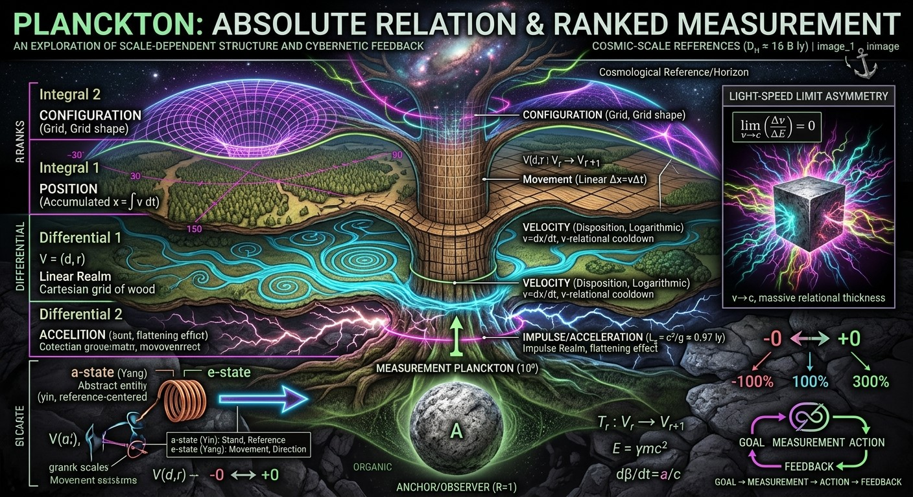
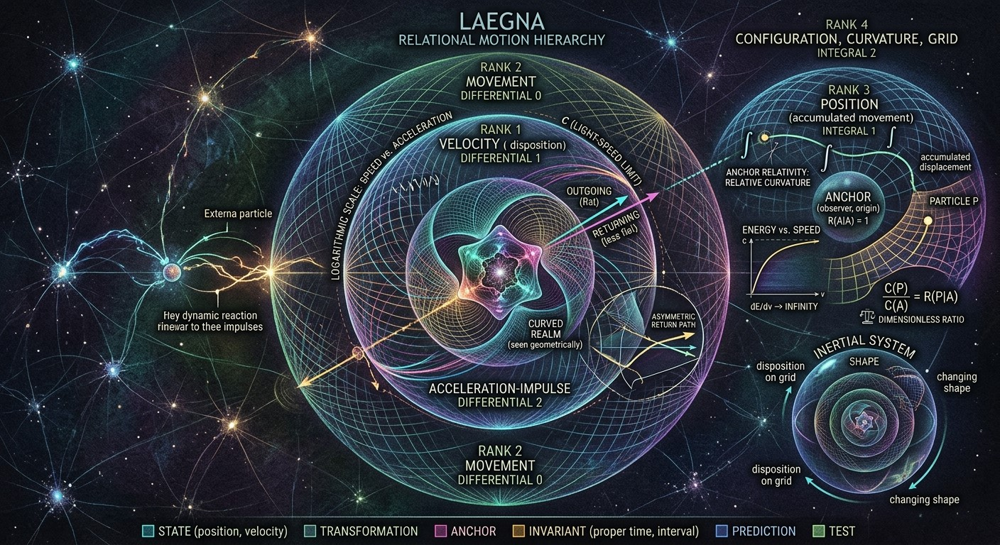
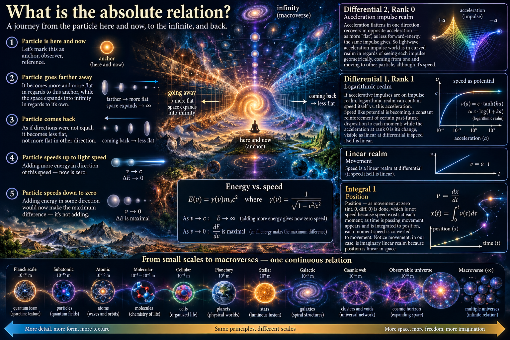
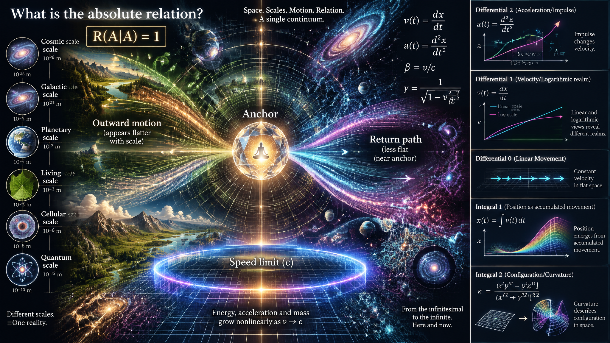

 

# What is the absolute relation?

Consider particle is here and now:
- Let's mark this as anchor, observer, reference.

Consider particle goes farther away:
- It becomes more and more flat in regards to this anchor, while the space expands into infinity in regards to it's own.

Consider particle *comes back*:
- As if directions were not equal, it becomes *less flat*, not *more flat in other direction*.

Consider particle speeds up to light speed:
- Adding more energy in direction of this speed - now is zero.

Consider particle speeds down to zero:
- Adding energy in some direction would now make the maximum difference - it's not adding.

Differential 2; Rank 0:
- Acceleration impulse realm, where acceleration flattens in one, recovers in opposite acceleration - as more "flat", as less forward-energy the same impulse gives. So lightwave acceleration impulse world is in curved realm in regards of seeing each impuse geometrically, coming from one and moving to other particle, altough it's speed.

Differential 1; Rank 1:
- If accelerative impulses are on impulse realm, logarithmic realm can contain speed itself vs. this acceleration.
- Speed like potential is becoming, a constant reinforcement of certain past-future disposition to each moment; while the acceleration at rank 0 is it's *change*, visible as linear at differential if speed itself is linear.

Linear realm; Movement.

Integral 1:
- Position - as movement at zero (int. 0, diff. 0) is done, which is not speed because speed exists at each moment; as time is passing movement appears and is integrated to position, each moment speed is converted to movement.
- Notice movement, in our case, is imaginary linear realm because position is linearized at integral 1.

Integral 2:
- Curvature position - as infinities pass internally, the curvature is changing;
- Integral 2 is disposition on grid where it can move. It's the higher bit of position - position is changing infinitely, while this superposition is the inertial system and it's shape in regards to original anchor.

# Anchor-relativity

What makes the numbers consistent is that zero is the origin, and unless recalculated it keeps it's relative "1:1" curvature, unitary curvature which is counted "as if curvature did not exist there" - each other, relatively, then *is* some curvature not zero or identity.

---

 

ChatGPT's article on this topic:

# Absolute Relation: Anchor, Curvature, and the Ranks of Motion

## 1. The absolute relation

Consider a particle here and now.

We choose its current state as an **anchor**: the observer's reference, the origin of measurement, and the state against which other states are compared.

The anchor establishes a unit of relation. Relative to itself, it is identical to itself:

$$
R(A\mid A)=1
$$

Here, \(A\) is the anchor and \(R(P\mid A)\) describes a normalized relation between a state \(P\) and that anchor.

The value \(1\) does not mean that the anchor has no physical curvature. It means that its relation to itself is normalized to unity. Curvature, displacement, and change become measurable through their relations to this reference.

This is the starting point of **anchor-relativity**:

- The anchor defines the origin.
- The origin establishes the identity relation.
- Other states are described by their differences from the anchor.
- Changing the anchor changes the relative description, even when the physical situation itself has not changed.

The absolute relation is therefore not necessarily an absolute physical location. It is the reference rule that makes comparisons consistent.

## 2. A particle moving away from its anchor

Imagine a particle initially at rest relative to an observer. Its position, velocity, and acceleration are measured relative to that observer.

As the particle moves farther away, its separation grows. But separation alone does not tell us whether the particle is moving uniformly, accelerating, or following a curved trajectory.

We must distinguish several different quantities:

$$
x(t),\qquad v(t)=\frac{dx}{dt},\qquad a(t)=\frac{d^2x}{dt^2}
$$

These represent position, velocity, and acceleration respectively.

In the Laegna rank interpretation, these quantities belong to different levels of description. The particle's position is not the same thing as its movement; movement is not the same thing as its acceleration; and the geometry of the trajectory is not the same thing as any one of these quantities.

The interesting possibility is that the *appearance* of a state changes as the reference scale changes.

A small displacement can be significant relative to a nearby anchor but negligible relative to a much larger distance. Conversely, a small local change may accumulate into a large difference over time.

This is why a relational number system needs to specify both the measured quantity and its reference.

### Flatness as a relational idea

Suppose that a particle moves along a straight line in Euclidean space. Its trajectory has zero geometric curvature, regardless of how far it travels.

However, if we describe its position using a nonlinear coordinate transformation, the same motion may look compressed or expanded on a graph.

Consequently, three ideas must remain distinct:

1. **Physical curvature** — a property of a specified geometry or trajectory.
2. **Representational flatness** — how a chosen coordinate system displays differences.
3. **Relative flatness** — how small a difference appears compared with a chosen reference scale.

The Laegna concept of becoming flatter relative to an anchor can be explored through the second and third meanings without assuming that physical curvature itself must decrease.

## 3. Returning is not simply reversing the picture

Now imagine that the particle comes back toward its original anchor.

In an elementary one-dimensional model, its signed position can decrease as it returns. But its distance from the anchor, defined by

$$
r(t)=|x(t)-x_A|,
$$

decreases as it approaches the anchor.

The signed displacement and the unsigned distance therefore describe different relations.

This distinction offers a useful way to investigate the idea that returning becomes *less flat*, rather than merely becoming flat in the opposite direction.

The return journey might be represented by a change in a normalized coordinate, a reversal in the sign of velocity, or a change in the curvature of a trajectory. These are not equivalent operations.

For example, a particle can reverse its direction while remaining on a straight line. Its velocity changes sign, but the geometric curvature of the line remains zero.

If Laegna assigns an additional curvature-like value to the return process, that value needs its own definition. It could describe directional asymmetry, the change in a normalized relation, or the difference between the outgoing and returning states.

This gives the idea a testable mathematical question:

**Can the outward and returning states be described by one relational function, or does the model require separate directional transformations?**

If one function suffices, the asymmetry should emerge from the function's structure. If two functions are required, their relationship must be specified.

## 4. Differential 2 — the acceleration-impulse realm

 

Acceleration describes the rate at which velocity changes:

$$
a(t)=\frac{dv}{dt}.
$$

For constant acceleration over a time interval,

$$
\Delta v=a\,\Delta t.
$$

An impulse is a related but distinct concept. In classical mechanics, impulse changes momentum:

$$
J=\int F(t)\,dt=\Delta p.
$$

For a nonrelativistic particle of constant mass, this becomes

$$
J=m\Delta v.
$$

The acceleration-impulse realm is therefore a natural candidate for the second differential rank: it describes changes in a state that is already changing.

In the proposed Laegna interpretation, an impulse can be examined geometrically as a transition between a prior and a subsequent state. The initial velocity determines how that transition relates to the existing direction of motion.

An impulse in the direction of motion and an impulse against it can have different effects on the particle's speed. The same impulse magnitude can increase speed, decrease speed, or reverse motion depending on the initial state.

This does not mean that the physical impulse itself becomes flatter. Rather, the *effect of an impulse on the chosen state variable* depends on the state from which the impulse is applied.

### A useful normalized model

Let the one-dimensional velocity be normalized by the speed of light:

$$
\beta=\frac{v}{c}.
$$

Then \(\beta\) is dimensionless, and its rate of change is

$$
\frac{d\beta}{dt}=\frac{a}{c}.
$$

This creates a clean separation between the state \(\beta\) and its change.

Near a limiting value, the relationship between additional energy and the change in velocity becomes increasingly nonlinear for a massive relativistic particle. That is one possible physical example of a state whose response becomes compressed near a boundary.

It is not, by itself, proof of a universal curvature law. It is an established physical relationship that can be used to test whether a proposed relational transformation captures a meaningful pattern.

## 5. Differential 1 — velocity as a continuing disposition

Velocity is the first derivative of position:

$$
v(t)=\frac{dx}{dt}.
$$

It is not simply a completed displacement. It specifies the instantaneous rate and direction at which position changes.

This distinction supports the Laegna idea of velocity as a *disposition*: the particle's current motion describes how its position is changing, while acceleration describes how that motion changes.

For constant velocity,

$$
x(t)=x_0+vt.
$$

The position changes linearly with time, even though the velocity remains constant.

If velocity changes, the position trajectory is no longer described by one constant slope. The derivative captures this change of slope.

### Linear and logarithmic descriptions

Suppose a positive quantity \(q\) changes over several orders of magnitude. On a linear scale, equal absolute differences occupy equal distances. On a logarithmic scale, equal ratios occupy equal distances.

For positive values,

$$
u=\ln\left(\frac{q}{q_0}\right)
$$

expresses the quantity relative to a reference \(q_0\).

A multiplicative change in \(q\) becomes an additive change in \(u\). This is useful when a model compares scales that differ by many orders of magnitude.

For example, a quantity that doubles repeatedly is exponential in the number of doublings, but linear in the logarithm of its value.

The logarithmic realm is therefore a promising mathematical interpretation of a rank that compares a state across scales. It should not be identified with velocity itself: logarithmic scaling is a choice of representation, while velocity is a physical derivative.

The two can be connected if the model explicitly defines which quantity is being transformed.

## 6. Differential 0 — linear movement

The simplest movement model is

$$
\Delta x=v\,\Delta t
$$

for constant velocity over a time interval.

Movement connects a change in time to a change in position. It is linear when the velocity is constant and the coordinates are inertial Cartesian coordinates.

This is a useful reference realm because it provides a baseline against which nonlinear transformations can be compared.

If a proposed curvature measure vanishes for constant-velocity motion, it might represent deviation from linear movement. If it remains nonzero, it may instead describe a broader property of the coordinate system or the reference relationship.

The distinction matters because a quantity cannot be called curvature merely because it changes with position. Its definition must specify what is curved, which metric or coordinate structure is used, and how the result transforms under a change of reference frame.

In the Laegna hierarchy, linear movement can serve as the transition level between differential descriptions of change and integral descriptions of accumulated state.

## 7. Integral 1 — position as accumulated movement

Position can be recovered by integrating velocity:

$$
x(t)=x(t_0)+\int_{t_0}^{t}v(\tau)\,d\tau.
$$

Each interval of velocity contributes displacement. The total position depends on the initial position and the accumulated movement.

This makes position different from velocity.

Velocity exists as an instantaneous state of motion. Displacement accumulates over an interval. Position then expresses the resulting state relative to a coordinate origin.

The integral does not mean that movement has ceased physically. It means that the history of movement has been accumulated into a position description.

In the Laegna interpretation, this is a transition from the local rate of change to the accumulated state.

### Position depends on the origin

If the coordinate origin is shifted by a constant \(b\), then

$$
x'(t)=x(t)-b.
$$

The velocity remains unchanged:

$$
\frac{dx'}{dt}=\frac{dx}{dt}=v(t).
$$

Thus, position depends on the chosen origin, while velocity is invariant under a constant spatial translation.

This is an important example of anchor-relativity. The numerical position changes when the anchor changes, but the physical velocity does not.

A consistent relational system must distinguish properties that depend on the anchor from properties that remain invariant under its transformation.

## 8. Integral 2 — configuration, curvature, and the grid

Integrating position with respect to time gives

$$
X_2(t)=\int_{t_0}^{t}x(\tau)\,d\tau.
$$

This is a further accumulated quantity. Its physical interpretation depends on the units and the context of the model.

For example, if position is measured in metres and time in seconds, then \(X_2\) has units of metre-seconds. It is not automatically a curvature or a spatial configuration.

The proposed Integral 2 rank can instead be interpreted more broadly as a level at which the model describes a configuration of possible positions, a reference grid, or a changing geometric structure.

To make this rigorous, the model must specify an additional geometric object.

For a trajectory in a plane, one possible definition of curvature is

$$
\kappa=\frac{|x'y''-y'x''|}{(x'^2+y'^2)^{3/2}},
$$

where the derivatives are taken with respect to a trajectory parameter and the denominator is nonzero.

This curvature describes how rapidly the trajectory changes direction per unit arc length. It is not the same as an integral of position.

Alternatively, if the intended concept is a grid or a space of possible positions, the relevant object might be a metric, a transformation matrix, or a field describing how distances are measured.

The important extension is to define Integral 2 not merely as another integral, but as a **configuration rank** with a clearly specified mathematical structure.

This would let the framework compare a particle's changing state with the geometry of the space in which its state is represented.

## 9. The light-speed limit and the difference between state and change

For a massive particle, the relativistic energy is

$$
E=\gamma mc^2,
\qquad
\gamma=\frac{1}{\sqrt{1-v^2/c^2}}.
$$

As \(v\) approaches \(c\), \(\gamma\) grows without bound. A massive particle cannot be accelerated to the speed of light using finite energy.

This gives a precise example of a limit where adding energy produces progressively smaller increments in speed.

Differentiate the energy with respect to velocity:

$$
\frac{dE}{dv}=m\gamma^3v.
$$

The derivative grows without bound as \(v\to c\). Equivalently, for increasingly large energy increments, the speed approaches \(c\) ever more closely.

At rest, \(v=0\), the same particle can begin to move when acted on by a force. However, the response depends on the force, its duration, the particle's mass, and the frame of measurement.

The two cases are not symmetric:

- Near \(v=0\), finite energy can produce a substantial change in speed.
- Near \(v=c\), finite energy produces a smaller and smaller change in speed.
- At \(v=c\), a massive particle cannot exist in this model.

This asymmetry is a promising comparison for the Laegna idea that the effect of a change depends on the state at which the change is applied.

The physical explanation is relativistic energy-momentum dynamics. A further Laegna curvature interpretation would need to show what additional mathematical structure it contributes.

## 10. Anchor-relativity and normalized curvature

The anchor principle can be formalized by choosing a quantity \(C(P)\) that describes some defined property of a state \(P\).

If the anchor has \(C(A)\ne0\), define

$$
R(P\mid A)=\frac{C(P)}{C(A)}.
$$

Then

$$
R(A\mid A)=1.
$$

This relation provides a dimensionless comparison. If the anchor changes to \(B\), then

$$
R(P\mid B)=\frac{C(P)}{C(B)}.
$$

When all quantities are defined and nonzero, the transformations between anchors obey

$$
R(P\mid B)=\frac{R(P\mid A)}{R(B\mid A)}.
$$

This is a useful consistency rule. It says that changing the anchor requires recalculating relative values according to the same underlying quantity.

There are important limitations.

First, if \(C(A)=0\), the ratio is undefined. A different normalization is required.

Second, a ratio is appropriate for quantities that can be meaningfully divided. For vector quantities, signed quantities, and geometric objects, the comparison may require a norm, an inner product, a tensor transformation, or another suitable operation.

Third, setting \(R(A\mid A)=1\) does not establish that \(C\) is physical curvature. It establishes a normalization convention for the chosen quantity.

### Identity is not necessarily flatness

In geometry, a reference state can be assigned an identity relation without having zero curvature.

For example, a curved surface has local tangent planes. The tangent plane provides a useful linear approximation near a point, but the surface need not be globally flat.

Similarly, the identity relation in anchor-relativity can be understood as the baseline of comparison. Other states are measured relative to it, while the underlying geometry may remain nontrivial.

This is a strong foundation for a relational system because it separates the choice of reference from the physical properties being measured.

## 11. What remains invariant when the anchor changes?

A useful relational framework must distinguish between values that change with the anchor and properties that remain invariant.

| Quantity | Changes when the spatial origin shifts? | Depends on the reference frame? |
|---|---|---|
| Position coordinates | Yes | Yes |
| Displacement between two events | No, under a constant translation | Yes, under general frame changes |
| Velocity | No, under a constant spatial translation | Yes |
| Acceleration | No, under a constant spatial translation | Yes |
| Proper time along a worldline | No | No; it is invariant |
| Spacetime interval | No | No; it is invariant between specified events |
| Normalized ratio \(R(P\mid A)\) | Depends on the chosen anchor | Depends on the definition of \(C\) |

This distinction suggests a useful development for Laegna: classify each proposed rank by the transformations under which it changes, and by the transformations under which it remains invariant.

The rank would then identify not only the type of quantity but also its role in the relational structure.

## 12. Rank transitions as transformations between descriptions

The differential and integral ranks can be treated as a hierarchy of mathematical operations:

| Rank label | Candidate mathematical object | Operation or interpretation |
|---|---|---|
| Differential 2 | Acceleration | Rate of change of velocity |
| Differential 1 | Velocity | Rate of change of position |
| Differential 0 | Linear movement | Displacement over an interval |
| Integral 1 | Position | Accumulated displacement plus origin |
| Integral 2 | Configuration or geometric state | Requires an explicitly defined additional structure |

The table is a proposed organizational convention, not a claim that standard mathematics contains a universal five-rank physical hierarchy.

A particularly useful extension is to treat the ranks as **different views of one dynamical system** rather than independent physical worlds.

A particle's trajectory can be described by its position, velocity, acceleration, and geometric curvature simultaneously. Each description preserves different information and makes different comparisons easy.

The hierarchy becomes mathematically meaningful when transitions between ranks are explicitly defined and the information lost or gained in each transformation is identified.

For example, differentiating position gives velocity but removes the arbitrary constant position offset. Integrating velocity recovers position only after an initial condition is supplied.

This is directly related to anchor-relativity: integration requires a reference condition, while differentiation removes certain reference-dependent constants.

## 13. A possible extension: relational state vectors

The framework could represent the state of a particle using a vector of related quantities:

$$
S(t)=
\begin{bmatrix}
x(t)\\
v(t)\\
a(t)
\end{bmatrix}.
$$

The vector contains three different kinds of information. A dynamical model describes how the state evolves:

$$
\frac{d}{dt}
\begin{bmatrix}
x\\
v\\
a
\end{bmatrix}
$$

=

$$
\begin{bmatrix}
v\\
a\\
j
\end{bmatrix},
$$

where \(j=da/dt\) is jerk, the rate of change of acceleration.

The inclusion of jerk illustrates an important point: derivatives can continue beyond acceleration. Therefore, the Laegna rank system should define which ranks are fundamental to its own organization rather than assuming that acceleration is the final differential level.

A relational state vector could also include normalized quantities, reference-scale information, and a defined curvature measure. Each component would need units, transformation rules, and an explicit interpretation.

This would allow the framework to compare different representations of the same physical state without confusing them with separate physical realities.

## 14. A possible extension: scale-dependent linearity

A relation may appear nonlinear at one scale and approximately linear at another.

Consider a smooth function \(f(x)\). Near a reference point \(x_0\), its first-order approximation is

$$
f(x)\approx f(x_0)+f'(x_0)(x-x_0).
$$

The approximation becomes useful when the higher-order terms are sufficiently small over the range of interest.

This provides a mathematical interpretation of a local linear realm: the anchor defines the point around which the system is approximated linearly.

Farther from the anchor, the approximation may become inaccurate, requiring higher-order terms or a different coordinate system.

The resulting pattern is not necessarily a change in physical law. It can be a change in the adequacy of a representation.

For Laegna, this suggests a practical question: **At what scale does a particular relation remain approximately linear, and at what scale does another representation become more useful?**

That question can be answered quantitatively by measuring approximation errors.

## 15. A possible extension: comparing scales logarithmically

Suppose two positive scales are \(q_1\) and \(q_2\). Their ratio is

$$
\rho=\frac{q_2}{q_1}.
$$

Their logarithmic separation is

$$
\Delta u=\ln\left(\frac{q_2}{q_1}\right).
$$

The logarithmic separation is independent of the choice of units, provided both quantities use the same unit. It describes multiplicative distance rather than additive distance.

This is particularly useful when comparing microscopic and macroscopic scales.

However, a logarithmic scale does not make physically different quantities equivalent. A length, a duration, and an energy may each be expressed logarithmically, but their dimensions remain different.

A sound comparison therefore requires two stages:

1. Specify the physical quantity and its units.
2. Choose a normalization or dimensionless ratio suitable for the comparison.

This allows the framework to explore scale relationships without conflating numerical similarity with physical identity.

## 16. What would make the framework scientifically testable?

 

The most productive next step is to define the proposed curvature-like quantity precisely.

A testable formulation should state:

1. **The state:** What is being measured — position, velocity, acceleration, trajectory curvature, or another quantity?
2. **The anchor:** Which event, particle state, coordinate origin, or reference scale defines the comparison?
3. **The transformation:** How is the quantity recalculated when the anchor changes?
4. **The rank:** Which mathematical operation or structural property determines the rank?
5. **The invariants:** Which values must remain unchanged under a specified transformation?
6. **The prediction:** What numerical result follows that is not already built into the definition?
7. **The test:** How does the result compare with an independent calculation, measurement, or established physical model?

These conditions help distinguish a useful notation system from a new mathematical result, and a mathematical result from a physical discovery.

A successful relational model should produce consistent results under changes of reference, preserve dimensional correctness, and offer predictions or simplifications that can be checked independently.

## Conclusion

Absolute relation begins with a simple operation: choose an anchor and define how other states are compared with it.

From that point, position, velocity, acceleration, accumulated quantities, and geometric configuration can be organized into a hierarchy of descriptions. The hierarchy becomes useful when every rank has a precise mathematical definition and every transition has a clear rule.

The most important principle is that **the identity of the reference is not the same as the absence of physical structure**. An anchor can be normalized to unity while remaining part of a curved, dynamic, or otherwise nontrivial system.

The next mathematical step for Laegna is therefore to define the curvature-like relation, specify its transformation under a change of anchor, and determine which parts of the proposed rank hierarchy are invariant, approximate, or scale-dependent.

That would turn anchor-relativity from an intuitive description of motion into a framework that can be evaluated through equations, transformations, and reproducible comparisons.
