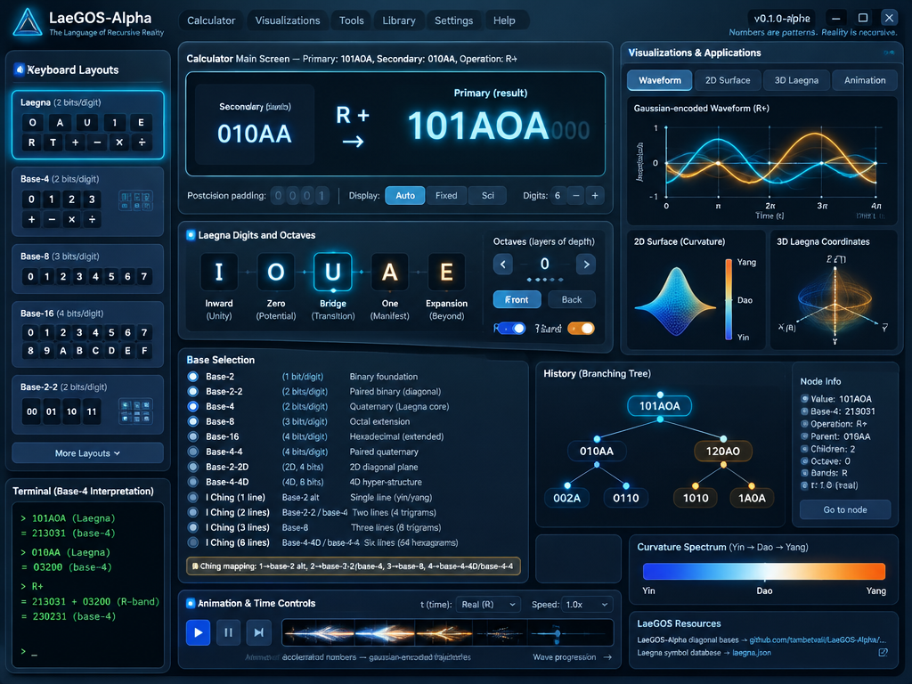

 

---

# First Iterations

## Operational Backup

The operating system manages this information between it's apps:
- A number on screen.
- Operation, knowing it's sign (symbol) and callback.
- A secondary number left of previous operations, used as basis of the current one.

## Number Structure

Number:
- Array of Laegna Base-2 digits "O" or "A".

It's hidden and visible curvature:
- Octaves behind can be used to turn normal operations into Laegna ranked operations; R modification moves the space, achieving higher-complexity in hidden structure, i.e. using number with higher dimensionality as it's true meaning.
- Octaves on fronth can be used to show higher complexity version of the number: if it's chosen to be Z, X or Y instead of _, the default, it will show another screen with that many octaves up number.

Curvature is from yin to yang, with center at dao; or in laegna numbers, from I to E, with center balance at additional U between O and A.
- In general, curvature is measured in octaves.

Hidden depth of number is it's internal complexity, while wisible height is the complexity multiplicator which turns it to projective.

## Keyboard function

It turns the screen to it's own basin, so switching keyboards efficiently switches basin of the screen:
- "Terminal" could be at bottom, containing base-4 interpretation.

The position after last digit is kept permanently, so if number systems need certain "postcision", padded digits to 2 or 3 or 4 base-2 digits in base-2, base-8 and base-16, zeroes are imagined at beginning, or if zeroes are not available - ones.

Shadowed, the infinite pattern of same digit sequence repetition could be shown!

## Screen Elements

On top:
- Wide and low height: the Calculator's Main Screen with primary and secondary number and operation.

On left:
- Side panel with keyboard and keyboard layout switch - each layout changes panel resolution, using different number of bits for single digit or symbol.

Bases:
- Base-2, base-2-2, base-4, base-8, base-16, base-4-4, base-2-2D and base-4-4D (diagonals) can be selected from Laegna number systems; diagonal bases are defined [here](https://github.com/tambetvali/LaeGOS-Alpha/blob/main/LaeGOS-Skydrive/DataRfx/diagonalnumberbases.md), otherwise normal Laegna number systems are used.
- I Ching bases: 1, 2, 3 or 6 yinyang lines can be selected as bases - for 1 line, base-2 Laegna is alt. representation; for 2 lines, base-2-2 or base-4 Laegna can be selected; for 3 lines, base-8 laegna is used and for 4 lines, base-4-4D or base-4-4 can be selected.
  - I Ching has all those selections as single combinations, and in each case the default base is also changed.
    - Selecting the base explicitly can affect the underlying number more than merely switching between keyboards, but mainly it has to select the corresponding Laegna keyboard.
    - I Ching symbol tables are normal keyboards, which appear together with selected Laegna system keyboard, and while I Ching is then large on screen, Laegna number is small.

In content pane, all the rest (large):
- Windows and applications.

## Animations + OS plus

Additional OS feature must be animations:
- Number can describe wavelength, wave structure with progression etc.
  OS will synchronize animation and timelines.

Laegna number is accelerated number:
- Acceleration can gaussian-encode complex trajectories and in Laegna Number System which supports a little more features, it can represent any function and function with any theoretical complexity, within the Laegna Universe and it's "any" complexity.
- Accelerated number, thus, is animable and can be function fot t, vector or matrix can be functions with input t for various time-based transformations. Time t itself can be complex number, gaussian-composed unit, which will create similar structures on it's own behaviour inside other math, logecs / logex.
- OS must provide this acceleration, and understand why and how every number is accelerated.
  - If number has R and T bands, it can choose it's acceleration - if not, acceleration is relative to value, either breaking at certain points in Laegna Linear (vector-1) number, or going with curvature in complex number simplification (internal complexity as given before).

I do not think OS can provide any more:
- Calculator is very definite in it's simplification level, and while others can provide scientific calculators with expression input, this one must show how applications are synchronized in this way.

## History

Additional plausible idea is history:
- Tree of branch numbers, and same type of operations as branches; selecting any allows to continue it's operation chain on normal calculator.
- This is basically extended undo feature and not so definitely inside calculator scope; calendar can switch the single numeric screen condition without adding complexity to applications, it's a hook.

## Applications

There are the layers:
- Zooms and Number system: Configuration layer.
  - Here, number presentation and selected system can be fine-tuned.
- Decimals and visualizations: Application layer.
  - Here, Laegna numbers can be associated with decimals and decimal units; for example if A and E are given decimal values, they follow this through exponent curvature, where if I and E are given decimal values, they use Laegna quadratic. In mixed system, later I try to generally solve each curvature, initially it might decline and one must define exact basin.
  - Here also, visual interpretations of numbers are given:
    - Current number as 0D value + time (1D and 1 value in total) sound wave, 1D pendulum wave, 2D surface of wave or abstract / abstract physical wave, or 3D simplification from Laegna coordinate system.
      - Each of them must be single number structure.
- PhySecs layer:
  - Here, in the end, it can associate Z, X and Y with quantum, linear and superlinear, and it can change all these associations.
  - It can show the scoping with simple Laegna numbers in parallel to decimals.
- LaeChing layer:
  - This supports LaeChing rank analysis;
    - I Ching is used for names = mnemonics for many users, but not for explanations, which is compability issue for atheist / materialist / sceptic users which *still* can use nice mnemonic system available at [laegna.json](https://github.com/tambetvali/LaeGOS-Alpha/blob/main/LaeGOS-Skydrive/DataRfx/laegna.json) LaeChing symbol database.
    - These ranks support scoping and positioning in physical systems, because they are perfectly aligned, and can provide spiritual insight for I Ching users with no warranties.
- Flower of Life layer
  - I was inspired to find these geometric shapes, and to align circular repetition idea of sacred geometry, and it's hyper-dimensional essence, with similar shapes in Laegna Math.
  - While with this app, one can find and pinpoint the 1\2 => 3/4 symmetry, which aligns with story of First Logos, the "First Word of God", in mythos, and provides similar idea in physics.
    - While this, also, will show just the geometry and not represent the mythos, it could be interesting for all users.
