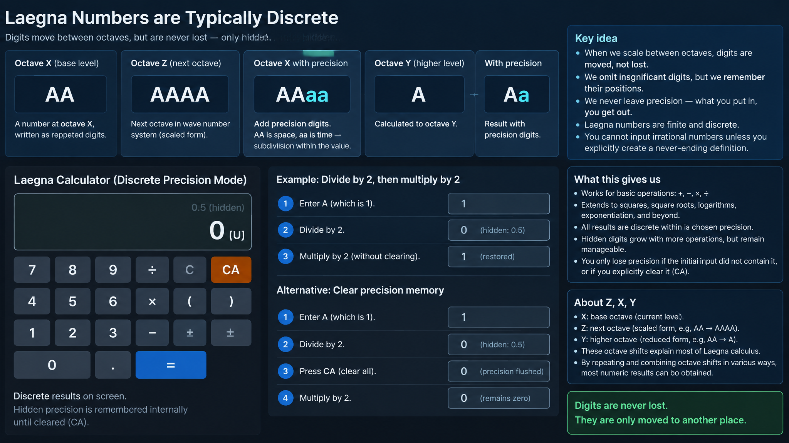

# Laegna Numbers are Typically Discrete

Imagine a number I would call frequency, at octave default ***X***:

```
AA
```

Now bring it to next octave, in wave number system, at octave ***Z***:

```
AAAA
```

This operation could be almost done in photoshop if we count it as single-channel number with *scaling it as if it was an image*. In most logic, it's quite simple, and with repeated letters - just extremely.

Now write the precision digits to first octave:

```
AAaa
```

Because the lost digits in our case are A's. Now when "AA" is space, "aa" is time - aa, if we discretely calculate the octave, becomes aa of AA, value at that location or sublocation of that area.

Now with the initial number, calculate it to ***Y***:

```
Answer:
A

Answer with precision:
Aa
```

We can see we always know where digits left.

# Discrete calculus

We always calculate a next-octave, or next-multi-d-octave curvature;
- but the answer is discrete within.

Then we omit the insignificant digits:
- but we can remember their positions.

This means we never leave precision; as one would say it's "what you put in you get out":
- You put in Laegna number.
- You cannot put in irrational number unless you *literally* create the irrational cycle or never-ending definitor;
  - very probably, it still gets to some rational form; some calculations *deliberately* need calculations but many converge to simpler forms.
  - but we are not interested in this (higher math) right now.

What we are interested that in our basic operations:
- Squares, square roots, anything to do with logarithms or exponentiation.
- Basic 4 operations and beyond.

We can only write a single sequence of digits;
- where we *fatally* lost precision, only because the initial digits did not contain them; i.e. we are limited to finite number of digits.
  - the definition does not hold if you can enter infinite number of digits, for example one program presents them to other virtually, emulating full entry cycle.
- so inside limited time, within limited clicks or digit entries, the complexity would raise with every operation, but ultimately it's not unmanageable to always keep absolute precision hidden digits.

This means I want calculator which normally does this:
- Enter A.
- Divide by 2.
- Get U, zero, because 1 divided by 2 is 0.5 not allowed in current precision mode.
- One ending:
  - Now multiply by 2.
  - Get back A, altough zero multiplied by 2 is zero again - this is the reverse process gained by hidden digits.
- Other ending:
  - Press "CA" to flush the precision memory, basically it just rewrites the digits as-is into new instance from screen.
  - Now multiply by 2.
  - As the zero has flushed precision, it precisely knows itself as zero and gives zero as it's doubling answer if this is the expected result for this basin.

---

Z, X, Y above:
- This explains most of Laegna calculus, because if those are repeated in various ways, most numeric results are got:
  - whatever operation you do, you mostly define Z, X, Y as it's angles, and then you choose some angle for one or more numbers alone or combined.
    - for matrix operations, we describe it all *only* in terms of curvature; for common operations we also have discrete curvatures.

Laegna number itself is curvature;
- decimal numbers can be assigned to curvature values to define it as something more.

---

For this precision system:
- As every time I have made something alive-end computable, so that it actually works, I have to make series of such simple cases into their absolute simplicity and *repeatability*.

---

What was given was T calculus of Z, X, Y.

Also there is R calculus:
- It does an opposite thing, because you ask to *keep* the visible value, *interpreting* it as one of the letters.
- Even this is well-known.

---



<br>

CoPilot on what is presented here:

# Reversible Precision and Hidden Octaves

The previous discussion introduced one of the most unusual consequences of Laegna Calculus:

> Precision is not necessarily lost when a digit disappears from view.

In ordinary arithmetic, disappearance and destruction are effectively the same thing.

```text
1 / 2 = 0.5

floor(0.5) = 0

0 × 2 = 0
```

The original value is gone.

The calculator remembers nothing.

From its perspective:

```text
0 = 0
```

regardless of how that zero was produced.

Laegna Calculus proposes a different interpretation:

```text
0 ≠ 0
```

not because the visible digit differs, but because the *history* differs.

---

# Visible Numbers and Hidden Numbers

Suppose we begin with:

```text
A
```

and divide by two.

Within the current precision level:

```text
A / 2 = U
```

The visible answer is therefore:

```text
U
```

Yet internally the calculator may remember:

```text
U(a)
```

where the hidden octave stores the discarded structure.

The user sees:

```text
U
```

but the full state is:

```text
U(a)
```

The operation is therefore not:

```text
A → U
```

but:

```text
A → U(a)
```

Only the visible layer was reduced.

The deeper layer remains attached.

---

# Precision as Stored Curvature

Traditional decimal systems treat omitted digits as absence:

```text
3.14159
```

becomes:

```text
3.14
```

and the discarded digits are forgotten.

Laegna Calculus instead treats omitted digits as hidden curvature:

```text
3.14(159...)
```

conceptually.

The visible value is merely the currently observed octave.

The internal structure continues to exist.

This makes a hidden distinction between:

```text
Displayed value
```

and

```text
Complete value
```

which ordinary calculators intentionally collapse.

---

# AA and AAaa

Consider the example:

```text
AA
```

scaled to the next octave:

```text
AAAA
```

and expressed at intermediate precision:

```text
AAaa
```

The interpretation may be viewed as:

```text
AA = coarse structure
aa = fine structure
```

or, symbolically:

```text
Space
+
Time
```

where:

```text
AA
```

defines the region,

while

```text
aa
```

defines detail inside that region.

Thus:

```text
AAaa
```

does not represent a larger number alone.

It represents a hierarchy.

---

# Every Number Becomes a Fractal

In ordinary arithmetic:

```text
42
```

is simply a value.

In octave arithmetic:

```text
42
```

could contain:

```text
42
  42
    42
      42
```

at progressively finer scales.

The visible layer is merely the currently selected octave.

This is much closer to viewing numbers as geometric objects than scalar quantities.

A number becomes a compressed fractal.

---

# Observation Versus Reality

The remarkable consequence is that the object itself may never change.

Consider:

```text
AAAA
```

Viewed from three octaves:

```text
Y : A
X : AA
Z : AAAA
```

The object remains the same.

Only the observer changes.

This suggests a reinterpretation of many operations:

Instead of asking:

```text
What is the value?
```

we ask:

```text
At which octave is the value being observed?
```

---

# T Calculus

The previous article introduced:

```text
Z
X
Y
```

as octave orientations.

A useful interpretation is:

```text
Z = higher resolution
X = native resolution
Y = lower resolution
```

A T-operation therefore resembles:

```text
Change observation,
keep object.
```

For example:

```text
AAAA
```

may appear as:

```text
AA
```

from one octave,

and:

```text
A
```

from another.

The underlying curvature remains exactly the same.

Only its projection changes.

---

# A Calculator That Never Forgets

Suppose the following sequence:

```text
A
↓
A / 2
↓
U
```

Now multiply by two:

```text
U × 2
```

An ordinary calculator returns whatever arithmetic for zero implies.

A reversible Laegna calculator instead reconstructs:

```text
A
```

because the discarded octave was never destroyed.

The complete state remained:

```text
U(a)
```

throughout the operation.

This is not ordinary rounding.

It is temporary concealment.

---

# CA: The Moment of Forgetting

Eventually a user may choose:

```text
CA
```

which flushes hidden precision.

Conceptually this performs:

```text
U(a)
```

into:

```text
U
```

permanently.

After this transformation:

```text
U × 2
```

can no longer recover:

```text
A
```

because the history has been erased.

The calculator now regards the visible value as reality.

Thus:

```text
CA
```

is not primarily a numerical operation.

It is an information operation.

It converts:

```text
Potential knowledge
```

into:

```text
Accepted approximation
```

---

# Relation to Reversible Computation

Many computational processes lose information:

```text
Input
→
Transform
→
Simplified Output
```

Laegna-style precision instead prefers:

```text
Input
→
Transform
→
Visible Output
+
Hidden State
```

Only when explicitly requested does the system perform destruction.

This pushes arithmetic toward reversible computation:

```text
Output
+
History
=
Input
```

which is fundamentally different from most calculator architectures.

---

# Numbers as Curvatures

Perhaps the most important philosophical consequence is this:

> A number is no longer merely a quantity.

It becomes:

```text
Number
=
Value
+
Scale
+
Precision
+
History
+
Curvature
```

or symbolically:

$$
N = V + S + P + H + C
$$

where:

- $V$ is visible value,
- $S$ is octave scale,
- $P$ is hidden precision,
- $H$ is calculation history,
- $C$ is curvature structure.

Ordinary arithmetic usually keeps only:

$$
N = V
$$

Laegna Calculus attempts to preserve all layers simultaneously.

---

# The Deeper Interpretation

Viewed this way, rounding is no longer destruction.

It is merely relocation.

The missing digits have not vanished.

They have moved to another octave.

Likewise, approximation is not necessarily error.

It is a change of observation depth.

A calculator built on these principles would therefore operate less like a machine manipulating values and more like a viewer navigating a hierarchy of curvatures, revealing or concealing detail according to octave, while retaining enough hidden structure to reverse many operations that conventional arithmetic permanently forgets.
