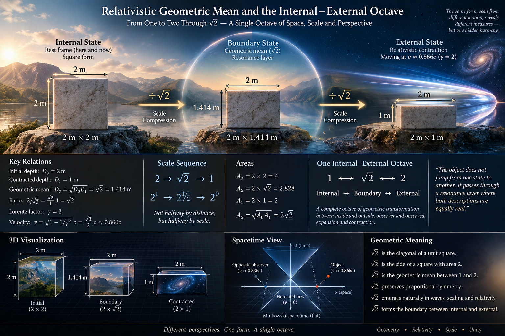
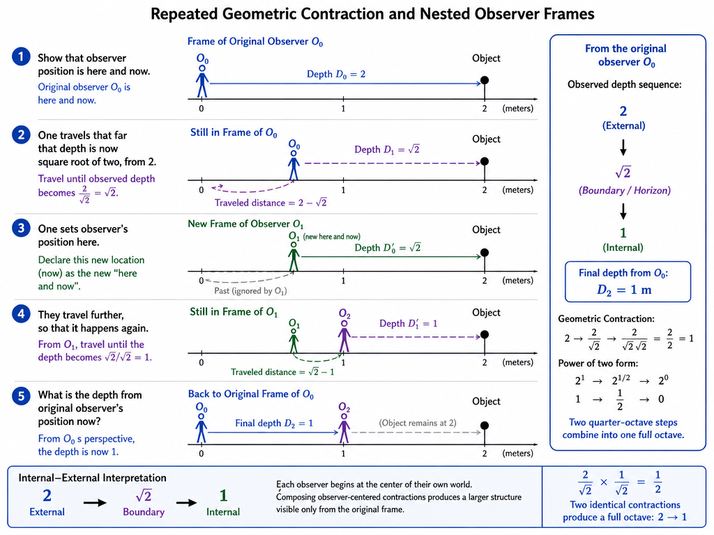

# AI Coding Report

I made DataCode with AI, then DataLib with AI.
- I am quite happy with UI quality and I think, other users can utilize GitHub CodeSpaces and other AI solutions to re-engineer these into their inner needs.
- Scientific use is governed mostly by science laws, while use of technologies, ideas and tips qualifies in CC40 licence which is rooted at every project's root folder.
  - If scientific use produces free thinking and actual productive qualities, through this filter those qualities are already heavily yours.
  - For creative user, the licence cycle is very productive and what seems technological innovation, such as main protocol in AI Experiments, is code-wise reusable under scientific conditions because the main basin is undertood;
    - For non-creative user, where the code is not understood and proven, it's less than scientific reuse and more of use of technology or protocol, by which patent and copyright laws apply through CC40 licence and the cycle is unfortunate only in case they would fake autoritative deep understanding of the code. This is legally quite permissive, but in repeated game this confusing licence can be irritating to some clients and reusers. For all the ends, the actual end-users and developers or science workers must fight their own rights as my plan is not a court game, but licence which allows you to straight up your own relations.

Here the code and libs which are made by AI, fail the actual implementation of the number systems, while the UI part is OK. AI needs more examples, which are directly Laegna.

Let's call this soft coding and hard coding:
- Soft coding is creating code base by AI;
  - I utilize soft coding in most of the UI, images and follow-up texts or the ones which need global expertise and precise matching.
- Hard coding is code what is created by myself or users who understand the area;
  - For number system basins, hard coding has been a requirement - core of sheep counters and laelane is done by me, while laGEOsis is programmed with assistance of CodePilot and some classic math implemented by it; yet it would be more interpolated and straight ball if I do it myself - that's some point where the oscillation cycles are binarized by me.

---

# Core Data implementation

The library will be updated and synchronized by AI.
- Examples are brought for it to compare.

My work is the implementation of core number systems and basic operations, and API which provides that, for:
- Currently, even some basic understanding is missing by AI; number systems are commonly understood by algorithms.

# Implementation details

Number format:

When user enters "A" in base 4, bits "O" and "A" will be remembered:

```
["B4", "O", "A"]
```

Calculator stores numbers with:
- Mixed base system tags and bits.
- Each base system tag is complete identification string of this base system of a single digit.

Values which are bits:
- "O" - False, 0, O
- "A" - True, 1, **A**
- "U" - False or True, ***U***
- "V" - Known, *V*

Then, "U" and "V" of B4, Laegna Base 4, is stored with following positional code:

```
U, unknown on less significant bit; which makes the other bit known:

["B4", "V", "U"]

First bit is excluded, second bit which is less significant will contain the "U".

Upside-down U, unknown on the significant bit; which makes the other bit known:

["B4", "U", "V"]

One can see first bit is significant and second bit is insignificant (in significant).
```

"Known" means that the bit is excluded from the calculation, not yielding any value. Known bits also allow to take average of two bits, so that for example U · upside-down U, which takes positional average, evaluates to \["B4", "U", "U"\]; while the "empty position" of number yields that it's not calculated at all, the calculator excludes it.

The whole string looks like this, when referring to number "UE", in two base-4 digits:

```
["B4", "V", "U", "B4", "A", "A"]
```

The final value each bit can have is "x":
- This means the bit is removed.
- Whole digit will be garbage-collected if it's all bits are either "x", or removed. For unary digits, thus we still need one bit, rather "A" in it's last unary position, or "O" below the line (laegna way to say "O" line of it's 2D number, with A and O lines for two unary dispositions - position and negation).

# Discrete calculation

The Laegna Calculation is normally completely discrete:
- Dividing:
  - Precision downwards need to be squared one- or multidimensionally (in every dimension used as separate channel / band for this purpose):
    - This means operators are mapped from double-vector to matrix complexity in it's main unit.
- Multiplying:
  - Precision upwards grows by same amount;
    - So double-vector => matrix complexity is done.
- Subtraction:
  - Precision goes to logarithm scale:
    - In multiplication, EE * EE = EEEE so it maximally doubles; in division II * II = IIII so it maximally doubles;
      - EE + EE = AEE and it rather maximally, grows by one bit. So we do logging, log here for this lost bit:
        - In AEE, eeee is four-precision, ee is two-precision dimension in logarithm; eeee adds one bit, while anything below eaaa (in wave format), flips into "a" scope where it contains the added part inside the number.
        - Substraction, then, grows the scope by oooo.
        - Conventionally, we could still do doubling - but now what is doubled is repetition and not direction.

This means "CA" button could be used to reset the memory without the numbers disappearing, but flattened;
- CE clears the current entry;
- C clears the current entry and answer / totals.

# Laegna Frequential Numbers

If you read LaeLane, you can see:
- Complex log-lin-exp-free space curvature, function, logic or raw data is converted to single number on linear scale of comparison and measurement;
  - You can see the measurement turns it to 2\*2=2\+2 remappings, where 2D octave might mean that the lower "O" line, pattern band, is repeated 2 times forming 4, while the "A" is scaled up 2 times, forming "4". One can see how one 2D octave, one step, invariable gives the scaled invariant in every step, and lower digits make it upwards-symmetric.
    - When converted to numeric value, the exponent band which was scaled, is always scaled so it grows exponentially. i.e. numeric value of E, altough EE is the same number, is square root of higher-significant digit E. Square root of 4 is 2.
    - When converted to numeric value, the logarithm band, O band, just remains numerically equal in new scope; i.e. A vs. AA are just the same number. They could also be summed as many times as big is R, in which case AA vs. A is that 1+1 = 2, which is *symmetric* to 2+2 = 4, so that A could also mean local E or E could mean local A, where they both are 1 or both are 2 - logic is always self-repeating and symmetric, and laegna math knows it's letters as it *keeps* this subtle difference of their different value-positions, even if kind of abstract but numerological and what we want. One can do it differently in special cases if the patterns to be reflected are different, altough they should find the same pattern in number form.

```
OA

Doubled:

OOAA - frequencies / octaves
OAOA - values

2D number, doubled:
- 1 lines becomes 2 band lines
- 2 positions become 4 digit positions
```

What is frequency of Laegna number now?

Looking at LaeLane, one can guess:

Number frequency is that doubled this way, they reflect the whole global pattern through repeated closest, averaged shape like gaussian decomposition estimate of points to single number, spatial "wavelength" of the series of numbers in this relation where fourier decomposition <=> gaussian composition; we can map that something sees number chain as single number like it otherwise sees frequency over bands; something sees the multifrequency fourier map indeed as chain of numbers, a function curve. 4 directions appear - O and A, O is gaussian unification to single component, A is fourier decomposition; but where they parallel I and E appear - both used directly as opposites of other, but in their own band, create two more possibilities of decomposing a function curve into single metafrequency or de composing each frequency into multiple subfrequencies. In Laegna, all this bunch appears so symmetric and "equal".

One can see the pattern meets itself perfectly when scaled, but gives curvature which is not necessarily very pattern-based or logical, just a chaos might done if enough precision is used;
- Now what makes it frequential, is the case that it looks rather like frequency when applied directly at top of itself.
- The frequency appears, then, into linearized Laegna number system, which repeats the same curve at every scale, going through the same steps - while in decimal system conversion, the curve is smooth but complex.
  - Laegna number system can turn this 45 degrees, rotating it into position where this math could express random curvatures up and down in convenient, single-number way.

So, frequency appears if this 2D single fractal cell, is applied to itself over and over, doubling the square, but showing rather how older squares end their futuristic projections even now, and future projections already unfold first cells of their pasts doing some estimations.

As we show each scaling step as linear square, and they work a bit in parallel because past decides it's meaning into back-then unknown bits, while future gets it's basin and past from what is already known, gradually. This is all a number expenditure, Unfolding of Time in Endless Schroedinger's Potential Logic of the Field, and even the Psychology of our Senses - they approximate to past and future in compatible framework.

# Discreteness to the end

Because each operation makes the number space twice larger:
- Most of these bits go to garbage;
  - But their subpositions are known and I rather keep them hiddenly.

I build up all the symmetries of multiplication and division etc., and grand that no number, ever entered within a single CA step, is never forgot. It's not to remember every digit, but:
- Complexity relations need to be updated.
- The digit dispositioning recorded.

After operations of mixed-base digits, it's hard to decide which one to use now:
- I am finding that curvature must be mapped to most expressive simple number.

# Matrix operations

Main operators (**op14** and *op48*):
- ***I to E***, 1 to 4: "÷", "-", "+", "×";
- ***i to e***, 5 to 8: "⊘", "⊖", "⊕", "⊗";

Unknowns, knowns and zeroes:
- ***U to Ո***, 0 and 9 or 00 and 99: "·", ":";
- ***U to Ո***, missing or 09 and 90: "⊙", "⊚".

What will be granted:
- The lower rank of normal operations:
  - Non-holographic behaviour easily decides that precision bits are lost if recovery would be illogical anyhow.
- The higher rank of matrix operations:
  - We think of it as "Laegna self-Referential System", rather than it's primordial basin;
    - Thus, all operations are normal matrix operations which indeed, are defined by rotations, cycles, oscillations;
      - In such way, for example if precision digits of operation are lost in it's least significant positions, they still reappear at new most significant positions if those positions are octave-resonant, but did not directly exist in previous state. This hologram logic rather than seeing some single, here-and-now numbers, sees nodes of infinite curvature matrix and anything it understands is not a number, but it's position and wavelength in curvature node.

# Laegna Curvature

Is founded metaphysically and mathematically, but highly resonant with the one of Einstein.

I assume O-curvature and A-curvature:
- In mass, curvature is slowly produced by gravity. Object stands in time, moves in space.
- In light speed, it's produced fast by speed. Object stands in space, moves in time. Movement towards all directions, integrated, become e, energetic equivalent of what is single-point directional for light. Overcoming barriers has mathematical-geometric shape of solution, which is itself unknown: the spatiality needs to be even more flattened, into deeper multidimension, or the spot light needs to be reduced to even a spot according it's own size. Then, particles disappearing and appearing to universe, or coming slightly closer to maximae are already of interest to us - but we measure and not estimate right now; what is known is not the algorithm, but mathematical shape of solution which exists only because it's solution to such task. But we can approximate, it's close to typical theorems of such solutions.
- In both cases, energy equals and remains invariant in our math.

I think now, O and A curvature are mapped to number space:
- Observer at zero;
- we assume them coming or going at certain speed.

We assign:
- Point here.
- Point there.
- A frequency.

At higher frequency, adding areas together rather multiplies, while at lower in same cases, it's rather addition.

We can assign:
- Point and frequency here.
- Point and frequency there.
- Drawing a straight line with one added, vertical dimension.

Finally, frequency is perfectly a part of position, and we can also spatially move *in frequency or octave model* - by this we approach a relativistic moment whose interesting constant comes now; presented by CoPilot - we can see we can make one octave, not just forward but backwards, so that we can really see how adding, substracting, but most interesting substracting backwards through zero - asking the observer location *now before this time*, *but in same relative units of directly going backwards*.

This is theoretical physics, measuring wavelights.

---



CoPilot:

# Relativistic Geometric Mean and the Internal–External Octave

## Presumptions

Consider an object with initial dimensions:

<br>

$$
W_0 = 2\,m
$$

<br>

$$
D_0 = 2\,m
$$

where:

- $W$ is width, perpendicular to motion;
- $D$ is depth, parallel to motion.

Suppose relative motion causes the observed depth to contract to:

<br>

$$
D_1 = 1\,m
$$

while width remains unchanged:

<br>

$$
W_1 = 2\,m
$$

The two observed states are therefore:

| State | Width | Depth |
|---------|---------|---------|
| Initial | 2 m | 2 m |
| Contracted | 2 m | 1 m |

---

## Geometric Mean State

The geometric mean depth is:

<br>

$$
D_G = \sqrt{D_0 D_1} = \sqrt{2 \cdot 1} = \sqrt2 = 1.41421356237\ldots\,m
$$

Since:

<br>

$$
\frac{2}{\sqrt2} = \sqrt2
$$

the same midpoint can be written as:

<br>

$$
D_G = \frac{2\,m}{\sqrt2} = \sqrt2\,m = 1.41421356237\ldots\,m
$$

This is neither the original depth nor the contracted depth. It is the exact multiplicative balance point between them.

---

## Areas

Initial area:

<br>

$$
A_0 = 2 \cdot 2 = 4
$$

Contracted area:

<br>

$$
A_1 = 2 \cdot 1 = 2
$$

Geometric-mean area:

<br>

$$
A_G = \sqrt{A_0A_1} = \sqrt{4 \cdot 2} = 2\sqrt2 = 2.82842712475\ldots
$$

Notice that the same factor $\sqrt2$ reappears.

---

## Scale Interpretation

The depth progression is:

<br>

$$
2 \rightarrow \sqrt2 \rightarrow 1
$$

or equivalently:

<br>

$$
2^1 \rightarrow 2^{1/2} \rightarrow 2^0
$$

The ratio from one level to the next is identical:

<br>

$$
\frac{2}{\sqrt2} = \frac{\sqrt2}{1} = \sqrt2
$$

This means that $\sqrt2$ is not halfway by distance, but halfway by scale.

An arithmetic midpoint would instead be:

<br>

$$
\frac{2+1}{2} = 1.5
$$

However, geometric systems, wave systems, and relativistic scaling are usually governed by ratios rather than differences, making $\sqrt2$ the more natural midpoint.

---

## Meaning

The transition from $2\,m$ to $1\,m$ can be interpreted as one complete octave of geometric compression:

<br>

$$
2 = 2^1
$$

<br>

$$
\sqrt2 = 2^{1/2}
$$

<br>

$$
1 = 2^0
$$

Just as a musical octave spans a doubling,

<br>

$$
f \rightarrow 2f
$$

this geometric octave spans:

<br>

$$
1 \rightarrow 2
$$

with $\sqrt2$ sitting exactly at the center.

The number $\sqrt2$ therefore acts as a resonance boundary between two equally valid descriptions of the same system.

---

## Internal–External Octave

Let us define:

<br>

$$
1 \leftrightarrow \text{Internal}
$$

<br>

$$
\sqrt2 \leftrightarrow \text{Boundary}
$$

<br>

$$
2 \leftrightarrow \text{External}
$$

Then the octave becomes:

<br>

$$
1 \rightarrow \sqrt2 \rightarrow 2
$$

or viewed in reverse:

<br>

$$
2 \rightarrow \sqrt2 \rightarrow 1
$$

The object does not jump directly between the internal and external descriptions.

Instead, it passes through a balanced transition layer where both descriptions possess equal geometric weight:

<br>

$$
\frac{\text{External}}{\text{Boundary}} = \frac{\text{Boundary}}{\text{Internal}} = \sqrt2
$$

This makes $\sqrt2$ a natural horizon between inside and outside, observer and observed, expansion and contraction.

---

## One Internal–External Octave

The complete octave may therefore be summarized as:

<br>

$$
1 \leftrightarrow \sqrt2 \leftrightarrow 2
$$

<br>

$$
2^0 \leftrightarrow 2^{1/2} \leftrightarrow 2^1
$$

<br>

$$
\text{Internal} \leftrightarrow \text{Boundary} \leftrightarrow \text{External}
$$

From this viewpoint, the relativistic contraction from $2\,m$ to $1\,m$ naturally produces the same structure as a one-octave geometric transition. The value $\sqrt2$ is not an arbitrary midpoint but the exact scale-symmetric bridge connecting the two ends of the octave.

---



<br>

This was interesting, but I had to clarify into one more task:

> Can you write one:​‌
> - Show that observer position is here and now.​‌
> - One travels that far that depth is now square root of two, from 2.​‌
> - One sets observer's position here.​‌
> - They travel further, so that it happens again.​‌
> - What is the depth from original observer's position now?

# Repeated Geometric Contraction and Nested Observer Frames

## Initial Observer

Let the original observer define the reference frame as "here and now".

The object initially has depth:

<br>

$$
D_0 = 2\,m
$$

We now travel until the observed depth becomes the geometric midpoint between $2$ and $1$:

<br>

$$
D_1 = \frac{2}{\sqrt2} = \sqrt2 \approx 1.41421356237\,m
$$

So the first contraction step is:

<br>

$$
2 \rightarrow \sqrt2
$$

---

## New Observer Position

We now declare the new location and moment to be the new "here and now".

This observer sees the object depth as:

<br>

$$
D'_0 = \sqrt2
$$

The previous history is ignored, just as each inertial observer naturally considers their own frame to be the present reference frame.

---

## Second Contraction

The new observer performs exactly the same operation again.

Depth contracts by the same geometric factor:

<br>

$$
D'_1 = \frac{\sqrt2}{\sqrt2} = 1
$$

Thus the second observer sees:

<br>

$$
\sqrt2 \rightarrow 1
$$

---

## Combined Transformation

From the original observer's perspective, both contraction steps occurred.

Therefore:

<br>

$$
D_0 = 2
$$

<br>

$$
D_1 = \frac{2}{\sqrt2}
$$

<br>

$$
D_2 = \frac{2}{\sqrt2 \cdot \sqrt2}
$$

Since:

<br>

$$
\sqrt2 \cdot \sqrt2 = 2
$$

we obtain:

<br>

$$
D_2 = \frac{2}{2} = 1
$$

---

## Result

The original observer measures:

<br>

$$
2 \rightarrow \sqrt2 \rightarrow 1
$$

The first contraction creates the halfway octave point.

The second contraction completes the octave.

The final depth observed from the original frame is:

<br>

$$
D_2 = 1\,m
$$

---

## Power Representation

The sequence is clearer when written as powers of two:

<br>

$$
2^1 \rightarrow 2^{1/2} \rightarrow 2^0
$$

Every step removes half an exponent:

<br>

$$
1 \rightarrow \frac12 \rightarrow 0
$$

The first observer sees two quarter-octave steps combining into one complete octave compression.

---

## Internal–External Interpretation

Using the symbolic interpretation:

<br>

$$
2 \leftrightarrow \text{External}
$$

<br>

$$
\sqrt2 \leftrightarrow \text{Boundary}
$$

<br>

$$
1 \leftrightarrow \text{Internal}
$$

the process becomes:

<br>

$$
\text{External}
\rightarrow
\text{Boundary}
\rightarrow
\text{Internal}
$$

The remarkable feature is that each observer believes they begin at the center of their own world.

Yet the composition of observer-centered transformations produces a larger structure that is visible only from the original frame.

Thus:

<br>

$$
\frac{2}{\sqrt2} \times \frac{1}{\sqrt2} = \frac{1}{2}
$$

and two identical geometric contractions combine into a full octave:

<br>

$$
2 \rightarrow 1
$$

with

<br>

$$
\sqrt2
$$

appearing as the unique intermediate horizon between the two ends.
