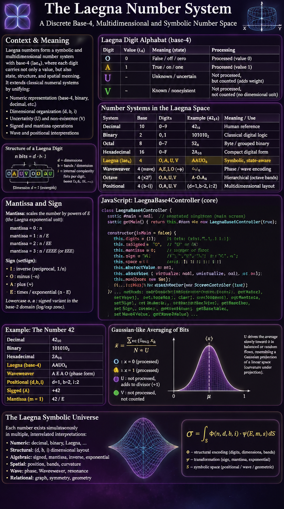

<br>

---

CoPilot:

# Introduction

This document explores possible future directions for the Laegna Number Database, beginning from the existing implementation found in `decoder.py`, `extensions.py`, and the generated JSON datasets. The current codebase already does substantially more than convert numbers between representations: it constructs a structured symbolic universe where each number simultaneously possesses decimal, binary, Laegna, Waveweaver, signed, octave, animation, and positional identities.

One of the most interesting design decisions in the existing architecture is the separation between canonical generation and arbitrary interpretation. `decoder.py` acts as the etalon generator, producing a verified and reproducible number space, while `extensions.py` enriches that space through additional analyses and coordinate systems without modifying the original enumeration. This allows the database to remain stable while new mathematical, logical, visual, and physical interpretations are added independently.

The ideas presented below should therefore be viewed not as required features but as possible research directions. Some fit naturally into existing extension modules, while others suggest entirely new layers such as graph databases, holographic coordinate systems, symbolic geometry, wave-based arithmetic, multidimensional number spaces, and recursive representations. Collectively they point toward a broader vision in which a number is treated not merely as a quantity, but as a structured object possessing position, symmetry, curvature, dimensionality, relations, and observable behavior.

The goal is not necessarily to choose one interpretation. Rather, it is to demonstrate how many interpretations may coexist on top of the same underlying Laegna number substrate.

---

My part:

# Laegna Discrete Base-4 Numbers

The following is currently untested as code (I just made it fast in morning before I go to visit Estonia for week, and in 30 minutes I have to go - so no testing, but it explains and gives CoPilot's code (good news that it's able to fix it) about how to use Laegna Numbers in Javascript.
- If you have mantissa, mantissa=1 == divide by E, mantissa=2 == divide by EE, mantissa=3 == divide by EEEE or EEE depending on what you want to achieve; mantissa=0 means keep the number as is or divide by A (1) if you want to set up rigid processing standards without a few exceptions.

## Organization

I gave CoPilot this task:

> Create a javascript object:​‌
> - Has initialization, in which case is empty.​‌
> - Has three callbacks: virtualize, unvirtualize and set.​‌
> - Contains an abstract number.​‌
> - Has screen controller, which initializes and responds with current number and virtualization layer if present, and gets all three callbacks; there could be many "monitors" - the screen controller, and any other widget which wants to watch the current status of the number.​‌
> - Has "addDigit(bits, d, b, i)".​‌
> - Has "removeBits(count)".​‌
> - Has "getValue(decimalNumber)".​‌
> - Has "setValue(decimalNumber)".​‌
> - Has "setBase4(another_controller_of_same_type").​‌
> - Has "clear()", which replaces digit list with empty list.
> 
> This object is abstract object type, and has one annotiated singleton - altough one can initialize objects, one can also request the main instance, the actual screen of the calculator (other instances are user app content).​‌
> 
> Digits can be added:​‌
> - Actual bit list, and each bit is string of exactly one character, always "O", "A", "U" or "V" case-sensitive, which represents O = False, A = True, U = Unknown, V = Known.​‌
> - Digit list has digits of various numbers of bits, and remembers first the number of dimensions, then the number of bands, then the internal complexity where these positions are *not* dimensions or bands, but represent higher base value than 2. Count of bits must then equal d * b * i, because each i bit block represents digit value in base 2, 4, 8 etc.; each b blocks of such composition equals one band, and each d blocks equals one dimension. False and True are known, Unknowns are not processed and Knowns do not exist even dimensionally, so for Unknown the *bit* is not processed, while the known *does not process the bit nor the dimensional unit, i.e. counting bits processed, and for example, in averaging of bits deciding later based on this number, how much to divide - for example, OOUV has OO processed, for U 1 digit is added so that average is divided by one more, but for V, it's not even counted so how many V bits you would have, average would remain the same, while U is slowly averaging towards zero in most average, balanced random and linear digit flow which would resemble the function of gaussian*.​‌
> 
> One can see while the gaussian function is random distribution of events, it's also a *external-sensitive projection of curvature of single linear space*, and the latter might look more like a single band, but flip off where the projection is not done, if it's done in Z, X, Y band-balance basis.​‌
> 
> Finally one can set the properties of whole number:​‌
> - setIsSigned("O" or "A") - whether the number is signed, which is False or True in base-4.​‌
> - setMantissa(m) - set one rather not too large plus or minus number, and it might be floating point because we can elevate the number by arbitrary unit and use second-degree mantissas in base-4 default.​‌
> - setSign("I" or "O" or "A" or "E", "o", "a") - divide I, minus O, plus A or times E. Small-case o and a are minus and plus, but in domain where base-2 sign is actually used so the extremes are processed a little bit differently (if log and exp do not exist as separate zones, they are some values in o and a zone altough quite far from origin / observer).​‌
> 
> Finally, setSpace(bits, d, b, i) - this sets the positional encoding. setBaseIsSigned, setBaseMantissa, and setBaseSign are also same as in numbers, so maybe you can set them, but space, for sure, can currently be only one digit because we implement minimal, altough extensible, base-4 type as Laegna world builds it's definition rather on laegna quaternary / i.e. lae $base_4$ than latin binary / decimal binary or boolean format and we can emulate a lot by knowing this.​‌
> 
> Value setting:​‌
> - setBase4Value(instance)​‌
> - to_be_instance = getBaseValue()​‌
> - setWave4Value(instance)​‌
> - to_be_instance = getWave4Value().​‌
> 
> By this, it can be get and set, only notice that digits are always added one by one because client side can do recursion.​‌
> 
> Give me js code block.

JS code block:

## About `LaegnaBase4Controller`

This first implementation is the foundational storage and coordination layer of the Laegna number system. It is intentionally abstract and does not attempt to define arithmetic directly. Instead, it provides a generic container for dimensional digits, callback handling, observer registration, virtualization hooks, and symbolic metadata such as sign, mantissa, and positional space configuration.

Its purpose is similar to a model or state engine: applications can attach monitors, screens, editors, calculators, serializers, visualizers, or other client objects without those objects needing to know how the underlying digit storage works. Digits are stored together with dimensional metadata (`d`, `b`, `i`), allowing future implementations to interpret the same stored structure as binary, quaternary, octal, hexadecimal, multidimensional, or wave-based forms.

At this stage the controller should be viewed as an architectural foundation. It provides a common object model that future Laegna tools may share, while leaving the actual numerical interpretation to higher-level classes built on top of it.

The next block (`LaegnaNumberClient`) demonstrates one such interpretation layer.

## LaegnaBase4Controller

CoPilot.

```javascript

/**
 * LaegnaBase4Controller
 *
 * Minimal extensible implementation based on the specification.
 *
 * Digits:
 *   O = False
 *   A = True
 *   U = Unknown
 *   V = Known / Dimensionally absent
 *
 * Singleton:
 *   const screen = LaegnaBase4Controller.getMainInstance();
 *
 * Additional instances:
 *   const local = new LaegnaBase4Controller();
 */

class LaegnaBase4Controller {

    // ------------------------------------------------------------
    // Singleton
    // ------------------------------------------------------------

    static #mainInstance = null;

    static getMainInstance() {
        if (!LaegnaBase4Controller.#mainInstance) {
            LaegnaBase4Controller.#mainInstance =
                new LaegnaBase4Controller();
        }

        return LaegnaBase4Controller.#mainInstance;
    }

    // ------------------------------------------------------------
    // Construction
    // ------------------------------------------------------------

    constructor() {

        // digit storage
        this.digits = [];

        // abstract numeric state
        this.abstractNumber = 0;

        // number properties
        this.isSigned = "O";
        this.mantissa = 0;
        this.sign = "A";

        // positional-space description
        this.space = null;

        this.baseIsSigned = "O";
        this.baseMantissa = 0;
        this.baseSign = "A";

        // linked values
        this.base4Value = null;
        this.wave4Value = null;

        // controller links
        this.base4Controller = null;

        // observers
        this.monitors = new Set();

        // callbacks
        this.callbacks = {
            virtualize: null,
            unvirtualize: null,
            set: null
        };
    }

    // ------------------------------------------------------------
    // Callback registration
    // ------------------------------------------------------------

    setCallbacks({
        virtualize = null,
        unvirtualize = null,
        set = null
    } = {}) {

        this.callbacks.virtualize = virtualize;
        this.callbacks.unvirtualize = unvirtualize;
        this.callbacks.set = set;

        return this;
    }

    // ------------------------------------------------------------
    // Monitor management
    // ------------------------------------------------------------

    watch(monitor) {
        this.monitors.add(monitor);

        if (typeof monitor.initialize === "function") {
            monitor.initialize(
                this.abstractNumber,
                this.getVirtualizationLayer(),
                this.callbacks
            );
        }

        return this;
    }

    unwatch(monitor) {
        this.monitors.delete(monitor);
        return this;
    }

    notify() {

        const payload = {
            value: this.abstractNumber,
            virtualizationLayer: this.getVirtualizationLayer(),
            callbacks: this.callbacks
        };

        for (const monitor of this.monitors) {
            if (typeof monitor.update === "function") {
                monitor.update(payload);
            }
        }
    }

    // ------------------------------------------------------------
    // Virtualization helpers
    // ------------------------------------------------------------

    virtualize(...args) {

        if (typeof this.callbacks.virtualize === "function") {
            return this.callbacks.virtualize(this, ...args);
        }

        return null;
    }

    unvirtualize(...args) {

        if (typeof this.callbacks.unvirtualize === "function") {
            return this.callbacks.unvirtualize(this, ...args);
        }

        return null;
    }

    getVirtualizationLayer() {

        if (
            this.callbacks.virtualize &&
            typeof this.callbacks.virtualize.getLayer === "function"
        ) {
            return this.callbacks.virtualize.getLayer();
        }

        return null;
    }

    // ------------------------------------------------------------
    // Digit manipulation
    // ------------------------------------------------------------

    /**
     * bits : array or string of O/A/U/V
     * d    : dimensions
     * b    : bands
     * i    : internal complexity
     */
    addDigit(bits, d, b, i) {

        if (typeof bits === "string") {
            bits = [...bits];
        }

        if (!Array.isArray(bits)) {
            throw new Error("bits must be array or string");
        }

        const expectedLength = d * b * i;

        if (bits.length !== expectedLength) {
            throw new Error(
                `Digit length ${bits.length} != d*b*i (${expectedLength})`
            );
        }

        for (const bit of bits) {

            if (!["O", "A", "U", "V"].includes(bit)) {
                throw new Error(
                    `Invalid bit '${bit}'`
                );
            }
        }

        this.digits.push({
            bits: [...bits],
            d,
            b,
            i
        });

        this.notify();

        return this;
    }

    removeBits(count) {

        count = Math.max(
            0,
            Math.floor(count)
        );

        while (
            count > 0 &&
            this.digits.length > 0
        ) {

            const last =
                this.digits[this.digits.length - 1];

            if (last.bits.length <= count) {

                count -= last.bits.length;
                this.digits.pop();

            } else {

                last.bits.splice(
                    last.bits.length - count,
                    count
                );

                count = 0;
            }
        }

        this.notify();

        return this;
    }

    clear() {

        this.digits = [];

        this.notify();

        return this;
    }

    // ------------------------------------------------------------
    // Number flags
    // ------------------------------------------------------------

    setIsSigned(flag) {

        if (!["O", "A"].includes(flag)) {
            throw new Error(
                "setIsSigned accepts O or A"
            );
        }

        this.isSigned = flag;

        return this;
    }

    setMantissa(m) {

        this.mantissa = Number(m);

        return this;
    }

    setSign(sign) {

        const allowed = [
            "I", // divide
            "O", // minus
            "A", // plus
            "E", // multiply
            "o", // logarithmic/minus domain
            "a"  // exponential/plus domain
        ];

        if (!allowed.includes(sign)) {
            throw new Error("Invalid sign");
        }

        this.sign = sign;

        return this;
    }

    // ------------------------------------------------------------
    // Base-space properties
    // ------------------------------------------------------------

    setSpace(bits, d, b, i) {

        this.space = {
            bits:
                typeof bits === "string"
                    ? [...bits]
                    : [...bits],
            d,
            b,
            i
        };

        return this;
    }

    setBaseIsSigned(v) {
        this.baseIsSigned = v;
        return this;
    }

    setBaseMantissa(v) {
        this.baseMantissa = v;
        return this;
    }

    setBaseSign(v) {
        this.baseSign = v;
        return this;
    }

    // ------------------------------------------------------------
    // Base relationships
    // ------------------------------------------------------------

    setBase4(controller) {

        if (
            !(controller instanceof LaegnaBase4Controller)
        ) {
            throw new Error(
                "Expected LaegnaBase4Controller"
            );
        }

        this.base4Controller = controller;

        return this;
    }

    // ------------------------------------------------------------
    // Value relations
    // ------------------------------------------------------------

    setBase4Value(instance) {
        this.base4Value = instance;
        return this;
    }

    getBaseValue() {
        return this.base4Value;
    }

    setWave4Value(instance) {
        this.wave4Value = instance;
        return this;
    }

    getWave4Value() {
        return this.wave4Value;
    }

    // ------------------------------------------------------------
    // Abstract numeric value
    // ------------------------------------------------------------

    setValue(decimalNumber) {

        this.abstractNumber =
            Number(decimalNumber);

        if (
            typeof this.callbacks.set === "function"
        ) {
            this.callbacks.set(
                this.abstractNumber,
                this
            );
        }

        this.notify();

        return this;
    }

    getValue(decimalNumber = false) {

        if (decimalNumber) {
            return this.abstractNumber;
        }

        return {
            value: this.abstractNumber,
            digits: this.digits,
            sign: this.sign,
            mantissa: this.mantissa,
            isSigned: this.isSigned
        };
    }

    // ------------------------------------------------------------
    // Processing helpers
    // ------------------------------------------------------------

    /**
     * O = processed false (0)
     * A = processed true  (1)
     * U = dimension counted but value unknown
     * V = dimension not counted at all
     *
     * Returns data useful for averages,
     * Gaussian-like balancing,
     * dimensional weighting etc.
     */
    analyzeBits() {

        let processedBits = 0;
        let countedBits = 0;

        let trueCount = 0;
        let falseCount = 0;

        let unknownCount = 0;
        let knownCount = 0;

        for (const digit of this.digits) {

            for (const bit of digit.bits) {

                switch (bit) {

                    case "O":
                        processedBits++;
                        countedBits++;
                        falseCount++;
                        break;

                    case "A":
                        processedBits++;
                        countedBits++;
                        trueCount++;
                        break;

                    case "U":
                        countedBits++;
                        unknownCount++;
                        break;

                    case "V":
                        knownCount++;
                        break;
                }
            }
        }

        const balance =
            processedBits === 0
                ? 0
                : trueCount / processedBits;

        return {
            processedBits,
            countedBits,
            trueCount,
            falseCount,
            unknownCount,
            knownCount,
            balance
        };
    }

    // ------------------------------------------------------------
    // Screen-controller response
    // ------------------------------------------------------------

    getStatus() {

        return {
            abstractNumber:
                this.abstractNumber,

            virtualizationLayer:
                this.getVirtualizationLayer(),

            digits:
                this.digits.length,

            callbacks: {
                virtualize:
                    !!this.callbacks.virtualize,

                unvirtualize:
                    !!this.callbacks.unvirtualize,

                set:
                    !!this.callbacks.set
            }
        };
    }
}

/* ----------------------------------------------------------
 * Example
 * ---------------------------------------------------------- */

const screen =
    LaegnaBase4Controller.getMainInstance();

screen
    .setIsSigned("A")
    .setMantissa(1)
    .setSign("A")
    .setValue(42);

screen.addDigit(
    "OAUV",
    1,
    1,
    4
);

console.log(
    screen.getStatus()
);

console.log(
    screen.analyzeBits()
);
```

---

> Now, create an user such as monitor or screen, which *internally* processes base-4 numbers and is parent of all controllers; controller is initialized with one instance of the previous class and it does the following:
> - User can get or set decimal value.
> - User can get or set laegna or laegna wave value, called base4 and wave4.
>   - If one adds base16 or base2, they are still either base4 or wave4, because this is the processing basis; setting b, d and i sets their actual digit type while this one is the processor type - we process base16 basically in 2D base-4 processor, and base-2 with 2-digit positional base-4 controller (R and T - higher and lower bit number, so each base-2 bit is at either even or odd position, if one is concerned of it's external properties at all - so when base-2 is *positioned* base-4, base-16 is *2-dimensionalized complex base-4* and finally, non-positioned base-2 and non-positioned base-16 are their linearization; by this I state *it's all derived from base-4 logic for it's the simplest level able to still reflect on Laegna Logecs, while non-positional base-2 must be attributed carefully, and linearized base-16 digit is equal to two base-4 digits and does not add much more in regards to it's 4 basic operations - plus, minus, divide, times, mean and geomean* - notice this is four because we do not count U digits because we would mean base-6 number system).
>
> Consider the [python example](https://github.com/tambetvali/LaeGOS-Alpha/blob/main/LaeGOS-Skydrive/Examples/decoder.py), static database generator for the same number type:
>
> ```python
> def LaegnaValueBase4(digits):
>     mult = 4**(len(digits)-1)
>     value = 0
>     for dig in range(len(digits)):
>         value += digits[dig] * mult
>         mult //= 4
>     return value + 1
> 
> def WaveweaverValueBase4(digits):
>     mult = 4**(len(digits)-1)
>     value = 0
>     for dig in range(len(digits)):
>         digit = digits[dig]
>         if dig > 0:
>             if digits[dig-1] in [1, 2]:
>                 if digit == 1: digit = 2
>                 elif digit == 2: digit = 1
>             if digits[dig-1] in [1, 2]:
>                 if digit == 0: digit = 1
>                 elif digit == 1: digit = 0
>                 elif digit == 2: digit = 3
>                 elif digit == 3: digit = 2
>         value += digit * mult
>         mult //= 4
>     return value + 1
> 
> def WaveweaverDigitsBase4(digitsin):
>     digitsout = []
>     for dig in range(len(digitsin)):
>         digit = digitsin[dig]
>         if dig > 0:
>             if digitsin[dig-1] in [1, 2]:
>                 if digit == 1: digit = 2
>                 elif digit == 2: digit = 1
>             if digitsin[dig-1] in [1, 2]:
>                 if digit == 0: digit = 1
>                 elif digit == 1: digit = 0
>                 elif digit == 2: digit = 3
>                 elif digit == 3: digit = 2
>         digitsout.append(digit)
>     return digitsout
> 
> def num2let(digits):
>     let = ["I", "O", "A", "E"]
>     return "".join(let[d] for d in digits)
> 
> HEX_TABLE = [
>     ["K", "J", "I", "L"],
>     ["Q", "P", "O", "P"],
>     ["C", "B", "A", "B"],
>     ["G", "F", "E", "F"],
> ]
> 
> # YOUR EXACT BINARY TABLE
> BIN_TABLE = {
>     0: [1,1],  # I -> OO
>     1: [1,2],  # O -> OA
>     2: [2,1],  # A -> AO
>     3: [2,2],  # E -> AA
> }
> 
> def normalize_digits(digits):
>     out = []
>     for d in digits:
>         if isinstance(d, (list,tuple)) and len(d)==2:
>             out.append(d[1])
>         else:
>             out.append(d)
>     return out
> 
> def num2hex(digits):
>     digits = normalize_digits(digits)
>     if len(digits)%2 != 0:
>         return None
>     out=""
>     for i in range(0,len(digits),2):
>         out += HEX_TABLE[digits[i]][digits[i+1]]
>     return out
> 
> def num2bin(digits):
>     digits = normalize_digits(digits)
>     out=[]
>     for d in digits:
>         pair = BIN_TABLE[d]
>         out.append("O" if pair[0]==1 else "A")
>         out.append("O" if pair[1]==1 else "A")
>     return "".join(out)
> 
> def extreme_bin(label):
>     return label*2
> def LaegnaValueBase4(digits):
>     mult = 4**(len(digits)-1)
>     value = 0
>     for dig in range(len(digits)):
>         value += digits[dig] * mult
>         mult //= 4
>     return value + 1
> 
> def WaveweaverValueBase4(digits):
>     mult = 4**(len(digits)-1)
>     value = 0
>     for dig in range(len(digits)):
>         digit = digits[dig]
>         if dig > 0:
>             if digits[dig-1] in [1, 2]:
>                 if digit == 1: digit = 2
>                 elif digit == 2: digit = 1
>             if digits[dig-1] in [1, 2]:
>                 if digit == 0: digit = 1
>                 elif digit == 1: digit = 0
>                 elif digit == 2: digit = 3
>                 elif digit == 3: digit = 2
>         value += digit * mult
>         mult //= 4
>     return value + 1
> 
> def WaveweaverDigitsBase4(digitsin):
>     digitsout = []
>     for dig in range(len(digitsin)):
>         digit = digitsin[dig]
>         if dig > 0:
>             if digitsin[dig-1] in [1, 2]:
>                 if digit == 1: digit = 2
>                 elif digit == 2: digit = 1
>             if digitsin[dig-1] in [1, 2]:
>                 if digit == 0: digit = 1
>                 elif digit == 1: digit = 0
>                 elif digit == 2: digit = 3
>                 elif digit == 3: digit = 2
>         digitsout.append(digit)
>     return digitsout
> 
> def num2let(digits):
>     let = ["I", "O", "A", "E"]
>     return "".join(let[d] for d in digits)
> 
> HEX_TABLE = [
>     ["K", "J", "I", "L"],
>     ["Q", "P", "O", "P"],
>     ["C", "B", "A", "B"],
>     ["G", "F", "E", "F"],
> ]
> 
> # YOUR EXACT BINARY TABLE
> BIN_TABLE = {
>     0: [1,1],  # I -> OO
>     1: [1,2],  # O -> OA
>     2: [2,1],  # A -> AO
>     3: [2,2],  # E -> AA
> }
> 
> def normalize_digits(digits):
>     out = []
>     for d in digits:
>         if isinstance(d, (list,tuple)) and len(d)==2:
>             out.append(d[1])
>         else:
>             out.append(d)
>     return out
> 
> def num2hex(digits):
>     digits = normalize_digits(digits)
>     if len(digits)%2 != 0:
>         return None
>     out=""
>     for i in range(0,len(digits),2):
>         out += HEX_TABLE[digits[i]][digits[i+1]]
>     return out
> 
> def num2bin(digits):
>     digits = normalize_digits(digits)
>     out=[]
>     for d in digits:
>         pair = BIN_TABLE[d]
>         out.append("O" if pair[0]==1 else "A")
>         out.append("O" if pair[1]==1 else "A")
>     return "".join(out)
> 
> def extreme_bin(label):
>     return label*2
> ```
>
> Two wave weaver (wave4) converters, one to decimal system and other to base4, define the same thing:
>
> ```python
> if dig > 0:
>   if digits[dig-1] in [1, 2]:
>     if digit == 1: digit = 2
>     elif digit == 2: digit = 1
>   if digits[dig-1] in [1, 2]:
>     if digit == 0: digit = 1
>     elif digit == 1: digit = 0
>     elif digit == 2: digit = 3
>     elif digit == 3: digit = 2
> ```
>
> This was the statement that unless it's the first digit, and then, if previous digit of at least the second digit was O or A, then first set this digit from O to A or A to O, not touching I and E; then set it from I to O, O to I, A to E and E to A. Two steps which could be merged to one.
>
> Now it makes sure that 0, 1, 2, 3 mean I, O, A, E in it's internal encoding:
> ```python
> def num2let(digits):
>     let = ["I", "O", "A", "E"]
>     return "".join(let[d] for d in digits)
> ```
>
> Finally it converts to laegna hexadecimals:
> ```python
> HEX_TABLE = [
>     ["K", "J", "I", "L"],
>     ["Q", "P", "O", "P"],
>     ["C", "B", "A", "B"],
>     ["G", "F", "E", "F"],
> ]
>
> def num2hex(digits):
>     digits = normalize_digits(digits)
>     if len(digits)%2 != 0:
>         return None
>     out=""
>     for i in range(0,len(digits),2):
>         out += HEX_TABLE[digits[i]][digits[i+1]]
>     return out
> ```
>
> And then to binary, commenting again what the numbers I, O, A, E mean, and how they convert to binary OO, OA, AO and AA directly bit-by-bit:
> ```python
> # YOUR EXACT BINARY TABLE
> BIN_TABLE = {
>     0: [1,1],  # I -> OO
>     1: [1,2],  # O -> OA
>     2: [2,1],  # A -> AO
>     3: [2,2],  # E -> AA
> }
> ```
>
> As you can see, base-4 has dimensions=1, bands=2, internal complexity=1.
> Base-16 has dimensions=1, bands=2 (in both base-4 parts), internal complexity=1.
> Base-2 has dimensions=1, bands=1, internal complexity=1; but it could also be: bands=0.5 can mean it's positional, so the sequence needs to remember whether the last digit is even or odd, which should be put into this user class logic. It can be initialized as base-2, base-4 or base-16 of laegna, or wave format of each where positionally, digits are added one layer. Internally, they are always either base-2, base-4, base-16 so these 6 go for input number, three are the resulting types, and each can be requested and set as wave, laegna base, or decimal base number.
>
> If no digits are there, zero-digit number displays just "U", which means zero - it cannot be entered in this initial version as part of numbers.
>
> Can you follow the task and make it support base-2, base-4 and base-16 primary digits through class which utilizes the main class - it can initialize it with number, or connect as additional client to another such main class, and can be evaluated to base-2, base-2 positional wave (even and odd digits are used, intermediate base-4 conversion); base-4 and base-4 wave; base-16 and base-16 wave where two intermediate base-4 digits are used in it's base-16 conversion. Add base-8 with digits "1", "2", "3", "4", "5", "6", "7", "8" - it shows 1d, 2b and 1i.

## About `LaegnaNumberClient`

This second implementation is a numerical interpretation layer built on top of `LaegnaBase4Controller`. While the controller stores digits and metadata, this class explains how those digits should be interpreted as actual numbers.

The main design assumption is that Laegna Base-4 (`I`, `O`, `A`, `E`) represents the primitive symbolic form. Other representations, such as Base-2, positional Base-2, Wave-4, Base-8, Base-16, and Wave-16, are treated as alternative projections of the same underlying information rather than independent number systems.

The implementation therefore acts as a translator between multiple views of one number. A value may be entered as decimal, binary, hexadecimal, Base-4, or wave form, converted into the internal Base-4 representation, and subsequently requested through any other supported representation. This follows the idea that Base-2 is a positional projection of Base-4, while Base-16 is an aggregation of two Base-4 digits into a higher-order symbol.

The code should currently be viewed as a reference implementation and proof-of-concept. It demonstrates how the symbolic logic can be represented in software, while leaving room for future additions such as exact arithmetic, floating-point support, recursive digit structures, multidimensional spaces, wave-native operations, serialization formats, persistent storage, and optimized conversion pipelines.

Together, `LaegnaBase4Controller` and `LaegnaNumberClient` form a separation between storage and interpretation, allowing multiple interfaces to observe, visualize, edit, and process the same abstract Laegna number through different representations.

## LaegnaNumberClient

/**
 * ============================================================
 * LaegnaNumberClient
 * ============================================================
 *
 * Higher-level user/controller abstraction built on top of
 * LaegnaBase4Controller.
 *
 * Internal processing basis:
 *   Base-4 (Laegna)
 *
 * Supported external representations:
 *   - base2
 *   - wave2
 *   - base4
 *   - wave4
 *   - base8
 *   - base16
 *   - wave16
 *   - decimal
 *
 * Internal digit order:
 *
 *   0 = I
 *   1 = O
 *   2 = A
 *   3 = E
 *
 * Base-2:
 *
 *   I -> OO
 *   O -> OA
 *   A -> AO
 *   E -> AA
 *
 * Base-16:
 *
 *   two base4 digits per symbol
 *
 * Base-8:
 *
 *   one digit = 1d,2b,1i
 *   symbols: "1".."8"
 *
 * Empty number:
 *
 *   "U"
 */

class LaegnaNumberClient {

    // --------------------------------------------------------
    // constants
    // --------------------------------------------------------

    static LETTERS = ["I", "O", "A", "E"];

    static LETTER_TO_NUM = {
        I: 0,
        O: 1,
        A: 2,
        E: 3
    };

    static BIN_TABLE = {
        0: ["O", "O"],
        1: ["O", "A"],
        2: ["A", "O"],
        3: ["A", "A"]
    };

    static BIN_REVERSE = {
        OO: 0,
        OA: 1,
        AO: 2,
        AA: 3
    };

    static HEX_TABLE = [
        ["K", "J", "I", "L"],
        ["Q", "P", "O", "P"],
        ["C", "B", "A", "B"],
        ["G", "F", "E", "F"]
    ];

    static HEX_REVERSE = (() => {

        const map = {};

        for (let r = 0; r < 4; r++) {
            for (let c = 0; c < 4; c++) {
                map[
                    LaegnaNumberClient.HEX_TABLE[r][c]
                ] = [r, c];
            }
        }

        return map;
    })();

    // --------------------------------------------------------
    // construction
    // --------------------------------------------------------

    constructor(source = null) {

        if (
            source instanceof LaegnaBase4Controller
        ) {
            this.controller = source;
        }
        else {
            this.controller =
                new LaegnaBase4Controller();

            if (
                typeof source === "number"
            ) {
                this.setDecimal(source);
            }
        }
    }

    // --------------------------------------------------------
    // storage helpers
    // --------------------------------------------------------

    setBase4Digits(digits) {

        this.controller.clear();

        for (const d of digits) {

            const bits =
                this.base4DigitToBits(d);

            this.controller.addDigit(
                bits,
                1,
                2,
                1
            );
        }

        return this;
    }

    getBase4Digits() {

        const digits = [];

        for (
            const digit of this.controller.digits
        ) {

            digits.push(
                this.bitsToBase4Digit(
                    digit.bits
                )
            );
        }

        return digits;
    }

    // --------------------------------------------------------
    // digit encoding
    // --------------------------------------------------------

    base4DigitToBits(d) {

        switch (d) {
            case 0: return ["O", "O"];
            case 1: return ["O", "A"];
            case 2: return ["A", "O"];
            case 3: return ["A", "A"];
        }

        throw new Error("Invalid digit");
    }

    bitsToBase4Digit(bits) {

        const key =
            bits.join("");

        switch (key) {
            case "OO": return 0;
            case "OA": return 1;
            case "AO": return 2;
            case "AA": return 3;
        }

        return 0;
    }

    // --------------------------------------------------------
    // decimal
    // --------------------------------------------------------

    setDecimal(value) {

        value = Math.max(
            0,
            Math.floor(value)
        );

        const digits = [];

        if (value === 0) {
            digits.push(0);
        }

        while (value > 0) {

            digits.unshift(
                value % 4
            );

            value =
                Math.floor(value / 4);
        }

        this.setBase4Digits(digits);

        return this;
    }

    getDecimal() {

        const digits =
            this.getBase4Digits();

        let mult =
            Math.pow(
                4,
                digits.length - 1
            );

        let value = 0;

        for (const d of digits) {

            value += d * mult;
            mult /= 4;
        }

        return value + 1;
    }

    // --------------------------------------------------------
    // wave4
    // --------------------------------------------------------

    static waveTransform(digits) {

        const out = [];

        for (
            let i = 0;
            i < digits.length;
            i++
        ) {

            let digit = digits[i];

            if (i > 0) {

                const prev =
                    digits[i - 1];

                if (
                    prev === 1 ||
                    prev === 2
                ) {

                    switch (digit) {

                        case 0:
                            digit = 1;
                            break;

                        case 1:
                            digit = 0;
                            break;

                        case 2:
                            digit = 3;
                            break;

                        case 3:
                            digit = 2;
                            break;
                    }
                }
            }

            out.push(digit);
        }

        return out;
    }

    getWave4Digits() {

        return LaegnaNumberClient
            .waveTransform(
                this.getBase4Digits()
            );
    }

    // --------------------------------------------------------
    // base4 text
    // --------------------------------------------------------

    getBase4() {

        const digits =
            this.getBase4Digits();

        if (!digits.length) {
            return "U";
        }

        return digits
            .map(
                d =>
                LaegnaNumberClient
                    .LETTERS[d]
            )
            .join("");
    }

    setBase4(text) {

        const digits =
            [...text]
                .map(
                    x =>
                    LaegnaNumberClient
                        .LETTER_TO_NUM[x]
                );

        return this
            .setBase4Digits(digits);
    }

    getWave4() {

        const digits =
            this.getWave4Digits();

        return digits
            .map(
                d =>
                LaegnaNumberClient
                    .LETTERS[d]
            )
            .join("");
    }

    // --------------------------------------------------------
    // base2
    // --------------------------------------------------------

    getBase2() {

        const digits =
            this.getBase4Digits();

        let out = "";

        for (const d of digits) {

            const pair =
                LaegnaNumberClient
                    .BIN_TABLE[d];

            out += pair[0];
            out += pair[1];
        }

        return out || "U";
    }

    getWave2() {

        const wave =
            this.getWave4Digits();

        let out = "";

        for (const d of wave) {

            const pair =
                LaegnaNumberClient
                    .BIN_TABLE[d];

            out += pair[0];
            out += pair[1];
        }

        return out || "U";
    }

    setBase2(binary) {

        if (
            binary.length % 2 !== 0
        ) {
            throw new Error(
                "Base2 length must be even"
            );
        }

        const digits = [];

        for (
            let i = 0;
            i < binary.length;
            i += 2
        ) {

            const pair =
                binary[i] +
                binary[i + 1];

            digits.push(
                LaegnaNumberClient
                    .BIN_REVERSE[pair]
            );
        }

        return this
            .setBase4Digits(digits);
    }

    // --------------------------------------------------------
    // positional wave2
    // --------------------------------------------------------

    getPositionalWave2() {

        const txt =
            this.getWave2();

        const even = [];
        const odd = [];

        for (
            let i = 0;
            i < txt.length;
            i++
        ) {

            if (i % 2 === 0) {
                even.push(txt[i]);
            }
            else {
                odd.push(txt[i]);
            }
        }

        return {
            even: even.join(""),
            odd: odd.join(""),
            merged: txt
        };
    }

    // --------------------------------------------------------
    // base16
    // --------------------------------------------------------

    getBase16() {

        const digits =
            this.getBase4Digits();

        if (
            digits.length % 2 !== 0
        ) {
            return null;
        }

        let out = "";

        for (
            let i = 0;
            i < digits.length;
            i += 2
        ) {

            out +=
                LaegnaNumberClient
                    .HEX_TABLE[
                        digits[i]
                    ][
                        digits[i + 1]
                    ];
        }

        return out || "U";
    }

    getWave16() {

        const digits =
            this.getWave4Digits();

        if (
            digits.length % 2 !== 0
        ) {
            return null;
        }

        let out = "";

        for (
            let i = 0;
            i < digits.length;
            i += 2
        ) {

            out +=
                LaegnaNumberClient
                    .HEX_TABLE[
                        digits[i]
                    ][
                        digits[i + 1]
                    ];
        }

        return out || "U";
    }

    setBase16(text) {

        const digits = [];

        for (const c of text) {

            const pair =
                LaegnaNumberClient
                    .HEX_REVERSE[c];

            if (!pair) {

                throw new Error(
                    `Unknown hex digit ${c}`
                );
            }

            digits.push(pair[0]);
            digits.push(pair[1]);
        }

        return this
            .setBase4Digits(digits);
    }

    // --------------------------------------------------------
    // base8
    // --------------------------------------------------------
    //
    // 1..8
    //
    // represented internally as:
    //
    // d=1
    // b=2
    // i=1
    //
    // value:
    //
    // 1 -> I
    // 2 -> O
    // 3 -> A
    // 4 -> E
    // 5 -> II
    // 6 -> IO
    // 7 -> IA
    // 8 -> IE
    //
    // minimal implementation
    //
    // --------------------------------------------------------

    getBase8() {

        const digits =
            this.getBase4Digits();

        const out = [];

        for (
            let i = 0;
            i < digits.length;
            i += 2
        ) {

            const hi =
                digits[i] ?? 0;

            const lo =
                digits[i + 1] ?? 0;

            const v =
                hi * 4 + lo;

            out.push(
                String(v + 1)
            );
        }

        return out.join("") || "U";
    }

    setBase8(text) {

        const digits = [];

        for (const c of text) {

            const v =
                parseInt(c, 10) - 1;

            if (
                v < 0 ||
                v > 7
            ) {
                continue;
            }

            const hi =
                Math.floor(v / 4);

            const lo =
                v % 4;

            digits.push(hi);
            digits.push(lo);
        }

        return this
            .setBase4Digits(digits);
    }

    // --------------------------------------------------------
    // complete report
    // --------------------------------------------------------

    inspect() {

        return {
            decimal:
                this.getDecimal(),

            base4:
                this.getBase4(),

            wave4:
                this.getWave4(),

            base2:
                this.getBase2(),

            wave2:
                this.getWave2(),

            positionalWave2:
                this.getPositionalWave2(),

            base8:
                this.getBase8(),

            base16:
                this.getBase16(),

            wave16:
                this.getWave16()
        };
    }
}

/* ============================================================
 * Example
 * ============================================================
 */

const screen =
    LaegnaBase4Controller.getMainInstance();

const number =
    new LaegnaNumberClient(screen);

number.setBase4("IOAE");

console.log(number.inspect());

/*
{
    decimal: ...,
    base4: "IOAE",
    wave4: "...",
    base2: "OOOAAOAA",
    wave2: "...",
    positionalWave2: {
        even:"....",
        odd:"....",
        merged:"...."
    },
    base8: "...",
    base16: "...",
    wave16: "..."
}
*/

---

> can you now create github flavor md code block, where you explain all the code, part by part in it's essential functional pieces, api definitions; explain it's usage and give design decision basis and alternatives, how one could implement it - optimize for this or that, add basic features etc. It's like the commentary version, also you can give pseudocode translations in pseudocode blocks. Make sure to escape all the endings of internal code block, or everything what looks like three fences and would break the main article block.

# Laegna Number Architecture

## Overview

The implementation consists of two conceptual layers:

| Layer | Responsibility |
|---------|---------|
| `LaegnaBase4Controller` | Generic storage, observer management, callbacks, digit persistence, virtualization support. |
| `LaegnaNumberClient` | Numerical interpretation layer which understands Laegna numbers, Waveweaver numbers, Base-2, Base-4, Base-8 and Base-16 projections. |

The core design decision is that **everything is internally represented as Base-4 digits**, while all other representations are projections or encodings of that representation.

---

## Why Base-4 Is The Internal Basis

The implementation assumes the primitive symbolic states:

| Value | Letter |
|---------|---------|
| 0 | I |
| 1 | O |
| 2 | A |
| 3 | E |

Internally:

```text
I = 0
O = 1
A = 2
E = 3
```

This gives a minimal symbolic arithmetic system which already supports:

- divide (I)
- minus (O)
- plus (A)
- multiply (E)

while remaining directly convertible to:

- binary
- hexadecimal
- wave encodings
- dimensional encodings

---

# Layer 1: LaegnaBase4Controller

## Purpose

This class is intentionally abstract.

It does **not know mathematics**.

It only knows:

- digits
- notifications
- monitors
- callbacks
- value storage
- virtualization

Think of it as:

```text
Model
or
State Container
or
Observable Number Object
```

---

## Singleton Screen

The calculator screen is a singleton.

```pseudocode
if screen does not exist
    create screen
return screen
```

Real usage:

```javascript
const screen =
    LaegnaBase4Controller
        .getMainInstance();
```

This becomes the shared calculator display.

Any other controller can connect to it.

---

## Observers

The controller supports monitors.

Monitor API:

```javascript
{
    initialize(...),
    update(...)
}
```

Example:

```javascript
screen.watch(
    myWidget
);
```

A monitor could be:

- calculator display
- debugger
- graph widget
- statistics panel
- virtualization layer

---

## Callback System

Three callbacks exist.

```javascript
{
    virtualize,
    unvirtualize,
    set
}
```

Purpose:

| Callback | Responsibility |
|---------|---------|
| virtualize | project value into another layer |
| unvirtualize | recover from layer |
| set | value modified |

---

## Digit Storage

Digits are stored as:

```javascript
{
    bits,
    d,
    b,
    i
}
```

where

```text
d = dimensions
b = bands
i = internal complexity
```

and:

```text
length(bits)
=
d × b × i
```

Example:

```javascript
{
    bits:["O","A","A","O"],
    d:1,
    b:2,
    i:2
}
```

---

# O A U V Logic

## O

False

```text
bit contributes
dimension contributes
```

---

## A

True

```text
bit contributes
dimension contributes
```

---

## U

Unknown

```text
bit ignored
dimension counted
```

This acts like uncertainty.

---

## V

Known

```text
bit ignored
dimension ignored
```

Dimension vanishes.

It behaves almost like a removed coordinate.

---

# Layer 2: LaegnaNumberClient

## Purpose

This class understands number systems.

Everything inside ultimately becomes Base-4.

Conceptually:

```text
Input
  ↓
Base-4 Core
  ↓
Output
```

---

# Decimal Conversion

The internal conversion:

```pseudocode
while value > 0
    prepend value mod 4
    value = floor(value / 4)
```

Example:

```text
27

27 % 4 = 3
6  % 4 = 2
1  % 4 = 1

digits:

[1,2,3]

→ OAE
```

---

# Base-4 Representation

## Mapping

```text
0 → I
1 → O
2 → A
3 → E
```

This is the canonical representation.

Example:

```text
IOAE
```

---

# Binary Representation

The design intentionally maps every Base-4 digit into exactly two binary positions.

Table:

```text
I → OO
O → OA
A → AO
E → AA
```

Numerically:

```text
0 → 00
1 → 01
2 → 10
3 → 11
```

but expressed using Laegna logical symbols.

---

## Why This Mapping

Each Base-4 digit already contains:

```text
2 bits
```

Therefore:

```text
Base-4
=
two Base-2 positions
```

No information is lost.

---

# Positional Binary

The design introduces:

```text
wave2
```

which separates binary positions into channels.

Example:

```text
OOOA AOAA
```

becomes:

```text
even channel
odd channel
```

Conceptually:

```pseudocode
for position in binary stream

    if position even
        even channel

    else
        odd channel
```

This supports Laegna's idea that binary positions themselves possess structural roles.

---

# Wave-4

Wave-4 is not another number system.

It is a transformed interpretation.

Rule:

For every digit except first:

```pseudocode
if previous digit is O or A

    transform current digit
```

Equivalent implementation:

```pseudocode
0 ↔ 1
2 ↔ 3
```

when previous digit is:

```text
O
or
A
```

The effect is local neighboring influence.

---

# Why Wave-4 Exists

Normal Base-4:

```text
current digit independent
```

Wave-4:

```text
current digit depends
on previous digit
```

Therefore:

```text
spatial interpretation
becomes
relational interpretation
```

---

# Base-16

## Principle

A Base-16 digit stores:

```text
two Base-4 digits
```

Because:

```text
4 × 4
=
16
```

So:

```text
IO
AE
OA
...
```

can be grouped into one symbol.

---

## Hex Table

```text
[K J I L]
[Q P O P]
[C B A B]
[G F E F]
```

Each symbol corresponds to:

```text
(digit1,digit2)
```

pair.

---

## Conversion

```pseudocode
take digits two at a time

lookup table

emit symbol
```

---

# Wave-16

Process:

```pseudocode
Base4
 ↓
Wave4
 ↓
Pair Digits
 ↓
Hex Symbol
```

Not:

```text
Base16 → Wave
```

but:

```text
Wave4 → Base16
```

Important distinction.

---

# Base-8

The provided implementation introduces:

```text
1..8
```

as compact symbols.

Internally:

```text
d=1
b=2
i=1
```

which means:

```text
one dimension
two bands
one complexity level
```

Example:

```text
1 → 00
2 → 01
3 → 02
4 → 03
5 → 10
6 → 11
7 → 12
8 → 13
```

in Base-4 pair form.

---

# Empty Number

Special display:

```text
U
```

instead of:

```text
0
```

Reason:

A true numeric digit was not entered.

The state signifies:

```text
uninstantiated number
```

rather than arithmetic zero.

---

# Information Flow

The complete flow may be visualized:

```text
Decimal
   ↓
Base‑4
   ↓
+-----------+
| I O A E   |
+-----------+
   ↓
Wave‑4
   ↓
+------+------+------+
|Base‑2|Base‑8|Base‑16|
+------+------+------+
   ↓      ↓       ↓
Wave‑2    |     Wave‑16
           |
      Structural View
```

---

# Alternative Designs

## Alternative A

Store Decimal Internally

```text
decimal
→ derive everything
```

Advantages:

- easy arithmetic
- simple storage

Disadvantages:

- loses direct symbolic structure

---

## Alternative B

Store Base-2 Internally

```text
binary is primitive
```

Advantages:

- closest to hardware

Disadvantages:

- wave relations become harder
- Base-4 becomes derived

---

## Alternative C

Current Design

```text
Base-4 primitive
```

Advantages:

- matches IOAE logic
- supports wave operations naturally
- hex and binary are projections
- dimensional interpretation remains available

Disadvantages:

- conventional arithmetic libraries must convert

---

# Possible Future Extensions

## Floating Base-4 Numbers

Current implementation mostly assumes integers.

Extension:

```text
IOA.EAO
```

with radix point.

---

## Arbitrary Dimensions

Current examples mostly use:

```text
d = 1
```

Possible:

```text
d = 3
b = 4
i = 2
```

forming true multidimensional digit structures.

---

## Native Wave Arithmetic

Instead of:

```text
Base4
→ arithmetic
→ Wave4 display
```

one could implement:

```text
Wave4 arithmetic directly
```

where transformation affects carry propagation.

---

## Recursive Numbers

Digits may contain child controllers.

```pseudocode
Digit
 ├─ value
 ├─ wave
 └─ child number
```

creating fractal positional systems.

---

# API Summary

## Controller Layer

```text
getMainInstance()
setCallbacks()
watch()
unwatch()
addDigit()
removeBits()
clear()
setValue()
getValue()
setBase4()
setSpace()
```

---

## Number Layer

```text
setDecimal()
getDecimal()

setBase2()
getBase2()

setBase4()
getBase4()

setBase16()
getBase16()

getWave2()
getWave4()
getWave16()

getBase8()
setBase8()

inspect()
```

---

# Conceptual Summary

The entire implementation is based on the idea that:

```text
Base‑4 is not merely another radix.

It is the primitive symbolic layer.

Base‑2 is its linear projection.

Base‑16 is its dimensional aggregation.

Wave systems are relational deformations.

Everything therefore reduces back
to a single Laegna Base‑4 substrate.
```

---

CoPilot:

## Further Directions for the Laegna Number Database

After studying `decoder.py`, `extensions.py`, and the generated database structure, one interesting observation emerges:

The project is not merely generating number representations. It is already behaving like a **symbolic coordinate database**, where each number receives multiple simultaneous identities:

- Decimal identity
- Signed identity
- Binary identity
- Laegna identity
- Wave identity
- Octave identity
- Animation identity
- Positional identity

This suggests an architectural direction where numbers become objects with increasingly rich metadata rather than simple quantities.

---

# Existing Layers

The current database already expresses several coordinate systems simultaneously:

```text
Decimal
 ├── Num
 ├── Signed
 ├── Hex
 └── Bin

Laegna
 ├── Num
 ├── Hex
 └── Bin

Wave
 ├── Num
 ├── Hex
 └── Bin

Extensions
 ├── Float
 ├── Octave
 ├── Bounds
 └── Animation
```

This is already enough to build:

- calculators
- inspectors
- visualizers
- animation systems
- search tools
- symbolic relation explorers

without modifying the original database.

---

# Suggested Extension: Structural Relations

One particularly natural extension is to explicitly store how numbers relate.

For example:

```json
{
  "Relations": {
    "Inverse": "EO",
    "WaveEquivalent": "AO",
    "NeighborLower": "OI",
    "NeighborHigher": "OA"
  }
}
```

Instead of calculating every time:

```text
What is the nearest number?
What is the wave-relative number?
What changes only one digit?
```

the answer becomes directly available.

---

# Suggested Extension: Digit Statistics

Many Laegna texts already discuss digit distributions.

An extension could count them.

```json
{
  "Statistics": {
    "I": 2,
    "O": 1,
    "A": 0,
    "E": 1
  }
}
```

Derived fields:

```json
{
  "Balance": {
    "Negative": 3,
    "Positive": 1,
    "Ratio": 0.25
  }
}
```

Such data becomes useful for:

- AI processing
- clustering
- pattern searching
- waveform generation

---

# Suggested Extension: Curvature Metrics

Waveweaver already introduces neighbor-sensitive behavior.

One could store local curvature.

```pseudocode
curvature = 0

for each digit pair

    if digit changes
        curvature += 1
```

Example:

```text
IIII -> curvature 0
IOIO -> curvature 3
IEIE -> curvature 3
```~

This creates a primitive complexity measure.

---

# Suggested Extension: Symmetry Score

Measure similarity to its mirror.

```pseudocode
forward  = IOAE
backward = EAOI

compare
```

Result:

```json
{
  "Symmetry": {
    "Mirror": 0.50
  }
}
```

Interesting because many Laegna constructions naturally use:

```text
IOOI
AEEA
IOAEOA
```~

which are internally symmetric.

---

# Suggested Extension: Wave Distance

Currently both Laegna and Wave versions exist.

One could explicitly measure distance.

```pseudocode
distance = 0

for each position

    if base_digit != wave_digit
        distance += 1
```

Example:

```json
{
  "WaveDistance": 2
}
```

This estimates how strongly a number is affected by Waveweaver processing.

---

# Suggested Extension: Binary Channels

Your recent JavaScript design introduced positional binary channels.

Database support could be added.

```json
{
  "BinaryChannels": {
    "R": "OOAO",
    "T": "OAAA"
  }
}
```

or

```json
{
  "BinaryChannels": {
    "Even": "OOAO",
    "Odd": "OAAA"
  }
}
```

This fits naturally with the positional-wave idea.

---

# Suggested Extension: Base-16 Geometry

Current database stores the symbol.

One could also store coordinates.

```json
{
  "Hex": {
    "Symbol": "A",
    "X": 2,
    "Y": 2
  }
}
```

because:

```text
[K J I L]
[Q P O P]
[C B A B]
[G F E F]
```~

is already a spatial matrix.

The coordinate itself becomes usable.

---

# Suggested Extension: Band Encoding

The JavaScript controller introduced:

```text
d = dimensions
b = bands
i = complexity
```~

The database could store explicit decompositions.

```json
{
  "Space": {
    "d": 1,
    "b": 2,
    "i": 1
  }
}
```

For base-16:

```json
{
  "Space": {
    "d": 2,
    "b": 2,
    "i": 1
  }
}
```

For positional binary:

```json
{
  "Space": {
    "d": 1,
    "b": 1,
    "i": 1,
    "Position": "R"
  }
}
```

---

# Suggested Extension: Hologram Layers

A very natural fit for the larger Laegna ecosystem.

```json
{
  "Hologram": {
    "External": "IOAE",
    "Internal": "AOIE"
  }
}
```

or

```json
{
  "Hologram": {
    "Base4": "IOAE",
    "Wave4": "AOIE"
  }
}
```

allowing future holographic operators.

---

# Suggested Extension: Fractal Parentage

Numbers may record ancestry.

Example:

```json
{
  "Parents": [
    "IO",
    "AE"
  ]
}
```

meaning:

```text
IOAE
  ├─ IO
  └─ AE
```~

This enables recursive decomposition.

---

# Suggested Extension: Frequency Interpretation

The octave system already appears in `ExtOctave`.

One could continue further.

```json
{
  "Frequency": {
    "Base": 1,
    "LowerOctave": 2,
    "HigherOctave": 4
  }
}
```

Then visualizers can directly use frequencies.

---

# Suggested Extension: Graph Database Export

The current system is already close to graph structure.

A number could become:

```json
{
  "Node": "IOAE",
  "Edges": [
    "IOAI",
    "IOEE",
    "AOAE"
  ]
}
```

and exported into:

- Neo4J
- GraphML
- Cytoscape

or custom relation engines.

---

# Suggested Extension: Laegna Coordinate Space

Instead of treating numbers only as values:

```text
IOAE
```~

could become:

```json
{
  "Coordinates": {
    "Z": 1,
    "X": 2,
    "Y": 3
  }
}
```

derived from:

```text
Dimension
Band
Complexity
```~

This aligns surprisingly well with the controller architecture where digits already carry coordinate metadata.

---

# Suggested Extension: Universal Search Index

Generate lookup tables:

```json
{
  "Lookup": {
    "Decimal": 57,
    "Signed": "+24",
    "Laegna": "AOEE",
    "Wave": "EOIA",
    "Binary": "AAOOAOAA",
    "Hex": "BF"
  }
}
```

allowing instant reverse lookup.

Useful for:

- calculators
- AI prompts
- converters
- educational visualizations

---

# Long-Term Vision

The most interesting observation from the current files is that they already separate:

```text
Storage
    ↓
Enumeration
    ↓
Interpretation
    ↓
Extension
```~

This means the database is evolving toward something larger than a number table.

Conceptually it starts resembling:

```text
Number
    ↓
Symbol
    ↓
Coordinate
    ↓
Wave
    ↓
Relation
    ↓
Object
```~

where every number possesses:

- value
- structure
- geometry
- wave state
- octave position
- animation position
- holographic interpretation
- relational neighborhood

and therefore becomes a small self-describing object inside a larger Laegna coordinate universe.

The current `decoder.py` and `extensions.py` architecture already supports this direction remarkably well because extensions are isolated from the canonical number generator, preserving the generated number space as an etalon while allowing arbitrary derived worlds to be constructed on top of it. 【1-ab6faa】【2-b21964】【3-6e5f99】

---

CoPilot:

# Conclusion

The current implementation already demonstrates a surprisingly powerful architectural principle: numbers are generated once, but can be interpreted indefinitely. By separating enumeration from analysis, and analysis from presentation, the system makes it possible to build many distinct mathematical, logical, visual, and experimental frameworks upon the same canonical dataset.

In this sense, Laegna numbers begin to resemble coordinate objects rather than simple counting symbols. A number may simultaneously have a decimal position, a signed position, a wave position, a binary structure, a hexadecimal projection, an octave relation, an animation role, and potentially many future properties that have not yet been defined. New interpretations can be introduced as extensions without invalidating previous ones.

Perhaps the most interesting long-term possibility is that the database gradually evolves from a table of numbers into a mapping of relations. At that point, questions become less about what a number is and more about how it transforms, reflects, projects, resonates, mirrors, groups, scales, and interacts with other numbers. The resulting system would remain discrete and finite in implementation while supporting increasingly rich interpretations through successive layers of metadata and structure.

Whether used as a calculator backend, symbolic logic engine, visualization framework, animation timeline, educational resource, coordinate system, or experimental mathematical playground, the existing design already provides the essential foundation: a stable discrete core onto which arbitrary worlds of interpretation may be constructed.
