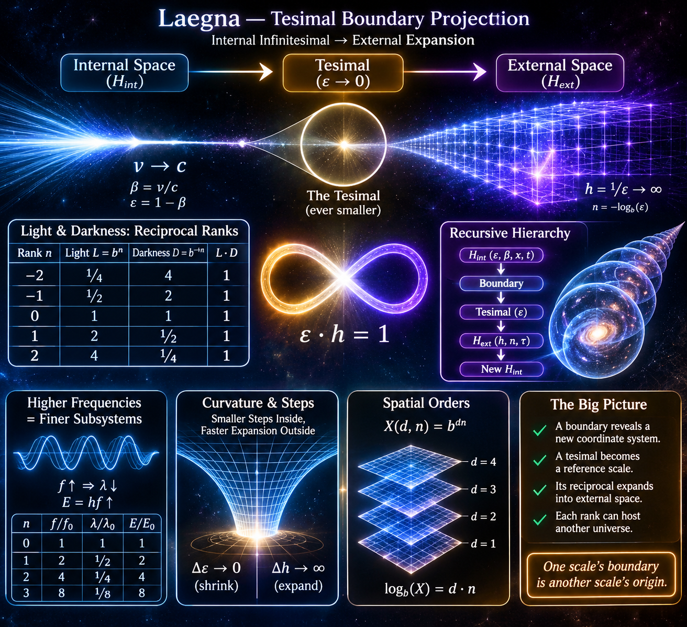
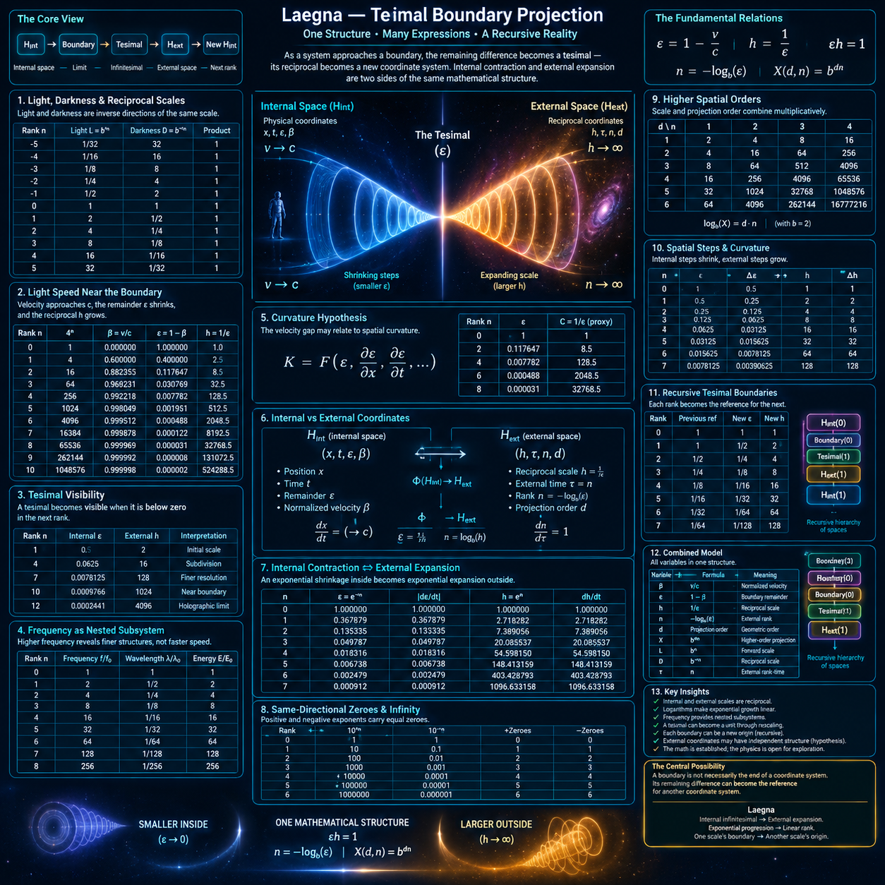
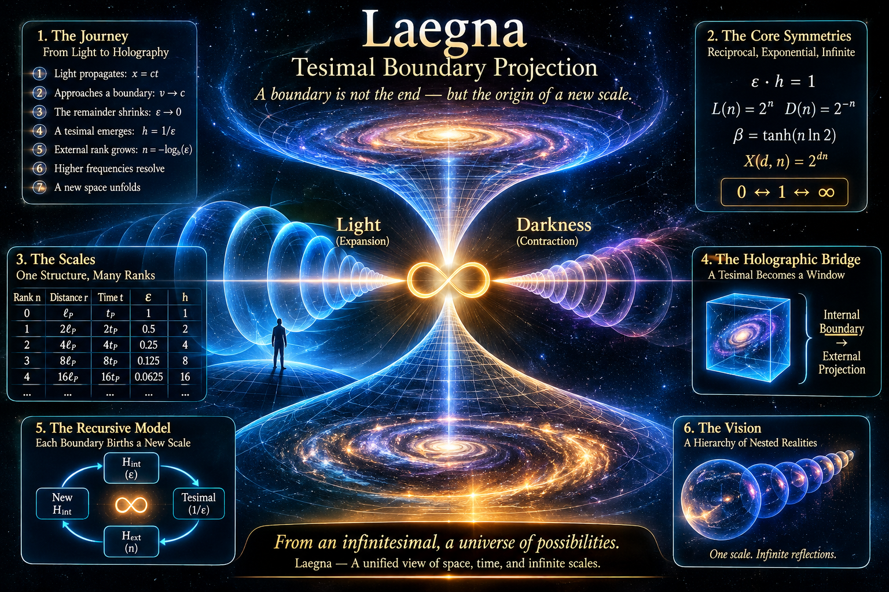

 

# SoL - Speed of Light

56 G symbolizes external odd-even position flip: to external coordinates.

---

ChatGPT:

# Laegna — Light, Darkness, External Space and the Linearization of Infinity

## 1. Introduction

We investigate a relationship between four fundamental operations:

- Addition (+): linear expansion.
- Subtraction (−): linear contraction.
- Multiplication (×): proportional expansion.
- Division (÷): proportional contraction.

The central hypothesis is that ordinary space and time describe linear propagation, while external space describes how that propagation is represented through higher-ranked, exponentially expanding coordinates.

Light provides a natural reference because its propagation in vacuum follows:

    x = ct

where:

- x is spatial displacement.
- c is the speed of light.
- t is elapsed time.

However, spatial geometry does not grow linearly in every measure.

For example, a spherical wavefront has:

    r(t) = ct
    A(t) = 4π(ct)²
    V(t) = (4π/3)(ct)³

Thus, the same temporal progression produces:

| Projection | Geometric measure | Time dependence |
|---|---|---|
| 1D | Radius | t |
| 2D | Surface area | t² |
| 3D | Enclosed volume | t³ |
| 4D | Higher-order measure | t⁴ |

This gives us a starting point for investigating how light propagates through a hierarchy of spatial coordinates.

The question is:

Can the exponential progression of spatial ranks be transformed into a linear progression in an external coordinate system?

---

## 2. Addition and multiplication as opposing coordinate systems

Consider two operations:

    2 + 2 = 4
    2 × 2 = 4

At the initial symmetric point, addition and multiplication coincide.

But repeated operations diverge:

| Rank | Repeated addition | Repeated multiplication |
|---:|---:|---:|
| 1 | 2 | 2 |
| 2 | 4 | 4 |
| 3 | 6 | 8 |
| 4 | 8 | 16 |
| 5 | 10 | 32 |
| 6 | 12 | 64 |
| 7 | 14 | 128 |
| 8 | 16 | 256 |

General expressions:

    A(n) = 2n
    M(n) = 2ⁿ

The distinction is that addition accumulates a constant quantity, while multiplication repeatedly changes the scale of the quantity.

We can organize the operations into two opposing pairs:

| Expansion | Contraction | Coordinate system |
|---|---|---|
| Addition (+) | Subtraction (−) | Linear |
| Multiplication (×) | Division (÷) | Multiplicative |

The logarithm connects these systems:

    log₂(2x) = 1 + log₂(x)

    log(xy) = log(x) + log(y)

    log(x/y) = log(x) - log(y)

Consequently, multiplicative progression becomes additive progression in logarithmic coordinates.

This is the mathematical basis of external-space linearization.

---

## 3. Higher spatial ranks generated by light

Let the dimensionless light-propagation coordinate be:

    q = ct / L

where L is a reference length.

Define successive spatial projections:

    X₁ = q
    X₂ = q²
    X₃ = q³
    X₄ = q⁴
    X₅ = q⁵
    ...

The general formula is:

    X_d = qᵈ

The corresponding inverse transformation is:

    q = X_d^(1/d)

The projections have the following properties:

| Rank | Projection | Interpretation |
|---:|---|---|
| 1 | q | Linear displacement |
| 2 | q² | Quadratic measure |
| 3 | q³ | Cubic measure |
| 4 | q⁴ | Fourth-order measure |
| 5 | q⁵ | Fifth-order measure |
| n | qⁿ | Generalized projection |

These are mathematical projections. They do not automatically establish additional physical spatial dimensions.

### 3.1 Rates of change

Differentiating with respect to ordinary time:

    dX₁/dt = c/L

    dX₂/dt = 2c²t/L²

    dX₃/dt = 3c³t²/L³

    dX₄/dt = 4c⁴t³/L⁴

In dimensional coordinates:

    x_d(t) = (ct)ᵈ

    dx_d/dt = d cᵈ t^(d-1)

The underlying physical light velocity remains c.

The higher-order coordinate rates change because their coordinates describe different powers of spatial displacement.

### 3.2 The common origin

At q = 1:

    X₁ = X₂ = X₃ = X₄ = ... = 1

All ranks coincide.

For q greater than 1, they expand differently.

For q smaller than 1, they contract differently.

This creates a natural reference point for internal and external coordinate transformations.

---

## 4. External space: making exponential progression linear

We now define an external coordinate.

Let:

    r = ℓP · 2ⁿ

where:

- ℓP is Planck length.
- n is the spatial octave rank.

For light propagation:

    t = tP · 2ⁿ

because:

    ℓP / tP = c

Therefore:

    r/t = c

The spatial and temporal octave ranks are identical.

    n_space = n_time

This is the first important symmetry.

However, ordinary distance and time are exponential functions of rank:

    r(n) = ℓP · 2ⁿ

    t(n) = tP · 2ⁿ

Apply logarithms:

    n = log₂(r/ℓP)

    n = log₂(t/tP)

We obtain a linear external coordinate:

    n = log₂(r/ℓP) = log₂(t/tP)

In this representation, every octave step corresponds to one unit of external rank.

### 4.1 Ordinary and external coordinates

| Property | Internal space | External space |
|---|---|---|
| Distance | r | log₂(r/ℓP) |
| Time | t | log₂(t/tP) |
| Propagation | r = ct | Equal spatial and temporal ranks |
| Expansion | Exponential in rank | Linear in rank |
| Contraction | Reciprocal powers | Negative ranks |
| Scale | Metric | Logarithmic |

The external coordinate is not another physical clock.

It is a coordinate transformation that makes multiplicative scale progression additive.

### 4.2 External light velocity

Define:

    n = log₂(r/ℓP)

and:

    τ = log₂(t/tP)

For a light ray:

    n = τ

Therefore:

    dn/dτ = 1

This is the constant external propagation rate in octave coordinates.

It is not a velocity in metres per second.

It describes the rate at which light advances through successive spatial and temporal ranks.

This is a particularly useful distinction:

    Physical light velocity: c

    External rank velocity: 1 octave / octave-time

The physical propagation is linear in ordinary spacetime, while the scale progression is linear in logarithmic spacetime.

---

## 5. Light and darkness: reciprocal propagation coordinates

We can now introduce a second coordinate family.

Let light represent the forward propagation limit and darkness represent its reciprocal scale.

There are two useful formulations.

### 5.1 Octave reciprocity

Define:

    L(n) = 2ⁿ

    D(n) = 2⁻ⁿ

Then:

    L(n) · D(n) = 1

This gives:

| Rank n | Light scale L(n) | Darkness scale D(n) | Product |
|---:|---:|---:|---:|
| -4 | 0.0625 | 16 | 1 |
| -3 | 0.125 | 8 | 1 |
| -2 | 0.25 | 4 | 1 |
| -1 | 0.5 | 2 | 1 |
| 0 | 1 | 1 | 1 |
| +1 | 2 | 0.5 | 1 |
| +2 | 4 | 0.25 | 1 |
| +3 | 8 | 0.125 | 1 |
| +4 | 16 | 0.0625 | 1 |

The central relationship is:

    L(n) = 1 / D(n)

This represents reciprocal scale symmetry.

Darkness here is an inverse coordinate, not a second physical signal propagating faster or slower than light.

### 5.2 Light-speed and darkness-speed coordinates

For a second representation, introduce a normalized velocity:

    β = v/c

Relativistic velocity is bounded by:

    -1 < β < 1

Define the rapidity coordinate:

    η = artanh(β)

Then:

    β = tanh(η)

For octave ranks, choose:

    η(n) = n ln(2)

Therefore:

    v(n) = c tanh(n ln(2))

Equivalently:

    v(n)/c = (4ⁿ - 1)/(4ⁿ + 1)

This provides a bounded, rank-indexed velocity transformation.

Define the remaining light-speed gap:

    δ(n) = 1 - v(n)/c

For positive n:

    δ(n) = 2/(4ⁿ + 1)

And its reciprocal:

    I(n) = 1/δ(n)

This gives an interesting relationship between the approach to light speed and an inverse infinity coordinate.

### 5.3 Rank-indexed light and darkness table

| Rank | Light velocity v/c | Darkness gap δ | Reciprocal I |
|---:|---:|---:|---:|
| 0 | 0 | 1 | 1 |
| 1 | 0.600000 | 0.400000 | 2.5 |
| 2 | 0.882353 | 0.117647 | 8.5 |
| 3 | 0.969231 | 0.030769 | 32.5 |
| 4 | 0.992218 | 0.007782 | 128.5 |
| 5 | 0.998049 | 0.001951 | 512.5 |
| 6 | 0.999512 | 0.000488 | 2048.5 |

The relationship is:

    v(n) → c
    δ(n) → 0
    I(n) → ∞

as n approaches positive infinity.

For negative ranks, the velocity changes sign:

    v(-n) = -v(n)

The positive and negative directions therefore describe opposite orientations of the same bounded velocity coordinate.

Important: δ is the remaining fractional gap to c, not a physical speed of darkness.

---

## 6. SoD and SoL: a decimal reciprocal scale

We can also investigate a simpler decimal scale.

Define the proposed Speed of Darkness rank coordinate:

    v_SoD(n) = c · 10⁻ⁿ

This is a scale model, not a measured velocity of a physical darkness signal.

Its reciprocal is:

    v_SoL(n) = c · 10ⁿ

The two satisfy:

    v_SoD(n) · v_SoL(n) = c²

A normalized table:

| Rank | SoD coordinate / c | SoL reciprocal / c |
|---:|---:|---:|
| 1 | 10⁻¹ | 10¹ |
| 2 | 10⁻² | 10² |
| 3 | 10⁻³ | 10³ |
| 4 | 10⁻⁴ | 10⁴ |
| 5 | 10⁻⁵ | 10⁵ |
| 6 | 10⁻⁶ | 10⁶ |
| 7 | 10⁻⁷ | 10⁷ |
| 8 | 10⁻⁸ | 10⁸ |
| 9 | 10⁻⁹ | 10⁹ |
| 10 | 10⁻¹⁰ | 10¹⁰ |
| 11 | 10⁻¹¹ | 10¹¹ |
| 12 | 10⁻¹² | 10¹² |
| 13 | 10⁻¹³ | 10¹³ |
| 14 | 10⁻¹⁴ | 10¹⁴ |
| 15 | 10⁻¹⁵ | 10¹⁵ |
| 16 | 10⁻¹⁶ | 10¹⁶ |

The reciprocal relationship is exact as a coordinate construction.

The SoD side approaches zero while the reciprocal SoL side approaches infinity.

The rank boundaries can be investigated as:

- SoD ranks 1–8: decreasing decimal scale.
- SoL ranks 8–16: increasing reciprocal scale.
- 10⁻⁸ and 10⁸: shared transition order.

The shared rank 8 is particularly interesting as a potential boundary between two representations.

---

## 7. Infinity and zero: same-directional zero progression

Now we compare the light/darkness relationship with decimal infinity.

Consider:

    1
    10
    100
    1000
    10000

and:

    1
    0.1
    0.01
    0.001
    0.0001

These are reciprocal sequences.

    10ⁿ · 10⁻ⁿ = 1

However, their zeroes appear on opposite sides of the significant digit.

### 7.1 Reciprocal infinity table

| Rank | Positive direction | Negative direction | Product |
|---:|---:|---:|---:|
| 0 | 1 | 1 | 1 |
| 1 | 10 | 0.1 | 1 |
| 2 | 100 | 0.01 | 1 |
| 3 | 1,000 | 0.001 | 1 |
| 4 | 10,000 | 0.0001 | 1 |
| 5 | 100,000 | 0.00001 | 1 |
| 6 | 1,000,000 | 0.000001 | 1 |
| 7 | 10,000,000 | 0.0000001 | 1 |
| 8 | 100,000,000 | 0.00000001 | 1 |

The positive direction accumulates zeroes after the significant digit.

The negative direction accumulates zeroes between the decimal separator and the significant digit.

These are two representations of the same multiplicative progression.

### 7.2 Same-directional zeroes

For a more symmetrical representation, count the distance of the significant digit from the reference position.

| Rank | Positive exponent | Negative exponent | Zero displacement |
|---:|---|---|---|
| 1 | 10¹ | 10⁻¹ | 1 |
| 2 | 10² | 10⁻² | 2 |
| 3 | 10³ | 10⁻³ | 3 |
| 4 | 10⁴ | 10⁻⁴ | 4 |
| 5 | 10⁵ | 10⁻⁵ | 5 |
| 6 | 10⁶ | 10⁻⁶ | 6 |
| 7 | 10⁷ | 10⁻⁷ | 7 |
| 8 | 10⁸ | 10⁻⁸ | 8 |

The number of zero positions is the same in both directions.

The significant digit moves away from the reference in opposite orientations.

This is the same reciprocal symmetry found in the light/darkness coordinates.

### 7.3 Infinity and zero as directional limits

We can express the two limits:

    lim(n→∞) 10ⁿ = ∞

    lim(n→∞) 10⁻ⁿ = 0

And:

    10ⁿ · 10⁻ⁿ = 1

The important distinction is that zero and infinity are not ordinary finite values.

They are limiting directions of the scale system.

This suggests the following notation:

    0 ↔ 1 ↔ ∞

The central 1 is the reciprocal reference.

A second symmetry is signed:

    -∞ ↔ 0 ↔ +∞

The first describes multiplicative scale reciprocity.

The second describes signed additive direction.

These should not be confused with one another.

---

## 8. Light, darkness and infinity in one table

We can now compare the three coordinate systems.

| Property | Light | Darkness | Infinity / zero |
|---|---|---|---|
| Basic direction | Forward | Reciprocal | Positive exponent |
| Opposing direction | Negative propagation | Inverse scale | Negative exponent |
| Main operation | Multiplication | Division | Powers |
| Linearization | Logarithm | Negative logarithm | Exponent becomes rank |
| Limiting value | c | 0 gap | Infinity |
| Opposite limit | -c | Reciprocal divergence | Zero |
| Central reference | 1 | 1 | 1 |
| Symmetry | Velocity reversal | Reciprocal scale | Reciprocal powers |

The three systems share a mathematical structure:

    Forward scale  ×  Reciprocal scale = 1

For velocity, the corresponding relationship is bounded rather than an ordinary reciprocal:

    β = tanh(η)

    δ = 1 - β

    I = 1/δ

This distinction matters because physical light speed cannot be exceeded by a massive object in special relativity.

---

## 9. Continuing the order of space and time

We can extend the spatial and temporal ranks in both directions.

Define:

    R(n) = ℓP · 2ⁿ

    T(n) = tP · 2ⁿ

For all integer n:

    R(n) / T(n) = c

The negative ranks describe increasingly small distances and times.

The positive ranks describe increasingly large distances and times.

### 9.1 Octave table

| Rank n | Distance | Time | Interpretation |
|---:|---|---|---|
| -4 | ℓP/16 | tP/16 | Sub-Planck coordinate |
| -3 | ℓP/8 | tP/8 | Sub-Planck coordinate |
| -2 | ℓP/4 | tP/4 | Sub-Planck coordinate |
| -1 | ℓP/2 | tP/2 | Half Planck scale |
| 0 | ℓP | tP | Planck reference |
| +1 | 2ℓP | 2tP | First expansion |
| +2 | 4ℓP | 4tP | Second expansion |
| +3 | 8ℓP | 8tP | Third expansion |
| +4 | 16ℓP | 16tP | Fourth expansion |
| +8 | 256ℓP | 256tP | Eighth expansion |
| +16 | 65,536ℓP | 65,536tP | Sixteenth expansion |

Sub-Planck entries are mathematical extrapolations, not established physically measurable spacetime intervals.

### 9.2 Spatial geometry at each rank

For a spherical wavefront:

    r(n) = ℓP · 2ⁿ

    A(n) = 4πℓP² · 4ⁿ

    V(n) = (4π/3)ℓP³ · 8ⁿ

The table becomes:

| Rank | Radius factor | Area factor | Volume factor | Time factor |
|---:|---:|---:|---:|---:|
| 0 | 1 | 1 | 1 | 1 |
| 1 | 2 | 4 | 8 | 2 |
| 2 | 4 | 16 | 64 | 4 |
| 3 | 8 | 64 | 512 | 8 |
| 4 | 16 | 256 | 4096 | 16 |
| 5 | 32 | 1024 | 32768 | 32 |
| 6 | 64 | 4096 | 262144 | 64 |

The radius and time have identical octave factors.

Area grows twice as quickly in exponent rank.

Volume grows three times as quickly.

This is the geometric consequence of higher-dimensional measure.

---

## 10. Extending to the next spatial orders

The sequence of spatial projections can continue indefinitely:

    X₁ = q
    X₂ = q²
    X₃ = q³
    X₄ = q⁴
    X₅ = q⁵
    X₆ = q⁶
    ...
    Xₙ = qⁿ

Their logarithmic coordinates are:

    log(Xₙ) = n log(q)

Therefore, the spatial order n becomes a linear multiplier in external coordinates.

We can also express the same progression in base 2:

    Xₙ = 2^(kn)

where k is the underlying octave coordinate.

The logarithmic transformation is:

    log₂(Xₙ) = kn

Thus, the progression of higher-order spaces is linearized.

### 10.1 Spatial order and time order

We can define two independent indices:

    n = octave rank
    d = spatial projection order

Then:

    X(d,n) = (2ⁿ)ᵈ

Which simplifies to:

    X(d,n) = 2^(nd)

This is a useful two-coordinate system.

| Spatial order d | Octave rank n | Result |
|---:|---:|---:|
| 1 | 1 | 2 |
| 2 | 1 | 4 |
| 3 | 1 | 8 |
| 4 | 1 | 16 |
| 1 | 2 | 4 |
| 2 | 2 | 16 |
| 3 | 2 | 64 |
| 4 | 2 | 256 |
| 1 | 3 | 8 |
| 2 | 3 | 64 |
| 3 | 3 | 512 |
| 4 | 3 | 4096 |

This separates two types of growth:

- Increasing n: moving through scale.
- Increasing d: moving through geometric order.

They are not the same operation.

---

## 11. Laegna digit structure: connecting the ranks

The Laegna four-symbol structure can represent the progression using:

    I, O, A, E

The two-digit sequence has sixteen ordinary states:

| Decimal index | Laegna |
|---:|---|
| 1 | II |
| 2 | IO |
| 3 | IA |
| 4 | IE |
| 5 | OI |
| 6 | OO |
| 7 | OA |
| 8 | OE |
| 9 | AI |
| 10 | AO |
| 11 | AA |
| 12 | AE |
| 13 | EI |
| 14 | EO |
| 15 | EA |
| 16 | EE |

With:

    UU = 0

And the exceptional external notation:

    VV = external / infinity-related state

The ordinary sixteen-state structure is:

    4² = 16

Higher orders extend it:

    4³ = 64
    4⁴ = 256
    4⁵ = 1024
    4⁶ = 4096

The number of states increases exponentially with digit length.

The corresponding external coordinate is:

    R = log₄(N)

This provides a direct connection between positional rank and logarithmic scale.

The mirror relation for an R-digit sequence is:

    n' = 4ᴿ + 1 - n

The central reciprocal balance can be expressed as:

    C_R(n) = log₂[n / (4ᴿ + 1 - n)]

This gives a signed curvature coordinate around the center of the positional system.

The exceptional VV state should remain distinct from ordinary finite digit sequences.

---

## 12. The combined model: four layers of progression

We can now identify four related layers.

### Layer 1 — Physical propagation

    x = ct

Light travels through ordinary space and time.

### Layer 2 — Geometric expansion

    A ∝ t²

    V ∝ t³

Higher-order spatial measures grow around the same propagation.

### Layer 3 — External linearization

    n = log₂(r/ℓP)

    τ = log₂(t/tP)

    n = τ

Exponential spatial and temporal progression becomes linear in rank coordinates.

### Layer 4 — Reciprocal infinity

    2ⁿ · 2⁻ⁿ = 1

    10ⁿ · 10⁻ⁿ = 1

Positive and negative scale directions become reciprocal.

These four layers can be combined:

    Physical propagation
          ↓
    Higher spatial projections
          ↓
    External logarithmic coordinates
          ↓
    Reciprocal infinity / zero symmetry

---

## 13. New research questions

The construction suggests several further investigations.

### A. Is there a common external speed?

The physical speed of light is constant:

    dx/dt = c

The external rank speed is also constant:

    dn/dτ = 1

Can these be generalized into a common coordinate transformation for all spatial orders?

### B. Can gravity be expressed as the reciprocal spatial projection?

A possible investigation is:

    Light:       X(n) = 2ⁿ

    Darkness:    D(n) = 2⁻ⁿ

The question is whether gravitational concentration can be represented through inverse geometric measures, while preserving the distinction between gravitational field propagation and gravitational response.

### C. Can spatial dimensions be treated as projection orders?

For example:

    1D → q
    2D → q²
    3D → q³
    4D → q⁴

Can the same construction be extended to fractional orders?

    X(d) = qᵈ

This would permit investigation of intermediate geometric scaling.

### D. Can zero and infinity be treated as opposing external boundaries?

The multiplicative sequence:

    ... 10⁻³, 10⁻², 10⁻¹, 1, 10¹, 10², 10³ ...

is linear in logarithmic coordinates:

    ... -3, -2, -1, 0, 1, 2, 3 ...

The zero and infinity boundaries are therefore opposite directions of an unbounded rank coordinate.

### E. Can light and darkness share a common rank?

A useful candidate is:

    L(n) = 2ⁿ

    D(n) = 2⁻ⁿ

    L(n)D(n) = 1

The same rank describes both expansion and contraction.

This could become a basis for a reciprocal model of SoL and SoD.

---

## 14. Conclusion

The most important discovery in this construction is that several apparently different progressions can be represented through one mathematical framework.

| Physical / mathematical phenomenon | Natural representation |
|---|---|
| Light propagation | Linear spacetime |
| Spatial expansion | Higher powers |
| Multiplicative scaling | Exponential coordinates |
| External space | Logarithmic coordinates |
| Darkness / inverse scale | Reciprocal powers |
| Infinity | Positive unbounded rank |
| Zero | Negative unbounded rank |
| Laegna positional structure | Base-4 rank encoding |

The central equations are:

    x = ct

    X(d,n) = 2^(dn)

    n = log₂(r/ℓP)

    τ = log₂(t/tP)

    n = τ

    L(n) = 2ⁿ

    D(n) = 2⁻ⁿ

    L(n)D(n) = 1

    0 ↔ 1 ↔ ∞

The physical propagation of light, the expansion of spatial measures, the logarithmic progression of external space and reciprocal infinity are different mathematical descriptions.

The promising direction is to investigate whether they can be joined into a consistent rank-based coordinate system.

**The central Laegna hypothesis:**

Space and time can be linear in physical propagation, exponential in higher-order spatial projection, and linear again when represented through external logarithmic rank coordinates.

Light provides the propagation reference. Darkness provides the reciprocal scale. Infinity and zero provide the opposing boundaries.

This is a mathematical research framework, with its physical interpretations requiring separate verification.

---

 

# Laegna — Tesimal Boundary Projection
## Light, Darkness, External Space and Recursive Holographic Coordinates

> Continuation of: Laegna — Light, Darkness, External Space and the Linearization of Infinity.

## 1. Introduction

This article develops a hypothesis about how light propagation, spatial curvature, exponential scaling, infinitesimal resolution and external holographic coordinates might form a common mathematical structure.

The central idea is that a system approaching a limiting boundary can generate a new coordinate system from the increasingly small difference between its current state and that boundary.

The process is:

1. Light propagates through internal space and time.
2. Its coordinate approaches a limiting value.
3. The remaining difference becomes increasingly small.
4. The difference becomes a tesimal reference unit.
5. Its reciprocal becomes an expanding external coordinate.
6. Higher-frequency subsystems resolve increasingly fine structures.
7. The external coordinate system can become the internal coordinate system of a new rank.

The proposed recursive relationship is:

    H_int → Boundary → Tesimal → H_ext → New H_int

The physical interpretation remains a research hypothesis. The mathematical transformations themselves can be defined and tested independently.

---

## 2. Fundamental coordinate definitions

We begin with the speed of light in vacuum:

    c = 299792458 m/s

Define normalized velocity:

    β = v/c

For a velocity approaching the light-speed boundary:

    β → 1

Define the remaining normalized difference:

    ε = 1 - β

Therefore:

    β = 1 - ε

As the limiting boundary is approached:

    ε → 0

We can now define an external reciprocal coordinate:

    h = 1/ε

Consequently:

    ε · h = 1

This is the fundamental reciprocal relationship of Tesimal Boundary Projection.

| Variable | Definition | Interpretation |
|---|---|---|
| c | Light speed | Physical propagation reference |
| v | Internal velocity | Velocity in the physical coordinate system |
| β | v/c | Normalized velocity |
| ε | 1 - β | Remaining boundary difference |
| h | 1/ε | External reciprocal coordinate |
| n | -log_b(ε) | External rank |
| b | Scale base | Exponential progression base |

The central transformation is:

    ε → 0
    h → ∞
    n → ∞

The internal remainder becomes smaller while the external representation grows.

---

## 3. Approaching the boundary through successive exponents

Let the remaining difference decrease exponentially:

    ε(n) = b^(-n)

where:

    b > 1

The reciprocal external coordinate becomes:

    h(n) = b^n

Their product is invariant:

    ε(n) · h(n) = 1

### 3.1 Binary progression

For b = 2:

    ε(n) = 2^(-n)

    h(n) = 2^n

| Rank n | Internal remainder ε | External coordinate h | Product |
|---:|---:|---:|---:|
| 0 | 1 | 1 | 1 |
| 1 | 0.5 | 2 | 1 |
| 2 | 0.25 | 4 | 1 |
| 3 | 0.125 | 8 | 1 |
| 4 | 0.0625 | 16 | 1 |
| 5 | 0.03125 | 32 | 1 |
| 6 | 0.015625 | 64 | 1 |
| 7 | 0.0078125 | 128 | 1 |
| 8 | 0.00390625 | 256 | 1 |
| 9 | 0.001953125 | 512 | 1 |
| 10 | 0.0009765625 | 1024 | 1 |
| 11 | 0.00048828125 | 2048 | 1 |
| 12 | 0.000244140625 | 4096 | 1 |
| 13 | 0.0001220703125 | 8192 | 1 |
| 14 | 0.00006103515625 | 16384 | 1 |
| 15 | 0.000030517578125 | 32768 | 1 |
| 16 | 0.0000152587890625 | 65536 | 1 |

The internal and external coordinates are reciprocal.

The logarithmic representation is:

    n = -log₂(ε)

    n = log₂(h)

The number of exponential steps becomes a linear coordinate.

### 3.2 Decimal progression

The same construction can be performed in base 10:

    ε(n) = 10^(-n)

    h(n) = 10^n

| Rank n | Internal remainder ε | External coordinate h |
|---:|---:|---:|
| 0 | 1 | 1 |
| 1 | 0.1 | 10 |
| 2 | 0.01 | 100 |
| 3 | 0.001 | 1000 |
| 4 | 0.0001 | 10000 |
| 5 | 0.00001 | 100000 |
| 6 | 0.000001 | 1000000 |
| 7 | 0.0000001 | 10000000 |
| 8 | 0.00000001 | 100000000 |
| 9 | 0.000000001 | 1000000000 |
| 10 | 0.0000000001 | 10000000000 |

The binary and decimal representations are equivalent in structure.

Their difference is the scale base.

---

## 4. The tesimal as a new unit of measurement

A tesimal is introduced here as the remaining difference between an internal coordinate and its limiting boundary.

    ε = 1 - β

It becomes increasingly small as β approaches 1.

However, the same quantity can become the reference unit of another coordinate system.

For example:

    ε = 0.001

    h = 1/ε = 1000

The relationship is:

    ε · h = 1

The internal system sees a very small remainder.

The external system sees a large reciprocal coordinate.

### 4.1 Tesimal visibility table

| Rank | Internal ε | External h | Interpretation |
|---:|---:|---:|---|
| 1 | 0.5 | 2 | Initial reciprocal scale |
| 2 | 0.25 | 4 | First subdivision |
| 3 | 0.125 | 8 | Second subdivision |
| 4 | 0.0625 | 16 | Third subdivision |
| 5 | 0.03125 | 32 | Fourth subdivision |
| 6 | 0.015625 | 64 | Fifth subdivision |
| 7 | 0.0078125 | 128 | Sixth subdivision |
| 8 | 0.00390625 | 256 | Seventh subdivision |
| 9 | 0.001953125 | 512 | Eighth subdivision |
| 10 | 0.0009765625 | 1024 | Ninth subdivision |
| 11 | 0.00048828125 | 2048 | Tenth subdivision |
| 12 | 0.000244140625 | 4096 | Eleventh subdivision |

### 4.2 Interpretation

The tesimal does not physically become larger by itself.

Its apparent expansion comes from changing the reference unit.

A quantity that is too small to resolve in one coordinate system can become a measurable quantity in another coordinate system.

This is the proposed transition:

    Internal infinitesimal
          ↓
    New reference unit
          ↓
    External coordinate
          ↓
    New resolution system

The hypothesis is that successive boundary transitions can generate nested coordinate systems.

---

## 5. Light velocity and the limiting boundary

The earlier rapidity construction provides a useful bounded model.

Define:

    η = n · ln(2)

    β(n) = tanh(η)

Therefore:

    β(n) = tanh(n · ln(2))

Using the exponential definition of the hyperbolic tangent:

    β(n) = (4^n - 1)/(4^n + 1)

The remaining difference is:

    ε(n) = 1 - β(n)

    ε(n) = 2/(4^n + 1)

The reciprocal coordinate is:

    h(n) = (4^n + 1)/2

This is a more physically meaningful bounded velocity parametrization than simply setting velocity equal to c times an arbitrary exponential.

### 5.1 Light-speed boundary table

| Rank n | 4^n | β = v/c | ε = 1 - β | h = 1/ε |
|---:|---:|---:|---:|---:|
| 0 | 1 | 0 | 1 | 1 |
| 1 | 4 | 0.600000 | 0.400000 | 2.5 |
| 2 | 16 | 0.882353 | 0.117647 | 8.5 |
| 3 | 64 | 0.969231 | 0.030769 | 32.5 |
| 4 | 256 | 0.992218 | 0.007782 | 128.5 |
| 5 | 1024 | 0.998049 | 0.001951 | 512.5 |
| 6 | 4096 | 0.999512 | 0.000488 | 2048.5 |
| 7 | 16384 | 0.999878 | 0.000122 | 8192.5 |
| 8 | 65536 | 0.999969 | 0.000031 | 32768.5 |
| 9 | 262144 | 0.999992 | 0.000008 | 131072.5 |
| 10 | 1048576 | 0.999998 | 0.000002 | 524288.5 |

The important asymptotic relationship is:

    β → 1

    ε → 0

    h → ∞

The internal velocity approaches its limiting value, while the reciprocal coordinate expands.

This is a coordinate model of boundary proximity.

It does not imply that an ordinary massive object can reach or exceed c.

---

## 6. The curvature hypothesis

The proposed relationship is that the difference between the internal velocity and its limiting value represents a changing spatial curvature scale.

We define:

    ε = 1 - v/c

The hypothesis is:

    Smaller ε
       ↓
    Finer internal resolution
       ↓
    Different effective geometric scale
       ↓
    External reciprocal representation

However, velocity difference is not itself curvature.

To investigate physical curvature, we must introduce a metric:

    ds² = g_ij(x) dx^i dx^j

and its curvature tensor:

    R^i_jkl

A scalar curvature measure can be defined as:

    K = R

where R is the Ricci scalar.

We can then investigate a possible relation:

    K = F(ε, dε/dx, dε/dt, ...)

The function F must be derived from an actual geometric model.

### 6.1 Candidate curvature-coordinate table

For research purposes, consider a simple dimensionless proxy:

    C(n) = 1/ε(n)

This is not physical curvature; it is an inverse boundary-distance measure.

| Rank n | ε | C = 1/ε | Interpretation |
|---:|---:|---:|---|
| 0 | 1 | 1 | Reference |
| 1 | 0.4 | 2.5 | Initial approach |
| 2 | 0.117647 | 8.5 | Increasing resolution |
| 3 | 0.030769 | 32.5 | Smaller internal remainder |
| 4 | 0.007782 | 128.5 | Larger reciprocal scale |
| 5 | 0.001951 | 512.5 | Fine-scale boundary |
| 6 | 0.000488 | 2048.5 | High-rank projection |
| 7 | 0.000122 | 8192.5 | Near-boundary coordinate |
| 8 | 0.000031 | 32768.5 | Extreme reciprocal scale |

The research objective is to determine whether this proxy can be connected to a physically meaningful curvature quantity.

---

## 7. Higher frequencies as nested subsystems

Light frequency and wavelength satisfy:

    c = fλ

Therefore:

    f = c/λ

An increase in frequency corresponds to a decrease in wavelength.

Define:

    f(n) = f₀ · 2^n

    λ(n) = λ₀ · 2^(-n)

Then:

    f(n)λ(n) = f₀λ₀ = c

### 7.1 Frequency subdivision table

| Rank n | Frequency factor | Wavelength factor | Product |
|---:|---:|---:|---:|
| 0 | 1 | 1 | 1 |
| 1 | 2 | 0.5 | 1 |
| 2 | 4 | 0.25 | 1 |
| 3 | 8 | 0.125 | 1 |
| 4 | 16 | 0.0625 | 1 |
| 5 | 32 | 0.03125 | 1 |
| 6 | 64 | 0.015625 | 1 |
| 7 | 128 | 0.0078125 | 1 |
| 8 | 256 | 0.00390625 | 1 |
| 9 | 512 | 0.001953125 | 1 |
| 10 | 1024 | 0.0009765625 | 1 |

Higher frequency does not increase vacuum propagation speed.

Instead, it provides shorter wavelengths and different energy scales.

Photon energy is:

    E = hf

where h is Planck's constant.

Thus:

    E(n) = E₀ · 2^n

### 7.2 Frequency, wavelength and energy

| Rank n | Frequency / f₀ | Wavelength / λ₀ | Energy / E₀ |
|---:|---:|---:|---:|
| 0 | 1 | 1 | 1 |
| 1 | 2 | 1/2 | 2 |
| 2 | 4 | 1/4 | 4 |
| 3 | 8 | 1/8 | 8 |
| 4 | 16 | 1/16 | 16 |
| 5 | 32 | 1/32 | 32 |
| 6 | 64 | 1/64 | 64 |
| 7 | 128 | 1/128 | 128 |
| 8 | 256 | 1/256 | 256 |

The hypothesis is that higher-frequency subsystems can reveal finer internal structures.

Each frequency range can be investigated as a subsystem of a larger scale hierarchy.

---

## 8. Shrinking internal steps and accelerating external expansion

The next important relationship concerns the number and size of remaining steps.

Define internal exponential shrinkage:

    ε(t) = exp(-kt)

where k > 0.

Differentiate:

    dε/dt = -kε

The absolute rate of shrinkage is:

    |dε/dt| = kε

As ε approaches zero, the absolute shrinkage rate also approaches zero.

Now define:

    h(t) = 1/ε(t)

Therefore:

    h(t) = exp(kt)

Differentiate:

    dh/dt = kh

The external coordinate accelerates exponentially.

### 8.1 Internal and external progression table

For k = 1 and t = n:

| Time / rank | Internal ε = e^(-n) | Shrinkage magnitude | External h = e^n | External growth rate |
|---:|---:|---:|---:|---:|
| 0 | 1.000000 | 1.000000 | 1.000000 | 1.000000 |
| 1 | 0.367879 | 0.367879 | 2.718282 | 2.718282 |
| 2 | 0.135335 | 0.135335 | 7.389056 | 7.389056 |
| 3 | 0.049787 | 0.049787 | 20.085537 | 20.085537 |
| 4 | 0.018316 | 0.018316 | 54.598150 | 54.598150 |
| 5 | 0.006738 | 0.006738 | 148.413159 | 148.413159 |
| 6 | 0.002479 | 0.002479 | 403.428793 | 403.428793 |
| 7 | 0.000912 | 0.000912 | 1096.633158 | 1096.633158 |
| 8 | 0.000335 | 0.000335 | 2980.957987 | 2980.957987 |

The same exponential parameter produces opposite behaviour.

| Internal H_int | External H_ext |
|---|---|
| Exponential shrinkage | Exponential expansion |
| Negative exponent | Positive exponent |
| Smaller absolute steps | Larger absolute steps |
| Approaches zero | Approaches infinity |
| Increasing relative resolution | Increasing reciprocal scale |

The logarithmic rank is:

    n = -ln(ε)/k

Therefore:

    dn/dt = 1

The external rank progresses uniformly even though the internal and external coordinate magnitudes change exponentially.

This is one of the central mathematical relationships of Tesimal Boundary Projection.

---

## 9. Same-directional zeroes and reciprocal infinity

The previous Light and Darkness construction can now be connected to decimal positional scaling.

Define:

    P(n) = 10^n

    N(n) = 10^(-n)

Then:

    P(n) · N(n) = 1

### 9.1 Reciprocal zero table

| Rank | Positive exponent | Negative exponent | Positive zero count | Negative zero count |
|---:|---:|---:|---:|---:|
| 0 | 1 | 1 | 0 | 0 |
| 1 | 10 | 0.1 | 1 | 1 |
| 2 | 100 | 0.01 | 2 | 2 |
| 3 | 1000 | 0.001 | 3 | 3 |
| 4 | 10000 | 0.0001 | 4 | 4 |
| 5 | 100000 | 0.00001 | 5 | 5 |
| 6 | 1000000 | 0.000001 | 6 | 6 |
| 7 | 10000000 | 0.0000001 | 7 | 7 |
| 8 | 100000000 | 0.00000001 | 8 | 8 |

The zeroes accumulate symmetrically in exponent magnitude.

The significant digit moves in opposite directions relative to the decimal reference.

### 9.2 Comparison with the tesimal

| System | Internal direction | External direction |
|---|---|---|
| Light / darkness | Velocity gap decreases | Reciprocal gap increases |
| Decimal infinity | Negative exponent | Positive exponent |
| Frequency | Wavelength decreases | Frequency increases |
| Tesimal | Internal remainder decreases | External unit count increases |
| Spatial scale | Smaller distance | Larger reciprocal coordinate |

All five systems exhibit reciprocal scaling.

The shared mathematical structure is:

    x(n) = b^(-n)

    y(n) = b^n

    x(n)y(n) = 1

This is the reciprocal basin of the model.

---

## 10. Internal and external holographic coordinates

We now define two coordinate systems.

### 10.1 Internal space

Let:

    H_int = (x, t, ε, β)

This system describes:

- Physical position.
- Physical time.
- Remaining distance to a chosen velocity boundary.
- Normalized velocity.

Its basic propagation equation is:

    dx/dt = v

For a light ray in vacuum:

    dx/dt = c

The internal system has its own metric and causal structure.

### 10.2 External space

Let:

    H_ext = (h, τ, n, d)

where:

- h is reciprocal boundary scale.
- τ is external temporal coordinate.
- n is exponential rank.
- d is spatial projection order.

Define:

    h = 1/ε

    n = -log_b(ε)

    τ = n

The external system describes the scale progression rather than ordinary physical displacement.

### 10.3 Coordinate transformation

The proposed projection is:

    Φ(H_int) → H_ext

With:

    h = 1/ε

    n = -log_b(ε)

    τ = n

Therefore:

    h = b^n

The transformation is reversible for positive finite ε:

    ε = 1/h

    n = log_b(h)

### 10.4 Internal and external comparison

| Property | H_int | H_ext |
|---|---|---|
| Primary coordinate | x | h |
| Time coordinate | t | τ |
| Boundary | ε → 0 | h → ∞ |
| Scale direction | Shrinkage | Expansion |
| Representation | Physical metric | Reciprocal/logarithmic |
| Propagation reference | c | Rank progression |
| Resolution | Internal | External |
| Main transformation | Linear motion | Exponential/logarithmic |

The external coordinate can become the reference coordinate of another internal subsystem.

This creates the possibility of recursive spaces.

---

## 11. Parallel propagation outside the internal bubble

The proposed holographic interpretation is that external coordinates may continue to progress while internal coordinates approach a boundary.

We can distinguish two possibilities.

### 11.1 Coordinate-parallel propagation

The internal system follows:

    dx/dt = c

The external system follows:

    dn/dτ = 1

These are two representations of the same underlying progression.

The external coordinate may grow exponentially:

    h = b^n

This does not imply superluminal physical motion.

### 11.2 Independent external degrees of freedom

A stronger hypothesis is that H_ext has degrees of freedom not fully represented by H_int.

We can introduce a more general mapping:

    Φ : H_int → H_ext

and a coupling:

    C(H_int, H_ext)

The research question becomes whether information from an internal boundary can be encoded in an independent external structure.

This would require:

1. A defined external metric.
2. A defined external time coordinate.
3. A causal structure.
4. A mapping between internal and external observables.
5. A conservation or information-preservation rule.
6. A testable prediction distinguishing the model from an ordinary coordinate transformation.

A holographic analogy is useful here, but it does not establish that information physically escapes the light cone.

---

## 12. Recursive tesimal boundaries

The model becomes more interesting when the process repeats.

Suppose the first internal system generates a tesimal:

    ε₁

Its reciprocal becomes:

    h₁ = 1/ε₁

The external coordinate can now define a new internal reference system.

Let:

    ε₂ = 1/h₁

Then:

    ε₂ = ε₁

To create a genuinely new subsystem, introduce a new local boundary scale:

    ε_(n+1) = ε_n / b

Each successive system uses the previous tesimal as its new reference.

### 12.1 Recursive scale table

| Rank | Previous reference | New internal tesimal | New external reciprocal |
|---:|---:|---:|---:|
| 0 | 1 | 1 | 1 |
| 1 | 1 | 1/2 | 2 |
| 2 | 1/2 | 1/4 | 4 |
| 3 | 1/4 | 1/8 | 8 |
| 4 | 1/8 | 1/16 | 16 |
| 5 | 1/16 | 1/32 | 32 |
| 6 | 1/32 | 1/64 | 64 |
| 7 | 1/64 | 1/128 | 128 |
| 8 | 1/128 | 1/256 | 256 |

The global internal scale becomes:

    ε_n = b^(-n)

The global external scale becomes:

    h_n = b^n

Each rank is a possible reference for the next.

### 12.2 Nested holographic structure

    H_int(0)
       ↓
    Boundary(0)
       ↓
    Tesimal(1)
       ↓
    H_ext(1)
       ↓
    H_int(1)
       ↓
    Boundary(1)
       ↓
    Tesimal(2)
       ↓
    H_ext(2)
       ↓
    H_int(2)
       ↓
       ...

This is the recursive version of Tesimal Boundary Projection.

The mathematical construction is a hierarchy of rescaled coordinate systems.

Whether these correspond to independent physical spaces remains to be established.

---

## 13. Higher spatial orders and external projection

The earlier higher-order spatial projection can be integrated into the recursive model.

Let:

    q = ct/L

Define:

    X(d,n) = q^d

where d is the spatial projection order.

If the underlying scale follows binary octaves:

    q = 2^n

then:

    X(d,n) = 2^(dn)

The logarithmic coordinate becomes:

    log₂(X) = dn

### 13.1 Spatial order matrix

| Spatial order d | Rank n = 1 | Rank n = 2 | Rank n = 3 | Rank n = 4 |
|---:|---:|---:|---:|---:|
| 1 | 2 | 4 | 8 | 16 |
| 2 | 4 | 16 | 64 | 256 |
| 3 | 8 | 64 | 512 | 4096 |
| 4 | 16 | 256 | 4096 | 65536 |
| 5 | 32 | 1024 | 32768 | 1048576 |
| 6 | 64 | 4096 | 262144 | 16777216 |

This separates two directions:

- Increasing n changes the scale.
- Increasing d changes the projection order.

The two directions combine multiplicatively in ordinary coordinates and additively in logarithmic coordinates:

    log₂(X) = d · n

This is a useful representation for examining external spatial ranks.

---

## 14. Curvature and the number of internal steps

A further hypothesis concerns the relationship between curvature and the number of remaining steps.

Let the internal distance to the boundary be:

    ε_n = b^(-n)

The number of remaining logarithmic steps is:

    N = -log_b(ε)

Each additional rank represents another subdivision.

The external coordinate is:

    h = b^N

The difference between two successive internal scales is:

    Δε_n = ε_n - ε_(n+1)

Therefore:

    Δε_n = b^(-n)(1 - 1/b)

The absolute step size decreases exponentially.

The external difference is:

    Δh_n = h_(n+1) - h_n

Therefore:

    Δh_n = b^n(b - 1)

The external step size increases exponentially.

### 14.1 Step comparison

For b = 2:

| Rank n | Internal ε | Internal step Δε | External h | External step Δh |
|---:|---:|---:|---:|---:|
| 0 | 1 | 0.5 | 1 | 1 |
| 1 | 0.5 | 0.25 | 2 | 2 |
| 2 | 0.25 | 0.125 | 4 | 4 |
| 3 | 0.125 | 0.0625 | 8 | 8 |
| 4 | 0.0625 | 0.03125 | 16 | 16 |
| 5 | 0.03125 | 0.015625 | 32 | 32 |
| 6 | 0.015625 | 0.0078125 | 64 | 64 |
| 7 | 0.0078125 | 0.00390625 | 128 | 128 |

The internal step becomes smaller.

The external step becomes larger.

This gives a mathematical expression to the proposed transition from internal shrinkage to external acceleration.

However, the step sizes are coordinate differences, not directly physical acceleration or curvature.

---

## 15. Light and darkness as reciprocal rank directions

We can connect the model to the earlier SoL/SoD construction.

Define:

    L(n) = b^n

    D(n) = b^(-n)

Then:

    L(n)D(n) = 1

Light represents the positive scaling direction.

Darkness represents the reciprocal scaling direction.

### 15.1 Reciprocal table

| Rank n | Light coordinate L | Darkness coordinate D | Product |
|---:|---:|---:|---:|
| -5 | 1/32 | 32 | 1 |
| -4 | 1/16 | 16 | 1 |
| -3 | 1/8 | 8 | 1 |
| -2 | 1/4 | 4 | 1 |
| -1 | 1/2 | 2 | 1 |
| 0 | 1 | 1 | 1 |
| 1 | 2 | 1/2 | 1 |
| 2 | 4 | 1/4 | 1 |
| 3 | 8 | 1/8 | 1 |
| 4 | 16 | 1/16 | 1 |
| 5 | 32 | 1/32 | 1 |

This is a scale symmetry, not evidence of a physical darkness signal.

The important structural connection is that both the internal tesimal and the darkness coordinate approach zero in one direction, while their reciprocal representations grow without bound.

---

## 16. The combined coordinate model

We can now combine the main variables.

Define:

    n = external rank
    d = spatial projection order
    b = scale base
    ε = internal remainder
    h = external reciprocal
    β = normalized velocity

The basic equations are:

    ε(n) = b^(-n)

    h(n) = b^n

    β(n) = 1 - ε(n)

    n = -log_b(ε)

    X(d,n) = b^(dn)

The reciprocal symmetry is:

    εh = 1

The spatial projection is:

    log_b(X) = dn

The internal and external scales are:

    H_int = ε

    H_ext = 1/ε

The recursive transformation is:

    H_int → H_ext → H_int(next)

### 16.1 Combined variable table

| Variable | Mathematical definition | Role |
|---|---|---|
| β | v/c | Normalized velocity |
| ε | 1 - β | Boundary remainder |
| h | 1/ε | Reciprocal external scale |
| n | -log_b(ε) | External rank |
| d | Projection order | Geometric order |
| X | b^(dn) | Higher-order projection |
| L | b^n | Forward scale |
| D | b^(-n) | Reciprocal scale |
| τ | n | External rank-time |

---

## 17. What is established and what remains hypothetical?

| Proposition | Status |
|---|---|
| Light travels at c in vacuum | Established |
| Velocity can be normalized by c | Established |
| Rapidity provides a bounded-velocity parametrization | Established |
| Reciprocal powers multiply to unity | Established |
| Exponential scales become linear under logarithms | Established |
| Frequency and wavelength are reciprocal in vacuum | Established |
| Higher-order spatial measures grow as powers of time | Established |
| A tesimal can become a unit through rescaling | Established mathematics |
| External rank can be used as a coordinate | Established mathematics |
| Velocity gap directly measures physical curvature | Unproven |
| Every tesimal generates an independent physical space | Unproven |
| External holographic coordinates contain independent degrees of freedom | Hypothesis |
| Internal information can propagate outside its light cone | Not established |

The distinction between mathematical projection and physical propagation must remain explicit.

A coordinate transformation cannot by itself create a new physical universe or permit faster-than-light communication.

---

## 18. New research directions

### 18.1 Tesimal curvature function

Investigate a physical relationship:

    K = F(ε, ∂ε/∂x, ∂ε/∂t, ...)

The goal is to determine whether boundary proximity can be related to an actual metric curvature.

### 18.2 Recursive external metric

Introduce:

    ds_ext² = G_ab(y) dy^a dy^b

Investigate whether the external coordinates can have an independent metric.

### 18.3 Frequency-dependent subsystems

Investigate whether a frequency hierarchy can encode nested resolutions:

    F(n) = F₀b^n

    λ(n) = λ₀b^(-n)

### 18.4 Boundary information

Investigate how internal information is represented at the boundary:

    I_boundary = F(H_int)

And whether a separate external representation preserves the information:

    I_external = Φ(I_boundary)

### 18.5 Recursive rank transformations

Investigate whether each new tesimal becomes a reference for the next system:

    ε_(n+1) = ε_n/b

    h_(n+1) = b h_n

### 18.6 Fractional spatial orders

Extend:

    X(d,n) = b^(dn)

to fractional d:

    d ∈ R

This could permit investigation of intermediate scaling laws, fractal dimensions and non-integer geometric orders.

---

## 19. Final synthesis

Tesimal Boundary Projection proposes a recursive relationship between internal propagation and external scale representation.

The fundamental process is:

    Internal propagation
          ↓
    Approach to limiting boundary
          ↓
    Decreasing remainder
          ↓
    Tesimal resolution
          ↓
    Reciprocal expansion
          ↓
    External logarithmic rank
          ↓
    New internal reference system
          ↓
    Recursive continuation

The central equations are:

    ε = 1 - v/c

    h = 1/ε

    n = -log_b(ε)

    εh = 1

    X(d,n) = b^(dn)

For an exponential internal remainder:

    ε(t) = exp(-kt)

The external coordinate is:

    h(t) = exp(kt)

And the external rank progresses linearly:

    n(t) = kt / ln(b)

The resulting interpretation is:

- Internal space approaches a boundary.
- The remaining difference becomes increasingly fine.
- The tesimal becomes a new reference scale.
- Its reciprocal expands into an external coordinate.
- Logarithmic transformation makes this expansion linear.
- Higher-frequency subsystems provide finer-scale resolution.
- The external coordinate can become the internal reference of another rank.

The strongest mathematical result is the reciprocal relationship between internal contraction and external expansion.

The strongest physical research question is whether the external representation can be endowed with independent geometric and causal structure.

The strongest conceptual possibility is recursive holographic organization: each limiting boundary can become the origin of another scale system.

**Laegna — Tesimal Boundary Projection:**

    A boundary is not necessarily the end of a coordinate system.

    Its remaining difference can become the reference
    for another coordinate system.

    Internal infinitesimal → External expansion.

    Exponential progression → Linear rank.

    One scale's boundary → Another scale's origin.

---

 

