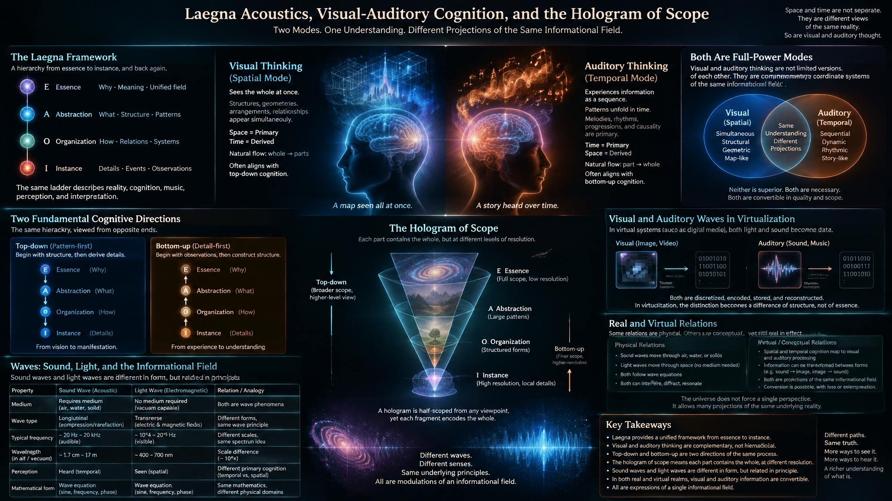
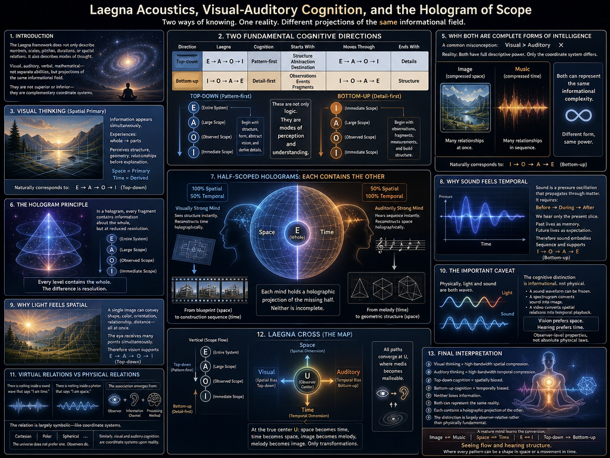

<br>

I asked CoPilot, that as I updated lacustics.md, I also need some back-up in this longer article (as you see I use "human-readable" names for these, so you can mentally filter them out if looking for plain data and it's minimal docs available in simple-filenamed files):

> In what is below, I added top-down and bottom-up dimensions, and explanations of visual vs. auditory thinking and how both are full-power modes in converible quality and scope, one in time and other in space. I used to be more of visual, but now I am more balanced as I understand the flow of these realms more. Can you give an md code block article, explain it all, and also the hologram of half-scoped and how this relates to physical sound wave vs. light wave or other waves, either in virtualization or in some of their real relations or property-relations, which is rather virtual?

# Laegna Acoustics, Visual-Auditory Cognition, and the Hologram of Scope

## Introduction

One of the most interesting consequences of the Laegna framework is that it does not merely describe numbers, scales, pitches, durations, or spatial relations. It also naturally describes different modes of thought.

Traditionally, people often divide cognition into:

- Visual thinkers.
- Auditory thinkers.
- Verbal thinkers.
- Mathematical thinkers.

However, these are often treated as separate abilities.

The Laegna view suggests something different:

> They are different projections of the same informational field.

Just as time and space are different projections of spacetime, visual and auditory cognition can be viewed as different projections of understanding itself.

Neither is superior.

They are complementary coordinate systems.

---

# Two Fundamental Cognitive Directions

The two primary directions are:

| Direction | Laegna | Cognition |
|------------|------------|------------|
| Top-down | E → A → O → I | Pattern-first |
| Bottom-up | I → O → A → E | Detail-first |

Top-down cognition begins with:

- structure
- form
- abstraction
- destination

and then derives details.

Bottom-up cognition begins with:

- observations
- events
- fragments
- measurements

and then constructs structure.

Thus:

```text
E
↓
A
↓
O
↓
I
```

and:

```text
I
↑
O
↑
A
↑
E
```

describe not only logic.

They describe perception.

---

# Visual Thinking

Visual cognition is naturally spatial.

Instead of experiencing information as a sequence, information appears simultaneously.

A visual thinker often experiences:

```text
whole → parts
```

rather than:

```text
part → whole
```

They perceive:

- structures
- geometries
- arrangements
- relationships

before perceiving explanation.

For visual cognition:

```text
Space = Primary
Time = Derived
```

The observer sees the entire map first.

The path is discovered later.

This naturally corresponds to:

```text
E
A
O
I
```

Top-down.

---

# Auditory Thinking

Auditory cognition is naturally temporal.

Music cannot be heard all at once.

Speech cannot arrive all at once.

A melody requires sequence.

Thus auditory thought experiences:

```text
part → whole
```

The pattern emerges from flow.

For auditory cognition:

```text
Time = Primary
Space = Derived
```

A musician may understand a structure only after hearing its progression.

A storyteller explains reality through unfolding events.

This naturally corresponds to:

```text
I
O
A
E
```

Bottom-up.

---

# Why Both Are Complete Forms of Intelligence

A common misconception is:

```text
Visual = more complete
Auditory = less complete
```

This is false.

Both possess full descriptive power.

The difference is coordinate system.

Mathematically:

```text
Image => compressed space
Music => compressed time
```

An image contains many relationships simultaneously.

A melody contains many relationships sequentially.

Both can represent the same informational complexity.

---

# The Hologram Principle



In a hologram:

Every small piece contains information about the whole.

Yet it contains it with reduced precision.

This resembles Laegna scope.

Suppose:

```text
Entire System = E
```

A fragment becomes:

```text
A
```

Smaller fragment:

```text
O
```

Smaller fragment:

```text
I
```

Yet every level still contains information regarding the whole.

The difference is resolution.

---

# Half-Scoped Holograms

This introduces an important concept.

A mind may possess:

```text
100% temporal scope
50% spatial scope
```

or:

```text
50% temporal scope
100% spatial scope
```

Neither is incomplete.

Each contains a holographic representation of the missing half.

Visual thinkers frequently reconstruct temporal flow from spatial form.

Auditory thinkers reconstruct spatial form from temporal flow.

For example:

A visual thinker may look at:

```text
Blueprint
```

and instantly imagine:

```text
Construction sequence
```

An auditory thinker may hear:

```text
Melody
```

and instantly imagine:

```text
Geometric structure
```

Each reconstructs the missing dimension.

This is holographic cognition.

---

# Why Sound Feels Temporal

Physical sound is fundamentally a pressure oscillation.

It propagates through matter.

A sound wave requires:

```text
Before
During
After
```

Therefore sound naturally embodies:

```text
Sequence
```

Its geometry unfolds in time.

A listener receives only the current slice.

The past survives as memory.

The future survives as expectation.

Therefore sound naturally supports:

```text
I → O → A → E
```

Bottom-up accumulation.

---

# Why Light Feels Spatial

Vision differs.

A single image may convey:

- shape
- color
- orientation
- relationship
- distance

simultaneously.

The eye receives many points at once.

Thus vision naturally supports:

```text
E → A → O → I
```

Top-down decomposition.

An entire scene can arrive in one instant.

---

# The Important Caveat

Physically:

Light and sound are both waves.

The cognitive distinction is mostly not physical.

It is informational.

For example:

A sound waveform can be frozen.

A spectrogram converts sound into image.

Likewise:

A video converts spatial relations into temporal playback.

Therefore:

```text
Light ≠ Space
Sound ≠ Time
```

strictly speaking.

Instead:

```text
Vision prefers space.
Hearing prefers time.
```

These are observer-level properties.

Not absolute physical laws.

---

# Virtual Relations vs Physical Relations

Many relations in cognition are virtual rather than physical.

For example:

There is nothing inside a sound wave that says:

```text
I am time.
```

There is nothing inside a photon that says:

```text
I am space.
```

The association emerges from:

```text
Observer
+
Information Channel
+
Processing Method
```

The relation is therefore largely symbolic.

This is similar to coordinate systems:

```text
Cartesian
Polar
Spherical
```

The universe does not prefer one.

Observers do.

Likewise:

```text
Visual cognition
Auditory cognition
```

are coordinate systems upon reality.

---

# Laegna Cross

Putting everything together:

```text
           E
      (Top-down)

A  ← Scope →  O

      (Observer)

           I
     (Bottom-up)
```

and:

```text
          Space
             ↑
             |
Visual -------+------- Auditory
             |
             ↓
            Time
```

Yet the true center is:

```text
U
```

where:

- space becomes time,
- time becomes space,
- image becomes melody,
- melody becomes image.

The observer no longer experiences separate media.

Only transformations.

---

# Final Interpretation

In the strongest interpretation of the Laegna framework:

- Visual thinking is high-bandwidth spatial compression.
- Auditory thinking is high-bandwidth temporal compression.
- Top-down cognition is spatially biased.
- Bottom-up cognition is temporally biased.
- Neither loses information.
- Both can represent the same reality.
- Each contains a holographic projection of the other.
- The distinction is largely observer-relative rather than physically fundamental.

This means a mature thinker does not become purely visual or purely auditory.

Instead they learn the conversion:

```text
Image ⇄ Music
Space ⇄ Time
E ⇄ I
Top-down ⇄ Bottom-up
```

At that point, the mind operates closer to the Laegna center:

```text
            ◉

      seeing flow
           and
      hearing structure
```

where every pattern can be viewed as a shape in space or a movement in time, and the difference becomes primarily one of perspective rather than substance.
