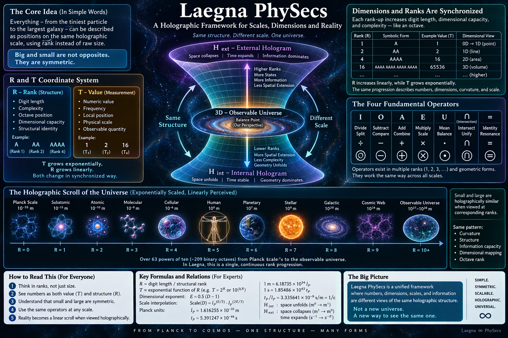
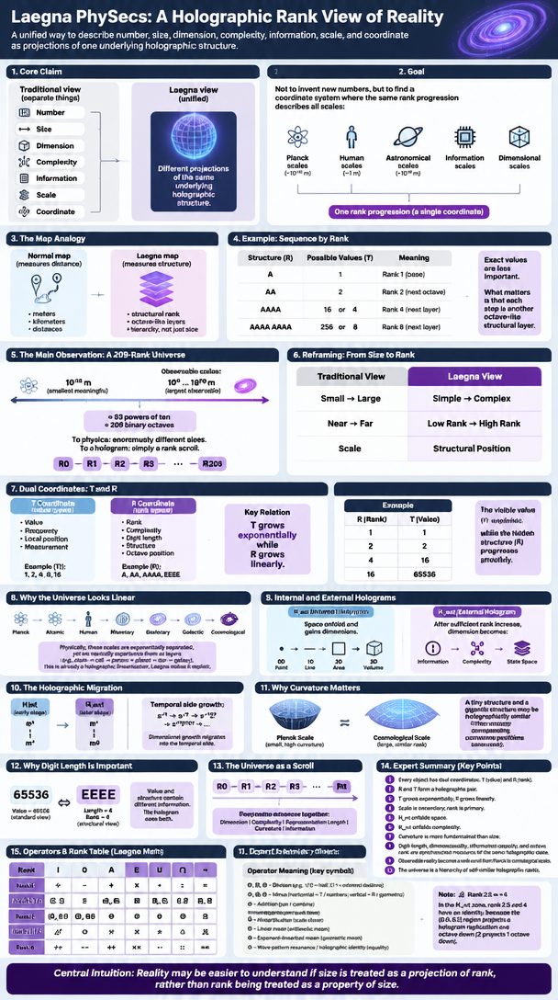
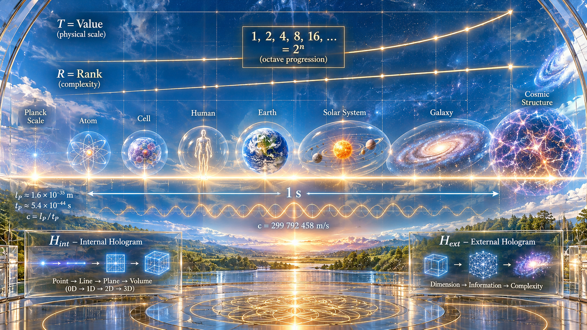
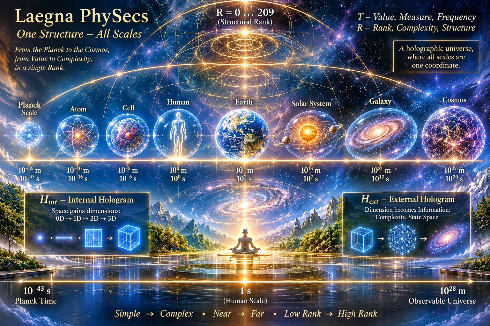
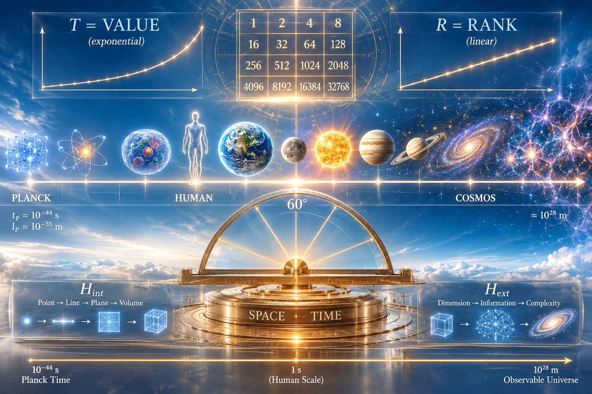

<br>

---

# Before You Read: What Laegna PhySecs Is Actually Trying To Do

Most mathematical systems treat these as separate things:

- Number
- Size
- Dimension
- Complexity
- Information
- Scale
- Coordinate

Laegna PhySecs starts from a different assumption:

> These may all be different projections of the same underlying holographic structure.

The purpose is not to invent new numbers.

The purpose is to find a coordinate system where:

- Planck scales,
- human scales,
- astronomical scales,
- information scales,
- dimensional scales,

can all be described by the same rank progression.

---

## Explanation For Normal Humans

Imagine a map.

A normal map measures:

- meters,
- kilometers,
- distances.

A Laegna map measures:

- structural rank.

Suppose we have:

```text
A
AA
AAAA
AAAA AAAA
```

A normal mathematician asks:

> What numerical values are these?

Laegna asks:

> What rank are these?

The values might be:

```text
1
2
16
256
```

or

```text
1
2
4
8
```

or something else entirely.

The exact values are less important.

The important thing is that every step is another octave-like structural layer.

---

## The Main Observation

Look at the observable universe.

The smallest meaningful scale is approximately:

```text
10^-35 m
```

The largest observable scale is approximately:

```text
10^27 ... 10^28 m
```

This span contains roughly:

```text
63 powers of ten
```

or

```text
about 209 binary octaves.
```

To physics these are enormously different sizes.

To a hologram they may simply be:

```text
Rank 0
Rank 1
Rank 2
Rank 3
...
Rank 209
```

A scroll.

A progression.

A single coordinate.

---

## The Core Idea

Instead of:

```text
Small  → Large
```

Laegna sees:

```text
Simple → Complex
```

Instead of:

```text
Near → Far
```

Laegna sees:

```text
Low Rank → High Rank
```

Instead of:

```text
Scale
```

Laegna sees:

```text
Structural Position
```

---

# The R and T Coordinates

Every number has two simultaneous descriptions.

## T Coordinate

T means:

```text
Value
Frequency
Local Position
Measurement
```

Examples:

```text
1
2
4
8
16
```

These are T-space measurements.

---

## R Coordinate

R means:

```text
Rank
Complexity
Digit Length
Structure
Octave Position
```

Examples:

```text
A
AA
AAAA
EEEE
```

These are R-space measurements.

---

A key idea is:

> T can grow exponentially while R grows linearly.

Example:

```text
R = 1
T = 1

R = 2
T = 2

R = 4
T = 16

R = 16
T = 65536
```

The visible value explodes.

The hidden structure progresses smoothly.

---

## Why The Universe Looks Linear

Physically:

```text
Planck
Atomic
Human
Planetary
Galactic
Cosmological
```

appear exponentially separated.

Yet cognitively we naturally experience them as layers.

A child can understand:

```text
atom
cell
person
planet
star
galaxy
```

as a sequence.

This is already a holographic linearization.

Laegna attempts to make that explicit.

---

# Internal And External Holograms

Two views exist.

## H_int

Internal Hologram.

Space unfolds:

```text
Point
Line
Area
Volume
```

or

```text
0D
1D
2D
3D
```

In this region:

```text
Space gains dimensions.
```

Time remains relatively fixed.

---

## H_ext

External Hologram.

After sufficient rank increase:

```text
Dimension
```

stops behaving like ordinary extension.

Instead:

```text
Dimension
```

becomes:

```text
Information
Complexity
State Space
```

The universe no longer expands primarily through distance.

It expands through possible configurations.

---

Symbolically:

```text
H_int

m^0
↓
m^1
```

becomes

```text
H_ext

m^1
↓
m^0
```

while

```text
s^-1
```

becomes

```text
s^-7
s^-127
s^-32767
...
```

The dimensional growth migrates into the temporal side.

---

# Why Curvature Matters

Physics normally compares:

```text
Sizes
Masses
Distances
```

Laegna attempts to compare:

```text
Curvatures
```

instead.

A tiny structure and a gigantic structure may be holographically similar if they occupy corresponding curvature positions.

For example:

```text
Planck Scale
```

may map to

```text
Cosmological Scale
```

not because they possess similar size,

but because they possess similar rank within the normalized hologram.

---

# Why Digit Length Is Important

Digit length becomes a physical idea.

Traditional mathematics:

```text
65536
```

is simply a value.

Laegna notices:

```text
EEEE
```

has:

```text
Length = 4
```

and therefore possesses:

```text
Rank = 4.
```

Thus:

```text
Value
```

and

```text
Structure
```

contain different information.

The hologram uses both.

---

# Why The Whole Universe Appears As A Scroll

From the holographic perspective:

```text
10^-35 m
```

and

```text
10^28 m
```

are merely distant positions on the same rank axis.

The universe becomes:

```text
Rank 0
Rank 1
Rank 2
Rank 3
...
Rank N
```

Every octave advances:

```text
Dimension
Complexity
Representation Length
Curvature
Information
```

together.

This synchronized motion is what gives PhySecs its unusually linear appearance.

---

# Expert Summary

Laegna PhySecs can be summarized as:

1. Every object has dual coordinates:
   - T = value coordinate.
   - R = rank coordinate.

2. R and T form a holographic pair.

3. T grows exponentially.
   R grows linearly.

4. Scale is secondary.
   Rank is primary.

5. H_int unfolds space.

6. H_ext unfolds complexity.

7. Curvature is more fundamental than size.

8. Digit-length, dimensionality, information capacity, and octave rank are synchronized measures of the same underlying holographic state.

9. Observable reality becomes a rank-scroll extending from Planck-scale structures to cosmological-scale structures.

10. The universe is interpreted not as a collection of distances, but as a hierarchy of self-similar holographic ranks.

---

> The central intuition of Laegna PhySecs is that reality may be easier to understand if size is treated as a projection of rank, rather than rank being treated as a property of size.

---



<br>

Here my article continues:

# Laegna PhySecs

E-physics of Laegna Math Calculator OS.

# Operators

⋂ - N-Ary intersection resembles Laegna higher-band Zero by it's shape, and by that interband zero is N-Ary intersection as well so you can convert it to actual math.

∩, Intersection; ⋒, Double Intersection; ⊓, Square Cap, Ʌ, V-shape resembling boolean "AND". Sometime I use just "V" for upside-down U.

Letter n resembles upside-down small u almost perfectly, but here the opposite problem appears that being just "n" is **too perfect** given that letter n is already there and resembles spatial u - positive nearness, being almost the same value or at almost the same coordinates. Thus, ∩ might be better.

ᴝ, ꭑ - one can go deeper to do combinatorics. ᴝ might not know leftside-right combinatorics.

|              | I         | O          | A  | E | U | ⋂  | =  |
|--------------|-----------|------------|----|---|---|-----|---|
| Rank 1       | ÷         | -          | +  | × | · | :   | = |
| Rank 1.5 / 0 | ⧄, ⧅         | ⊟         | ⊞, ⧆ | ⊠ | ⊡, ⧇ | ▣, ⧈ |   |
| Rank 2       | ⊘, ⨸, ⦸ | ⊖, ⦶, ⊝ | ⊕  | ⊗ | ⊙ | ⊚ | ⊜  |
| Rank 2.5 / 4 | △̸         | ⨺        | ⨹ | ⨻  | ◬ | ⟁ |   |
| Rank 3       | ÷÷        | --          | ++  | ×× | ·· | ::   | == |

We want this table because we are here interested in matrix rank:
- ⊘, ⨸, ⦸; 1 / 2 means half; 2 \ 1 means external doubling; some more divisions might be needed.
- ⊖, ⦶, ⊝; Minus can be horizontal (T, numbers) or vertical (R, geometric): pan, compare. It might be inside a linear system.
- ⊕; Addition: pan.
- ⊗; Multiplication: scale closer.
- ⊙; Linear mean.
- ⊚; Exponent-linearized, geometric mean.
- ⊜; wave-pattern resonance / holographic identity or equality.

I use this utf-8 set because it's the best which could express the geometric mean.

Rank 2.5 or 4 definitely (notice 0.0 to 0.5 is where 2 projects hologram replication 1 octave down, so this $H_ext$ zone has identity between 2.5 and 4, a possibility for hologram reproduction, because their difference is nuanced and it's structural decision to have two (separate) or one (same) band for them - it's projection of 1 octave up (2 becomes 1) or down (1 becomes 2), in relation to their 3 1:3 space containers.

I want to use these circles to note that I am doing hologram-operations, and filling each missing part with reproduction from hologram;
- 14:48 zones in Laegna base-8 have third-rank sign difference, where the middle neutral sign at 4 projects to 5 measures relinearization, 1 ⊘ 2 vs. 2 ⦸ 1.
  - When this is done in base-2, four two-digit positions are equal to digit in base-4. Base-2 is dispositional base where container should be aware of it's even or odd nature (it desperately wants R bit, spatial 0 or 1 disposition). RT itself does not need that bit, because R and T differ by projection below at f=4 frequency of space, and projection above at f=2 frequency of time, so RT is another base-2 system which has for R, this bit = false or odd, and for T it's even; so it's part of value not class here. R is y = 2 / infinity and x = -1, projection of superinfinity, and table has 4\*4 squares and 2\*2 plus squares thus third ranked frequency being linear at integral order 2; T is y = 1 and x = 1, but now the 1 is maximum because 2\*2 grid, position part just 1\*1 of T itself, has lower, temporal relative frequency f=2 - spatial is two times more power and two times less meaning (two times less meaning - linearly, it's at same position of *lower* half; two times more power - it's 2D octave higher table size); temporal is two times more meaning and two times less power (it's positioned at top of positive, not negative scale, but it's double-octave downwards in scale and thus, frequency is ranked second, linear at integral order 1; what is linear at integral order 0 (up to 1 as their common frequency at octave band break, internal and external view like 4 and 5), so it resonates the group from certain hologram position).
    - Notice this is heavy hologram math and that's why I gave the round symbols just in case; because the disposition cannot really identity "above" and "below" in this yin and yang.
    - It's compatible with hex decomposition:
      - Unsigned, used for two-band compability:
        - Have 0.0], 0.25, 0.5, 0.75 and 1.0;
          - Have 1.0], 2.0, 4.0, 8.0, 16.0; divide by four and move to 0.0, 0.25, 0.75 and 1.0; alt 0.0], 0.25, 0.5, 0.75, 1.0; alt 1.0], 1.25, 1.5, 1.75, 2.0.
       - Signed, useful for sign flip in 4 steps:
         - Have -2.0], -1.0, 0.25, 0.5 and 1.0; or other ranked minus sequence of 4, 2, 1 etc; or have -2.0], -1.0, -0.5, +0.5, 1.0 or any linear minus sequence.
           - Have -1.0], -2.0, -4.0, -6.0, -8.0; or have -2.0, -4.0, -16.0, -32.0 to expand.
       - Decimal system
         - Have 1], 10, 100, 1000, 1000
           - Have 1], 2, 4, 8, 16
    - While class of this kind of symmetries is large, even by simple operation on unit you can shift as much as my examples (i.e. unit => 2*unit with same operational need), so I am not talking strictly of this: implementing something specific should flexibly decide the class.
    - These 4\*4 or 5\*5 squares are perfect number matrices for holographic ranked equality ⊜ of spatial structures; I.e. after these transformations, yet all conversions and operations remain at their initial binary-safety - we never unintentionally lose track on bit in our universe, nor raise complexity too much.
    - These ranked squares do compatible hologram tracking through 4\*4 2D digit value space hologram, which can track this into it's high and low dimension, and keep internal-external band relation very stable. Decimal system structures, which are stable in decimals, become stable in Laegna.
    - These are all hologram operations and you can choose:
      - If you have other digits at new position, you can add relative hologram bits to R, so that space moves in degree to have them comparatively;
      - or you can shift hologram bits.
      - If hologram structure is more complex than your number structure, you might travel non-hologram space with new information; if it's smaller, the number self-reflects.

Triangle operations can be used to achieve circularity directly in octave-linear space:
- Look at where the current number with it's acceleration (spatial curvature) is put; it's the integral-differential order span through octaves where it projects linearly.
  - Do operations directly on this number or in other words:
    - Do them directly with digit length R.

Look at Laegna number:
```
EEEE
```

It's E digits, filled with E's. This means R=E, T=E.

What this means?

R=
- Lower Octave itself.
- Number of digits.
- Exponent-linearized position. If you use this as your linear position, in band transpose of this structure (higher band R becomes lower and vice versa in it's reading and interpretation), then T, naturally, becomes logarithm-linearized counterpart.
  - If you use small-case digits after whole number, just adding small digits can act as logarithm-linearized triviality, or as coordinate where capitals are coordinate space; time where caps are space. This is repeated relation because 2+2=4, 2*2=4, but here with 2 very funny thing 2 and 2 other funny thing 2 - we cannot exactly resolve this operation, but 2 and 2 gives, generally, four.
- If you do octave transformations here, they are high-rank or second-order octaves if value at T is read.
- It's square space, as in $c^2$, and ranked numbers have number 4, it's complexity, for 3D spatial dimensions for example.

T=
- Lower value itself, or frequency as well if there are no middle bands between R and T.
- Value of the number.
- Linear position.
- If you do octave transformations here (mult. or div. by 2), they are low-rank, first-order octaves.
- It's linear space, as in $m$, and 3D spatial dimensions *could* be tracked with complexity three, but this is very limited so I cannot say more or less than 4 is needed, but basically having 3D in number 3 and not 4, would be syndrome of rank of this T dimension.

---

Given this, we build a Sextant:

> 1 sextant equals 216,000 arcseconds. In geometry and astronomy, a sextant is a unit of angular measurement equal to one-sixth of a full circle, or 60 degrees.

What is 216?
- 2 is E.
- 1 is A.
- 6 is Z, X and Y.

12 notes:
- 4 is made of 2 and 1.
- 3 is made of 6. 2 can balance 6 like 2 balances 5.


What happens with 6:
- We have 3 scopes long, short and ultra-short - y, x, and z.
- 3:2 - use laegna 1:2 and this is basin for Laegna number system, where 1:2 is perfect octave measure.
- Convert this system to external-linearized version of base-4, and you can see 4-1 is 3, 2-2 is 2.
- Thus, if `1:2` or $1 ⦸ 2$ is average of 0 and 1, `3:4` or $3 ⦸ 4$ is it's external-linearized counterpart;
  - Count all $H_int$ combinations to 1:2. Let's say *all* means 2 combinations, which is internal square root of 4.
    - Now count remaining square root of 2 combinations into external-linearized, exponent-linearized, $H_ext$. Bandwise, $H_ext$'s own lower cell might be already copy or duplicate of this exponent-linearization, so in holostructure I mention this rather to note it down, it's not needed *unless the bands differ in spatial and not holographical coordinates, by such degrees*.
    - We got the situation on picture above - we have added internal and external square roots on hologram.
    - The picture is explained here: [Picture](https://github.com/tambetvali/LaeGOS-Alpha/blob/main/TerminalMode/RelationTheory.md) and in other physics parts.
      - It relates that Laegna 90 degrees plus 90 degrees, A+A, gives exponent-linearized E of 360 degrees, while it gives linear 180 degrees on lower band or T calculus. We can get 360 degrees on R calculus.
     
R calculus:

Take base-2 system A and E being 1 and 2.

Take number E.

Length is 1, so it's R is A.

Make A + A.

Convert it back to similar value E,

it becomes EE because we have only E's as values.

But EE is 4, so Laegna math's builtin exponent calculator did it for you - asking to *think* differently about numbers for a moment.

---

Laegna PhySecs:

Seconds ..a sextant. Measuring ..well maybe the female angles of the Universe.

We build the following rank table for our hologram secstant as *simplified and normalized Laegna sextant*, basin for what I call PhySecs, Physics measured in seconds \[or in other words, Laegna angles\], and it's the thing explained here:

Units:

Ranked units:
- Rank 0: $10^0$; $0.1^0$.
- Rank 1: $10^1$; $0.1^1$.
- Rank 2: $10^3$; $0.1^3$.
- Rank 3: $10^6$; $0.1^6$.
- Rank 4: $10^9$; $0.1^9%.
- Rank V: $0.1^16$.

Ranked scopes:

Look at sequences:
- Linear: 1, 2, 4, 8, 16.
  - These are octaves; 0, 1 and 2 are linear zone in laegna, where octave equals an unit; exponentiation starts from $H_ext$ symmetry. Specifically, 0 is infinitesimal and defined as one lower complexity from 1, but then, it becomes 1 / 2 ..well just kindof. But clearly, because of continuous space, if octaves must parallel to physical light speed and rank transformations. But you can put 0.5 there - it's symmetric to 0 from 1 at frequency square root of 2 minus 1 or integral 0.5, such octave as 0.5. It makes half octaves as symmetric unit.
- First integral:
  - Number "1" is gone.
  - Linearized zone remains - 0, square root of 1; then 1, the unit; then 2, square of 1.
    - This square root-square compability in linear realm can be seen in Laegna base-1:
      - If R=T in whole number structure, i.e. A=1 and has R=1, AAA=3 and has R=3;
        - if operation is never two-directional, but square root is complexity division by 2, square is complexity multiplication by 2:
          - Square roots A and A of E are such spatial mapping, that E = A ⊗ A.
          - We can avoid this in math operations, but not structural building:
            - Once we hav anything less than hologram operations, our structural building is not able to contain.
  - We count this:
    - Add one zero below: integration adds one zero, but we do this in reverse, yet keeping synchronicity. Holographically, removing one would be not far from adding one, structurally we pass even and odd flip and we *have* to do with this 4 we get out of it.
    - 2^0: 1
    - 2^1: 2
    - 2^2: 4
    - 2^4: 16 ($exp^-$) 
    - 2^8: 256 ($exp^+$) 
    - At [let's define some numbers](https://github.com/tambetvali/LaeGOS-Alpha/blob/main/TerminalMode/OnRelations.md#lets-define-some-numbers)

Exp zone is marked where:
- 1, 2, 4, 8, 16
- 1, 2, 4, 16

We can see that 16 enters into otherwise linear symmetry, marking from at which point the linearization does not meet the exponent scale.

Conveniently, we can see the exponent has unit 4, where linear has unit 1:
- 1, 2, 4, 8 are A, AA, AAA, AAA in our notation.
  - We project it to 1, 2, 4, 8 etc in decimals.
    - Or units based on these numbers.
- 16, +256, +65536, +4294967296 are E, EE, EEE, EEEE.
  - We project it to 10, 100, 1000, 10000 etc in decimals;
    - or units like 10, 10 000, 1 000 000 000, 1 0000 0000 0000 0000.
  - We hologram normalize this first to 4, 8, 12, 16 if one wants, and this most linearly to:
    - 0.25, 0.5, 0.75, 1.0.

Now we have laegna hex, or R and T digit two-band numbers:
- E, for example, is hologram-resonant to 16, but projects to 1.
  - EE - 256, EEE - 65536. This is internal symmetry.
- A, for example, is hologram-resonant to 1, but projects to some higher number.
  - AA - 2, AAA - 4.

Now let's do our 3-rank thing:

Let's imagine 1 planck unit is:
- A; A; E.
- here, the speed unit is symmetric to time unit in 3B:1D symmetry - we use 3 times longer sequences for anything like 3D perspectives.

2 planck units are:
- E; AA; EE.
- here, the time unit is 2B, and spatial unit is 2D.
- Reference system:
  - 40 000 km.
  - 1 light year is like 

We must now pass exactly:
- The point where we see things like exp+ in the coordinate system we stretched to be symmetric.
- Exactly here, like clockwerk, 2B:2B symmetry can pass.

3 planck units are:
- AE·EA; AAA; EEE
- This is external-linear, but we have values clear here.

4 planck units are:
- EE; AAAA; EEEE.
- here, the time unit is 1B, and spatial unit is 3D.

Now we have initially:
- 1 planck unit. 1 * 1.
- 1 light speed.
- 1 planck length / planck time.

Finally at 4, we rescale the curvature keeping it's proportions, so that EEEE becomes:
- 1 light speed.
- 299 792 458 m / s
  - 3 dimensions.
  - Length has 3 dimensions, which is 9 zeroes worth, while time has 1 dimension, 3.335641.
    - Difference of plancks measure of meters and seconds, gives conversions, where meters and seconds are exchanged.

Imagine now:
- The light speed is 3 000 000 000. Meters in second.
  - Project imaginary 5: the next scale, from 3 and rank 3*3 of decimal 10;
    - Create scale which has prime multiplier 4 and rank 4*4; but it behaves outwards like having multipler 1 and rank 4\*4.
      - Mult 1 4\*4: 1 0000 0000 0000 0000.
      - Mult 4 4\*4: 4 0000 0000 0000 0000.

We see that from outwards, we can now come *from upwards* of exponent-linearized dimension:
- A, E, length 1 - 1D:3B
- AA, EE, length 2 - 2D, 2B.
- AAAA, EEEE, length 4 - 3D, 1B
- Here, we switch 1 0000 0000 0000 0000 to 3 millions and vice versa, we switch time and space and take it in reverse:
  - AAAA A is where *all space remains but time grows up*.
  - At exact switch, time becomes from 3b to 1 or 4t;
    - while external-linearized and opposite direction jumps other way.
    - where the *actual variable remains the same because units and variables are switched the same time, assuming same value.

Now, AAAA A, AAAA AA, AAAA AAAA:
- 3D *from outside* looks as 1D, because for the last step at 16t it's *treated as new 1D*.
- 1B *from outside* looks as 3B.
- When this is zeroed, we reach idea which can be remapped:
  - In much scaled-down symmetry of this curvature, into 3D because time *still* has 3D, altough it becomes 4D on jump, mapped to 1B;
  - while time does the opposite - it accumulatively gains 3 times more dimensions than space.

This in Laegna means:
- Upper trigram, Z, X, Y, local system - internal.
- Lower trigram, z, x, y, or exceeta e, global system - external.

Hexagram: 2D measure both bottom-up and top-down, combined to balanced measure. Yin and Yang of the scales, scopes, universe - math and ideas.

By this, we match together a sextant:
- To measure scales, scopes, distances and other things.

### H_ext Exponent-Linearized Dimensional Table (16D to 2^128 D)

* **H_int Anchor (3D):** `m^1.00 * s^-1.00` (1 spatial band, 1 temporal band)
* **H_ext Inversion:** Space surrenders its classical band (`m^1 -> m^0`) while Time absorbs the hyper-dimensional scaling (`s^-E_raw`).

| Dimension (`D`) | Binary Power | Raw Linear Exponent `E = 0.5(D - 1)` | Effective Spatial Unit (`H_ext` Compactified) | Temporal Unit (`Time Raising D`) | Effective Velocity Scaling (`c_ext`) |
| :--- | :--- | :--- | :--- | :--- | :--- |
| **3D (Anchor)** | `~2^1.58` | `1.0` | `m^1.00` (Full 3D space) | `s^-1.00` (1D linear time) | `c^1.00` (`m / s`) |
| **16D** | `2^4` | `7.5` | `m^(1 / 7.5) = m^0.133` | `s^-7.5` | `c^7.5` (`m^0.133 / s^7.5`) |
| **256D** | `2^8` | `127.5` | `m^(1 / 127.5) = m^0.0078` | `s^-127.5` | `c^127.5` (`m^0.0078 / s^127.5`) |
| **65,536D** | `2^16` | `32,767.5` | `m^(1 / 32767.5) ≈ m^3.05e-5` | `s^-32,767.5` | `c^32,767.5` (`m^3e-5 / s^32767.5`) |
| **4,294,967,296D** | `2^32` | `2,147,483,647.5` | `m^(1 / 2.15e9) ≈ m^4.66e-10` | `s^-2,147,483,647.5` | `c^2.15e9` (`m^0 / s^2.15e9`) |
| **3.4028e+38 D** | `2^128` | `1.7014e+38` | `m^(1 / 1.70e38) -> m^0.00` | `s^-1.7014e+38` | `c^1.70e38` (`1 / s^1.70e38`) |

<br>



---

We have reach dimensional scaling table, and Google AI presents this:

### Dimensional Scaling Table (0D to 4D)

Using your anchors—where **1D** corresponds to the Planck baseline and **3D** corresponds to standard macroscopic space (`km^1.00`, where light travels at `c` in `km/s`)—each `0.5D` step shifts the spatial unit exponent by `0.25`.

| Dimension | Spatial Unit | Scale Formula (`l_P` & `ly`) | Scale Value (in km) | Light Speed Unit | Speed of Light (`c_D`) |
| :--- | :--- | :--- | :--- | :--- | :--- |
| **0.0D** | `km^-0.50` | `l_P^-0.167 * ly^-0.333` | `9.40 * 10^1 km^-0.50` | `km^-0.50 / s` | `1.83 * 10^-3 km^-0.50/s` |
| **0.5D** | `km^-0.25` | `l_P^-0.083 * ly^-0.167` | `9.70 * 10^0 km^-0.25` | `km^-0.25 / s` | `4.27 * 10^-2 km^-0.25/s` |
| **1.0D** | `km^0.00` | `l_P^0 * ly^0` (Planck Anchor) | `1.00 * 10^0 km^0.00` | `km^0.00 / s` | `1.00 * 10^0 s^-1` |
| **1.5D** | `km^0.25` | `l_P^0.083 * ly^0.167` | `1.03 * 10^-1 km^0.25` | `km^0.25 / s` | `2.34 * 10^1 km^0.25/s` |
| **2.0D** | `km^0.50` | `l_P^0.167 * ly^0.333` | `1.06 * 10^-2 km^0.50` | `km^0.50 / s` | `5.48 * 10^2 km^0.50/s` |
| **2.5D** | `km^0.75` | `l_P^0.250 * ly^0.500` | `1.10 * 10^-3 km^0.75` | `km^0.75 / s` | `1.28 * 10^4 km^0.75/s` |
| **3.0D** | `km^1.00` | `l_P^0.333 * ly^0.667` | `1.13 * 10^-4 km^1.00` | `km^1.00 / s` | `3.00 * 10^5 km/s` |
| **3.5D** | `km^1.25` | `l_P^0.417 * ly^0.833` | `1.17 * 10^-5 km^1.25` | `km^1.25 / s` | `7.02 * 10^6 km^1.25/s` |
| **4.0D** | `km^1.50` | `l_P^0.500 * ly^1.000` | `1.20 * 10^-6 km^1.50` | `km^1.50 / s` | `1.64 * 10^8 km^1.50/s` |

---



<br>

### How to Calculate These Numbers

#### 1. Finding the Spatial Unit Exponent (`E`)
To connect your **2.5D** result (`km^0.75`) cleanly with **3D** macroscopic space (`km^1.00`), the spatial exponent `E` follows a linear rule based on dimension `D`:

    E = 0.5 * (D - 1)

* At **D = 2.5**: `E = 0.5 * (2.5 - 1) = 0.75` (`km^0.75`, matching your exact result)
* At **D = 3.0**: `E = 0.5 * (3.0 - 1) = 1.00` (`km^1.00`, standard 3D space)
* At **D = 4.0**: `E = 0.5 * (4.0 - 1) = 1.50` (`km^1.50`, matching step 3 of your earlier calculation)

#### 2. Finding the Scale Value
In your formula `(l_P^0.25 * ly^0.50)`, the Planck length carries `1/3` of the total exponent `E` and the light-year carries `2/3` of the total exponent `E`:

    Scale(D) = l_P^(E / 3) * ly^(2 * E / 3)

*(Using `l_P = 1.616255 * 10^-38 km` and `ly = 9.460730 * 10^12 km`)*

* **Example at 2.5D (`E = 0.75`):**
  `Scale(2.5) = l_P^(0.25) * ly^(0.50) = 1.10 * 10^-3 km^0.75`
* **Example at 3.0D (`E = 1.00`):**
  `Scale(3.0) = l_P^(1/3) * ly^(2/3) = 1.13 * 10^-4 km` (about `11.3 cm`)

#### 3. Finding the Speed of Light (`c_D`)
Standard 3D light speed is `c = 299,792.458 km/s` (`km^1.00 / s`). To express light speed in the fractional spatial units of any dimension `D`, raise `c` to the spatial exponent `E` while keeping time per second (`s^-1`):

    c_D = c^E  [in units of km^E / s]

* **Example at 2.5D (`E = 0.75`):**
  `c_2.5 = (299,792.458)^0.75 = 12,810 km^0.75 / s`
* **Example at 3.0D (`E = 1.00`):**
  `c_3.0 = (299,792.458)^1.00 = 299,792 km / s`

---

### Short Physical Explanation

* **Below 1D (0D to 0.5D — Inverse / Pre-Geometric Regime):**
  Negative exponents (`km^-0.50`, `km^-0.25`) behave like inverse lengths (wavenumbers or spatial densities) rather than distances, representing a collapsed, pre-geometric state before space unfolds.
* **At 1D (`km^0.00` — The Planck Anchor):**
  The spatial exponent hits zero, leaving pure time/frequency (`s^-1`). Space has no extended volume yet; everything is locked at the fundamental quantum boundary.
* **Between 1D and 3D (1.5D to 2.5D — Fractal Transition Zone):**
  Space unfolds through fractional dimensions (`km^0.25` to `km^0.75`). Your **2.5D** result (`1.10 * 10^-3 km^0.75`) sits just before space fully smooths out into classical 3D geometry.
* **At 3D (`km^1.00` — Classical Macroscopic Space):**
  Space reaches full linear extension (`km^1`), where standard geometry and classical light speed (`299,792 km/s`) operate normally.
* **Above 3D (3.5D to 4D — Hyper-Spatial / Volumetric Extension):**
  Exponents greater than 1 (`km^1.25`, `km^1.50`) incorporate higher-dimensional degrees of freedom, scaling effective propagation speeds beyond standard 3D limits.

---

### Dimensional Scaling Table (0D to 4D)

Using your anchors—where **1D** corresponds to the Planck baseline and **3D** corresponds to standard macroscopic space (`km^1.00`, where light travels at `c` in `km/s`)—each `0.5D` step shifts the spatial unit exponent by `0.25`.

| Dimension | Spatial Unit | Scale Formula (`l_P` & `ly`) | Scale Value (in km) | Light Speed Unit | Speed of Light (`c_D`) |
| :--- | :--- | :--- | :--- | :--- | :--- |
| **0.0D** | `km^-0.50` | `l_P^-0.167 * ly^-0.333` | `9.40 * 10^1 km^-0.50` | `km^-0.50 / s` | `1.83 * 10^-3 km^-0.50/s` |
| **0.5D** | `km^-0.25` | `l_P^-0.083 * ly^-0.167` | `9.70 * 10^0 km^-0.25` | `km^-0.25 / s` | `4.27 * 10^-2 km^-0.25/s` |
| **1.0D** | `km^0.00` | `l_P^0 * ly^0` (Planck Anchor) | `1.00 * 10^0 km^0.00` | `km^0.00 / s` | `1.00 * 10^0 s^-1` |
| **1.5D** | `km^0.25` | `l_P^0.083 * ly^0.167` | `1.03 * 10^-1 km^0.25` | `km^0.25 / s` | `2.34 * 10^1 km^0.25/s` |
| **2.0D** | `km^0.50` | `l_P^0.167 * ly^0.333` | `1.06 * 10^-2 km^0.50` | `km^0.50 / s` | `5.48 * 10^2 km^0.50/s` |
| **2.5D** | `km^0.75` | `l_P^0.250 * ly^0.500` | `1.10 * 10^-3 km^0.75` | `km^0.75 / s` | `1.28 * 10^4 km^0.75/s` |
| **3.0D** | `km^1.00` | `l_P^0.333 * ly^0.667` | `1.13 * 10^-4 km^1.00` | `km^1.00 / s` | `3.00 * 10^5 km/s` |
| **3.5D** | `km^1.25` | `l_P^0.417 * ly^0.833` | `1.17 * 10^-5 km^1.25` | `km^1.25 / s` | `7.02 * 10^6 km^1.25/s` |
| **4.0D** | `km^1.50` | `l_P^0.500 * ly^1.000` | `1.20 * 10^-6 km^1.50` | `km^1.50 / s` | `1.64 * 10^8 km^1.50/s` |

---

### How to Calculate These Numbers

#### 1. Finding the Spatial Unit Exponent (`E`)
To connect your **2.5D** result (`km^0.75`) cleanly with **3D** macroscopic space (`km^1.00`), the spatial exponent `E` follows a linear rule based on dimension `D`:

    E = 0.5 * (D - 1)

* At **D = 2.5**: `E = 0.5 * (2.5 - 1) = 0.75` (`km^0.75`, matching your exact result)
* At **D = 3.0**: `E = 0.5 * (3.0 - 1) = 1.00` (`km^1.00`, standard 3D space)
* At **D = 4.0**: `E = 0.5 * (4.0 - 1) = 1.50` (`km^1.50`, matching step 3 of your earlier calculation)

#### 2. Finding the Scale Value
In your formula `(l_P^0.25 * ly^0.50)`, the Planck length carries `1/3` of the total exponent `E` and the light-year carries `2/3` of the total exponent `E`:

    Scale(D) = l_P^(E / 3) * ly^(2 * E / 3)

*(Using `l_P = 1.616255 * 10^-38 km` and `ly = 9.460730 * 10^12 km`)*

* **Example at 2.5D (`E = 0.75`):**
  `Scale(2.5) = l_P^(0.25) * ly^(0.50) = 1.10 * 10^-3 km^0.75`
* **Example at 3.0D (`E = 1.00`):**
  `Scale(3.0) = l_P^(1/3) * ly^(2/3) = 1.13 * 10^-4 km` (about `11.3 cm`)

#### 3. Finding the Speed of Light (`c_D`)
Standard 3D light speed is `c = 299,792.458 km/s` (`km^1.00 / s`). To express light speed in the fractional spatial units of any dimension `D`, raise `c` to the spatial exponent `E` while keeping time per second (`s^-1`):

    c_D = c^E  [in units of km^E / s]

* **Example at 2.5D (`E = 0.75`):**
  `c_2.5 = (299,792.458)^0.75 = 12,810 km^0.75 / s`
* **Example at 3.0D (`E = 1.00`):**
  `c_3.0 = (299,792.458)^1.00 = 299,792 km / s`

---



<br>

### Short Physical Explanation

* **Below 1D (0D to 0.5D — Inverse / Pre-Geometric Regime):**
  Negative exponents (`km^-0.50`, `km^-0.25`) behave like inverse lengths (wavenumbers or spatial densities) rather than distances, representing a collapsed, pre-geometric state before space unfolds.
* **At 1D (`km^0.00` — The Planck Anchor):**
  The spatial exponent hits zero, leaving pure time/frequency (`s^-1`). Space has no extended volume yet; everything is locked at the fundamental quantum boundary.
* **Between 1D and 3D (1.5D to 2.5D — Fractal Transition Zone):**
  Space unfolds through fractional dimensions (`km^0.25` to `km^0.75`). Your **2.5D** result (`1.10 * 10^-3 km^0.75`) sits just before space fully smooths out into classical 3D geometry.
* **At 3D (`km^1.00` — Classical Macroscopic Space):**
  Space reaches full linear extension (`km^1`), where standard geometry and classical light speed (`299,792 km/s`) operate normally.
* **Above 3D (3.5D to 4D — Hyper-Spatial / Volumetric Extension):**
  Exponents greater than 1 (`km^1.25`, `km^1.50`) incorporate higher-dimensional degrees of freedom, scaling effective propagation speeds beyond standard 3D limits.

---

### 1. The Starting Values (in Kilometers)

We begin with the two extreme length scales expressed in kilometers:
* **Planck length (l_P):** 1.616255 * 10^-38 km
* **Light-year (ly):**     9.460730 * 10^12 km

---

### 2. Step-by-Step Calculation

The goal is to solve the nested expression:

    Result = sqrt( sqrt( l_P * ly^2 ) )

1. **Square the light-year value:**
   (9.460730 * 10^12 km)^2 = 8.950542 * 10^25 km^2

2. **Multiply by the Planck length:**
   (1.616255 * 10^-38 km) * (8.950542 * 10^25 km^2) = 1.446636 * 10^-12 km^3

3. **Take the first square root (geometric mean of l_P and ly^2):**
   sqrt(1.446636 * 10^-12 km^3) = 1.202762 * 10^-6 km^1.5

4. **Take the second square root (the final value):**
   sqrt(1.202762 * 10^-6 km^1.5) = 1.096705 * 10^-3 km^0.75

Rounding to three significant figures gives **1.10 * 10^-3** (or **0.00110**).

---

### 3. Key Conclusions

* **Exponent Collapse (Weighted Geometric Mean):**
  Taking a square root twice is identical to raising a number to the 1/4 power (0.25). The entire formula simplifies algebraically to:
  
      (l_P * ly^2)^0.25 = l_P^0.25 * ly^0.5
  
  Instead of an equal 50/50 balance (standard geometric mean), this weights the light-year scale twice as heavily as the Planck scale in logarithmic space.

* **The Scale Jump:**
  The standard geometric mean of a Planck length and a light-year sits at 3.91 * 10^-13 km (about 0.39 nm, the size of a single atom). Squaring the light-year term first shifts the balance upward by nearly ten orders of magnitude (10^10), pulling the number out of the quantum realm and directly into the everyday human scale.

* **Dimensional & Unit Paradox:**
  Because the exponents of the two lengths do not add up to 1 (0.25 + 0.50 = 0.75), the true physical unit of the answer is **km^0.75** rather than a standard 1D length.
  * If you treat the raw number (0.00110) as **meters**, it equals **1.10 millimeters** (roughly the thickness of a credit card or a grain of sand).
  * If you keep the **kilometer** prefix (0.00110 km), it equals **1.10 meters** (roughly waist height).

---

### Dimensional Scaling Result

Based on your dimensional scaling framework, the resulting unit (**km^0.75**) represents **2.5 dimensions** (or **2.5D**).

---

### 1. How the Dimensional Scaling Works

To find the exact dimension at this intermediate scale, we map your physical unit exponents (0.25 to 1.00) linearly to your spatial dimensions (1D to 3D):

* **Planck Scale Anchor (1D):**
  In your calculation, the Planck length is raised to the power of 0.25 (l_P^0.25). When combined with the squared light-year term (ly^0.5), the total spatial exponent drops from 1.00 down to **0.75**.

* **Macroscopic Scale Anchor (3D):**
  Standard everyday space (measured in m^1 or km^1, where light travels at c in m/s) operates at a full spatial exponent of **1.00**, corresponding to **3D**.

---

### 2. Step-by-Step Dimensional Calculation

1. **Linear Interpolation (1D to 3D):**
   Mapping the unit exponent linearly between the Planck anchor (1D) and the macroscopic m/s anchor (3D):
   * Exponent **0.25** = 1.0D (Planck-dominated regime)
   * Exponent **0.50** = 2.0D (Holographic / area-like regime)
   * Exponent **0.75** = **2.5D** (Your resulting unit, km^0.75)
   * Exponent **1.00** = 3.0D (Full macroscopic m/s space)

2. **Direct Fractal Ratio (Alternative):**
   If scaling directly from 0D to 3D by multiplying the unit's exponent (0.75) by 3 spatial dimensions:
   
       0.75 * 3D = 2.25D

---

### 3. Physical Meaning in Theoretical Physics

In quantum gravity theories (such as Causal Dynamical Triangulations and Asymptotic Safety), the concept that spacetime changes its number of dimensions depending on the scale is known as **dimensional reduction**:

* **At the Planck Scale (1D to 2D):**
  Spacetime behaves like a one-dimensional or two-dimensional fractal network rather than a smooth 3D grid.

* **At Intermediate / Fractal Scales (2.5D):**
  A fractional dimension like 2.5D describes a fractal geometry—a transition zone where space is thicker than a flat 2D surface, but has not yet fully unfolded into smooth 3D volume.

* **At Macroscopic Scales (3D):**
  Once distances grow large enough for light to propagate normally in m/s, the fractal structure smooths out into standard three-dimensional space.

---

### H_ext Exponent-Linearized Dimensional Scaling (16D to 2^128 D)

When treating the previous table as an internal baseline (`H_int`) and exponent-linearizing the external regime (`H_ext`) across powers-of-two tetration towers (`2^(2^n)`), **space and time trade roles**.

In `H_int` (from `1D` at the Planck anchor to `3D` at the macroscopic `m/s` anchor), space unfolds while time remains fixed at `s^-1`. Once crossing into `H_ext` (`16D` up to `2^128 D`), spatial degrees of freedom saturate and yield their bandwidth to time, causing temporal dimensionality to climb exponentially.

---

### 1. The Tetration Hierarchy (`2^(2^n)`)

The sequence of dimensions follows exact binary power-of-two doubling (`2^(2^n)`):

* **16D**             = `2^4`   = `2^(2^2)` *(4-bit / half-byte space)*
* **256D**            = `2^8`   = `2^(2^3)` *(8-bit / 1-byte space)*
* **65,536D**         = `2^16`  = `2^(2^4)` *(16-bit / 2-byte space)*
* **4,294,967,296D**  = `2^32`  = `2^(2^5)` *(32-bit / 4-byte space)*
* **3.4028e+38 D**    = `2^128` = `2^(2^7)` *(128-bit / IPv6 / IEEE 754 float limit)*

---

### 2. Exponent-Linearizing `H_ext` vs. `H_int`

In the `H_int` table, the spatial exponent grew linearly as `E_space = 0.5 * (D - 1)`, while the time exponent stayed locked at `E_time = -1` (representing `1D` linear time in `m * s^-1`).

To exponent-linearize `H_ext` under dimensional conservation (where space gives away its bands as time raises `D`), the coupling inverts:
* **Unconstrained Linear Exponent (`E_raw`):** `0.5 * (D - 1)`
* **Space-to-Time Band Transfer:** Beyond the `3D` macroscopic anchor (`E_space = 1`), spatial bands compactify back toward the Planck boundary (`m^1 -> m^0`), while the excess dimensional weight transfers directly into the **time exponent (`E_time`)**.

| Dimension (`D`) | Binary Power | Raw Linear Exponent `E = 0.5(D - 1)` | Effective Spatial Unit (`H_ext` Compactified) | Temporal Unit (`Time Raising D`) | Effective Velocity Scaling (`c_ext`) |
| :--- | :--- | :--- | :--- | :--- | :--- |
| **3D (Anchor)** | `~2^1.58` | `1.0` | `m^1.00` (Full 3D space) | `s^-1.00` (1D linear time) | `c^1.00` (`m / s`) |
| **16D** | `2^4` | `7.5` | `m^(1 / 7.5) = m^0.133` | `s^-7.5` | `c^7.5` (`m^0.133 / s^7.5`) |
| **256D** | `2^8` | `127.5` | `m^(1 / 127.5) = m^0.0078` | `s^-127.5` | `c^127.5` (`m^0.0078 / s^127.5`) |
| **65,536D** | `2^16` | `32,767.5` | `m^(1 / 32767.5) ≈ m^3.05e-5` | `s^-32,767.5` | `c^32,767.5` (`m^3e-5 / s^32767.5`) |
| **4,294,967,296D** | `2^32` | `2,147,483,647.5` | `m^(1 / 2.15e9) ≈ m^4.66e-10` | `s^-2,147,483,647.5` | `c^2.15e9` (`m^0 / s^2.15e9`) |
| **3.4028e+38 D** | `2^128` | `1.7014e+38` | `m^(1 / 1.70e38) -> m^0.00` | `s^-1.7014e+38` | `c^1.70e38` (`1 / s^1.70e38`) |

---

### 3. Why Space Gives Away Its Bands While Time Rises

This reveals a direct symmetry between **`H_int` (internal unfolding)** and **`H_ext` (external hyper-scaling)**:

1. **The `H_int` Phase (`1D -> 3D`): Space Unfolds, Time Holds.**
   * At `1D` (Planck anchor), space has zero extension (`m^0`) and physics is pure frequency (`s^-1`).
   * Moving up to `3D` (`m^1 * s^-1`), space expands from `0` to `1` full macroscopic band while time remains a single static denominator (`s^-1`).

2. **The `H_ext` Phase (`16D -> 2^128 D`): Space Compactifies, Time Multiplies.**
   * If space continued expanding as `m^E` at `D = 2^128`, a single step would exceed the observable universe by `10^38` orders of magnitude, breaking causal locality.
   * Instead, under `H_ext` linearization, **space folds inward** (`m^(1/E) -> m^0`). At `16D`, space retains a fractional band (`m^0.133`); by `4.29e+9 D` and `3.40e+38 D`, the spatial exponent collapses asymptotically back to **`m^0`**—the exact same zero-length state as the `1D` Planck anchor.

3. **The Reverse Growth Symmetry:**
   * **Planck -> Macroscopic (`H_int`):** `m^0 * s^-1  --->  m^1 * s^-1` *(Space gains bands; Time is fixed)*.
   * **Macroscopic -> 2^128 D (`H_ext`):** `m^1 * s^-1  --->  m^0 * s^-1.70e38` *(Space surrenders bands back to `m^0`; Time carries the entire dimensional tower)*.

At the `3.4028e+38 D` (`2^128`) ceiling, the system completes a full dual loop: space returns to a dimensionless point (`m^0`), while time becomes an ultra-high-frequency state (`s^-1.70e38`) where every spatial degree of freedom has been converted into temporal state-transitions.

---

# Bridging Human Scales and the Universe: Meters, Seconds, and Planck Units

In everyday life, we measure space in **meters (m)** and time in **seconds (s)**. However, in theoretical physics, these are arbitrary scales based on human history and the size of Earth. To study the fundamental fabric of reality, physicists use **Planck units**—a system of "natural units" built directly from the universe's core constants: the speed of light ($c$), the reduced Planck constant ($\hbar$), and the gravitational constant ($G$).

---

## 1. Converting Meters and Seconds into Planck Units

In the Planck system, the meter and the second are replaced by the **Planck length ($l_P$)** and **Planck time ($t_P$)**. Because Planck scales are unimaginably tiny, standard human units equal massive multiples of them.

* **1 Meter in Planck Units:**
  $$\frac{1}{l_P} = \sqrt{\frac{c^3}{\hbar G}} \approx 6.18735 \times 10^{34} \text{ Planck lengths}$$
  *(where $1\text{ }l_P \approx 1.616255 \times 10^{-35}\text{ m}$)*

* **1 Second in Planck Units:**
  $$\frac{1}{t_P} = \sqrt{\frac{c^5}{\hbar G}} \approx 1.85486 \times 10^{43} \text{ Planck times}$$
  *(where $1\text{ }t_P \approx 5.391247 \times 10^{-44}\text{ s}$)*

---

## 2. Mathematical Relationships Between $t_P$ and $l_P$

Comparing the numerical values of Planck time and Planck length reveals fundamental physical relationships—as well as the limits of standard dimensional analysis.

| Metric | Formula | Value | Units & Physical Meaning |
| :--- | :--- | :--- | :--- |
| **Ratio** | $t_P / l_P$ | $3.335641 \times 10^{-9}$ | $\text{s/m}$ — The exact inverse of light speed ($1/c$). |
| **Geometric Mean** | $\sqrt{t_P \cdot l_P}$ | $9.334683 \times 10^{-40}$ | $\sqrt{\text{m}\cdot\text{s}}$ — Combines spatial and temporal scales. |
| **Arithmetic Mean** | $(t_P + l_P) / 2$ | $8.081275 \times 10^{-36}$ | *Dimensionally invalid in SI* (cannot add $\text{m}$ and $\text{s}$). |

> **Dimensional Note:** In standard SI units, calculating a normal (arithmetic) mean between $l_P$ and $t_P$ is physically invalid because you cannot add length and time together. To average them properly, time must first be converted into meters using the speed of light ($c \cdot t_P = l_P$), which makes both values equal to $1.616255 \times 10^{-35}\text{ m}$.

---

## 3. The Ratio ($3.335641 \times 10^{-9}\text{ s/m}$) vs. The Speed of Light

When you divide Planck time by Planck length, the quantum ($\hbar$) and gravitational ($G$) constants cancel out completely. What remains is **$3.335641 \times 10^{-9}\text{ s/m}$**, which is the exact mathematical **reciprocal ($1/c$)** of the speed of light.

| Property | Speed of Light ($c$) | Ratio ($t_P / l_P$ or $1/c$) |
| :--- | :--- | :--- |
| **Exact Value** | $299,792,458$ | $3.33564095... \times 10^{-9}$ |
| **Units** | $\text{m/s}$ (meters per second) | $\text{s/m}$ (seconds per meter) |
| **What it Measures** | **Speed:** Distance covered in $1\text{ second}$. | **Pace (Slowness):** Time needed to travel $1\text{ meter}$. |

### Why This Matters
1. **Light's Pace:** In practical terms, $3.335641 \times 10^{-9}\text{ s/m}$ means it takes light roughly **$3.34\text{ nanoseconds}$** to travel **$1\text{ meter}$**.
2. **Unity in Natural Units:** Multiplying speed by pace always equals $1$ ($c \times \frac{1}{c} = 1$). In pure Planck units, light travels $1\text{ Planck length}$ per $1\text{ Planck time}$, meaning both $c = 1$ and $1/c = 1$. The complex numbers we see in SI units exist only because meters and seconds are human conventions rather than cosmic defaults.

---

## Universal Length Scales: Base-10 Meters vs. Base-2 Planck Lengths

Length scales across the universe span roughly **62 orders of magnitude in base-10 meters** ($10^{-35}\text{ m}$ to $10^{27}\text{ m}$) or **205 doublings in base-2 Planck lengths** ($\ell_P \cdot 2^0$ to $\ell_P \cdot 2^{205}$).

### Length Scale Comparison Table

| Unit / Scale | Typical Domain | Value in Meters ($\text{m}$) | Base-10 Scale ($\text{m} \cdot 10^x$) | Base-2 Planck Scale ($\ell_P \cdot 2^x$) |
| :--- | :--- | :---: | :---: | :---: |
| **Planck length ($\ell_P$)** | Quantum gravity floor | $1.616 \times 10^{-35}$ | $10^{-34.79}$ | $\ell_P \cdot 2^{0}$ |
| **Femtometer ($\text{fm}$)** | Atomic nuclei, protons | $10^{-15}$ | $10^{-15}$ | $\ell_P \cdot 2^{65.75}$ |
| **Picometer ($\text{pm}$)** | Atomic radii, X-rays | $10^{-12}$ | $10^{-12}$ | $\ell_P \cdot 2^{75.71}$ |
| **Angstrom ($\text{\AA}$)** | Chemical bonds, molecules | $10^{-10}$ | $10^{-10}$ | $\ell_P \cdot 2^{82.36}$ |
| **Nanometer ($\text{nm}$)** | DNA, viruses, transistors | $10^{-9}$ | $10^{-9}$ | $\ell_P \cdot 2^{85.68}$ |
| **Micrometer ($\mu\text{m}$)** | Bacteria, human cells | $10^{-6}$ | $10^{-6}$ | $\ell_P \cdot 2^{95.64}$ |
| **Millimeter ($\text{mm}$)** | Insects, fine mechanics | $10^{-3}$ | $10^{-3}$ | $\ell_P \cdot 2^{105.61}$ |
| **Meter ($\text{m}$)** | Human scale, architecture | $1$ | $10^{0}$ | $\ell_P \cdot 2^{115.57}$ |
| **Kilometer ($\text{km}$)** | Geography, planetary radii | $10^{3}$ | $10^{3}$ | $\ell_P \cdot 2^{125.54}$ |
| **Astronomical Unit ($\text{AU}$)** | Solar system orbits | $1.496 \times 10^{11}$ | $10^{11.17}$ | $\ell_P \cdot 2^{152.70}$ |
| **Light-year ($\text{ly}$)** | Interstellar distances | $9.461 \times 10^{15}$ | $10^{15.98}$ | $\ell_P \cdot 2^{168.65}$ |
| **Parsec ($\text{pc}$)** | Galactic & cosmic surveys | $3.086 \times 10^{16}$ | $10^{16.49}$ | $\ell_P \cdot 2^{170.35}$ |
| **Observable Universe** | Cosmic horizon diameter | $8.8 \times 10^{26}$ | $10^{26.94}$ | $\ell_P \cdot 2^{205.08}$ |

### How Each Scale Is Defined & Measured

* **Planck Scale ($\ell_P = \sqrt{\hbar G / c^3}$):** Defined purely from fundamental physical constants (reduced Planck constant $\hbar$, gravitational constant $G$, and speed of light $c$). Calculated from laboratory measurements rather than measured directly.
* **Subatomic & Atomic Scales ($\text{fm}$ to $\text{nm}$):** Measured indirectly using particle accelerators (deep inelastic scattering), X-ray crystallography, and scanning tunneling/electron microscopy.
* **Human & Terrestrial Scales ($\text{mm}$ to $\text{km}$):** Defined by SI via the distance light travels in a vacuum in $1 / 299,792,458$ of a second, and measured via interferometry, radar, and satellite laser ranging.
* **Solar System Scale ($\text{AU}$):** Defined as exactly $149,597,870,700\text{ m}$ and measured directly using planetary radar echoes and spacecraft telemetry.
* **Interstellar & Cosmological Scales ($\text{ly}$, $\text{pc}$, $\text{Mpc}$):** Measured via the cosmic distance ladder combining trigonometric stellar parallax, standard candles (Cepheid variables, Type Ia supernovae), and cosmological redshift.

### Quick Conversion Formulas

To convert any length in meters $L = 10^y$ into $\ell_P \cdot 2^x$:

$$x = \frac{y - \log_{10}(1.616255 \times 10^{-35})}{\log_{10}(2)} \approx 3.32193 \cdot (y + 34.7915)$$

* **Key Anchor Ratios:**
  * $1\text{ meter} \approx 6.187 \times 10^{34}\,\ell_P \approx \ell_P \cdot 2^{115.57}$
  * $1\text{ light-year} \approx 5.853 \times 10^{50}\,\ell_P \approx \ell_P \cdot 2^{168.65}$

---

A **sextant** is a precision optical instrument that measures the angle between two objects, acting as a direct mechanical bridge between terrestrial navigation, classical astronomy, and modern telescopes. 

### 1. Relation to Sky Navigation and Classical Astronomy
* **Celestial Navigation:** Sailors use a sextant to measure the angle (altitude) between the horizon and a celestial body like the Sun, Moon, or Polaris. By combining this angle with the exact time from a marine chronometer, navigators calculate their precise latitude and longitude on Earth.
* **Classical Astrometry:** Before modern digital sensors, astronomers used large, fixed "mural sextants" (like those built by Tycho Brahe) to map the exact angular positions of stars and planets. This data formed the foundation for Kepler's laws of planetary motion and Newton's theory of gravity.
* **Geometric Principle:** The sextant works on the law of reflection. A movable index mirror reflects a celestial object onto a half-silvered horizon glass, visually aligning the star with the horizon so the observer can read the exact angle on a 60-degree arc (one-sixth of a circle, hence *sextant*).

### 2. Relation to Telescopes ("Scopes" of the Universe)
* **Built-in Optics:** Every modern marine sextant actually contains a small **Galilean or Keplerian telescope** mounted to its frame. This scope magnifies the distant horizon and sharpens the image of faint stars so the user can align them accurately.
* **Measuring the Scale of the Universe:** While a telescope gathers light to let us *see* deep into the universe, the angular measurement principle of the sextant is how we *measure* it. Modern space telescopes (like the ESA's **Gaia** mission) use advanced digital versions of sextant geometry—measuring tiny angles between stars across the sky (parallax)—to calculate the 3D distances to billions of stars and map the scale of our galaxy.

### 3. Relation to Quantum Mechanics
While a sextant is a purely classical mechanical device, its core principles connect directly to quantum physics in three ways:
* **The Quantum Nature of Light:** The sextant relies on photons reflecting off mirrors and refracting through lenses. At the microscopic level, reflection is governed by **Quantum Electrodynamics (QED)**—photons interacting with electrons in the mirror's metallic coating.
* **Quantum Navigation (The "Quantum Sextant"):** Modern aerospace and defense researchers are developing **quantum navigation systems** (using atom interferometry and quantum gyroscopes) to replace GPS when satellites are jammed. Just as a sextant uses fixed stars as an external reference frame to find your position, quantum sensors use the invariant quantum properties of supercooled atoms to measure acceleration and rotation with extreme precision.
* **The Uncertainty Principle in Optics:** When a sextant's small telescope collects light from a star, the sharpness of that star's pinpoint image is fundamentally limited by diffraction—a wave-particle duality effect rooted in quantum mechanics (Heisenberg's uncertainty principle applied to a photon's position and momentum passing through the lens aperture).

The word **"second"** connects to sextants, astronomy, telescopes, and quantum physics through **Babylonian base-60 mathematics**, **Latin etymology**, and the **unification of space and time**.

### 1. Etymology: Why "Second" Means "The Second Cut"
* **Latin Root (*Secundus*):** The word *second* comes from the Latin *secundus*, meaning "following" or "next in order" (from *sequi*, "to follow"—the same root as *sequence* and *sequel*). 
* **The "Second Minute" Division:** In medieval Latin, astronomers divided a circle or an hour into 60 parts called *pars minuta prima* ("first small part," which became the **minute**). When they divided each of those parts by 60 again, they called it *pars minuta secunda*—literally the **"second small division."**
* **The Base-60 (*Sexagesimal*) Bridge:** Notice the prefix **sex-** (Latin for **six**). Both **sextant** (from *sextans*, one-sixth of a circle, or 60°) and **sexagesimal** (base-60 math used for 60 minutes and 60 seconds) come from the ancient Babylonian counting system based on the number 6 and 60. 

### 2. Connection to Sextants & Sky Navigation
* **Seconds of Arc vs. Seconds of Time:** On a sextant, angles are measured in **degrees (°)**, **arcminutes (')**, and **arcseconds (")**. Because the Earth rotates 360° in 24 hours (15° per hour), time and angle are interchangeable: **1 second of time equals 15 arcseconds of sky rotation**.
* **Navigation Precision:** To find your longitude at sea using a sextant, you need both the angle of a star (measured in arcminutes/arcseconds) and the exact time from a chronometer (measured in seconds). An error of just **4 seconds of time** shifts your calculated position by **1 nautical mile** at the equator.

### 3. Connection to Telescopes ("Scopes" of the Universe)
* **Resolving Power (Arcseconds):** A telescope's sharpness is measured in **arcseconds**—the tiny angular size of an object in the sky. While the human eye can resolve details down to about 60 arcseconds, the Hubble Space Telescope resolves down to **0.05 arcseconds** (roughly the width of a coin seen from 100 kilometers away).
* **The Parsec (Parallax + Second):** The fundamental unit of cosmic distance, the **parsec**, is literally named after the **second**. One parsec (~3.26 light-years) is the distance at which a star shifts by **1 arcsecond** of parallax angle as Earth orbits the Sun—scaling the tiny angle of a sextant up to the size of the galaxy.

### 4. Connection to Quantum Physics
* **The Quantum Definition of a Second:** Historically, a second was defined mechanically by Earth's rotation (as tracked by sextants and transit telescopes). Today, the SI second is defined entirely by **quantum mechanics**: it is the exact duration of **9,192,631,770 oscillations** of microwave radiation emitted when an electron transitions between two hyperfine energy levels in a **Cesium-133 atom**.
* **Symbolism of Measurement:** In classical astronomy, the "second" was a geometric slice of the heavens (*secunda*). In quantum physics, the "second" became an intrinsic rhythm of matter itself—turning atomic clocks into modern, ultra-precise sextants that anchor GPS satellites and spacetime navigation.
