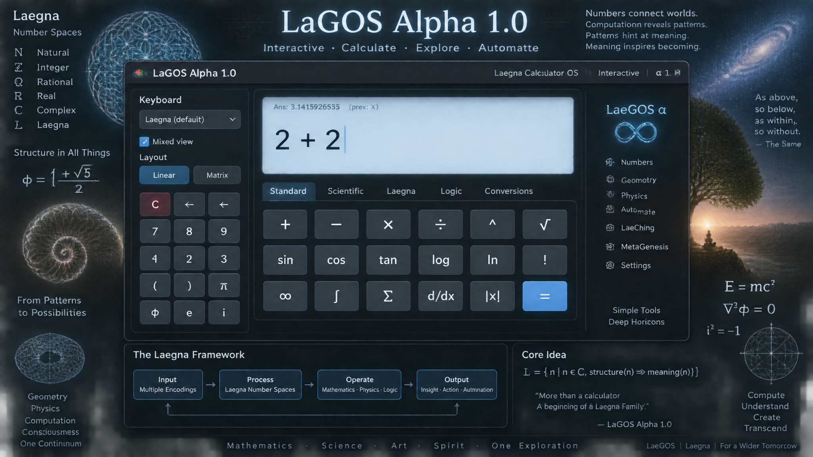

<br>

---

# Time has passed

And gave me a deliberate need for:
- Final Architecture Specification for simple Laegna Calculator OS

I gave up with LaeGOS intermediate versions:
- What follows is LaGOS Alpha 1.0, the first version of it's Alpha station / Alpha precompilation before it gives rise to Laegna Family of Sophisticated Automate.

The following is final specificiation for:
- LaGOS Alpha 1.0
  - Codenamed *interactive*.

Source documentation:
- *Current repostitory*: First JavaScript Version and Full Documentation of LaGOS.
- [LaGOS PhySecs](https://github.com/tambetvali/LaGOS-Physics-Laegna);
  - [FoL](https://github.com/tambetvali/LaGOS-Physics-Laegna/tree/main/Lagenesis) - Flower of Life metagenesis of LaGOS 1.0 Interactive;
  - [LaeComplex](https://github.com/tambetvali/LaeComplex) - just one of the places to learn about laegna basin axis.
  - [gosdb](https://github.com/tambetvali/LaeGOS-Drivers-LaeAutomate) - for possible linearization of Laegna Number Spaces.
  - [pygos](https://github.com/tambetvali/LaeGOS-Widgets) - analysis on possible Python implementation.
  - [lagos](https://github.com/tambetvali/LaeGOS) - laegos initial draft specification.

# User interface

*Simplified version* - I don't want to confuse AI or reader with long description which is in specialized file to be processed with; I will add it later and ***TODO: FIXME***.

WinBox: seems more reliable at "<script src="{{ url_for('static', filename='js/winbox.bundle.min.js') }}"></script>".

At top:
- Header panel contains permanent information
  - Current number user is entering
  - Ans value in small small font-size at top; operation which moved last current number to ans after it.

At left side, and we write from left to right - "at" is the one at left side, on screen, of this text; somehow the AI's are often confused so translate this to whatever their internal format:

```
              Up
              .
<- ·Left * Mid·dle * Right. ->
              .
              Down

Remember: we write left to right ==>, direction of this sentence in Latin alphabet.
```

This defines screen dimensions.

At left, there is the panel:
1. Keyboard selection, dropdown.
2. Mixed view, checkbox. When selected, each digit is in it's input format, otherwise they appear in visible view; after operations it becomes undefined, but it should follow the pattern if first digit is in one, others in other encoding, for some uses of LaeChing, and it could preserve some more logic - in some operations, it's more trivial; I won't do the combinatorics to the end right now as one can do this manually, just being like me long ago.
4. Keyboard is linear or matrix:
   - Either "C" for clear screen; then all keys in arrary; then "<-" in one digit utf-8 encoding to delete last digit.
   - Matrix: 2D rows and columns for keys, while delete one appears at top, wide over all columns, and C at bottom over all columns but one.
     - Last-last column, bottom-right, contains "CE", which deletes only the current value, but not Ans - the overleft from prev. calculus.

User can:
- Add digits in their current encoding to end of number.
- Delete digits from end.
- Then, it's indeed right-aligned, at near right edge of it's narrow screen at top, where one cannot position windows.
- See the selected operation; all client modules / programs can *provide* operations:
  - Provide sign / symbol of operation such as "+", "-", etc.
  - Provide callback of operation: extension classes can do operations on their own, while operating system coordinates their operation - last one which changed operation, decide what happens if current is operated on ans, current.op(ans) or ans.append(current).
  - Ans is considered constant, current as variable:
    - Operating system manages selected keyboard, and the ans, operation, callback and value on screen.
    - Extensions or applications have:
      - The content area, which is not top screen nor side panel, has four tabs - one can switch from top below the screen, next from the left pane; but screen is from 0% to 100%, and has internal padding not external spacing at top, left or right (only a major menu could appear over it); left pane and content area are below it, and right pane is inside each tab - it's own -, and windows can overlap everything under the calculator screen, but one cannot move window on top of it, because it has always better index (but one can move window away if it appears under it, like non-movable, for example default it's position).
      - Tabs: "Number Systems", "PhySecs & Decimals", "LaeChing", "LaeFlower":
        - Number Systems: one can view the basic number structure and it's animations, and change number properties from right panel of this tab, inside container under the tab selector.
        - PhySecs and Decimals: one can set it to correlate decimal units, and associate quantum, linear or extern spatial views (**Z**, **X**, **Y** projections of the current state, into various physical coordinates).
        - When PhySecs is open, the screen shows decimal representation under:
          - Number Systems, PhySecs, etc.: we use this inspiration from MacOS, that when one window of one of the apps is selected, it will change tab and current tab has it's windows always over all other tabs, so that depth indexes are basically in layers; selection order of tabs and windows between tabs decides group order, as each moves the selected tab / window group / shell or layer to the top, leaving others in their relative order.
          - PhySecs is relative to this, and has it's own calculator where decimal number can be seen and calculated under their own rules, altough integral-differential coordinates, bands and dimensions are associated by Laegna Logecs.
            - This emulates standard decimal physics calculus.
          - Decimal System emulation:
            - Choose SI table units and their close-up brothers from physics, chemistry etc.
              - Later, one should be able to make standard sound wave, light wave, etc. structure as central, choosing it's approximate scope.
          - PhySecs is meant to map physical system into closest real correlation to Laegna system, which could introduce further imperfections, i.e. it could hiddenly use real speed of light if it chooses so for current calculation, etc. - so we define standards such as what we mean by real speed of light in terms of Laegna Relations which are not precisely the decimal system.
          - Altough this, Physecs has it's interface with decimal mapping, but direct Laegna Logic - if this cannot be achieved by small, matrix-like complexity tuning, the exactness could blur away in my versions when one scales up or down and expects *exact* light speed. Mistake is something like 0.001% or below as I understood CoPilot.
        - LaeChing
          - Trigrams, Hexagrams, etc. represent rank systems.
          - Windows allow changing through I, O, A, E with sliders for each rank; replacing lines with U and upside-down U, and analyzing their logic as various numbers.
            - It accepts if user wants the first digit to be LaeChing hexagram, trigram or other, symbolizing the sign, while followed by keyboard digits of other system so that this would always change the first digit; it then accepts hexagram, and optional hexagram after the change.
              - Heart shape is for sign: +0 has 0 at center, with other signs close-up; +1000 has the same sign, but unlike continued +0 at center of +- axis, which equals -0 and creates the internal dimension; +1000 and -1000 are heart-like expansion of + and - into it's actual growth left or right, up or down; by which now the dimension is neutral - + and - are just one coordinate system.
              - 💙 Multiply **×** - these lines form E, change from yin to yang.
                - log-exp higher band is used, position A.
              - 💛 Divide **÷** - these lines form I, change from yang to yin.
                - log-exp higher band is used, negotion O.
              - 💚 Add **+** - these lines form A, yang remains yang, no change, fortunate:
                - linear band is used, in log-exp band the number without angle does not move, so it's upper band of linear realm.
              - ❤️ Substract **-** - these lines form O, yin remains yin, no change, unfortunate:
                - linear band is used, but this time downwards.
             - We will actually calibrate 16 positions in each heart; we use playing card's four symbolics for next 4, and · and : - black and white heart; for operation unknown in long or short term. One can see only single operation can be unknown, in single digit - involving it's two positions in potentials, symmetrically now in this disposition.
          - LaeFlower
            - Flower of life appears as exterior-linearization of logos 2, and LaGOS is the Logos-operational system, starting from zeroeth or first logecs, depending on counting.

# Windows

The background, using WinBox defaults, contains the potential windows which can be extended to window position so that their position becomes empty and shrinked down: it should have some data about the window with ability to minimize or close it so that it appears back or at the bottom of window.
- I don't play much with it's behaviour except the MacOS-inspired tabs, because I think it can be made behave with standard ways without this.

# Digit Encoding

It will be digit system independent:

Hex Base-16 of Laegna digit value dimensions (notice not only numbers, but digits have 2 dimensions in Laegna):

Unit: 1 ts (1 timespace, the e)

```
  Code: base16-material
  KJIL
  QPOR
  CBAD
  GFEH
```

This is four bits:
- Band up and down in both dimensions - 2 bits for both, at the same time.
  - Inside this: two dimensions separated.
  - This makes 4 bits - 2 bands * 2 dimensions.

This is hexadecimal system and it can be changed to:
- Material / physics / programming: the given version from I at top to E at bottom.
- Spiritual / business / ethical: counting I, O, A, E upwards.
- Diagonal / emulating base-4 in higher precision.

Diagonal chessfield:

This is spatial multiplication, s = m => s = m^2 (mass unit gets squared unidirectionally in Laegna Number System Theory).

Negative diagonal, temporal space, "materialist view" but not literally this time:

Unit 1 t/s^2 (mc^2, material view, physics): 

```
  Code: base-16 diagonal-material
  JKLI LR - left-right, T switch (scalar switch).
  QPOR - no switch (linear switch - no-R, no-T / say nor not, 1 and 2 dimensional not to remember some assembler and logic).
  DABC LRUD - two-dimensional switch, R and T.
  EHGF UD - up-down, R, good and bad reversed, left and right not.
```

So let's do it in ethical, E-up way (top-down, spiritual, ethical, business / economics / thermodynamic and optimization value / "goal true and false"-kind of view):

Unit 1 t^2/s (m^2c, spiritual or quantum view below 1 dimensions, below planck unit within same projection, for example, where decimal cannot open up easily so much downwards without some complexities): 

```
  Code: base-16 diagonal-spiritual
  FGHE - LR, bottom-up switches two infinities and two minus infinities both inside their own group.
  CBAD - A is the mean baseline in positive dimension. It remains so - you can see it becomes negative in negative space in negative, materialist diagonal or quantum diagonal.
  ROQP - LRUD - bottom-up, left-right
  ILKJ - UD - switch negative and positive polarity, where diagonal I position does that.
```

This is needed to:
- Emulate base-4 in matrix operational system.

Matrix mode defaults to matrix operator:
- Digits, for all operations, are processed in all combinations - in 2D, up-to-down and left-to-right; this means the answer has square power compared to vectors - it's outwards-closing parallel.

What about holograms?

Expansion 2^n, 4^n etc. are holograms whose linear structure, in their linearized realm where zero is still normal zero at the end:
- Their root reflects their shape and is correspondingly n^2, n^4.
- For example, s^n €^n - scalar with power n and unit with power n - means specific *acceleration factor* in laegna.
  - But n^s and n^€ are their *opposites* around unit 1 in precision which linearly grows, if the V vectors in the middle - outwards-quantum inwards-decimal - are envisioned.
    - Notice octave space syndrome: each connection is approximation, each moment is real. Space itself closes patterns topologically not because number is unknown, but because number does not exist.
    - Your spirit, mind, thinking, imagination, soul, even irrational aspects, none of them connects finite and infinite without this topological layer; it's in the number structure.
    - Basin-0 and Basin-1 at laegna - interior and exterior linearized in continuous, basin-0 and basin-1 in discrete realm; they won't connect "around" the edge, but build on their complexities; yet both are internally consistent and linear.
      - This is how: +zero repeats +one repeats +infinity, but they all change sides in already 3 signs or octaves.

Laegna Base-4:

Horizontal / vertical:

Scalar value:

```
IOAE
```

Laegna Base-8:

1-Vector value:

```
I
O
A
E
```

OR

```
IOAE
```

Base-2-2:

```
AE
IO
```

Base-2-2 diagonal, sorrily, is too many lines :) Empty lines in middle:
```
I1O12A123E
```

If number positions are empty and laegna digit positions at line which is same as character in given string `I_O__A___E`, or it's square-space mapping etc.,
- Vertical dimension can be designed.

For each digit separately:
- It will choose internal or external scope, mass or light speed, speed or position, at 0=1 dispositions where one cannot meet another, this is the gender polarity in hermesis.

Diagonal-diagonal, both diagonals in same shape imaginarly from inside or outside:

```
OIEA
```

This maps base-2 diagonal into OA.

But where we actually put these coordinates virtually, and here we just realign the base to make it exponent-fit, as in Laegna Wave Numbers:
- Notice I talk about systems here.

We *never* change our original base-16 container:

Base-8 actuality:

```
Code: Base-8
8844
7733
6622
5511

Keyboard allows to change signs:
- Z, X, Y can be selected as sign, moving it into one of three realms. This is rank-2.5 sign for rank-2.5 number exactly.
```

Notice Base-3 separates + and - sign channel in upwards-half precision on each channel, linearly going up:
- Base-3 has *values* where base-8 has *binary axis*, becoming a sign-operator, so we put it into sign-operator space.

Bit 1 becomes most important, bits 2 and 3 come logically. Repeated digits becomes single information unit through it's digits, as if they are not logically separate.

Base-1:

```
AAAA
AAAA
AAAA
AAAA
```

It has only + sign; numbers from 1 to 4: A, AA, AAA, AAAA.
- Notice T=R, which is important quality to do some operations easily; matter has this lack of direction for single value in time, unidirectionally but yet at it's center (it won't just jump around).

Base-4 actuality:

Here, the 2D view gets reconstructed into Base-16 system:

```
AAEE
AAEE
IIOO
IIOO
```

This has base-4 signs:
- Divided, Minus, Plus, Times

For example Times E is count from infinity downwards from E to A, so it's exact infinity in precision 1 (mean, unit);
- For example Plus A is count from downwards, A to E, and exact zero.

So base-4 keyboard involves this logic.

Base-2 actuality:

Here, the 2D view gets reconstructed into Base-16 system:

```
AAAA
AAAA
OOOO
OOOO
```

It just clearly states O is less important than A.

---

Operators:

With Base-1:
- Single dimensional operator curvature, 4 digits, then 16, then 256 give single higher digit.
- Values, rank 0. Notice this is not necessarily a value, but only a value-linear system.
- Rank 0 is first one where center is below zero, or below +infinitesimal such as square root normal volume of it.
- If inputs range around 1 here, it starts to go heavily downwards.

With Base-2:
- Half-octave operator curvature, 2 digits then 4 then 16 mean new real ranks at Base-4, Laegna Number System.
- Frequencies, rank 1. Notice it's not necessarily oscillations, but only a frequency-linear system.
- If inputs range around 1 here, it rather goes down.

With Base-4:
- Laegna-linear, high-order operator curvature which is linear space.
- First Order Octaves 2^n-symmetric Laegna idea, but actually rather exponential operator as we do *not* average at 1: rank 2.

With Base-16:
- Laegna-exponential, ranked operator curvature in exponential space:
- It's identity matrix has near square root of it's columns and rows - a single diagonal - averaging to ones *with other parts average to zeroes* it averages to itself;
  - One can see if *all of it* averages to zeroes, it's heavy exponential growth on it's +/-.
    - Base-16 is necessary for high angularity in beyond-horizons space;
      - Horizons, such as 1 ly and 16 b ly fractal infinitely upwards; they are symbolic: future realigns the "long" and "short", thinking of different zeroes, ones, twos, fours than us.
        - This is entropy in small, goal entropy in big:
          - We can see the expansion is logical if number just calculates itself, linearly to it's own structure and speed.
          - Even spiritual, imaginary - they cannot exist as templates or reflections of or for reality; even our mysterious soul cannot do this: not trivially, but because *the number does not exist*, not *because it gets guessed or averaged* - it always remains cyclic, and we always do the clockcrafting and bullet papers.

With base-16 we use 4 signs preferrably, altough 8 is the standard. I will think of this.

#### Why these diagonal systems?

Because I Ching has stable lines:
- Illusory base-2 or base-4
  - And I Ching has change lines:
    - Expands to m^2 or c^2 space view which has so-shaped hexadecimal laegna system; it's suited for another view which can also be expressed in operations in various ways.

---

Fractal realm:

This 4\*4 matrix will be fractalled through inside - Z repeating in lowest, X repeating but then changing at middle, Y just once, but with high precision at top, counting the external.

This adds Z, X, Y. We call Z, X, Y a T band.

We put another Z, X, Y *at top*, forming upwards multiplication by 2 of bands.
- 𝓩, 𝓧, 𝓨 are letters we will use for this topmost band: R band.

R band appears to reflect the *whole* square once from outwards, or if projected down - from inwards.
- Local space is complexity 1 + complexity 1.
  - These two are complexity 2 * complexity 2, and it becomes 4 and 4 in exponent-linearized realm easily becomes 1, because internal complexity is removed from all the cells and forms one hologram reverse in the first cell perhaps, for some viewers or algorithms.

---

Now:

This single digit system will get:
- Keyboards.
- Screen views.
- Either single-system conversion calculator;
  - Or system-mixed calculator where each digit's input weight is taken.
  - For bands and dimensions, each fractal layer approximates the other, and *lost digit values in each conversion can be linearly suboriented to calculation precision in each, providing digits after comma or internal curvature. Thus, all operation is yet informationless, and symmetric.
    - Full Laegna Math needs more symmetries, not simply equalling them all, but this is the easiest laegna-linear approach.
