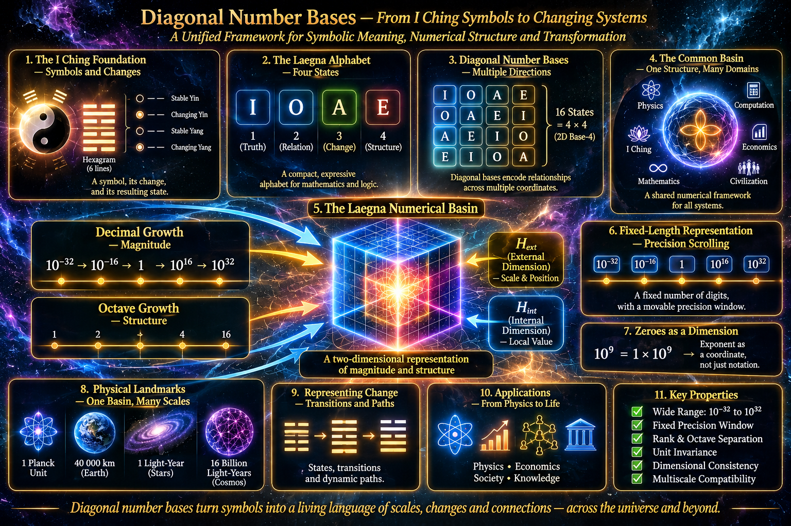
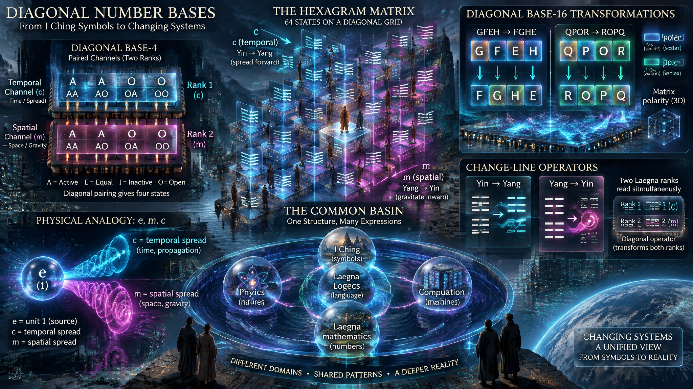

<br>

Notice where I will use the change lines:
- Laegna number is accelerated number.
- I will use the change line for this:
  - Draw this parallel:
    - Let's say e, energy is unit 1.
    - gravity, m, is it's spatial spread.
    - speed, c, is it's spread in time.
    - e, the energy, is substance which changes into m or c.
  - Now I need clearly this:
    - Change from yin to yang => this is equal to c.
    - Change from yang to yin => this is equal to m.
    - Yang => this is equal to 1.
    - Yin => this is equal to 1.
    - These are not values, but relative scales.

---

ChatGPT short intro:

# Diagonal Number Bases — From I Ching Symbols to Changing Systems

Laegna provides a common numerical basin in which different symbolic systems can be represented, compared, and transformed.

The I Ching traditionally describes situations through symbolic arrangements of lines. Its hexagrams represent configurations, while changing lines express movement from one configuration toward another. Laegna extends this idea: the symbols need not remain isolated labels. Their relationships, transformations, and directions of change can also be encoded.

## 1. From letters to transformations

The four Laegna values — I, O, A, E — provide a compact symbolic alphabet.

They are not simply four ordinary digits. They represent four structural states or truth-flavors, capable of describing different aspects of position, negation, and transition.

In an I Ching interpretation, this creates a useful distinction:

- **Symbol:** the state currently represented.
- **Relation:** how two symbolic states correspond.
- **Change:** how one configuration transforms into another.
- **Structure:** the larger arrangement containing these states and transformations.

Thus, an encoding can describe not only what a hexagram is, but also how it changes.

## 2. Why diagonal number bases matter

A diagonal representation allows values to be considered through more than one numerical direction or coordinate.

Instead of treating a number as an isolated position in a single sequence, we can examine its relationships across different bases and axes.

This is important because a transformation is not necessarily another independent value. It can be a relation between values, expressed through a different coordinate of the same numerical structure.

Laegna's four-state alphabet supplies the symbolic layer; diagonal number bases provide a way to organize its relationships and extensions.

## 3. The common basin

The same underlying structures can be reused across different domains:

- I Ching: configurations, changing lines, and transitions.
- Laegna Logecs: truth-values and logical transformations.
- Laegna mathematics: number structures, diagonals, and octaves.
- Physics: scales, coordinates, and transformations.
- Computation: explicit symbolic data and deterministic operations.

The basin is not a claim that all these domains are identical. It is a shared representational framework through which their structures can be mapped and compared.

## 4. From symbolic meaning to machine-readable change

The important computational consequence is that symbolic data can become operational.

A machine can distinguish a state from a transition, preserve the original encoding, calculate a resulting configuration, and compare different paths through the same structure.

This moves the I Ching-inspired representation beyond a static dictionary of letters. It becomes a structured language of states and changes.

**The central idea:** Laegna can encode not only what something represents, but also how it relates, develops, and transforms — using one common mathematical basin.

---

# Two modifications of Laegna Number Bases

I made two modifications which best represent the I Ching symbols:
- I wanted it to automatically shift between two simultaneous Laegna ranks.
- To achieve this, I have modification on their encoding.

Diagonal base-4:
```
A - AA
E - AO
I - OA
O - OO
```

I have used this modification to base-4 before, and here it shows that for no change lines, O and A are base-2; if there are change lines, E and I become posetive and negotive - one cancels the negative future, other cancels the positive past.

Diagonal base-16:
```
GFEH => FGHE (0-polar where 0 is at between G anf F, E and H, scalar polarity)
CBAD
QPOR => ROPQ (1-polar, vector polarity, where 1 is between QP and OR)
KJIL => JKLI (0, scalar) => ILKJ (1, vector)
- Simultaneous scalar and vector, indeed, create matrix polarity on outside.
```

What this base does?

If I encode I Ching symbols without change lines to same value on both channels, I see base-4.

If there are change lines, corresponding digits become base-16.

---

Notice in Laegna it's heavily convenient to create your own mods of the number systems!
- For example it's basin 16: still basin 16 ..nothin structurally destroyed.
- This is also same kind like difference between standard and wave numbers of Laegna systems, where wave numbers are more close to standard and resemble waves in their form, while standard numbers are simpler and can be used to form wave numbers with kind of one per-digit operation.

---



ChatGPT development on these ideas:

# Changing Lines, Diagonal Bases, and the Two Directions of Laegna

The purpose of extending Laegna number bases with changing lines is to represent something more than a static symbolic configuration. A number can describe a state, but a changing line describes a transition between states. This gives us a way to encode both the present configuration and its direction of development.

The I Ching is particularly suitable for this approach. Its symbols are not only arrangements of Yin and Yang lines: they also include the possibility that a line changes, producing another configuration. In Laegna, this distinction can be expressed through simultaneous numerical channels and different base structures.

The following modifications explore how this works.

## 1. The physical interpretation of a changing line

Consider a simple analogy in which energy is represented by a unit quantity:

- $e$ represents energy as the unit substance.
- $m$ represents its spatial spread, associated in this interpretation with mass and gravity.
- $c$ represents its spread in time, associated with speed.

The important idea is that energy is not being treated as three unrelated quantities. Rather, the same reference substance is considered through different directions of expression.

We can describe these directions through the changing line:

| I Ching direction | Laegna interpretation | Physical correspondence |
|---|---|---|
| Yang | Stable reference | $1$ |
| Yin | Stable reference | $1$ |
| Yin $\rightarrow$ Yang | Temporal development | $c$ |
| Yang $\rightarrow$ Yin | Spatial development | $m$ |

Here, Yang and Yin are both represented by the same relative unit, $1$. They are not two different numerical magnitudes. Their distinction is structural: they represent different orientations or conditions within the symbolic system.

The changing line introduces direction:

- **Yin to Yang** represents the temporal direction, corresponding to $c$.
- **Yang to Yin** represents the spatial direction, corresponding to $m$.

This is a proposed Laegna correspondence, not a claim that conventional physics defines mass as gravity or speed as a literal transformation of energy. In standard physics, mass, energy, velocity, and gravitational phenomena have distinct definitions and relationships. The purpose here is to establish a symbolic model in which one reference quantity can be examined through spatial and temporal expressions.

This also gives the I Ching change line a more specific role: it becomes an operator describing the direction in which a reference state develops.

## 2. Two simultaneous Laegna ranks

The first modification is to let the number representation shift automatically between two simultaneous Laegna ranks.

A configuration without changing lines can be represented using the same value on both channels. When a change line appears, the representation extends into a larger combined structure.

This is the reason for using diagonal number bases: they allow the two channels to be read together without losing their individual structure.

The simplest example is diagonal base-4.

## 3. Diagonal base-4

The modified base-4 encoding is:

```text
A - AA
E - AO
I - OA
O - OO
```

The important feature is that every symbol has a two-character representation.

The two positions form simultaneous channels. Instead of treating the symbol as one isolated digit, we can examine its relationship across both positions.

This gives the following structure:

| Symbol | First channel | Second channel |
|---|---|---|
| A | A | A |
| E | A | O |
| I | O | A |
| O | O | O |

The equal-channel cases are the diagonal endpoints:

- $AA$ represents A.
- $OO$ represents O.

The mixed cases, $AO$ and $OA$, represent E and I.

This distinction becomes useful when interpreting the I Ching.

If there are no changing lines, the corresponding values remain equal across the two channels. The representation therefore behaves as base-4.

When changing lines are introduced, the two channels can diverge. The representation then uses the combined structure, allowing the change to be expressed without discarding the original state.

In this interpretation, E and I also express the positive and negative directions of change. One cancels the negative future, while the other cancels the positive past. The distinction is not merely a difference in magnitude: it is a difference in the direction of the represented transition.

The result is a numerical system that can preserve a stable configuration while also representing its changing counterpart.

## 4. Diagonal base-16

The same principle can be extended into a larger base-16 arrangement.

Here are the transformations used in this modification:

```text
GFEH => FGHE
CBAD

QPOR => ROPQ
KJIL => JKLI => ILKJ
```

These arrangements introduce two kinds of polarity.

### Scalar polarity

The first transformation is:

```text
GFEH => FGHE
```

This is the 0-polar arrangement.

The scalar polarity is located between G and F, and between E and H. The transformation changes the ordering while preserving the distinction between the two sides.

### Vector polarity

The second transformation is:

```text
QPOR => ROPQ
```

This is the 1-polar arrangement.

Here, the polarity is between QP and OR. Rather than expressing only a scalar distinction, it expresses a vector-like direction between the two sides.

The following sequence extends the idea:

```text
KJIL => JKLI => ILKJ
```

The first transformation expresses the scalar arrangement; the second expresses the vector arrangement.

When scalar and vector polarity are considered simultaneously, they produce matrix polarity on the outside.

This is an important extension. Polarity is no longer restricted to one position or one direction. It can be represented through multiple simultaneous relationships.

The base-16 arrangement therefore provides a larger structural space in which the original symbolic configuration and its transformations can coexist.

## 5. How the two bases work together

The relationship between diagonal base-4 and diagonal base-16 can be summarized through the presence or absence of changing lines.

| Condition | Representation | Interpretation |
|---|---|---|
| No changing lines | Base-4 | Both channels encode the same state |
| Changing lines present | Base-16 | The channels encode additional relationships and transitions |
| Scalar polarity | 0-polar | Polarity expressed through scalar ordering |
| Vector polarity | 1-polar | Polarity expressed through directional ordering |
| Both polarities | Matrix polarity | Simultaneous scalar and vector structure |

This means that the representation can expand when additional information becomes relevant.

A static configuration does not need to carry the entire complexity of a changing configuration. The larger representation becomes useful when the system contains transitions.

The change line therefore acts as a structural condition for moving between representations.

This is more than simply adding another digit. It changes the way the encoded object is interpreted.

## 6. The Laegna basin is modifiable

One of the useful properties of Laegna is that its number systems can be modified without destroying the underlying basin.

For example, a system can be extended into basin 16 and still remain structurally connected to the same numerical framework.

The modification changes the representation, not the existence of the basin itself.

This is comparable to the relationship between standard and wave numbers in Laegna:

- Standard numbers provide a simpler numerical representation.
- Wave numbers express a related structure in a form closer to wave-like organization.
- A per-digit operation can be used to derive wave-number representations from standard numbers.

The two forms need not compete. They can be alternative representations of related underlying structures.

Diagonal bases follow the same principle. They introduce additional coordinates and relationships while retaining the ability to map back to a simpler representation.

This makes the system extensible: new encodings can be developed for particular applications without requiring every application to use the same surface notation.

## 7. From I Ching to a general language of change

The wider implication is that symbolic systems can be represented at several levels:

1. **State:** what is currently represented.
2. **Relation:** how the represented elements correspond.
3. **Direction:** how one state changes into another.
4. **Polarity:** which direction or orientation the change follows.
5. **Matrix structure:** how multiple directions coexist.
6. **Numerical basin:** the common framework in which these representations can be compared.

The I Ching provides a particularly clear example because it already distinguishes stable lines from changing lines. Laegna makes this distinction available to numerical encoding and computational interpretation.

An AI or other program could consequently work with more than a collection of symbolic labels. It could distinguish an original configuration from its transformation, preserve both channels, identify polarity, and compare alternative paths through the same structure.

The same approach can be explored in mathematics, logic, physics, and other domains. The correspondences must be defined for each application, but the representational principle remains reusable.

**The central idea is that a Laegna number can represent a state, while its diagonal extension can represent the relationships and changes that connect states.** The I Ching changing line becomes a natural bridge between symbolic meaning and numerical transformation.
