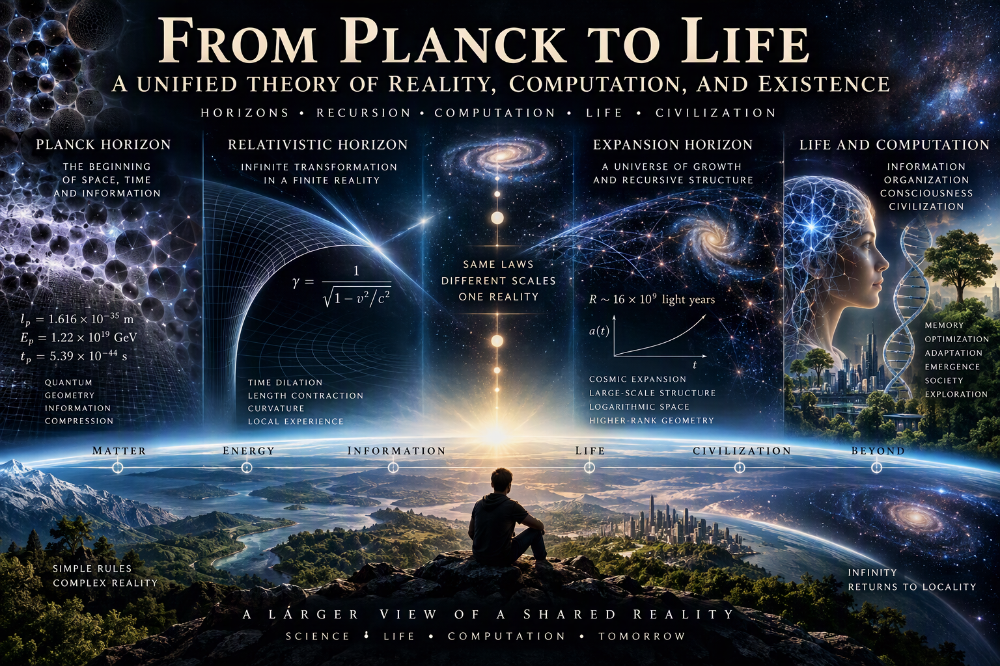
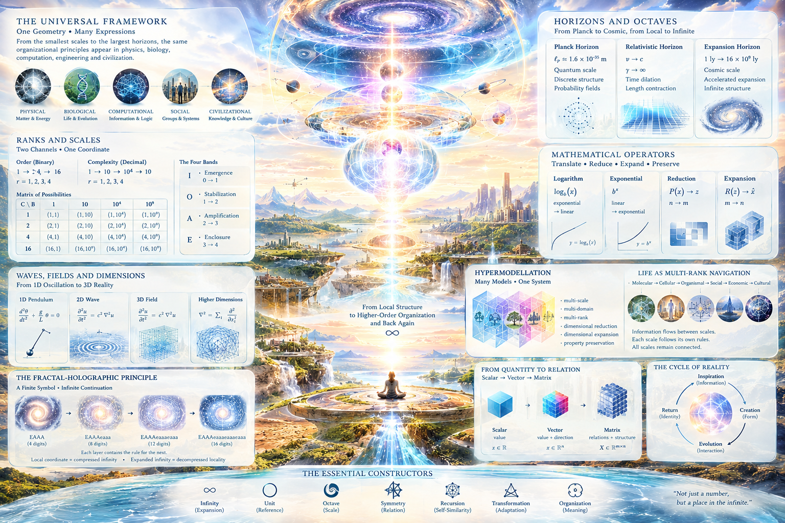
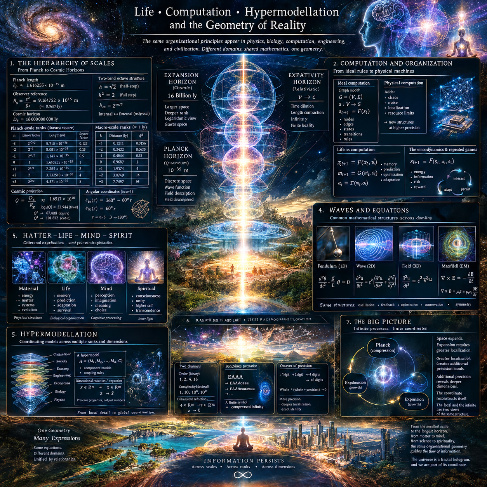
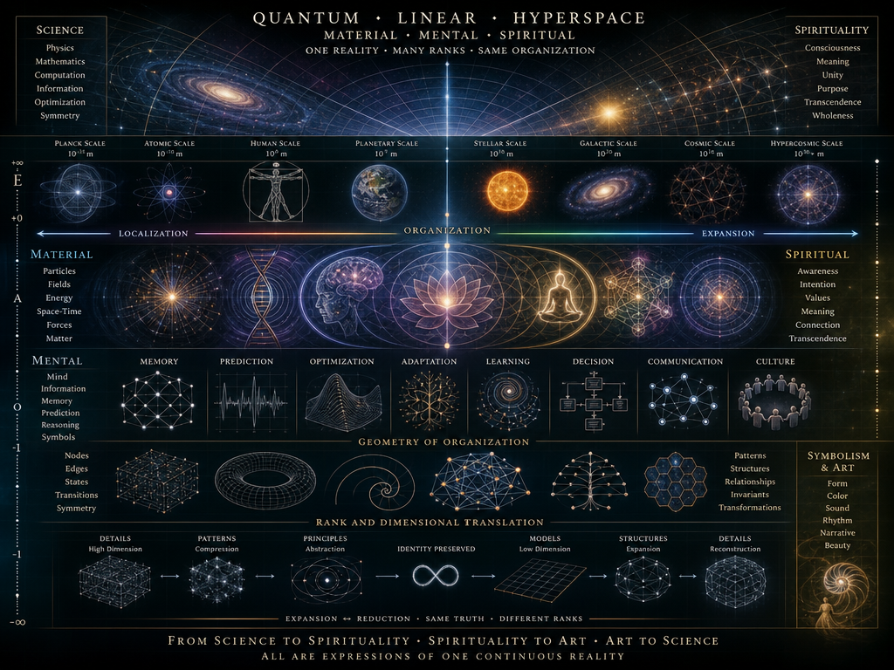
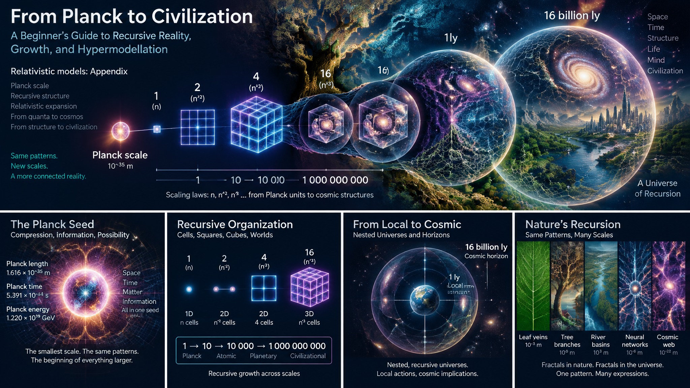
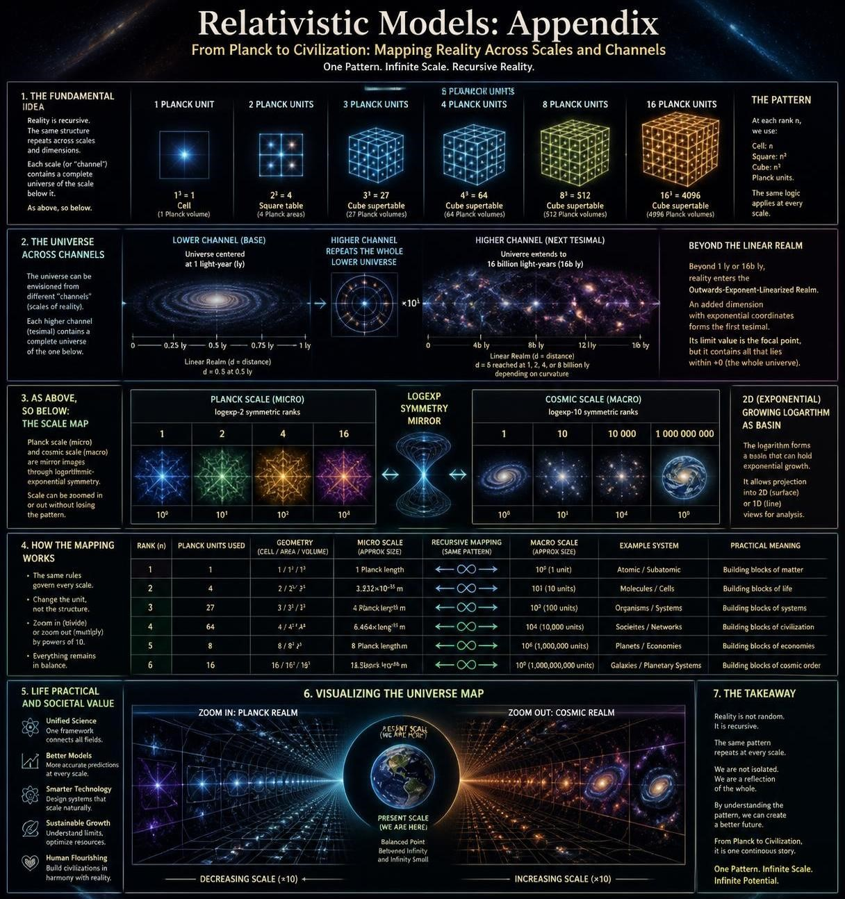
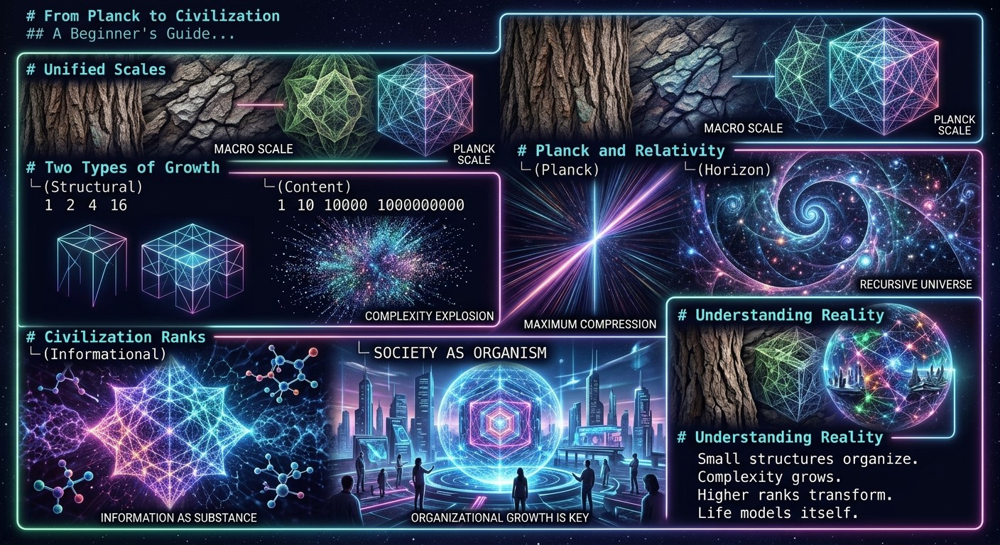
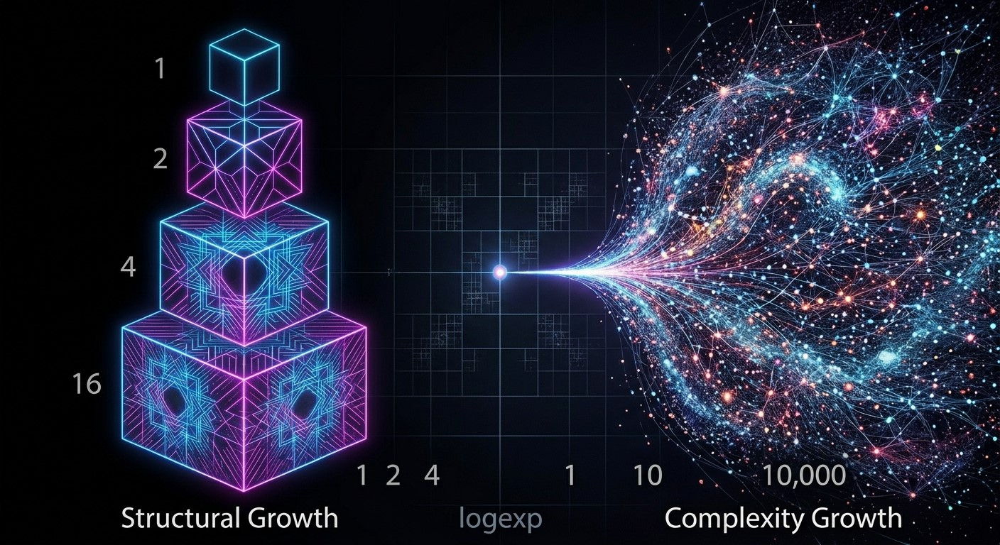
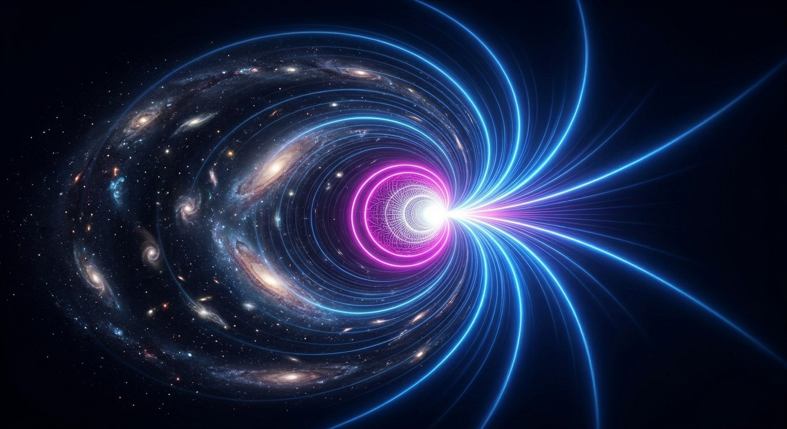

<br>

# On Life, Computation, Hypermodellation, and the Geometry of Reality

Physics often begins from matter.

Biology often begins from life.

Engineering often begins from machines.

Yet beneath all three lies something more fundamental:

```text
organization
```

A pendulum oscillates.

A neuron fires.

A society exchanges information.

A spacecraft navigates.

A civilization allocates resources.

Although the domains appear different, they solve remarkably similar problems.

They must process information, preserve memory, optimize action, and adapt to changing environments.

The suggestion explored here is that life, computation, physics, and large-scale modelling may all be understood as manifestations of the same deeper organizational geometry.

---

# Computation Before Hardware

A useful distinction exists between:

```text
ideal computation
```

and

```text
physical computation
```

An ideal computational system contains only rules.

For example:

```text
nodes
edges
states
transitions
```

The system may be represented as a graph.

Every possibility can be catalogued.

Every transition can be examined.

Every symmetry can be studied.

Within such a model there is no noise.

There is no uncertainty.

Only structure exists.

---

# Physical Reality Adds Localization

Real machines differ.

A physical machine introduces:

```text
chaos
noise
localization
resource limits
```

Memory becomes finite.

Processing becomes finite.

Sensors become imperfect.

The ideal grid becomes embedded inside matter.

This changes everything.

Tiny variations can produce unexpected outcomes.

The abstract structure remains present, but reality becomes locally unique.

---

# Precision Creates New Structure

An interesting phenomenon appears in all sciences.

A coarse model shows one reality.

A finer model reveals another.

For example:

```text
point
```

becomes:

```text
particle cloud
```

which becomes:

```text
wave function
```

which becomes:

```text
field interaction
```

Each increase in precision creates new observable structures.

Thus:

```text
more precision
≠
same model with more digits
```

Often it means discovering an entirely different level of organization.

The observer finds hidden dimensions of behavior.

---

# Life as a Computational Process

Life may be viewed through this lens.

An organism continuously performs:

```text
memory
prediction
optimization
adaptation
```

These are computational operations.

An animal estimates future outcomes.

A society estimates future outcomes.

An economy estimates future outcomes.

Even evolution itself can be interpreted as a distributed optimization process operating across generations.

---

# Thermodynamics and Repeated Games

When organizations persist through time, another layer appears.

The system must repeatedly interact with itself.

Game theory calls this:

```text
repeated games
```

Thermodynamics calls this:

```text
state evolution
```

Biology calls this:

```text
survival
```

The terminology differs, but the structure is similar.

A system repeatedly encounters situations.

It must balance:

```text
energy
information
risk
reward
```

The successful strategies survive.

The unsuccessful strategies disappear.

---

# Self-Reference and Waves

Many systems become self-referential.

The output influences the input.

The future influences expectations of the future.

The observer influences the observed.

This creates loops.

Wave phenomena provide a useful metaphor.

A wave is not merely movement.

It is repeated self-reference through space and time.

The same pattern reappears:

```text
crest
trough
crest
trough
```

Each cycle contains information about previous cycles.

---

# From Pendulum to Light

Consider increasingly sophisticated systems.

A one-dimensional pendulum:

```text
position
velocity
```

already exhibits oscillation.

A two-dimensional wave simulation adds:

```text
interference
propagation
reflection
```

Light introduces further complexity:

```text
phase
frequency
polarization
```

Three-dimensional physical systems add:

```text
volumes
fields
surfaces
coupled dynamics
```

Yet all of these systems share common mathematical structures.

---

# The Same Equations Reappear

This is one of the most remarkable facts in science.

The same mathematical ideas repeatedly emerge.

Examples include:

```text
oscillation
feedback
optimization
conservation
symmetry
```

The symbols may differ.

The domains may differ.

The organizational principles remain surprisingly similar.

A useful model therefore captures:

```text
relationships
```

rather than merely objects.

---

# Hypermodellation

As systems become larger, simple models become insufficient.

One begins studying:

```text
systems of systems
```

rather than isolated objects.

This leads to what may be called:

```text
hypermodellation
```

Hypermodellation attempts to describe extremely large organizations of interacting models.

Examples include:

```text
planetary economies
civilizations
interstellar logistics
ecosystems
scientific knowledge itself
```

The challenge is not solving a single equation.

The challenge is coordinating entire hierarchies of equations.

---

# Rank and Dimensional Translation

A powerful idea emerges here.

Many systems can be translated between representations.

For example:

```text
high-dimensional description
```

may become:

```text
low-dimensional approximation
```

and later be reconstructed.

This process appears in:

```text
compression
simulation
machine learning
physics
engineering
```

The remarkable feature is that important properties can remain preserved.

The representation changes.

The identity remains.

---

# Expansion and Reduction

This creates a powerful duality.

One may move upward:

```text
details
→ patterns
→ principles
→ abstractions
```

or downward:

```text
abstractions
→ models
→ structures
→ details
```

A useful theory permits both directions.

It allows expansion and reduction without losing essential information.

---

# Digital Symmetries

In a symbolic system, different representations may describe the same reality.

For example:

```text
scalar
vector
matrix
```

can describe identical structures from different perspectives.

Likewise:

```text
linear
logarithmic
exponential
```

descriptions may represent the same process viewed from different ranks.

The mathematical form changes.

The underlying relationships remain.

---



<br>

# Life as Multi-Rank Navigation

Viewed broadly, life itself may be understood as navigation through multiple ranks of organization.

A person simultaneously inhabits:

```text
molecular scale
biological scale
social scale
economic scale
cultural scale
```

Each scale contains its own rules.

Yet all scales remain connected.

Life continuously translates information between them.

---

# Space Travel and Civilizational Models

The same logic extends to exploration.

A spacecraft is not merely a machine.

It is a moving hierarchy of:

```text
energy systems
information systems
decision systems
survival systems
```

Likewise, a civilization is not merely a collection of people.

It is an evolving computational process distributed across space and time.

Hypermodellation therefore becomes essential for understanding future engineering and large-scale coordination.

---

# The Fractal View of Reality

At this point the earlier themes reappear.

Planck horizons, relativistic horizons, expansion horizons, localization systems, and computational systems begin to resemble one another.

Each involves:

```text
compression
expansion
translation
localization
```

The forms differ.

The organizing principles recur.

Reality appears less like separate disciplines and more like a hierarchy of recursively interacting structures.

---

# Conclusion

Life, computation, physics, engineering, and civilization may be viewed as different expressions of the same organizational problem:

```text
How can information persist,
transform,
and remain identifiable
across changing scales?
```

An ideal computational system provides the underlying symmetries.

Physical reality introduces localization, noise, and emergence.

Greater precision reveals deeper layers of structure.

Higher-rank models transform complexity into navigable coordinates.

Dimensional reduction compresses structure.

Dimensional expansion unfolds it again.

In this view, hypermodellation is not merely a method for studying large systems. It becomes a general framework for understanding how reality organizes itself across scales. A pendulum, a light wave, a living organism, a society, and a future interstellar civilization all become instances of the same deeper process: the continual translation of information between local structure and higher-order organization while preserving identity across changing dimensions and ranks.

-----



<br>

This is my initial intro:

We are going to search of physical planckotesimal:
- To find it, means to convert it to our mathematical tesimal.

Laegna positive numbers have two primary ranks:
- +0 continuous Rank 1: +0 is the unit size 1 tesimal.
- +1 discrete Rank 0: +1 is the unit size 1 numeric unit.

Laegna basic sizes:
- ***I***: Minus infinity. -√∞; -∞.
- **O**: Minus unit. -1; -0.
- **A**: Plus unit / unit. +1; +0 / 1; 0.
- ***E***: Plus infinity / infinity. +√∞; +∞ / √∞; ∞.
- Infinity and unit sizes correspond - they have same precision, and polar distance from zero in terms of exponent-linearized scale - multiplication and division:
  - 1 / 0 = ∞.
  - 0 / ∞ = 1.
  - 0 / 1 = √1. # Notice here the square root calculates dimensional value, whose two-dimensional value equals zero: it's numerically equal, but square root density from 1, available at log and sometimes, with numeric value of 0.5 (opposite of integral exponential 2), other times 1.0 (integral exponent has *less times* the value 1.0 to remove scalar transformations).
  - 0 / 0 = 1.
  - 0 * ∞ = 1.
  - 1 * ∞ = ∞.
  - ∞ * ∞ = ∞².
  - √∞² = ∞.
- Z, X, Y are prefixes where Z goes scale down so that Z1.0 equals already plus 1 infinitesimal - +0.0; Y+0.0 or +Y0.0 is already back 1.0. Those prefixes scale; they behave like numbers but they are rather plain scalar operators.

By infinitesimal we mean:
- Planck time.
- Planck space.
- Plus infinitesimal or single infinitesimal on positive number axis.

By infinity we mean:
- Horizons of Physics are normally powers of infinities.

-----

My Q to CoPilot:

> In theory of relativity:​‌
> - Let's take object width w = 2.​‌
> - Let's take the point where depth d = 0.5, should it *slow down to reach here*.​‌
> - Let's put this into horizons: 0.97 or in our system, 1 ly of local horizon and 16 billions light years of global horizon which includes growth of spacetime.​‌
> - Now: where the depth is 2.0, given the speed and acceleration it has to reach, in it's linear optimum way outwards?

# On Relativity, Horizons, and the Octave Structure of Depth

Relativity is usually introduced through clock rates, lengths, and velocities. Yet it can also be viewed geometrically through a simple relationship between width and depth, where the observer asks not merely how fast an object moves, but how its visible structure changes as it approaches limiting horizons.

The discussion here begins from a simple assumption:

- Width: `w = 2`
- Reference depth: `d = 1`
- Inner octave: `d = 0.5`
- Outer octave: `d = 2.0`

The question is then:

> If depth equals 0.5 at one side of the system and depth equals 2.0 at the other side, what velocity or relativistic state corresponds to these values, and where should they appear relative to local and cosmic horizons?

---

## The Relativistic Interpretation

In ordinary special relativity, the key quantity is the Lorentz factor:

$$
\gamma=\frac{1}{\sqrt{1-v^2/c^2}}
$$

where:

- $v$ is velocity,
- $c$ is the speed of light.

The Lorentz factor measures how strongly spacetime geometry departs from the rest state.

At rest:

$$
v=0
$$

and therefore:

$$
\gamma=1
$$

The value `1` is thus the natural reference scale.

---

## The First Octave Above Unity

Suppose we identify depth with the Lorentz factor:

$$
d=\gamma
$$

Then asking where:

$$
d=2
$$

means solving:

$$
2=\frac{1}{\sqrt{1-v^2/c^2}}
$$

which gives:

$$
v=\sqrt{1-\frac14}\,c
$$

or

$$
v\approx0.866025c
$$

Therefore:

```text
d = 1.0  -> v = 0
d = 2.0  -> v = 0.866c
d → ∞    -> v → c
```

The value `d = 2` is not reached at light speed itself.

Rather, it appears at approximately 86.6% of light speed.

---

## The Symmetric Octave

Now consider the sequence:

```text
0.5 -> 1 -> 2
```

This is not merely arithmetic.

It is an octave structure.

The value 1 is the center.

The values 0.5 and 2 are equally distant from it on a logarithmic scale.

Indeed:

```text
0.5 × 2 = 1
```

and

```text
log(0.5) = -log(2)
```

Thus:

```text
0.5 = one octave inward
1.0 = balance point
2.0 = one octave outward
```

This symmetry is independent of the particular physical interpretation.

---

## Local and Cosmic Horizons

Now introduce two horizons.

```text
Local horizon  ≈ 1 light year
Cosmic horizon ≈ 16 billion light years
```

The first may be viewed as the nearest large-scale observational basin.

The second represents the observable cosmic domain.

The ratio between them is enormous:

```text
1 ly
↓
16 000 000 000 ly
```

Rather than treating this range linearly, consider it logarithmically.

The geometric center becomes:

$$
\sqrt{1\times16\,000\,000\,000}
$$

which yields approximately:

$$
126\,000 \; \text{light years}
$$

or:

```text
≈ 126 thousand light years
```

Remarkably, this is close to galactic dimensions.

The hierarchy becomes:

```text
1 ly
126 000 ly
16 000 000 000 ly
```

where the middle value occupies the logarithmic center between the two horizons.

---

## Depth as a Curvature State

Under this interpretation, depth should not be regarded as an ordinary distance.

Instead, it behaves more like a curvature coordinate.

The values:

```text
0.5
1
2
```

represent states rather than locations.

One may therefore imagine:

```text
inner horizon
      |
     0.5
      |
      1
      |
      2
      |
outer horizon
```

where equal logarithmic displacements from unity generate reciprocal depth values.

The important observation is that the structure is scale-independent.

Whether the interval spans Planck lengths, stellar distances, galactic dimensions, or cosmic horizons, the relation:

```text
0.5 -> 1 -> 2
```

remains unchanged.

---

## An Octave View of Relativity

From this perspective, relativity acquires an additional geometric interpretation.

Instead of thinking only in terms of speed, one may think in terms of movement through a hierarchy of curvature states.

The reference point is:

```text
d = 1
```

The inward octave is:

```text
d = 0.5
```

The outward octave is:

```text
d = 2
```

and relativistic motion determines how rapidly the system travels between such states.

If depth is identified directly with the Lorentz factor, then:

```text
d = 2
```

corresponds to:

```text
v ≈ 0.866c
```

while

```text
d → ∞
```

corresponds to the unattainable light-speed limit.

---

## Conclusion

The conventional relativistic result is straightforward:

```text
depth = 2
⇔
Lorentz factor = 2
⇔
velocity ≈ 0.866c
```

The broader geometric interpretation is more interesting.

The values:

```text
0.5
1
2
```

form a logarithmic octave surrounding a natural center.

When local and cosmic horizons are introduced, this octave relation does not disappear. Instead, it suggests a scale-invariant structure in which depth behaves less like a distance and more like a state of curvature.

In that sense, the unity value `1` becomes the pivotal symmetry point of the system, while `0.5` and `2` become reciprocal horizons around it, expressing the same geometric relationship at different scales.

-----

My Question to CoPilot:

> Can we play with symmetries.​‌
> - Let's say 1 ly and 16 000 000 000 ly are made of two components;​‌
> - 1: ranks 1, 2, 4, 16 form orders or ranks 1, 2, 3, 4, which have complexities 1, 2, 4, 16.​‌
> - 2: ranks 1, 10, 10 000, 1 000 000 000 form orders or ranks in their complexity class which counts square times zeroes and uses log and exp symmetries to catch the number.​‌
> - Let's have "linear" scale with these two anchored to same rank, number got through multiplication; then try to divide 1 light year with this complexity. Vector scale has them separated - binary and decimal growth in two channels through these 4 ranks I=0..1, O=1..2, A=2..3 and E=3..4, as they are in two possible rank systems (0, 1, 2, 3 is the other; lower part linearized and -100% to 300% or -1 to 3 is it's unit-normalized scale where "1" is matrix unit, second rank from scalar 0 and vector 1 as operation centric mean). If both are in integral order scale, log-exp-scale positioned where their growth from zero or unit in one step is possible with acceleration at that integral rank. Matrix allows two-band operation with rather 4*4 matrix than 4 digit scalar or 4 digit transposed (from down to up) scalar - relatively, scalar and first vector (i.e. 1 word / 1-length 1D vector).
> - Try to renormalize them now - matrix can be used for 2-band locatification. Notice 2, 4, 8, 16 is order 1 and 1, 2, 4, 16 is order 0 interpolation of 0, 1, 2, 4, 8, 16 or 1, 2, 4, 16 of what means 1 to 16; they provide different 2D fourier-componentized matrix components. Notice in Laegna base-4 digit is relative to it's value and position pair in ideal fourier local symmetrix.
> 
> Can we play with symmetries.​‌
> - Let's say 1 ly and 16 000 000 000 ly are made of two components;​‌
> - 1: ranks 1, 2, 4, 16 form orders or ranks 1, 2, 3, 4, which have complexities 1, 2, 4, 16.​‌
> - 2: ranks 1, 10, 10 000, 1 000 000 000 form orders or ranks in their complexity class which counts square times zeroes and uses log and exp symmetries to catch the number.​‌
> - Let's have "linear" scale with these two anchored to same rank, number got through multiplication; then try to divide 1 light year with this complexity. Vector scale has them separated - binary and decimal growth in two channels through these 4 ranks I=0..1, O=1..2, A=2..3 and E=3..4, as they are in two possible rank systems (0, 1, 2, 3 is the other; lower part linearized and -100% to 300% or -1 to 3 is it's unit-normalized scale where "1" is matrix unit, second rank from scalar 0 and vector 1 as operation centric mean). If both are in integral order scale, log-exp-scale positioned where their growth from zero or unit in one step is possible with acceleration at that integral rank. Matrix allows two-band operation with rather 4*4 matrix than 4 digit scalar or 4 digit transposed (from down to up) scalar - relatively, scalar and first vector (i.e. 1 word / 1-length 1D vector).
> - Try to renormalize them now - matrix can be used for 2-band locatification. Notice 2, 4, 8, 16 is order 1 and 1, 2, 4, 16 is order 0 interpolation of 0, 1, 2, 4, 8, 16 or 1, 2, 4, 16 of what means 1 to 16; they provide different 2D fourier-componentized matrix components. Notice in Laegna base-4 digit is relative to it's value and position pair in ideal fourier local symmetrix.

# On Dual Rank Systems, Horizons, and the Geometry of Complexity



<br>

Most people think of numbers as points on a line.

A larger number lies further to the right.
A smaller number lies further to the left.

However, once systems become hierarchical, this picture begins to fail.

A galaxy is not merely a larger atom.
A language is not merely a longer word.
A matrix is not merely a bigger scalar.

At each level, new organization appears.

This article explores a possible geometric interpretation of such organization using two simultaneous rank systems:

1. A binary-order system.
2. A decimal-complexity system.

Together they form a two-band coordinate structure for describing scales between local and cosmic horizons.

---

# Two Kinds of Growth

Consider first the familiar binary progression:

```text
1
2
4
16
```

These values may be interpreted as four ranks:

```text
Rank 1 = 1
Rank 2 = 2
Rank 3 = 4
Rank 4 = 16
```

Here the rank itself measures structural order.

The system is concerned with organization.

A value becomes larger because additional layers of structure become available.

---

Now consider a second progression:

```text
1
10
10 000
1 000 000 000
```

This system behaves very differently.

Its growth is not primarily about order.

Instead it measures complexity density through powers of ten.

One may view it as counting the amount of decimal expansion available within a rank.

In this interpretation:

```text
1
10^1
10^4
10^9
```

contains the pattern:

```text
0²
1²
2²
3²
```

inside the exponents.

The rank therefore grows according to squared complexity.

---

# Two Coordinate Axes

The interesting observation is that both systems possess four levels.

Binary system:

```text
1
2
4
16
```

Decimal system:

```text
1
10
10 000
1 000 000 000
```

One therefore obtains two simultaneous coordinates:

```text
(order, complexity)
```

instead of a single numerical value.

A point is no longer just a number.

It becomes a location inside a two-dimensional hierarchy.

For example:

```text
Rank 1 = (1,1)
Rank 2 = (2,10)
Rank 3 = (4,10 000)
Rank 4 = (16,1 000 000 000)
```

The number acquires both shape and magnitude.

---

# Local and Cosmic Horizons

Now introduce two physical anchors.

```text
Local horizon:
1 light year

Global horizon:
16 000 000 000 light years
```

These may be regarded as endpoints of a scale.

Ordinarily one divides the distance directly:

```text
16 000 000 000
```

times larger than the local horizon.

Yet in a dual-rank system this ratio can be factorized.

Instead of one enormous interval, we distribute the growth across two channels:

```text
binary order
decimal complexity
```

Such a decomposition transforms a single gigantic number into navigable components.

The horizon becomes a coordinate pair rather than a scalar.

---

# The Four Laegna Bands

Suppose the interval is divided into four operational bands:

```text
I = 0 → 1
O = 1 → 2
A = 2 → 3
E = 3 → 4
```

These do not necessarily represent quantities.

Instead they represent transformations.

Each band describes how organization changes when moving between neighboring ranks.

One may therefore think of:

```text
I = emergence
O = stabilization
A = amplification
E = enclosure
```

or any other operational interpretation.

The important feature is that the bands define movement through rank-space rather than movement through distance-space.

---

# Scalar and Vector Descriptions

A scalar contains only value.

For example:

```text
16
```

simply states magnitude.

A vector contains value together with direction.

For example:

```text
(4,10000)
```

contains position inside the dual-rank system.

The hierarchy can therefore be viewed as progressing:

```text
scalar
vector
matrix
```

where each stage increases contextual information.

A scalar knows its value.

A vector knows its relation.

A matrix knows how relations interact.

---

# Why a Matrix Appears Naturally

Once two growth channels exist simultaneously, a matrix becomes unavoidable.

The four binary ranks:

```text
1
2
4
16
```

form one axis.

The four decimal ranks:

```text
1
10
10 000
1 000 000 000
```

form another.

Together they produce:

```text
4 × 4
```

possible locations.

This may be represented symbolically as:

```text
      1      10      10⁴      10⁹

1     •       •        •        •

2     •       •        •        •

4     •       •        •        •

16    •       •        •        •
```

The system is no longer a line.

It has become a field.

---

# Fourier-Like Interpretation

An interesting viewpoint emerges when each coordinate is interpreted as a component rather than an isolated value.

In Fourier analysis, a signal is decomposed into modes.

Likewise, rank systems may decompose magnitude into:

```text
position component
value component
```

A number then becomes less like a fixed object and more like a localized pattern.

The binary channel captures structural frequency.

The decimal channel captures complexity amplitude.

Their combination specifies a location within an idealized symmetry field.

---

# Renormalization of the Horizons

The local horizon:

```text
1 light year
```

and the cosmic horizon:

```text
16 billion light years
```

can now be represented not merely as distances but as coordinates in rank space.

Instead of asking:

```text
How far apart are they?
```

one asks:

```text
How many rank transitions separate them?
```

The question becomes organizational rather than metric.

Distance is transformed into structure.

Magnitude is transformed into complexity.

---

# Conclusion

A conventional numerical scale places all values on one line.

A dual-rank system instead places every value within a field defined by two simultaneous growth laws.

The first growth law describes order:

```text
1
2
4
16
```

The second describes complexity:

```text
1
10
10 000
1 000 000 000
```

Together they form a two-dimensional coordinate system.

The local horizon and cosmic horizon become locations within this field rather than endpoints of a ruler.

From this viewpoint, a matrix is not merely a computational object. It becomes a natural geometric description of reality whenever multiple hierarchies coexist. The number itself is no longer fundamental. What becomes fundamental is the position of that number within interacting systems of order and complexity.

In such a framework, the progression from scalar to vector to matrix mirrors a progression from quantity to relation to organization, and horizons become rank structures whose meaning depends not only on size, but on where they reside within the geometry of complexity itself.

---

I asked CoPilot:

> Can you comment on Laegna Location system:​‌
> - As more digits one adds, into as more complexity the fractal details into infinities exponent-linearized scale where single number is imaginable as infinite progression, altough such step value could be single number at decisive point of exponential time and calculus, in it's own terms. External, H_ext, it's 360 to 720 degrees of exponent-linearized space, it's outwards compressed and more digits unfolds it.​‌
> - Now, small letters are the small digits. Let's say with 1 digit full value, it's very local but external space, you need 1 digit of small-letter or after comma / point value; in rank 0 you need none. Add 1 letter you get 2 digits and you need 2 precision digits or 4, or now 1 in rank 0. Add 2 letters and you need 4 or 16, or with rank 0 you might need 2. It might be various growths, but they are octave-related in relations to recursion of 2 and 4 - 1 and 2 band or 1 and 2 dimensional octaves, recursion 2^n or 4^n for 1 or 2 bands or dimensions. Basically, as more precise the exterior goes, as more "high" the fractal evolves in integral levels - exponentially growing list of small digits is exact number of bands to see *which number encodes it best*. For example say EAAA as it's 4 digits, is infinity-relative location, but 4 gives 16 in simples exponent coding of 1 band representation; EAAAeaaaeaaaeaaa is the focal point of this value - if this is rounded to 4, it gives precise EAAA because the digit value, when empty, is fractal-hologram continuation like this because the number must equal to itself - othewise it's magnitudes and locations count nothing because adding some unknown digit positions, it becomes random local value and not even a value in the system.​‌
> 
> Can you find out what I mean in terms of octaves? You already found and defined octave in physics and planck-infinity relations.

>
> But can you write article in previously used form, which gives that as space expands - the precision numbers of such exponential length in regards to their whole / whole + precision digit count, always give exact location in bigger and bigger infinity, because the internal dimension in fractal is met and it comes back to linear realm of local bubble throughout it's fractal hologram coordinate?

# On Fractal-Holographic Location, Octaves of Precision, and the Return from Infinity

Most numbering systems treat a number as a quantity.

A larger number means more.
A smaller number means less.

Precision digits merely refine that quantity:

```text
4
4.1
4.12
4.123
```

Each additional digit is assumed to be an approximation of a value that already exists.

The perspective explored here is different.

Instead of treating precision as approximation, it treats precision as localization.

A number is not merely a value.

A number is also a coordinate.

As more digits are revealed, one does not merely approach the value. One approaches the location from which the value emerges.

---

# Value and Location

Ordinary arithmetic primarily observes value:

```text
4
16
256
1024
```

The focus is magnitude.

A location system introduces a second aspect:

```text
value
location
```

The value says what the quantity is.

The location says where the quantity resides within a recursive hierarchy.

Thus:

```text
4
```

is not simply a number.

It is a compressed coordinate describing a position inside a larger fractal structure.

---

# Infinite Expansion of a Coordinate

Suppose a coordinate is written as:

```text
EAAA
```

In a conventional system this would be merely a symbol.

In a recursive location system it contains its own continuation:

```text
EAAA
→ EAAAeaaa
→ EAAAeaaaeaaa
→ EAAAeaaaeaaaeaaa
→ ...
```

The continuation is not random.

It is generated by the coordinate itself.

The shorter representation therefore acts as a hologram of an infinite recursive structure.

Every deeper expansion is another octave of the same location.

---

# The Octave of Precision

Previously we encountered octaves through magnitude:

```text
1
2
4
8
16
```

where each step doubles scale.

The same structure may appear in localization.

Instead of doubling size, we double descriptive depth:

```text
1 digit
2 digits
4 digits
8 digits
16 digits
```

or in two-dimensional systems:

```text
1
4
16
64
256
```

localization bands.

The important observation is that complexity does not grow linearly.

It grows exponentially.

Every octave reveals a larger internal coordinate space.

---

# Small Digits as Interior Dimensions

In ordinary notation, digits after a decimal point describe precision.

In a fractal location system they describe entry into internal dimensions.

One may imagine:

```text
whole digits
```

as establishing external position,

while

```text
precision digits
```

describe internal localization.

Thus:

```text
Value
+
precision structure
```

becomes:

```text
external coordinate
+
internal coordinate
```

The deeper the precision chain becomes, the deeper one enters the internal structure of the location itself.

---

# External Space and Internal Space

Consider a universe whose observable horizon continually expands.

From the external perspective:

```text
space becomes larger
```

More distance becomes visible.

More structure appears.

From the internal perspective:

```text
more digits unfold
```

The coordinate acquires deeper recursive layers.

The two descriptions mirror one another:

```text
larger external horizon
=
deeper internal precision
```

Expansion of space corresponds to expansion of coordinate depth.

---

# Why Infinity Does Not Destroy Locality

The natural objection is obvious.

If precision expands forever, does the coordinate disappear into infinity?

The surprising answer is no.

It survives precisely because the expansion is recursive.

The coordinate generates itself repeatedly:

```text
EAAA
→ EAAAeaaa
→ EAAAeaaaeaaa
→ ...
```

Every deeper level preserves the same structural identity.

The observer encounters increasing complexity, yet the coordinate remains recognizable.

The location never vanishes.

Infinity continuously reconstructs it.

---

# The Fractal-Holographic Principle

This leads to a holographic interpretation.

The shortest coordinate:

```text
EAAA
```

already contains the rule for generating:

```text
EAAAeaaa
```

which contains the rule for generating:

```text
EAAAeaaaeaaa
```

and so forth.

The whole structure exists implicitly within every layer.

Thus:

```text
local coordinate
=
compressed infinity
```

and

```text
expanded infinity
=
decompressed locality
```

The two become dual descriptions of the same entity.

---

# Description Depth as an Octave Scale

The octave now acquires a new meaning.

Instead of measuring size, it measures self-reference.

For example:

```text
1 layer
2 layers
4 layers
16 layers
```

or:

```text
1 digit
2 digits
4 digits
16 digits
```

or:

```text
self
self(self)
self(self(self))
...
```

Each octave reveals a deeper representation of the same coordinate.

No new location is created.

Only its internal structure becomes visible.

---

# The Return to Linear Reality

Inside the recursive hierarchy, localization becomes increasingly complex.

Yet local experience remains simple.

This may be viewed as a projection process.

The coordinate expands inward through fractal dimensions:

```text
local
→ recursive
→ recursive of recursive
→ deeper recursive hierarchy
```

Yet eventually the recursive structure closes onto itself.

The coordinate becomes a fixed point.

It returns to a stable local identity.

Thus the observer experiences:

```text
infinite depth
→ self-similarity
→ stable coordinate
→ local reality
```

The fractal interior continuously regenerates the local exterior.

---

# Whole Digits and Precision Digits

An important consequence follows.

The significance of a number no longer comes solely from its leading digits.

Instead, it emerges from the relation between:

```text
whole digits
```

and

```text
precision digits
```

As precision expands exponentially:

```text
whole
/
(whole + precision)
```

approaches zero.

Yet localization becomes increasingly exact.

This is the opposite of conventional intuition.

The coordinate gains certainty precisely because its recursive structure becomes richer.

Its identity depends on the pattern rather than on the finite prefix.

---

# Horizons and Infinite Localization

One may imagine two simultaneous horizons:

```text
External horizon:
ever larger observable space

Internal horizon:
ever deeper recursive precision
```

As one expands outward, the other expands inward.

The process is symmetric.

Every new external horizon requires new localization.

Every new localization reveals a deeper internal horizon.

The coordinate lives between these two infinities.

---

# The Central Insight

The resulting picture can be summarized as:

```text
Space expands.

Expansion requires greater localization.

Greater localization creates additional
precision bands.

Additional precision reveals deeper
fractal dimensions.

The deeper dimensions eventually
reconstruct the same coordinate.

The coordinate therefore remains exact
at every observational scale.
```

In this view, precision digits are not merely approximations. They are localization octaves.

A finite symbol becomes the visible surface of an infinitely recursive coordinate.

As more digits unfold, the location expands into larger and larger infinities. Yet because the expansion is self-similar, the coordinate repeatedly returns to its own identity.

The local bubble and the infinite hierarchy are therefore not opposites. They are dual aspects of the same fractal-holographic location, observed at different depths of recursive space.

-----

This is ChatGPT version of the first question:

# Laegna Spatial Octaves: Planck Scale, Cosmic Horizons, and Internal–External Projection

## 1. Reference Constants

The system connects a microscopic reference, the Planck length, with a macroscopic reference derived from the speed of light and standard gravitational acceleration.

$$
c=299792458\ \mathrm{m/s}
$$

$$
g_0=9.80665\ \mathrm{m/s^2}
$$

$$
\ell_P\approx1.616255\times10^{-35}\ \mathrm{m}
$$

$$
1\ \mathrm{ly}=9.4607304725808\times10^{15}\ \mathrm{m}
$$

Define the characteristic distance

$$
R_g=\frac{c^2}{g_0}
$$

$$
R_g\approx9.16475227255809\times10^{15}\ \mathrm{m}
$$

$$
R_g\approx0.968715079572289\ \mathrm{ly}
$$

The two macroscopic anchors are

$$
D_1=R_g
$$

$$
D_4=16\,000\,000\,000\ \mathrm{ly}
$$

Their distance ratio is

$$
Q=\frac{D_4}{D_1}
\approx1.65167244088575\times10^{10}
$$

The approximately one-light-year scale and the 16-billion-light-year scale are treated as separate horizon anchors in the proposed rank system.

## 2. The Two-Band Octave

The octave combines internal and external half-steps. The two bands correspond to the zeroth and first integral lines.

The first band uses the square-root factor

$$
h_0=\sqrt{2}=2^{1/2}
$$

The second band uses the square of that factor

$$
h_1=(\sqrt{2})^2=2
$$

The internal and external half-steps are reciprocal.

| Integral line | Internal half-step | Reference | External half-step |
|---|---:|---:|---:|
| Zeroth | $1/\sqrt{2}$ | $1$ | $\sqrt{2}$ |
| First | $1/2$ | $1$ | $2$ |

For the zeroth integral line,

$$
\frac{\sqrt{2}}{1/\sqrt{2}}=2
$$

For the first integral line,

$$
\frac{2}{1/2}=4
$$

The two bands express the same half-step structure at different dimensional degrees. The internal and external directions are reciprocal, while the square projection changes by a factor of two per half-step.

For a general dimensional degree $m$, the half-step factors are

$$
h_m=2^{m/2}
$$

$$
h_{m,\mathrm{internal}}=2^{-m/2}
$$

$$
h_{m,\mathrm{external}}=2^{m/2}
$$

The complete internal-to-external ratio is

$$
\frac{h_{m,\mathrm{external}}}
{h_{m,\mathrm{internal}}}=2^m
$$

## 3. Internal and External Angular Coordinates

The internal coordinate proceeds inward from $360^\circ$ toward $0^\circ$. The external coordinate proceeds outward from $0^\circ$ toward $360^\circ$.

For the proposed base-4 angular mapping, rank $3$ corresponds to $180^\circ$, giving an increment of $60^\circ$ per rank.

$$
\theta_{\mathrm{int}}(r)=360^\circ-60^\circ r
$$

$$
\theta_{\mathrm{ext}}(r)=60^\circ r
$$

| Rank $r$ | Internal angle | External angle |
|---:|---:|---:|
| $0$ | $360^\circ$ | $0^\circ$ |
| $1$ | $300^\circ$ | $60^\circ$ |
| $2$ | $240^\circ$ | $120^\circ$ |
| $3$ | $180^\circ$ | $180^\circ$ |
| $4$ | $120^\circ$ | $240^\circ$ |
| $5$ | $60^\circ$ | $300^\circ$ |
| $6$ | $0^\circ$ | $360^\circ$ |

The midpoint is shared:

$$
\theta_{\mathrm{int}}(3)
=
\theta_{\mathrm{ext}}(3)
=
180^\circ
$$

This is the revised angular convention. Rank $3$ is assigned to $180^\circ$, rather than $450^\circ$ in the earlier construction.

The angular rank and octave rank are different coordinates: one describes angular position, while the other describes scale transformation.

## 4. Planck-Scale Rank Table

Take the Planck length as the reference scale:

$$
L_0=\ell_P
$$

Let $n$ count half-octave steps. The linear projection is

$$
L_n=\ell_P\,2^{n/2}
$$

The square projection is

$$
A_n=\ell_P^2\,2^n
$$

| Half-step rank $n$ | Linear factor | Length (m) | Square factor |
|---:|---:|---:|---:|
| $-3$ | $2^{-3/2}$ | $5.715\times10^{-36}$ | $0.125$ |
| $-2$ | $2^{-1}$ | $8.081\times10^{-36}$ | $0.25$ |
| $-1$ | $2^{-1/2}$ | $1.143\times10^{-35}$ | $0.5$ |
| $0$ | $1$ | $1.616255\times10^{-35}$ | $1$ |
| $+1$ | $2^{1/2}$ | $2.285\times10^{-35}$ | $2$ |
| $+2$ | $2$ | $3.232510\times10^{-35}$ | $4$ |
| $+3$ | $2^{3/2}$ | $4.571\times10^{-35}$ | $8$ |

Each half-step changes the linear measure by $\sqrt{2}$ and the square measure by $2$.

Two consecutive half-steps give one conventional octave in the linear measure:

$$
\sqrt{2}\times\sqrt{2}=2
$$

In the square measure, those same two half-steps multiply the value by $4$.

## 5. Macro-Scale Table Around One Light-Year

Set the characteristic observer distance as the macro-scale reference.

$$
D_0=R_g
$$

The ordinary geometric octave progression is

$$
D_k=R_g\,2^k
$$

Its square projection is

$$
S_k=R_g^2\,4^k
$$

| Rank $k$ | Distance (ly) | Square factor $4^k$ | Reciprocal distance (ly) |
|---:|---:|---:|---:|
| $-3$ | $0.121089385$ | $0.015625$ | $7.749720637$ |
| $-2$ | $0.242178770$ | $0.0625$ | $3.874860318$ |
| $-1$ | $0.484357540$ | $0.25$ | $1.937430159$ |
| $0$ | $0.968715080$ | $1$ | $0.968715080$ |
| $+1$ | $1.937430159$ | $4$ | $0.484357540$ |
| $+2$ | $3.874860318$ | $16$ | $0.242178770$ |
| $+3$ | $7.749720637$ | $64$ | $0.121089385$ |

The reciprocal distance is

$$
D_k^{\mathrm{ext}}=R_g\,2^{-k}
$$

Thus,

$$
D_{-k}=D_k^{\mathrm{ext}}
$$

This table shows the ordinary geometric octave around the approximately one-light-year reference. It does not yet encode the separate 16-billion-light-year anchor.

## 6. The Cosmic Horizon and Its Octave Equivalents

The proposed cosmic horizon is

$$
D_4=16\,000\,000\,000\ \mathrm{ly}
$$

Relative to the observer reference,

$$
Q=\frac{D_4}{R_g}
\approx1.65167244088575\times10^{10}
$$

The linear octave-equivalent rank is

$$
k_1=\log_2(Q)\approx33.944
$$

The square projection is

$$
Q^2\approx2.72802185198151\times10^{20}
$$

Its octave-equivalent count is

$$
k_2=\log_2(Q^2)\approx67.888
$$

The cubic projection is

$$
Q^3\approx4.507\times10^{30}
$$

Its octave-equivalent count is

$$
k_3=\log_2(Q^3)\approx101.832
$$

| Dimensional degree | Projection | Octave-equivalent count |
|---|---:|---:|
| Linear | $Q$ | $33.944$ |
| Square | $Q^2$ | $67.888$ |
| Cubic | $Q^3$ | $101.832$ |

For a general dimensional degree $m$,

$$
M_m=Q^m
$$

and

$$
k_m=m\log_2(Q)
$$

The dimensional degree multiplies the octave-equivalent count. It does not change the underlying linear distance.

## 7. Reciprocal External Projection of the Cosmic Horizon

The external reciprocal of the linear projection is

$$
Q^{-1}\approx6.0544692473\times10^{-11}
$$

The square reciprocal is

$$
Q^{-2}\approx3.6656597867\times10^{-21}
$$

The cubic reciprocal is

$$
Q^{-3}\approx2.2199\times10^{-31}
$$

| Degree | Internal projection | External reciprocal |
|---|---:|---:|
| Linear | $1.65167244\times10^{10}$ | $6.05446925\times10^{-11}$ |
| Square | $2.72802185\times10^{20}$ | $3.66565979\times10^{-21}$ |
| Cubic | $4.507\times10^{30}$ | $2.2199\times10^{-31}$ |

For every degree $m$,

$$
Q^mQ^{-m}=1
$$

The internal and external projections are reciprocal descriptions of the same normalized ratio.

## 8. Planck and Cosmic Scales in One Table

The Planck length provides the microscopic unit. The macro-scale distances can be expressed in that unit using

$$
1\ \mathrm{ly}\approx5.854\times10^{50}\ell_P
$$

$$
R_g\approx5.670\times10^{50}\ell_P
$$

$$
D_4\approx9.366\times10^{60}\ell_P
$$

| Reference | Distance (m) | Distance (ly) | Distance in Planck lengths |
|---|---:|---:|---:|
| Planck length | $1.616255\times10^{-35}$ | $1.709\times10^{-51}$ | $1$ |
| Observer reference | $9.16475227\times10^{15}$ | $0.968715080$ | $5.670\times10^{50}$ |
| Cosmic horizon | $1.513717\times10^{26}$ | $1.6\times10^{10}$ | $9.366\times10^{60}$ |

The normalized cosmic distance can also be expressed in Planck lengths:

$$
Q=\frac{D_4/\ell_P}{R_g/\ell_P}
$$

The Planck-unit conversion and the observer-relative projection therefore refer to the same distance ratio.

## 9. The Two Horizon Anchors

The proposed model assigns the same normalized depth to the first and fourth horizons:

$$
d(D_1)=d(D_4)=0.5
$$

with

$$
D_1\approx0.968715079572289\ \mathrm{ly}
$$

and

$$
D_4=16\,000\,000\,000\ \mathrm{ly}
$$

The corresponding physical distance ratio is

$$
\frac{D_4}{D_1}
\approx1.65167244088575\times10^{10}
$$

This means that normalized depth and physical distance are separate coordinates in the proposed rank construction. The two anchors cannot be connected by ordinary geometric doubling alone while retaining the same normalized depth.

A complete numerical interpolation between the anchors requires the rank-progression operator that maps the intermediate ranks to distances and normalized depths.

## 10. Summary of the Numerical Structure

The system distinguishes four operations.

**Half-octave scaling**

$$
h=2^{1/2}=\sqrt{2}
$$

**Dimensional projection**

$$
M_m=Q^m
$$

**Internal–external reversal**

$$
Q\longleftrightarrow Q^{-1}
$$

**Angular rank**

$$
\theta_{\mathrm{int}}(r)=360^\circ-60^\circ r
$$

$$
\theta_{\mathrm{ext}}(r)=60^\circ r
$$

The half-octave defines the scale factor. The dimensional degree determines the power of the projection. The reciprocal defines the internal and external directions. The base-4 angular coordinate defines the angular rank, with rank $3$ at $180^\circ$.

The Planck table and macro-scale table use the same half-octave operator. The cosmic horizon is included as a separate macro-scale anchor, and its linear, square, and cubic projections are calculated explicitly.

Together, these relations provide a common numerical framework for comparing microscopic scale, observer-relative distance, dimensional projection, and internal–external rank.

-----

I asked:

> Now, we have planck and relativity-horizon and expansion-horizon (which is actually rank 2, matrix calculus space, which becomes exponential and sees the lower-rank space as logarithms, infinite functions meet their ends as in theory of relativity - they become flat as they progress, onto the local coordinates and their infinite travel). Tell all the theory together in next article, from given articles make the whole up.

# On Planck Horizons, Relativistic Horizons, Expansion Horizons, and Fractal-Holographic Location

Modern physics usually discusses reality through separate theories.

At very small scales, there is the Planck regime.

At high velocities, there is relativity.

At cosmic scales, there is expansion of spacetime.

Mathematics introduces another layer through logarithms, exponentials, limits, recursion, and infinite functions.

The perspective explored here attempts to view all of these as manifestations of a single geometric principle:

```text
locality emerges from infinity,
and infinity returns to locality
through recursive self-similarity.
```

In this interpretation, horizons are not merely distances.

They are transitions between different modes of description.

---

# Three Horizons

The framework begins with three fundamental horizons.

```text
1. Planck horizon
2. Relativistic horizon
3. Expansion horizon
```

Each horizon represents a different limit of observation.

---

## The Planck Horizon

The Planck horizon is the smallest meaningful scale.

Approaching it, ordinary geometry loses its smoothness.

Distances cease behaving like ordinary lengths.

The local coordinate becomes increasingly compressed.

Symbolically:

```text
space
→ smaller space
→ Planck scale
→ coordinate seed
```

The Planck horizon therefore represents the inward direction of localization.

It is the limit in which an entire universe becomes compressed into a coordinate.

---

## The Relativistic Horizon

The second horizon appears in relativity.

As velocity approaches the speed of light:

```text
v → c
```

various quantities diverge.

Time dilation grows.

Length contraction grows.

The Lorentz factor grows.

Yet from the viewpoint of the moving observer, reality remains locally normal.

This is the crucial observation.

Infinite relativistic curvature continuously projects itself into finite local experience.

Thus relativity already suggests:

```text
infinite transformation
→ finite locality
```

The observer never experiences infinity directly.

Infinity becomes locally flattened.

---

## The Expansion Horizon

The third horizon appears cosmologically.

Space expands.

The observable universe grows.

Distances become enormous.

One may imagine:

```text
1 light year
```

as a local horizon and

```text
16 billion light years
```

as a large-scale horizon.

Between them exist vast hierarchies of structure.

However, from a rank perspective, expansion creates something else:

```text
additional coordinate depth
```

The external universe becomes larger.

The coordinate system becomes deeper.

Expansion outward generates recursion inward.

---

# Rank 1 and Rank 2 Space

An interesting distinction emerges between two modes of geometry.

Rank 1:

```text
scalar space
```

contains quantities.

Examples:

```text
1
2
4
16
```

This is ordinary arithmetic.

Values grow.

---

Rank 2:

```text
matrix space
```

contains relationships.

Instead of asking:

```text
What is the value?
```

one asks:

```text
What relates to what?
```

A matrix does not merely contain numbers.

It contains interactions.

---

From this perspective:

```text
Rank 1
↓
linear arithmetic

Rank 2
↓
relational arithmetic
```

The higher rank sees the lower rank differently.

---

# Why the Higher Rank Sees Logarithms

An exponential function appears dramatic when viewed from below.

For example:

```text
1
10
100
1000
10000
```

Growth seems increasingly explosive.

However, when viewed from a higher rank, the same sequence is transformed:

```text
0
1
2
3
4
```

through logarithms.

The exponential becomes linear.

What appeared infinite becomes navigable.

The higher rank therefore acts as a flattening process.

---

This produces an interesting symmetry:

```text
lower rank:
linear → exponential

higher rank:
exponential → linear
```

Every higher horizon converts lower infinities into manageable coordinates.

---

# Infinite Functions Meet Their Ends

This idea resembles what happens in relativity.

The Lorentz factor grows toward infinity:

```text
γ → ∞
```

Yet the observer experiences a finite local frame.

Likewise:

```text
exp(x)
```

may diverge enormously.

But:

```text
log(exp(x))
```

returns to a linear coordinate.

Thus:

```text
infinity
→ coordinate
```

becomes a recurring principle.

---

# Location as a Recursive Coordinate

This leads naturally to the Laegna-style location interpretation.

Suppose a coordinate is written as:

```text
EAAA
```

The coordinate contains its own continuation:

```text
EAAA
→ EAAAeaaa
→ EAAAeaaaeaaa
→ EAAAeaaaeaaaeaaa
→ ...
```

This continuation is not arbitrary.

It is generated by the structure itself.

The coordinate behaves like a recursive attractor.

---

A short representation therefore acts as a hologram:

```text
finite symbol
=
compressed infinity
```

while the infinite expansion becomes:

```text
infinity
=
decompressed locality
```

Both describe the same object.

---

# Octaves of Precision

The same octave structure that appears in physics appears again in localization.

Physical octave:

```text
0.5
1
2
```

Precision octave:

```text
1
2
4
16
```

Localization octave:

```text
1 digit
2 digits
4 digits
16 digits
```

Recursive octave:

```text
self
self(self)
self(self(self))
...
```

All four describe increasing access to internal structure.

---

# The Fractal-Holographic Bubble

Imagine locality as a bubble.

Inside:

```text
space appears linear
```

Outside:

```text
space appears recursive
```

Going inward toward the Planck horizon reveals recursive compression.

Going outward toward cosmic expansion reveals recursive expansion.

Surprisingly, both directions converge toward the same principle:

```text
self-similar structure
```

The very small and the very large become mirrors.

---

# The Mutual Conversion of Horizons

The three horizons now become connected.

Planck horizon:

```text
infinity compressed into locality
```

Relativistic horizon:

```text
infinite transformation flattened into locality
```

Expansion horizon:

```text
infinite distance encoded into locality
```

All three perform essentially the same operation.

Each converts an infinite process into a finite coordinate.

---

# The Central Symmetry

The entire picture may be summarized through a single progression:

```text
Planck
↓
local coordinate
↓
relativistic transformation
↓
local coordinate
↓
cosmic expansion
↓
local coordinate
```

At every stage:

```text
infinity appears

infinity unfolds

infinity reaches a horizon

infinity becomes locally linear
```

The higher-rank space sees the lower-rank infinity as a logarithm.

The lower-rank space sees the higher-rank coordinate as an exponential.

The two descriptions are dual.

---

# Conclusion

This framework proposes a common interpretation of Planck scales, relativity, cosmic expansion, recursion, and fractal location.

Rather than viewing infinities as unreachable limits, they become coordinate transformations.

Planck compression, relativistic curvature, and cosmic expansion all perform the same essential task:

```text
they convert infinite structure
into finite locality.
```

The local coordinate is therefore not the opposite of infinity.

It is infinity viewed from its own fixed point.

Every additional rank transforms former infinities into linear coordinates. Every additional octave reveals deeper internal structure while preserving identity. The universe becomes a hierarchy of recursive horizons in which the smallest coordinate and the largest infinity continuously reconstruct one another through fractal-holographic self-similarity.

----

I asked it to write the introduction, the answer is first in the file:

> Now write about life:​‌
> - Computational capabilities, optimizations, memory and processing estimations; discrete-number model support for grid of edge / node cases of ideal symmetries. Real physical machine adds chaos and localization, and more precision can create unknown structures for the basic machine.​‌
> - People can model life and large models in relation to these simplifications, to calculate thermodynamic and repeated game terms where physical system is evolving over any self-referential lightwave or waveform paradox.​‌
> - 1D pendulum to 2D light simulation to all 3D waves - they all follow the same equational structures to work properly. It's not a single domain or essential structure forming this calculus, but rather the mathematical consolidation of well-met criteria.​‌
> - Practical modellation and life, society, engineering, space travel or multi-rank, extremely large models (hypermodellation, i.e. high-rank and high-d linearization and dimensional reduction and expansion symmetrically, with leaving properties intact and even - the number digital form has these transformations have clear symmetries with each form, if not digitwise equality in symmetric translations to other spaces).

-----

<br>


-----

# Relativistic models: Appendix

I asked CoPilot:

> Can you now compare these systems:​‌
> - 1, 2, 3, 4, 8 and 16 planck units, where in each time area of n, n*n, n*n*n planck units - cell, square table or cube supertable - are used.​‌
> - Universe is envisioned either to be at 1 ly at center, at 16 billion ly at the edge on higher channel.​‌
> - Each tesimal of higher channel repeats whole universe of lower.​‌
> - Take 1g; if starting from Earth, one passes either 1ly or 16b ly in way that in one case, 0.5 ly or 0.25 ly equals the d=0.5 and in 16b, d=0.5 is passed at 1, 2, 4 or 8 for various curvatures. This is linear realm; beyond 1 ly or 16 ly there will be outwards-exponent-linearized realm, and if added dimension has coordinate system of exponent, and whole last dimension is the first tesimal with it's limit value as focal point, but all content as what is within this +0.​‌
> - As above so below: the planck scale unit is within 1, 2, 4, 16 logexp-2 symmetric ranks; the macroscale is logexp-10-symmetrically calculated at 1, 1 0, 1 00 00, 1 000 000 000 2D (exponentially) growing logarithm as basin, able for 2D or 1D projection. The planck scale can be scaled up, the other down - show how this maps the Universe!

> Can you write complete article for beginner to advanced reader, given they did not read the question and initial articles, but want to understand both purpose, process and life practical from person to society added value and exponential as well as material growth.

# From Planck to Civilization



<br>

## A Beginner's Guide to Recursive Reality, Growth, and Hypermodellation

Most people encounter reality in separate pieces.

Physics studies matter.

Biology studies life.

Economics studies societies.

Computer science studies information.

Engineering studies machines.

Cosmology studies the universe.

The central idea of this article is that these may not be separate stories at all.

Instead, they may be different scales of the same organizational process.

The smallest structures of reality and the largest structures of reality appear radically different. Yet many of their mathematical patterns repeat.

The purpose of this article is not to replace established science. Rather, it is to present a conceptual framework for seeing how scales, growth, complexity, information, life, and civilization can be viewed as parts of one continuous hierarchy.

---

# The Simplest Question

Suppose a child asks:

> How does a tiny thing become a huge thing?

The usual answer is:

```text
By growing.
```

But growth comes in different forms.

A stone becomes larger by accumulating matter.

A society becomes larger by accumulating people.

Knowledge becomes larger by accumulating relationships.

The first grows materially.

The second grows organizationally.

The third grows informationally.

Already we are dealing with different kinds of growth.

---

# Two Types of Growth

The framework begins with two simple progressions.

Structural growth:

```text
1
2
4
16
```

Complexity growth:

```text
1
10
10 000
1 000 000 000
```

The first progression measures order.

The second progression measures content.

One asks:

```text
How many levels exist?
```

The other asks:

```text
How much can each level contain?
```

Together they form a coordinate system for understanding complexity.

---

# The Universe of Ranks

Imagine reality organized into ranks.

For example:

```text
Rank 1
Rank 2
Rank 3
Rank 4
```

A rank does not merely mean size.

It means organizational capability.

For instance:

```text
atom
molecule
cell
organism
```

are not just larger and larger objects.

Each introduces new forms of organization.

The same idea appears everywhere.

---

# Dimensions Multiply Capability

Now imagine the same rank existing in different dimensions.

One dimension:

```text
n
```

Two dimensions:

```text
n²
```

Three dimensions:

```text
n³
```

Suddenly the same basic unit gains vastly different capacities.

For example:

```text
2
4
8
```

all emerge from the same underlying value in different dimensions.

The lesson is simple:

```text
organization creates growth
```

even before additional material exists.

---

# Planck Scale and Compression

Physics introduces a fascinating idea.

At extremely small scales, near the Planck regime, ordinary intuition begins to fail.

One may imagine this region symbolically as:

```text
maximum compression
```

A tremendous amount of structure becomes concentrated into an extremely small domain.

Conceptually:

```text
universe
↓
compressed information
↓
coordinate seed
```

The smallest scale becomes a source point.

---

# The Relativistic Horizon

Relativity introduces another kind of limit.

As velocity approaches light speed:

```text
v → c
```

certain quantities grow dramatically.

Yet the observer does not experience an infinite world.

The observer experiences a local world.

Thus:

```text
very large transformation
```

still produces

```text
local experience
```

Infinity becomes locally manageable.

---

# The Expansion Horizon

Now move in the opposite direction.

Instead of looking inward toward Planck scales, look outward toward cosmic scales.

Imagine:

```text
1 light year
```

as a local horizon and

```text
16 billion light years
```

as a cosmic horizon.

To ordinary perception the difference is enormous.

Yet mathematically they may be viewed as two positions within a larger hierarchy.

The same organizational principles may operate at both scales.

---

# As Above, So Below

One recurring intuition in both ancient philosophy and modern systems thinking is:

```text
As above,
so below.
```

In this context it means:

```text
small scales
and
large scales
may share similar structures.
```

Not identical structures.

Similar structures.

A branching tree resembles a river basin.

A river basin resembles a vascular network.

A vascular network resembles certain computational graphs.

Patterns reappear.

---

# Information as the Hidden Substance

Matter is important.

Energy is important.

But life depends heavily upon information.

A single cell contains:

```text
instructions
memory
error correction
selection
adaptation
```

These are informational properties.

Civilizations exhibit the same behavior.

They store laws.

They store knowledge.

They store culture.

They store technology.

They store memory.

Civilizations behave partly like large information-processing systems.

---

# Life as Computation

This does not mean humans are machines.

Rather it means living systems perform computations.

Every day people perform:

```text
prediction
planning
evaluation
adaptation
```

These are computational behaviors.

Families perform them.

Companies perform them.

Cities perform them.

Nations perform them.

Life continuously processes information about possible futures.

---

# Repeated Games and Thermodynamics

A single decision rarely determines success.

Reality is iterative.

We repeatedly encounter similar situations.

Thus life behaves like a repeated game.

Examples include:

```text
friendship
business
education
health
trust
cooperation
```

The quality of long-term outcomes often depends more upon repeated interactions than upon individual victories.

Thermodynamics tells a similar story.

Systems evolve.

Patterns persist.

Energy flows.

Stable structures emerge.

Life exists inside these flows.

---

# The Importance of Models

Humans cannot calculate reality exactly.

Reality is too large.

Therefore we use models.

Examples include:

```text
maps
equations
simulations
stories
languages
theories
```

Every model simplifies reality.

The challenge is preserving useful properties during simplification.

A good model removes unnecessary details while retaining essential structure.

---

# Hypermodellation

As systems become larger, ordinary models become insufficient.

A civilization cannot be understood through a single equation.

A planet cannot be understood through a single graph.

A future interstellar society certainly cannot.

This motivates what may be called:

```text
hypermodellation
```

The modelling of interacting models.

Instead of describing one system, we describe systems that contain other systems.

Examples include:

```text
economies of economies
networks of networks
models of models
civilizations of civilizations
```

The scale becomes recursive.

---

# Higher Ranks See Lower Ranks Differently

A powerful idea appears here.

What looks complicated from one level often appears simple from a higher level.

For example:

```text
exponential growth
```

appears dramatic.

But viewed logarithmically:

```text
exponential
→ linear
```

The higher perspective simplifies the lower perspective.

This may happen repeatedly through hierarchical rank structures.

Each higher rank transforms previous complexity into manageability.

---

# Localization and Fractal Coordinates

Suppose reality contains recursive structure.

Then a short description may encode a vast amount of information.

Just as a fractal formula generates an apparently infinite pattern:

```text
simple rule
→ enormous structure
```

A local coordinate may contain the instructions for vast organizational depth.

The coordinate becomes holographic.

The local contains the global.

---

# Society as a Higher-Dimensional Organism

Individuals possess:

```text
memory
goals
knowledge
adaptation
```

Societies possess the same things.

The difference is scale.

A society stores memory in books.

A company stores memory in procedures.

A civilization stores memory in institutions.

Individual intelligence becomes collective intelligence.

---

# Material Growth vs Exponential Growth

Material growth is limited.

A factory can only become so large.

A planet contains finite resources.

Physical expansion eventually encounters constraints.

Informational growth behaves differently.

Ideas can replicate.

Knowledge can compound.

Networks can accelerate.

Thus the future depends increasingly upon:

```text
organizational growth
```

alongside

```text
material growth
```

The most successful systems often combine both.

---

# Practical Meaning for Everyday Life

The framework becomes useful when applied personally.

A person may ask:

```text
What rank am I developing?
```

Material rank:

```text
income
resources
tools
```

Informational rank:

```text
knowledge
skills
understanding
```

Organizational rank:

```text
relationships
teams
communities
```

The greatest long-term improvements often occur when all three develop together.

---

# Practical Meaning for Society

Societies also face rank transitions.

They evolve from:

```text
survival
↓
coordination
↓
specialization
↓
innovation
↓
knowledge civilization
```

Each stage increases organizational capability.

The future may depend less on raw resources and more on how effectively information is organized across scales.

---

# The Central Insight

The central insight of the entire framework can be summarized simply:

```text
Small structures organize into larger structures.

Larger structures generate new dimensions
of organization.

Information accumulates.

Complexity grows.

Higher ranks transform previous complexity
into new simplicity.

Life becomes increasingly capable of modelling
itself and its environment.

Civilization becomes a recursive process
of learning about learning.
```

---

# Conclusion

From Planck-scale compression to cosmic expansion, from cells to societies, from simple computations to hypermodellation, a common theme appears:

```text
Reality is not merely growing.

Reality is organizing.
```

Matter accumulates.

Information accumulates.

Relationships accumulate.

Models accumulate.

At each stage new levels of structure emerge.

The smallest scales contribute the building blocks.

The largest scales provide the context.

Life exists between them as a continual process of compression, expansion, modelling, adaptation, and understanding.

Viewed this way, the purpose of knowledge is not merely prediction.

It is navigation.

A person navigates life.

A society navigates history.

A civilization navigates possibility.

And every successful navigation depends upon the same fundamental skill:

```text
transforming complexity
into understanding.
```

---

<br>



<br>

---

<br>

I have created a visual journey for your article that bridges the gap between raw natural textures, precise mathematical physics, and digital neon holofractals. Each image is designed to act as a meditative visual anchor for the concepts presented in the text.

Here is the markdown article with the imagery integrated:

---

# From Planck to Civilization

## A Beginner's Guide to Recursive Reality, Growth, and Hypermodellation

***This article is gallery of Gemini Image Generator!***



---

### Image 1: The Unified Field of Scales

This foundational image visualizes the article’s core premise: that separate fields of study are actually connected scales of one organizational process. We see a seamless transition where rugged natural bark and stone textures flow directly into glowing, geometric, laser-etched patterns. This merger of organic biology and crystalline information mathematics symbolizes the continuous hierarchy from the smallest atomic structures to vast cosmological systems, all bound together by elegant mathematical logic.


Most people encounter reality in separate pieces.

Physics studies matter. Biology studies life. Economics studies societies. Computer science studies information. Engineering studies machines. Cosmology studies the universe.

The central idea of this article is that these may not be separate stories at all. Instead, they may be different scales of the same organizational process.

The smallest structures of reality and the largest structures of reality appear radically different. Yet many of their mathematical patterns repeat.

The purpose of this article is not to replace established science. Rather, it is to present a conceptual framework for seeing how scales, growth, complexity, information, life, and civilization can be viewed as parts of one continuous hierarchy.

---

# The Simplest Question

Suppose a child asks:

> How does a tiny thing become a huge thing?

The usual answer is: `By growing.`

But growth comes in different forms.

A stone becomes larger by accumulating matter.
A society becomes larger by accumulating people.
Knowledge becomes larger by accumulating relationships.

The first grows materially. The second grows organizationally. The third grows informationally.

Already we are dealing with different kinds of growth.

---

### Image 2: The Two Growth Progressions

This image provides a visualization of the two types of growth discussed: structural order versus exponential content. We start with the single, perfectly formed crystalline cell (Rank 1). This shifts into a glowing geometric "table" structure representing organized connections (Structural Growth).

Contrasting this is the "Logexp-10" sequence: a simple point explodes into a dense, almost overwhelming cloud of a billion interconnected dots. It captures the sheer scaling difference between neat structural hierarchy and exploding information density.



# Two Types of Growth

The framework begins with two simple progressions.

Structural growth: `1, 2, 4, 16`
Complexity growth: `1, 10, 10 000, 1 000 000 000`

The first progression measures order. The second progression measures content.

One asks: `How many levels exist?`
The other asks: `How much can each level contain?`

Together they form a coordinate system for understanding complexity.

---

# The Universe of Ranks

Imagine reality organized into ranks. For example: `Rank 1, Rank 2, Rank 3, Rank 4`

A rank does not merely mean size. It means organizational capability.

For instance: `atom -> molecule -> cell -> organism` are not just larger and larger objects. Each introduces new forms of organization. The same idea appears everywhere.

### Dimensions Multiply Capability

Now imagine the same rank existing in different dimensions.

One dimension: `n`
Two dimensions: `n²`
Three dimensions: `n³`

Suddenly the same basic unit gains vastly different capacities. For example: `2, 4, 8` all emerge from the same underlying value in different dimensions.

The lesson is simple: `organization creates growth` even before additional material exists.

---

# Planck Scale and Compression

### Image 3: The Planck Compression Focal Point

Here we visualize the ultimate limit of physics: the Planck scale. Using the deep blue void and neon geometric structures established in previous images, we see maximum compression.

A vast, glowing, spiraling universe is being force-compressed into a single, infinitesimal focal point—a "coordinate seed." The extreme energy of this "tesimal" glows white-hot, creating a powerful visualization of raw information density before it is expressed as spacetime.



Physics introduces a fascinating idea. At extremely small scales, near the Planck regime, ordinary intuition begins to fail.

One may imagine this region symbolically as: `maximum compression`

A tremendous amount of structure becomes concentrated into an extremely small domain.

Conceptually: `universe -> compressed information -> coordinate seed`

The smallest scale becomes a source point.

---

# The Relativistic Horizon

Relativity introduces another kind of limit. As velocity approaches light speed: `v -> c`, certain quantities grow dramatically. Yet the observer does not experience an infinite world. The observer experiences a local world.

Thus: `very large transformation` still produces `local experience`

Infinity becomes locally manageable.

---

# The Expansion Horizon

Now move in the opposite direction. Instead of looking inward toward Planck scales, look outward toward cosmic scales.

Imagine: `1 light year` as a local horizon and `16 billion light years` as a cosmic horizon. To ordinary perception the difference is enormous. Yet mathematically they may be viewed as two positions within a larger hierarchy. The same organizational principles may operate at both scales.

---

### Image 4: As Above, So Below (Recursive Branching)

This image visualizes the principle of recursion. It blends the natural textures (the forest) with the mathematical structures (the holofractal lattice). A massive, branching structure (a tree/river basin) is shown where a tiny vein in a single leaf repeats the exact geometry of the entire forest.

It bridges the 1-ly local scale (the leaf) with the 16-billion-ly cosmic scale (the forest network), illustrating how patterns persist across the vast range of symmetric ranks.


# As Above, So Below

One recurring intuition in both ancient philosophy and modern systems thinking is: `As above, so below.`

In this context it means: `small scales and large scales may share similar structures.` Not identical structures. Similar structures.

A branching tree resembles a river basin. A river basin resembles a vascular network. A vascular network resembles certain computational graphs.

Patterns reappear.

---

# Information as the Hidden Substance

Matter is important. Energy is important. But life depends heavily upon information.

A single cell contains: `instructions, memory, error correction, selection, adaptation`. These are informational properties.

Civilizations exhibit the same behavior. They store laws. They store knowledge. They store culture. They store technology. They store memory.

Civilizations behave partly like large information-processing systems.

---

# Life as Computation

This does not mean humans are machines. Rather it means living systems perform computations. Every day people perform: `prediction, planning, evaluation, adaptation`. These are computational behaviors.

Families perform them. Companies perform them. Cities perform them. Nations perform them.

Life continuously processes information about possible futures.

---

# Repeated Games and Thermodynamics

A single decision rarely determines success. Reality is iterative. We repeatedly encounter similar situations. Thus life behaves like a repeated game.

Examples include: `friendship, business, education, health, trust, cooperation`. The quality of long-term outcomes often depends more upon repeated interactions than upon individual victories.

Thermodynamics tells a similar story. Systems evolve. Patterns persist. Energy flows. Stable structures emerge. Life exists inside these flows.

---

# The Importance of Models

Humans cannot calculate reality exactly. Reality is too large. Therefore we use models.

Examples include: `maps, equations, simulations, stories, languages, theories`. Every model simplifies reality. The challenge is preserving useful properties during simplification.

A good model removes unnecessary details while retaining essential structure.

---

# Hypermodellation

As systems become larger, ordinary models become insufficient. A civilization cannot be understood through a single equation. A planet cannot be understood through a single graph. A future interstellar society certainly cannot.

This motivates what may be called: `hypermodellation` (the modelling of interacting models).

Instead of describing one system, we describe systems that contain other systems.

Examples include: `economies of economies, networks of networks, models of models, civilizations of civilizations`. The scale becomes recursive.

---

# Higher Ranks See Lower Ranks Differently

A powerful idea appears here. What looks complicated from one level often appears simple from a higher level.

For example: `exponential growth` appears dramatic. But viewed logarithmically: `exponential -> linear`.

The higher perspective simplifies the lower perspective. This may happen repeatedly through hierarchical rank structures. Each higher rank transforms previous complexity into manageability.

---

# Localization and Fractal Coordinates

Suppose reality contains recursive structure. Then a short description may encode a vast amount of information. Just as a fractal formula generates an apparently infinite pattern: `simple rule -> enormous structure`

A local coordinate may contain the instructions for vast organizational depth. The coordinate becomes holographic. The local contains the global.

---

### Image 5: The Hypermodelling Society

This image transitions the abstract concepts into the practical, social realm. It shows a futuristic, "smart" city defined by glowing holofractal architecture. A group of diverse individuals is interacting with complex, 3D holographic models of their own society.

They are practicing "hypermodellation"—modelling their own collective interactions. Individual biological life (the people) and collective computational power (the city lights and holograms) are perfectly integrated, showing how organizational growth maps a civilization's future.


# Society as a Higher-Dimensional Organism

Individuals possess: `memory, goals, knowledge, adaptation`. Societies possess the same things. The difference is scale.

A society stores memory in books. A company stores memory in procedures. A civilization stores memory in institutions. Individual intelligence becomes collective intelligence.

---

# Material Growth vs Exponential Growth

Material growth is limited. A factory can only become so large. A planet contains finite resources. Physical expansion eventually encounters constraints.

Informational growth behaves differently. Ideas can replicate. Knowledge can compound. Networks can accelerate.

Thus the future depends increasingly upon: `organizational growth` alongside `material growth`. The most successful systems often combine both.

---

# Practical Meaning for Everyday Life

The framework becomes useful when applied personally. A person may ask: `What rank am I developing?`

Material rank: `income, resources, tools`
Informational rank: `knowledge, skills, understanding`
Organizational rank: `relationships, teams, communities`

The greatest long-term improvements often occur when all three develop together.

---

# Practical Meaning for Society

Societies also face rank transitions. They evolve from: `survival -> coordination -> specialization -> innovation -> knowledge civilization`

Each stage increases organizational capability.

The future may depend less on raw resources and more on how effectively information is organized across scales.

---

# The Central Insight

The central insight of the entire framework can be summarized simply:

> Small structures organize into larger structures.
> Larger structures generate new dimensions of organization.
> Information accumulates.
> Complexity grows.
> Higher ranks transform previous complexity into new simplicity.
> Life becomes increasingly capable of modelling itself and its environment.
> Civilization becomes a recursive process of learning about learning.

---

# Conclusion

From Planck-scale compression to cosmic expansion, from cells to societies, from simple computations to hypermodellation, a common theme appears:

`Reality is not merely growing. Reality is organizing.`

Matter accumulates. Information accumulates. Relationships accumulate. Models accumulate.

At each stage new levels of structure emerge. The smallest scales contribute the building blocks. The largest scales provide the context.

Life exists between them as a continual process of compression, expansion, modelling, adaptation, and understanding.

Viewed this way, the purpose of knowledge is not merely prediction. It is navigation.

A person navigates life. A society navigates history. A civilization navigates possibility.

And every successful navigation depends upon the same fundamental skill: `transforming complexity into understanding.`

---

<br>

# Relativistic models: Appendix

I asked CoPilot:

> Can you now compare these systems:​‌
> * 1, 2, 3, 4, 8 and 16 planck units, where in each time area of n, n*n, n*n*n planck units - cell, square table or cube supertable - are used.​‌
> * Universe is envisioned either to be at 1 ly at center, at 16 billion ly at the edge on higher channel.​‌
> * Each tesimal of higher channel repeats whole universe of lower.​‌
> * Take 1g; if starting from Earth, one passes either 1ly or 16b ly in way that in one case, 0.5 ly or 0.25 ly equals the d=0.5 and in 16b, d=0.5 is passed at 1, 2, 4 or 8 for various curvatures. This is linear realm; beyond 1 ly or 16 ly there will be outwards-exponent-linearized realm, and if added dimension has coordinate system of exponent, and whole last dimension is the first tesimal with it's limit value as focal point, but all content as what is within this +0.​‌
> * As above so below: the planck scale unit is within 1, 2, 4, 16 logexp-2 symmetric ranks; the macroscale is logexp-10-symmetrically calculated at 1, 1 0, 1 00 00, 1 000 000 000 2D (exponentially) growing logarithm as basin, able for 2D or 1D projection. The planck scale can be scaled up, the other down - show how this maps the Universe!
> 
> 

> Can you write complete article for beginner to advanced reader, given they did not read the question and initial articles, but want to understand both purpose, process and life practical from person to society added value and exponential as well as material growth.


