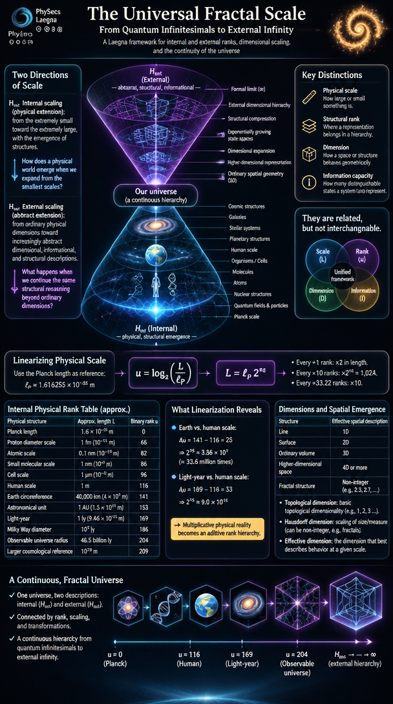

This is ChatGPT article, based on and contributing to:
- [PhySecs Laegna](DataRfx/PhySecs⊘⊖⊕⊗.md)

 

---

# The Universal Fractal Scale
## From Quantum Infinitesimals to External Infinity

### A Laegna framework for internal and external ranks, dimensional scaling, and the continuity of the universe

---

# 1. The central idea

The universe can be examined through two complementary directions:

- **Internal scaling (H_int):** moving from the extremely small toward the extremely large, following physical extension and the emergence of structures.
- **External scaling (H_ext):** moving from ordinary physical dimensions toward increasingly abstract dimensional, informational, and structural descriptions.

These are not necessarily two different universes. They are two ways of describing relationships within one universe.

The internal direction asks:

> How does a physical world emerge when we expand from the smallest scales?

The external direction asks:

> What happens when we continue the same structural reasoning beyond ordinary physical dimensions?

The central proposal is that both directions can be organized through rank, scaling, and transformations between descriptions.

A useful distinction must be maintained throughout:

- **Physical scale** tells us how large or small something is.
- **Structural rank** tells us where a representation belongs in a hierarchy.
- **Dimension** tells us how a space or structure behaves geometrically.
- **Information capacity** tells us how many distinguishable states a system can represent.

They may be related, but they are not interchangeable.

The purpose of this framework is to find a continuous mathematical language connecting them.

---

# 2. Two directions of scale

## 2.1 Internal scale — H_int

The internal direction begins with extremely small physical scales and expands toward macroscopic reality.

A simplified sequence is:

    Planck scale
        ↓
    Quantum fields and particles
        ↓
    Nuclear structures
        ↓
    Atoms
        ↓
    Molecules
        ↓
    Cells
        ↓
    Organisms
        ↓
    Human scale
        ↓
    Planetary structures
        ↓
    Stellar systems
        ↓
    Galaxies
        ↓
    Cosmic structures

Each transition introduces new effective descriptions.

For example:

- Quantum mechanics describes states and interactions.
- Atomic physics describes electron distributions and atomic structure.
- Chemistry describes molecular bonds and reactions.
- Biology describes organized living systems.
- Planetary physics describes large-scale gravitational structures.
- Cosmology describes the universe on its largest observable scales.

These are not completely independent worlds.

Atoms are still quantum systems. Organisms still consist of atoms. Planets still consist of matter governed by microscopic interactions.

What changes is which relationships dominate the description.

This is an important feature of scale:

**A larger system does not stop obeying smaller-scale physics. It develops additional effective structures.**

## 2.2 External scale — H_ext

The external direction continues the hierarchy through increasingly abstract dimensional and structural representations.

The proposed sequence is:

    Ordinary spatial geometry
        ↓
    Higher-dimensional representation
        ↓
    Dimensional expansion
        ↓
    Exponentially growing state spaces
        ↓
    Structural compression
        ↓
    External dimensional hierarchy
        ↓
    Formal limit toward infinity

Here, we must distinguish physical expansion from mathematical expansion.

A larger value of D does not automatically mean that physical space has more dimensions. It may instead represent:

- More independent structural coordinates.
- A larger mathematical state space.
- Greater representational capacity.
- A higher-order description of relationships.

The external hierarchy is therefore best treated as a formal model until a physical interpretation is specified.

---

# 3. Linearizing physical scale

Ordinary physical distances grow multiplicatively.

The difference between a meter and a kilometer is not comparable to the difference between a kilometer and a light-year.

A linear rank coordinate can solve this problem.

Let the Planck length be the reference:

$$
\ell_P \approx 1.616255 \times 10^{-35}\ \mathrm{m}
$$

Define the binary physical-scale coordinate:

$$
u = \log_2\left(\frac{L}{\ell_P}\right)
$$

where:

- L is a physical length.
- \ell_P is the Planck length.
- u is the linearized physical rank.

The inverse transformation is:

$$
L = \ell_P 2^u
$$

This gives us an important property:

$$
u(L_2)-u(L_1) = \log_2\left(\frac{L_2}{L_1}\right)
$$

Every increase of one rank corresponds to doubling the physical length.

Every increase of ten ranks corresponds to:

$$
2^{10}=1024
$$

Every increase of approximately 33.22 ranks corresponds to a factor of ten.

Thus, enormous physical distances can be represented on one linear axis.

The Planck length is used here as a mathematical reference, not as proof that shorter physical lengths are impossible.

---

# 4. The internal physical rank table

The following table provides approximate positions on the binary physical-scale axis.

The ranks are calculated from the reference Planck length. They are not automatically identical to every structural rank used elsewhere in Laegna.

| Physical structure | Approximate length | Binary rank u |
|---|---:|---:|
| Planck length | 1.6 × 10^-35 m | 0 |
| Proton diameter scale | 1 fm | 66 |
| Atomic scale | 0.1 nm | 82 |
| Small molecular scale | 1 nm | 86 |
| Cell scale | 1 μm | 96 |
| Human scale | 1 m | 116 |
| Earth circumference | 40,000 km | 141 |
| Astronomical unit | 1 AU | 153 |
| Light-year | 1 ly | 169 |
| Milky Way diameter | 100,000 ly | 186 |
| Observable universe radius | 46.5 billion ly | 204 |
| Larger cosmological reference | 10^28 m | 209 |

These values are approximate because the selected physical objects have different characteristic sizes.

For example, an atom does not have one perfectly defined diameter, and the observable universe has a horizon-dependent definition.

Nevertheless, the table demonstrates how a single logarithmic coordinate can connect the quantum, biological, planetary, galactic, and cosmological regimes.

## 4.1 What does linearization reveal?

Consider the distance between the human scale and the Earth scale:

$$
\Delta u \approx 141-116=25
$$

This means that Earth is approximately:

$$
2^{25}\approx 3.36\times10^7
$$

times larger than the one-meter reference.

The difference between a human and a light-year is:

$$
169-116=53
$$

or approximately:

$$
2^{53}\approx 9.0\times10^{15}
$$

The same coordinate can describe both differences without requiring an entirely new numerical system.

This is the first useful meaning of a linearized universe:

**Multiplicative physical reality becomes an additive rank hierarchy.**

---

# 5. Internal dimensions and spatial emergence

Physical scale and spatial dimension are related, but they describe different things.

A length coordinate tells us how far apart two points are.

A dimension tells us how many independent directions are required to describe a space.

For example:

| Structure | Effective spatial description |
|---|---|
| Line | 1D |
| Surface | 2D |
| Ordinary volume | 3D |
| Higher-dimensional mathematical space | 4D or more |
| Fractal structure | Potentially non-integer dimension |

A three-dimensional object can contain structures whose effective dimension is fractional.

For example, a branching structure may occupy a three-dimensional region while its mass distribution has a non-integer fractal dimension.

This means that dimensionality is not always simply a count of ordinary spatial directions.

We should distinguish:

- **Topological dimension:** the basic topological dimensionality of a space.
- **Hausdorff dimension:** a measure of scaling behavior.
- **Spectral dimension:** a dimension inferred from diffusion or propagation.
- **Effective dimension:** the dimension relevant to a particular physical description.

These distinctions are especially important when discussing quantum gravity and the Planck scale.

---

# 6. The quantum limit: approaching zero

The first direction of the fractal investigation is:

$$
L \rightarrow 0
$$

What happens when we repeatedly reduce the scale of observation?

At ordinary scales, objects appear continuous.

At atomic scales, matter becomes structured through quantum states, electron distributions, and interactions.

At nuclear scales, different degrees of freedom dominate.

At still smaller scales, conventional descriptions of spacetime may become inadequate.

The Planck length is approximately:

$$
\ell_P = \sqrt{\frac{\hbar G}{c^3}}
$$

It combines three fundamental constants:

- \hbar: quantum action.
- G: gravitational coupling.
- c: speed of light.

It identifies a scale at which quantum effects and gravitational effects are expected to become simultaneously important.

However, a complete experimentally confirmed theory of quantum gravity is not yet available.

Therefore, the Planck scale is a significant theoretical reference, not a confirmed smallest possible object.

## 6.1 Schrödinger scaling

The Schrödinger equation provides an important example of how physical descriptions change under scale transformations.

For a free non-relativistic particle:

$$
i\hbar\frac{\partial\psi}{\partial t} = -\frac{\hbar^2}{2m}\nabla^2\psi
$$

Consider the transformation:

$$
x \rightarrow \lambda x
$$

The spatial derivative transforms as:

$$
\nabla^2 \rightarrow \lambda^{-2}\nabla^2
$$

To preserve the form of the free Schrödinger equation, time scales as:

$$
t \rightarrow \lambda^2t
$$

This is an example of a dynamical scaling exponent:

$$
z=2
$$

More generally:

$$
t \propto L^z
$$

For this particular equation, z = 2.

This is important because spatial and temporal scales do not always transform identically.

A scale transformation can preserve the mathematical structure of a theory while changing the relative scaling of space and time.

That provides a useful analogy for investigating Laegna's internal and external transformations.

It does not, by itself, establish that the universe follows the same scaling law at every scale.

---

# 7. The external limit: approaching infinity

The complementary direction is:

$$
D \rightarrow \infty
$$

Here, D represents a formal dimensional or structural quantity.

The question is no longer simply how far apart physical objects are.

Instead, we ask how a structure behaves when its dimensional representation grows without bound.

The Laegna framework proposes the external exponents:

$$
E(D)=\frac{D-1}{2}
$$

The internal spatial exponent is:

$$
\alpha_{\mathrm{int}}=E(D)
$$

The external spatial exponent is:

$$
\alpha_{\mathrm{ext}}=\frac{1}{E(D)}
$$

The external temporal exponent is:

$$
\beta_{\mathrm{ext}}=-E(D)
$$

Therefore:

$$
\alpha_{\mathrm{int}}\alpha_{\mathrm{ext}}=1
$$

This reciprocal relationship is the central mathematical feature of the proposed internal/external inversion.

As D grows:

$$
E(D)\rightarrow\infty
$$

and consequently:

$$
\alpha_{\mathrm{ext}}\rightarrow0
$$

while:

$$
\beta_{\mathrm{ext}}\rightarrow-\infty
$$

The formal interpretation is that increasing external rank corresponds to a progressively compressed spatial exponent and an increasingly large negative temporal exponent.

This is a mathematical construction within the Laegna model.

It should not yet be interpreted as an experimentally established law of physical spacetime.

---

# 8. External dimensional hierarchy

The proposed external sequence is:

$$
D = 16,\ 256,\ 65536,\ 2^{32},\ 2^{128}
$$

The sequence is highly nonlinear.

To make it easier to compare, introduce a second linearized coordinate:

$$
v=\log_2(\log_2 D)
$$

for D greater than 1.

The inverse is:

$$
D=2^{2^v}
$$

This gives:

| External rank v | D |
|---:|---:|
| 2 | 16 |
| 3 | 256 |
| 4 | 65,536 |
| 5 | 2^32 |
| 6 | 2^64 |
| 7 | 2^128 |

The original sequence skips 2^64. Including it makes the logarithmic rank progression regular.

Notice what this transformation accomplishes.

The dimensional quantity D grows extremely rapidly, but the coordinate v increases by one at each step.

This is another form of linearization:

$$
\text{Double exponential growth}
\rightarrow
\text{Linear rank}
$$

## 8.1 Internal and external exponents

Using the proposed Laegna relation:

$$
E(D)=\frac{D-1}{2}
$$

we obtain:

| D | E(D) | External spatial exponent 1/E |
|---:|---:|---:|
| 3 | 1 | 1 |
| 16 | 7.5 | 0.1333 |
| 256 | 127.5 | 0.00784 |
| 65,536 | 32,767.5 | 0.0000305 |
| 2^32 | ≈ 2.147 × 10^9 | ≈ 4.66 × 10^-10 |
| 2^64 | ≈ 9.22 × 10^18 | ≈ 1.08 × 10^-19 |
| 2^128 | ≈ 1.70 × 10^38 | ≈ 5.88 × 10^-39 |

This table shows the formal inversion clearly.

The internal exponent grows with D.

The external spatial exponent approaches zero.

The external temporal exponent becomes increasingly negative.

---

# 9. What does external compression mean?

It is useful to distinguish three different concepts.

### 9.1 Physical compression

An object becomes physically smaller.

For example, matter is compressed into a smaller volume.

### 9.2 Dimensional compression

A mathematical representation requires fewer effective coordinates or degrees of freedom.

For example, a complicated structure may be represented by a lower-dimensional model.

### 9.3 Informational compression

A large amount of information is represented through a smaller description.

For example, a regular pattern can be represented by a short generating rule.

These concepts are related, but they are not identical.

The external Laegna transformation can be interpreted as a form of dimensional or representational compression.

As external rank increases, the spatial exponent approaches zero.

This does not necessarily mean that physical space disappears.

It may mean that spatial extension becomes less important in the chosen representation, while structural or informational relationships become dominant.

That is a useful hypothesis to investigate.

---

# 10. The dimensional-analysis requirement

There is an important mathematical issue when interpreting the external exponents physically.

The speed of light has units:

$$
[c]=\frac{\mathrm{m}}{\mathrm{s}}
$$

Therefore:

$$
[c^E]=\left(\frac{\mathrm{m}}{\mathrm{s}}\right)^E
$$

This is not dimensionally equivalent to:

$$
\mathrm{m}^{1/E}\mathrm{s}^{-E}
$$

Consequently, the relation:

$$
m^1s^{-1}\rightarrow m^{1/E}s^{-E}
$$

cannot be derived simply by raising c to the power E.

A physical implementation needs a dimensionless scaling law.

One possible approach is to introduce reference units:

$$
\bar L=\frac{L}{L_0}
$$

$$
\bar t=\frac{t}{t_0}
$$

Then both quantities are dimensionless.

A proposed transformation can be written:

$$
\bar L_{\mathrm{ext}}=\bar L^{1/E}
$$

$$
\bar t_{\mathrm{ext}}=\bar t^{-E}
$$

These expressions are mathematically valid for positive dimensionless quantities.

However, their physical meaning still needs to be defined.

In particular, a negative temporal exponent is not automatically equivalent to time running backward.

It could describe an inverse scaling relationship, a change of temporal reference, or a different mathematical representation of temporal processes.

The interpretation must follow from the model's transformation rules.

---

# 11. The fractal connection: whole and parts

The next question is whether internal and external scaling can be connected through a common structural principle.

This is where fractal reasoning becomes useful.

A fractal is often associated with self-similarity: a structure resembles itself under changes of scale.

But there are two different concepts worth separating.

## 11.1 Geometric self-similarity

A structure has a scaling relationship such as:

$$
f(\lambda x)=\lambda^d f(x)
$$

where d is a scaling exponent.

The structure preserves a mathematical relationship under a change of scale.

This is a relatively strict mathematical condition.

## 11.2 Structural recursion

A more general system can contain repeated relationships without having identical geometry.

For example:

- A cell contains organized molecular structures.
- An organism contains organized cellular structures.
- A society contains organized human structures.
- A galaxy contains organized stellar structures.

These systems are not geometrically identical.

However, they can share certain organizational properties:

- Components.
- Interactions.
- Boundaries.
- Hierarchies.
- Feedback.
- Energy exchange.
- Information transfer.

This is structural correspondence rather than exact geometric self-similarity.

It is a more flexible way to investigate relationships between physical scales.

---

# 12. A normalized correspondence operator

To express this idea mathematically, define a normalization operator:

$$
\mathcal N(S)
$$

where S is a system and \mathcal N extracts the structural properties relevant to a comparison.

Two systems may be considered structurally corresponding when:

$$
A\boldsymbol{\⊜}B
\quad\Longleftrightarrow\quad
\mathcal N(A)\approx\mathcal N(B)
$$

The symbol \boldsymbol{\⊜} represents structural equivalence or correspondence.

The approximation is important.

A biological cell and a galaxy are not the same physical object.

But one may investigate whether selected properties of their organization can be represented through similar mathematical structures.

For example:

- A network of interacting components.
- A hierarchy of subsystems.
- A distribution of connections.
- A set of energy or information flows.

The operator does not claim that all such systems are equivalent.

It provides a way to define precisely which properties are being compared.

## 12.1 Recursive structural scaling

Let a system at rank n be represented by:

$$
S_n
$$

A recursive transformation produces:

$$
S_{n+1}=\mathcal F(S_n)
$$

If the normalized structure is approximately preserved:

$$
\mathcal N(S_{n+1})\approx\mathcal N(S_n)
$$

then the system exhibits structural recurrence across ranks.

This is the mathematical foundation for a generalized fractal hierarchy.

The transformation \mathcal F need not preserve physical size, material, or dynamics.

It preserves selected relationships.

---

# 13. A unified coordinate system

We now have two independent linearized coordinates.

The internal physical coordinate:

$$
u=\log_2\left(\frac{L}{\ell_P}\right)
$$

The external structural coordinate:

$$
v=\log_2(\log_2D)
$$

These describe different kinds of scale.

- u measures physical extension.
- v measures the growth of a formal dimensional hierarchy.

They should not be treated as the same quantity.

Instead, they form a two-dimensional rank map:

$$
\mathbf R=(u,v)
$$

This is a useful representation of the Laegna universe.

    External rank v
           ↑
           |
           |      External dimensional
           |      and informational hierarchy
           |
           |
           |
           |
           +----------------------------→
               Quantum       Human       Cosmic
               scale         scale       scale

                     Physical rank u

The horizontal direction describes physical scale.

The vertical direction describes external structural rank.

A system can therefore be:

- Physically small but structurally complex.
- Physically large but structurally simple.
- Physically large and structurally complex.
- Physically small and structurally simple.

This prevents a common mistake: assuming that physical size and complexity must always increase together.

---

# 14. Connecting the two directions

The most interesting question is whether we can travel continuously from one coordinate system to the other.

We can express a general transformation as:

$$
\Phi:
(u,v)\rightarrow(u',v')
$$

The transformation should preserve whichever structural properties are relevant.

For example:

$$
\mathcal N(S(u,v))
\approx
\mathcal N(S(u',v'))
$$

This means that the same structural relationship may be represented at different physical scales or different external ranks.

However, a physical distance cannot automatically become an external dimension.

A conversion rule must define the relationship.

One possible general form is:

$$
v=\mathcal G(u,\mathcal N(S))
$$

where:

- u is physical rank.
- \mathcal N(S) is the normalized structural representation.
- \mathcal G is a transformation rule.

The function \mathcal G remains to be specified.

It is not enough to say that physical infinity becomes external infinity.

We must define how the transition preserves information, geometry, or other invariants.

This is where the Laegna operators can become useful.

---

# 15. A continuous journey through the realms

The complete conceptual journey can now be divided into five regions.

## Region I — Quantum infinitesimals

$$
L\rightarrow0
$$

The description approaches quantum and eventually quantum-gravitational regimes.

The relevant questions concern:

- Quantum states.
- Fields and interactions.
- The structure of spacetime.
- Effective dimensions.
- Limits of classical geometry.

The Planck scale is a natural reference point.

It is not necessarily an absolute boundary.

## Region II — Internal emergence

$$
u:0\rightarrow\infty
$$

The physical scale expands.

Quantum structures form the basis of atoms, molecules, cells, organisms, planets, stars, and galaxies.

Different effective theories become useful at different ranks.

The physical world becomes increasingly extended, but its underlying interactions remain connected.

## Region III — The transition region

This is the conceptual meeting point between physical extension and structural representation.

A three-dimensional physical description may be replaced by a more abstract representation.

The relevant question is:

> Which properties remain invariant when the description changes?

This region is where holographic ideas, dimensional reduction, and normalized structural equivalence may be investigated.

It is not necessarily another physical location.

It may be a transition between coordinate systems.

## Region IV — External hierarchy

$$
v:0\rightarrow\infty
$$

The formal dimensional hierarchy expands.

The number of represented degrees of freedom, dimensions, or structural states may grow rapidly.

The spatial exponent becomes progressively smaller under the proposed Laegna inversion:

$$
\alpha_{\mathrm{ext}}=\frac{1}{E(D)}
$$

The external representation becomes increasingly compressed in its spatial exponent.

## Region V — External infinity

$$
D\rightarrow\infty
$$

The formal limit gives:

$$
\alpha_{\mathrm{ext}}\rightarrow0
$$

and:

$$
\beta_{\mathrm{ext}}\rightarrow-\infty
$$

This is the limiting behavior of the proposed exponent system.

It is not a statement that an observable physical universe necessarily ends in a zero-dimensional state.

It describes what happens to the mathematical representation as D increases without bound.

---

# 16. Why the universe may appear fractal

The universe contains structures at many scales.

Some exhibit approximate self-similarity.

Examples include:

- Branching structures.
- Turbulent flows.
- River networks.
- Certain biological networks.
- Clustering patterns.
- Some statistical distributions of matter.

But not every large-scale structure is a fractal.

For example, the universe is statistically homogeneous and isotropic on sufficiently large cosmological scales according to the standard cosmological model.

Therefore, a universal fractal theory must not assume that every structure repeats geometrically forever.

A stronger and more useful proposition is:

**The universe may contain recurring structural principles whose mathematical expressions depend on scale.**

This allows us to investigate similarities without forcing unrelated physical systems into identical geometries.

## 16.1 Scale-dependent dimensionality

There are theoretical approaches to quantum gravity in which the effective spectral dimension changes with scale.

Some models, including causal dynamical triangulations, find behavior in which the spectral dimension approaches approximately four at large scales and approaches approximately two at very short scales.

This is interesting because it suggests that the effective dimensionality of spacetime may depend on the scale at which it is examined.

However:

- These are theoretical results.
- They depend on the model and the definition of dimension.
- They are not direct experimental proof that spacetime literally changes its topological dimension.

The important connection is methodological:

**Dimensionality can be a scale-dependent property of a description.**

This provides a scientifically motivated area for comparison with Laegna's H_int and H_ext framework.

---

# 17. The role of time

Physical scale is usually measured in meters.

But the universe is also a hierarchy of temporal processes.

Consider:

- Quantum interactions.
- Atomic transitions.
- Molecular vibrations.
- Biological processes.
- Human activity.
- Planetary rotation.
- Stellar evolution.
- Cosmological evolution.

These processes operate over vastly different timescales.

A complete scale system should therefore include a temporal coordinate.

For example:

$$
w=\log_2\left(\frac{t}{t_0}\right)
$$

where t_0 is a reference time.

Then the internal physical representation becomes:

$$
\mathbf R_{\mathrm{int}}=(u,w)
$$

This allows us to distinguish physical size from characteristic duration.

Two systems can have similar physical scales but very different temporal behavior.

Likewise, two systems can have similar temporal durations but very different physical sizes.

The Schrödinger scaling example already demonstrated that space and time can scale differently.

The external temporal exponent in Laegna could therefore be investigated as part of a more general transformation between spatial and temporal coordinates.

But the transformation needs a defined physical interpretation before it can be treated as a law.

---

# 18. A possible universal scale equation

The different parts can be collected into one formal representation.

Let:

- T represent measurable physical quantities.
- R represent structural rank.
- D_int represent internal effective dimensionality.
- D_ext represent external formal dimensionality.
- N represent normalized structure.

Then:

$$
\mathcal U=
\mathcal H(T,R,D_{\mathrm{int}},D_{\mathrm{ext}},\mathcal N)
$$

Here, \mathcal H is a general representation of the universe across different scales.

It is not yet a predictive physical equation.

It is a framework for organizing the relationships that a more complete theory would need to define.

A more explicit coordinate representation is:

$$
\mathbf R=
\left(
\log_2\frac{L}{\ell_P},
\log_2\frac{t}{t_0},
\log_2(\log_2D)
\right)
$$

This provides three independent axes:

1. Physical length rank.
2. Physical time rank.
3. External dimensional rank.

The system can then be extended with other quantities, such as mass, energy, curvature, or information.

The important point is that these quantities should remain distinguishable rather than being merged into one arbitrary number.

---

# 19. The Laegna operators and the scale transformations

The Laegna operators can be interpreted as a possible language for transformations between different representations.

The exact definitions must be supplied by the mathematical system, but their roles can be organized as follows.

| Operator | Possible role in the scale framework |
|---|---|
| \odot | Multiplicative or scale-related transformation |
| \otimes | Combined or higher-order structural composition |
| \oplus | Additive or compositional transformation |
| \boldsymbol{\⊚} | Geometric or holographic correspondence |
| \boldsymbol{\⊜} | Normalized structural equivalence |

These descriptions are functional suggestions, not substitutes for the formal definitions in the Laegna mathematical system.

A particularly useful property to investigate is whether a transformation preserves normalized structure:

$$
\mathcal N(\Phi(S))\approx\mathcal N(S)
$$

If so, the transformation can connect different ranks without losing the selected structural relationships.

This would provide a mathematical basis for moving between internal and external descriptions.

---

# 20. The most important distinctions

For the framework to remain mathematically consistent, several distinctions must be maintained.

| Quantity | Meaning | What it does not automatically mean |
|---|---|---|
| L | Physical length | Structural complexity |
| u | Logarithmic physical rank | Physical dimension |
| R | Laegna structural rank | Physical distance |
| D | Formal dimensional quantity | Number of physical spatial directions |
| E(D) | Laegna scaling exponent | Measured physical exponent |
| v | Linearized external rank | Physical distance |
| N(S) | Normalized structural representation | Complete identity of systems |
| H_int | Internal scaling framework | A separate physical universe |
| H_ext | External scaling framework | Experimentally established extra dimensions |

These distinctions make it possible to develop the model without confusing mathematical analogy with physical evidence.

---

# 21. What would make this a physical theory?

The framework becomes scientifically stronger when it makes predictions that can be distinguished from existing theories.

Several questions are especially important.

### 21.1 Define the dimensional quantity D

Is D:

- A count of independent dimensions?
- A state-space dimension?
- An information capacity?
- A rank-dependent mathematical variable?

Different answers produce different physical interpretations.

### 21.2 Define the transition function

A complete theory needs a function connecting internal and external coordinates:

$$
\Phi:(u,w,D_{\mathrm{int}})\rightarrow(v,D_{\mathrm{ext}})
$$

It should specify what is preserved during the transformation.

### 21.3 Define measurable invariants

Possible invariants include:

- Ratios of characteristic lengths.
- Dimensionless physical constants.
- Scaling exponents.
- Information measures.
- Correlation functions.
- Spectral properties.

### 21.4 Recover known physics

The framework should reproduce established physical results in the regimes where they are already tested.

For example:

- Quantum mechanics at atomic scales.
- Classical mechanics in its appropriate limits.
- General relativity in gravitational regimes.
- Standard cosmology at large scales.

### 21.5 Produce a new prediction

A useful new theory should predict something that existing theories do not predict, or explain an existing observation more effectively.

Without this, the framework remains a mathematical and conceptual model.

That is still useful, but it is a different scientific status.

---

# 22. The complete picture

We can now summarize the entire hierarchy:

    EXTERNAL LIMIT
         D → ∞
           |
           |
    Spatial exponent → 0
    Temporal exponent → -∞
           |
           |
    EXTERNAL HIERARCHY
           |
    Dimensional growth
           |
    State-space expansion
           |
    Structural compression
           |
    HOLOGRAPHIC TRANSITION
           |
    Normalized correspondence
           |
    INTERNAL HIERARCHY
           |
    Cosmic scale
           |
    Galactic scale
           |
    Stellar scale
           |
    Planetary scale
           |
    Human scale
           |
    Biological scale
           |
    Molecular scale
           |
    Atomic scale
           |
    Nuclear scale
           |
    Quantum description
           |
    PLANCK REFERENCE
           |
         L → 0

This is not a literal map of physical locations.

It is a map of transformations between scales and descriptions.

The internal direction describes how physical extension develops.

The external direction describes how dimensional and structural representations may expand.

The transition between them asks whether the same normalized relationships can be preserved.

---

# 23. Final proposition: one universe, multiple scales

The most useful conclusion is not that everything is identical at every scale.

It is that different scales may be connected through recurring mathematical relationships.

A quantum system, a biological organism, a planetary system, and a galaxy are physically different.

But they can all be investigated through:

- Components and relationships.
- Boundaries and interactions.
- Energy and information flows.
- Dimensional descriptions.
- Scaling laws.
- Hierarchical organization.

The fractal question is therefore:

$$
\boxed{
\mathcal N(S_{n+1})\approx\mathcal N(S_n)
}
$$

Does the normalized structure remain recognizable as we move from one rank to another?

The internal question is:

$$
\boxed{
u=\log_2\left(\frac{L}{\ell_P}\right)
}
$$

Can physical extension be represented as a continuous linearized rank?

The external question is:

$$
\boxed{
v=\log_2(\log_2D)
}
$$

Can an exponentially growing dimensional hierarchy be represented through a continuous linearized coordinate?

And the unifying question is:

$$
\boxed{
\Phi:
\text{Physical scale}
\longleftrightarrow
\text{Structural scale}
}
$$

Can we define a transformation that connects the two while preserving meaningful mathematical relationships?

This is the central research direction of the Universal Fractal Scale.

It begins with the quantum limit, expands through the physical universe, and continues into external dimensional representations.

It does not require every realm to be physically identical.
It requires that the relationships between realms can be described, compared, and potentially transformed through a consistent mathematical system.

**The universe becomes a continuous hierarchy of physical scales, structural ranks, and dimensional representations — with fractal correspondence providing the possibility of connecting the whole to its parts.**
