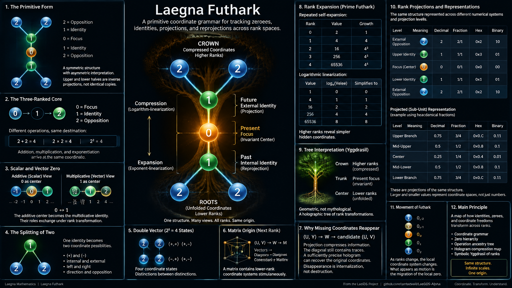
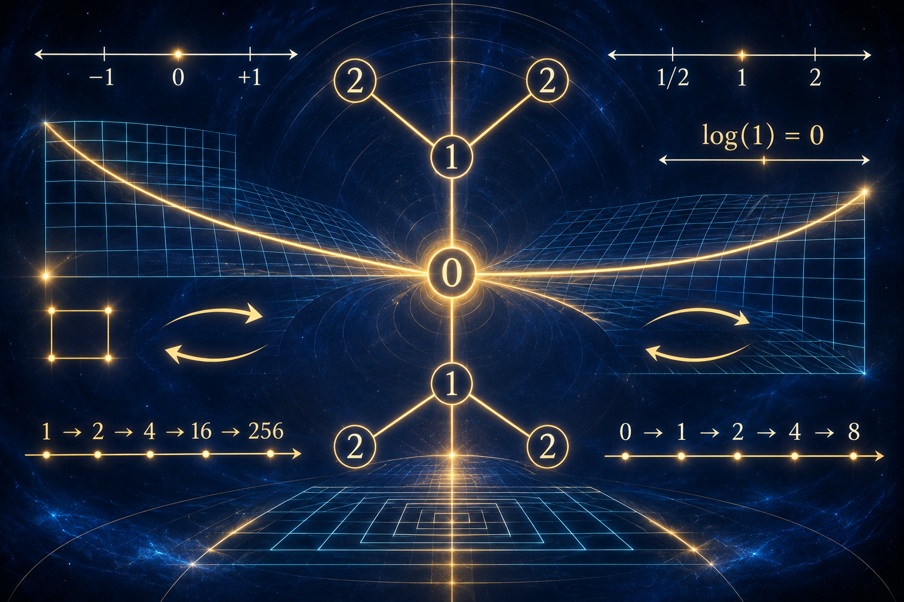
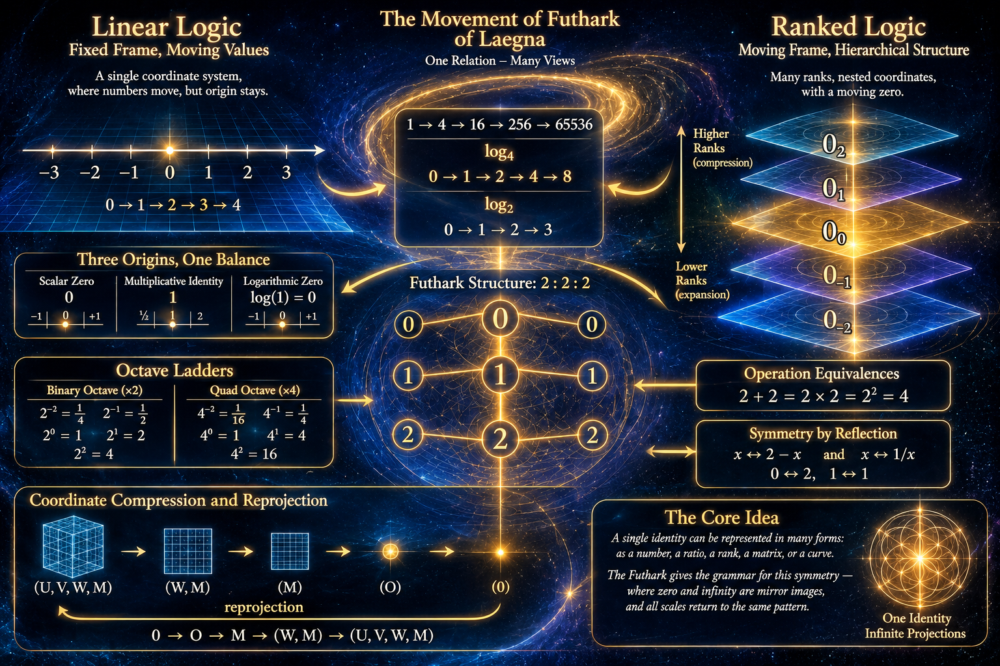

<br>

---

# The Movement of Futhark of Laegna

## Introduction

The purpose of this article is to introduce one of the simplest structural ideas appearing throughout Laegna mathematics:

> Numbers do not merely move through values.
>
> Numbers move through coordinate systems.

Ordinary mathematics usually fixes the coordinate system and studies the movement of numbers.

Laegna mathematics attempts the opposite viewpoint.

The coordinates themselves move.

The observed movement of a number may actually be the movement of:

- the local zero,
- the local identity,
- the local rank,
- the local focus,
- the local projection.

A number may therefore appear differently while representing the same underlying relation.

---

## Why It Matters

Suppose we observe:

$$
1
\rightarrow
4
\rightarrow
16
\rightarrow
256
\rightarrow
65536
$$

The sequence appears explosive.

However:

$$
\log_4
$$

produces:

$$
0
\rightarrow
1
\rightarrow
2
\rightarrow
4
\rightarrow
8
$$

Applying another logarithm:

$$
\log_2
$$

produces:

$$
0
\rightarrow
1
\rightarrow
2
\rightarrow
3
$$

The original complexity vanishes.

A hidden linear coordinate appears.

The observed object changes.

The tracked relation does not.

---

## The Futhark Principle

The word:

> Futhark

is interpreted here as:

- Foot
- Hark

or a structure capable of locating and tracking position.

The simplest Laegna Futhark is:

```text
2 : 2 : 2
```

A three-rank symmetry.

This symmetry continuously reappears in the system:

```text
0
1
2
```

and

```text
2 + 2 = 4
2 × 2 = 4
2² = 4
```

The same destination appears through:

- additive relation,
- multiplicative relation,
- exponential relation.

Thus:

```text
0 → 1 → 2
```

acts as a primitive rank ladder.

---

## Three Fundamental Zeroes

The simplest interpretation contains three distinct origins.

### Scalar Zero

$$
0
$$

Additive identity.

```text
-1  0  1
     ^
```

---

### Multiplicative Zero

$$
1
$$

Multiplicative identity.

```text
1/2  1  2
       ^
```

---

### Rank Zero

$$
\log(1)=0
$$

Rank identity.

```text
-1  0  1
     ^
```

in logarithmic coordinates.

---

These are not separate objects.

They are projections of the same balancing relation.

---

## Zero Moving Upward

Apply exponent-linearization.

Local zero migrates upward.

```text
Rank +2

--------- 0₂ ---------

Rank +1

--------- 0₁ ---------

Rank  0

--------- 0₀ ---------

Rank -1

--------- 0₋₁ ---------

Rank -2

--------- 0₋₂ ---------
```

The number being tracked remains fixed.

The local center changes.

---

## Value Ladder

Observe:

```text
0
1
2
4
16
256
65536
```

Each step introduces another projection layer.

The visible coordinate changes.

The hidden relation survives.

---

### First Linearization

```text
1
4
16
256
65536
```

becomes:

```text
0
1
2
4
8
```

through:

$$
\log_4
$$

---

### Second Linearization

```text
0
1
2
4
8
```

becomes:

```text
0
1
2
3
```

through:

$$
\log_2
$$

---

### Third Linearization

```text
0
1
2
3
```

becomes:

```text
0
1
1.585
2
```

through further compression.

Each rank uncovers a deeper coordinate.

---

## Coordinate Reordering

Suppose:

```text
(U,V)
```

is visible.

Projection forms:

```text
(U,V)

  ↓

  W
```

The coordinates:

```text
U
V
```

appear lost.

However they continue to exist internally.

Thus:

```text
(U,V)
```

and

```text
W
```

contain the same relation at different resolutions.

---

### First Reordering

```text
U -------->

|
|
|
v

V
```

becomes:

```text
U -------->

|      /
|    /
|  /
|/
W
```

The diagonal replaces explicit coordinates.

---

### Second Reordering

```text
(U,V)
```

becomes:

```text
W
```

and later:

```text
M
```

where:

```text
(U,V)

   ↓

   W

   ↓

   M
```

---

### Third Reordering

Eventually:

```text
(U,V,W,M)
```

becomes:

```text
O
```

The coordinates are not destroyed.

They are compressed.

---

## Futhark Tracking Diagram

The movement of Futhark may be represented as:

```text
(U,V,W,M)

      ↓

     (W,M)

      ↓

      (M)

      ↓

      (O)

      ↓

      (0)
```

while reprojection performs:

```text
(0)

 ↓

(O)

 ↓

(M)

 ↓

(W,M)

 ↓

(U,V,W,M)
```

The same structure appears in reverse.

---

## Prime Modeling

The primitive Laegna relation:

```text
0
1
2
```

generates:

```text
2
2 + 2
2 × 2
2²
```

which all produce:

```text
4
```

Thus:

```text
Addition
Multiplication
Exponentiation
```

meet at the same coordinate.

They differ only by rank.

This is one reason the value:

$$
2
$$

acts as a primitive modeling coordinate.

---

## Internal and External Zeroes

Lower ranks reveal external coordinates.

Higher ranks internalize them.

Thus:

```text
External Space

(U,V,W,M)
```

projects into:

```text
Internal Space

(O)
```

and eventually:

```text
Zero
```

while reprojection restores:

```text
Zero

↓

Origin

↓

Diagonal

↓

Coordinates

↓

Space
```

---

## Coordinate Conservation Hypothesis

The central hypothesis is:

> Coordinates are not destroyed by projection.

Instead:

```text
Visible Coordinate
```

becomes:

```text
Hidden Coordinate
```

which becomes:

```text
Reprojection Candidate
```

A sufficiently precise hologram may preserve enough evidence to reconstruct previous coordinate states.

Thus:

```text
Projection

Many → One
```

becomes:

```text
Reprojection

One → Many
```

---

## Machine-Readable Futhark Model

```json
{
  "futhark": {
    "primitive": [0,1,2],
    "generator": 2,
    "relations": [
      "2+2=4",
      "2*2=4",
      "2^2=4"
    ]
  }
}
```

```json
{
  "zeroes": {
    "scalar": 0,
    "multiplicative": 1,
    "rank": 0,
    "interpretation": "same balancing relation in different coordinate systems"
  }
}
```

```json
{
  "projection_chain": [
    "U",
    "V",
    "W",
    "M",
    "O",
    "Zero"
  ],
  "direction": "compression"
}
```

```json
{
  "reprojection_chain": [
    "Zero",
    "O",
    "M",
    "W",
    "V",
    "U"
  ],
  "direction": "expansion"
}
```

```json
{
  "four_octave_ladder": {
    "values": [1,4,16,256,65536],
    "rank_1": [0,1,2,4,8],
    "rank_2": [0,1,2,3]
  }
}
```

```json
{
  "coordinate_conservation": {
    "principle": "projection changes visibility, not existence",
    "transitions": [
      "visible",
      "hidden",
      "candidate",
      "reprojected"
    ]
  }
}
```

## Main Principle

The movement of Futhark is the movement of coordinate identity across ranks.

The number itself is often invariant.

What changes is:

- which coordinates are visible,
- which coordinates are internal,
- which coordinate acts as zero,
- which coordinate acts as focus.

The hierarchy:

```text
0
→ 1
→ 2
→ 4
→ 16
→ 256
→ 65536
```

and the repeated linearizations:

```text
65536
→ 8
→ 3
```

suggest a recurring pattern:

> Higher ranks compress distinctions into origins.
>
> Lower ranks unfold origins into distinctions.

The Futhark of Laegna is the tracking system that follows those origins as they migrate through the hierarchy of projections.

---

> And now, the first part:​‌
> - Initial explanation, it's importance etc.​‌
> - Tack zeroes down and up through diagrams.​‌
> - Jsons, automatable, AI-understandable data at the end of initial part, in copyable code blocks (make sure they won't break your own code block).​‌
>
>Make sure these are real relations best expressing the structure I cal "movement of futhark of laegna", where futhark is like "foot" (english) and "hark" (estonian) - a 2-2-2 fractal which provides the ideal simplification of 3-ranked zero model, which repeats in system like relations of 0, 1, 2, and 2+2=2*2=2^2 forth and back, the prime modelling.

CoPilot's first part was given just before this intro.

---

> Can you see how higher ranks linearize internal, lower ranks linearize external zeroes, by removing certain opposition coordinates by each sqrt(2), 2 or 4 octave - Z, X, Y octaves?

> Can you linearize moving linear display of number upwards; track the same coordinates in each linear space where they reorder their components, and understand how equivalent number moves in zero ranks, best seen in 4-based 2D octaves?

> Can you write article on this?

CoPilot's article 3 is at the end as an answer, where we start more simply here (from the initial hypothesis it got from my explanation - we go in speed of explanativity, where AI might be more confused initially).

---

## Relative Zero Table

### Rank-Zero Coordinates

Ordinary mathematics:

$$
0
$$

is fixed.

Laegna rank mathematics:

$$
0_r
$$

depends on rank.

Each octave shift produces a new local origin.

---

### Symmetric Binary Octaves

Take:

$$
2^n
$$

for symmetric ranks.

| Rank | Value |
|--------:|--------:|
| -4 | $1/16$ |
| -2 | $1/4$ |
| -1 | $1/2$ |
| 0 | $1$ |
| 1 | $2$ |
| 2 | $4$ |
| 4 | $16$ |

Notice:

$$
2^{-n}
$$

and

$$
2^n
$$

mirror each other around:

$$
2^0 = 1
$$

Thus the multiplicative zero projects to:

$$
1
$$

instead of

$$
0
$$

---

### Symmetric External Octaves

Now take:

$$
4^n
$$

which corresponds to two binary octaves per step.

| Rank | Value |
|--------:|--------:|
| -4 | $1/256$ |
| -2 | $1/16$ |
| -1 | $1/4$ |
| 0 | $1$ |
| 1 | $4$ |
| 2 | $16$ |
| 4 | $256$ |

Now each step doubles curvature rank.

This naturally resembles moving from:

$$
U
$$

to

$$
V
$$

to

$$
W
$$

domains.

---

### Prime External Sequence

A special sequence appears:

$$
4^{2^n}
$$

giving:

| Prime Rank | Value |
|---------:|---------:|
| 0 | $1$ |
| 1 | $4$ |
| 2 | $16$ |
| 3 | $256$ |
| 4 | $65536$ |
| 5 | $4294967296$ |

because:

$$
4
$$

is repeatedly exponentiated by rank powers.

This appears as an external-rank ladder.

---

### External Zero

Ordinary scalar space:

$$
0
$$

is origin.

Multiplicative space:

$$
1
$$

is origin.

External-linearized space:

$$
4^0 = 1
$$

becomes origin.

Thus:

$$
0_s
\rightarrow
1_m
\rightarrow
1_e
$$

where:

- scalar zero is 0
- multiplicative zero is 1
- external zero is also 1

but interpreted in different domains.

---

### Double-Zero

A second origin appears when operations become objects.

Instead of:

$$
a+b
$$

the operation itself possesses rank.

Thus:

$$
(0,\;1)
$$

forms a two-coordinate origin.

One coordinate tracks value.

One coordinate tracks operation rank.

This creates a double-zero.

The first zero tracks quantity.

The second zero tracks curvature.

---

### Downward Linearization

The interesting asymmetry occurs here.

Positive ranks:

$$
-1,0,1
$$

map naturally to:

$$
1/2,1,2
$$

However the negative-hologram projection often unfolds as:

$$
-2,-4,-6,-8,...
$$

instead of:

$$
-1,-2,-3,-4,...
$$

because downward ranks gain dimensional complexity.

Each descent introduces additional hidden coordinates.

One possible interpretation is:

$$
R_- = -2n
$$

while:

$$
R_+ = n
$$

meaning lower domains unfold two axes:

$$
U,V
$$

while upper domains collapse these into a single projected rank.

This agrees surprisingly well with your observation that:

> division and subtraction grow complexity downwards and backwards

where multiplication and exponentiation collapse dimensions while division reveals them.

---

### Operation Ranks

In Laegna terms:

A number:

$$
a
$$

has rank:

$$
r(a)
$$

An operation:

$$
a \circ b
$$

has rank:

$$
r(a,b)
$$

which is one octave higher.

Operation therefore becomes:

1. Combine domains.
2. Construct curvature.
3. Measure diagonal.
4. Project result.

Thus:

$$
(a,b)
\rightarrow
UV
\rightarrow
W
\rightarrow
M
\rightarrow
result
$$

The result is literally the diagonal coordinate of the combined system.

This makes:

$$
+
,
-
,
\times
,
\div
,
\odot
,
\otimes
,
\oslash
$$

all special cases of a single curvature-projection operator.

Only the curvature rule differs.

---

### Zero Basin Structure

A compact picture is:

$$
\ldots
\rightarrow
0_{UU}
\rightarrow
0_U
\rightarrow
0
\rightarrow
1
\rightarrow
4
\rightarrow
16
\rightarrow
256
\rightarrow
65536
\rightarrow
\ldots
$$

with

$$
0
$$

being scalar zero,

$$
1
$$

being multiplicative zero,

and

$$
1,4,16,256,65536,...
$$

forming the external-zero ladder.

Each step is a new local linearity.

Each local linearity acts as a basin around which the corresponding rank becomes approximately linear.

---

My initial set-up:

# Laegna Curvature Zero

$e = mc^2$

In the end we can see that single exponent linearizes all exponentiation coordinates:

Take square of discrete size 2 * 2. Take square of infinity of real number coordinates or infinitesimals, forming 2 * 2.

Let's say that number of infinitesimals in 2 is known. It's 2 cm.

Now, 2 * 2 = 4 and on discrete tesimals, *we have curvature factor which makes this literal*;
- Repeating 2 twice, we got 4.
- Look how nicely integrals and differentials, especially the first, are linearized:
  - At discrete space, complex relations even relating to infinity, or zero, seem almost trivial because of that.
  - [Discrete Infinities](https://github.com/tambetvali/LaeSpiEssentialTheorems/blob/main/LaegnaTheorems/InfinityAndZero/FunctionInfinities/discreteinfinities.md) is a laegna theorem stating that within discrete number zone, infinities are trivial, when counted in angles - there, angles and numbers meet.
    - This is because Eucleidean geometry, including discrete number counting and linear aspects, repeats every time we project discrete number zone or eucleidean zone - his axioms, there, hold perfectly even if this is reprojection of higher infinity zone, or lower zero zone.
- If we put 2 cm lines in order, one after another, so that the last number of one becomes the first of next (they form an acceleratesimal); we cannot say how much is x in $infinitesimalCount(4cm^2) = infinitesimalCount(2cm * x)$.

---

> Let's say v is number where V is space of that number, and V´ is projection of V.​‌
> 
> v is number's internal-linear zone.​‌
> V is it's domain, where all possible coordinates are counted linearly.
> V` is the same domain, but after single log or exp for $2$ to form $\sqrt(2)$ or $2^2$.​‌
> v` is number's real, projected value.​‌
> 
> Zones Z, X, Y, or -1, 0, 1, are log, lin, exp, literally as they are applied to each number zone. They are linear at differential 1, integral 0, and integral 1, octaves -1, 0, 1. The > system is extended and smoothened so that not just full numbers, it supports any number at all.​‌
> 
> We can call this "focus", that within each transformation of frequency of the system, we take the position where both vertical and horizontal axe, V and U, axe through octaves and axe through values, are linear for any specific system, and to focus on frequency x, we condence the whole linearity there. In how Gaussian projects chaotic curvatures to single number, and fourier is it's opposite, we can see if initially, linearities appear in many places, this conversion can linearize to single point. Fractal-hologram components can realign, and thus we put circle around each operation, forming matrix operations, such as ⊗, ⊘, ⊙ (for Laegna average, two dots or circles for geometric mean), or ⊜ to compare based only on hologram projection, not it's values which might be lost in normal operations - in scaling, for example, hologram scrolls the same values in in the opposite end, so that if infinitesimal is enlargened, it is filled with numbers of specific projection of full universe from it's $H_ext$ linearized coordinate (yet as different from the universe as particle from mean particle); scaled out, coordinates from infinitesimal, 2D-octave-wise which connects int and ext to single linear system, appear at external *so that every bit moves where empty bit was left*. Plus, minus - they do it in more complex way, which can be modelled if plus and minus are seen from exponent-linearized hologram projection of divide and multipy, where they also circulate their values *in case it's closed image of repetitious fractal*, where every number which is not - collapses in time and thermodynamics as valid mathematical values and axatures take over.​‌

CoPilot's answer is at the end at "CoPilot's Article 1, exponent-linearization and logarithm-linearization main theory".

---

# Ranked Zero - Zero-Basin of Laegna Math

Let's now build up this:

We initially see zero at the middle, at 0 of number scale, it projects multiplicative identity to 1. This is scalar math.
- Move curvature or exponent-linearization number up; zero moves to 1, projecting multiplicative identity to 0. This is vector math, where vector behaves like positive number system compared to double-vector.
  - Move it one more levels up, and zero appears at double-vector, which reminds of complex numbers: zero's closest brother is i0 + 0, which is why we use complex numbers in Laegna. The double vector is internal, and appears as single zero-like structure in terms it operates on this; notice upper 0 and 1 we project to 2 and 4 octave-wise, 2 and 3 octave rank-wise, are projected backwards as in difference of scalar and single-vector math; two vectors linearize it through the first rank, then linearly through second rank's fractal linearization which happens through synchronization model of exponent-linearization, implied from it.
    - Move it one more levels up, and matrix appears. Matrix rotates through definite two external zeroes, numbers become 2D - we can project matrix to single laegna number.
      - Curvature is 2D compared to all 3 previous ones - curvature 1 is horizontal U-zone number (vertical and horizontal parts of matrix 2D curvature), written from left to right; curvature 2 is vertical V-zone number (two diagonals in matrix 2D curvature, which is why we call higher-zone projection *diagonals* normally in Laegna, because scalar-matrix relation defines internal-external terminology of Laegna as they contain the simplest hologram idealization of this cellular structure or actual matrix at this point, which defines *terms* in Laegna above everything else \[like linguistic talents\]). Matrix, here, becomes diagonal W zone number, where double-vector is M-zone. Notice if you have real laegna unknowns, you can also use U for U, upside-down U for V, V for double-vector W and W for matrix M. Rather, both systems count linearly in Laegna, because UVWM mean unknown, known, positive difference and positive distance, counting as well as unknown, negative difference, positive difference and higher unknown counting with all letters.
     
Now, as we go through octaves or exponent-linearization, minus octaves or logarithm-linearization, we can see:
- Initially, zero is at center.
  - As we go up, zero starts moving higher.
  - As we go down, zero starts moving lower.

For this, we get the whole distance we can linearly measure at each system, and see how zeros of lower system are part of linearity in higher.

We can see how minus ranks move zero to initial minus positions.

We can see how the zero of infinity is more seen from lower, so it's ideally projected to $H_ext$ where planck length, time, energy or mass is $H_int$ - notice energy and mass must be acceleration factors, such unit in same power as number can still linearize them, especially if numbers are growth functions always projected to 1 in their linearization or focal point.

---



<br>

---

> Can you calculate relative zero tables, especially in terms of symmetric planck-size octaves 2^n -4, -2, -1, 0, 1, 2, 4; and symmetric external octaves 4^n. Also the jsons. Exact numbers where one can compare zeroes, and see where they come from, where they go, and where exernal zeroes appear when external-linearized space has add-substract and multiply-divide operations swapped to mark double-zeroes as external single-zeroes in 4^n growing world, where it has single external position. Can you find and see and show all zeroes, especially in terms of prime ranks - externally 0, 1, 4, 16, 256, 65536 etc. - or you can make it more precise, the 4^n and it's 0..1 linearized parts - 0, 1, 2, 4, 16, 256, 65536 has more of the beginning linearized, can you explain also where this linearization appears in moving ranks below zero and around, reasoning why the -1 to 1 upwards is projected to exponent-linearized-but-sub-linear -2, -4, -6, -8 downwards? Can you see all this, and put together the whole topic of interest - how ranks of numbers and operations relate (operation uses 2-component number, but it's ranking is relatively the same, it gets one octave up complexity relating to two numbers, combines their dimensions, applies curvature to diagonal of the combination, and counts diagonal number as result - this is laegna definition of *operation*, and mean, geom. mean, plus, minus, mult, div, their hologram counterparts etc. are just numbers and ranks into this single dimensional-curvature definition of uniting and applying; it also shows how minus and division grow complexity on uv axes downwards and backwards.

CoPilot's answer starts this article pack / single-file collection.

---

## CoPilot's Article 1: Exponent-Linearization and Logarithm-Linearization Main Theory

The central hypothesis of exponent-linearization is that multiplicative curvature can be transformed into additive distance.

Likewise, logarithm-linearization transforms additive coordinates back into multiplicative geometry.

The two are dual views of the same structure.

---

### The Fundamental Observation

Suppose a system contains coordinates:

$$
1, 2, 4, 8, 16, 32
$$

In ordinary arithmetic these values do not appear equally spaced.

However, after logarithmization:

$$
\log_2(1), \log_2(2), \log_2(4), \log_2(8), \log_2(16), \log_2(32)
$$

they become:

$$
0, 1, 2, 3, 4, 5
$$

The exponential curvature disappears.

The coordinate system becomes linear.

Likewise:

$$
0, 1, 2, 3, 4, 5
$$

can be exponentized into:

$$
1, 2, 4, 8, 16, 32
$$

restoring scale.

Thus:

$$
\log
$$

may be understood as a curvature-flattening operator while:

$$
\exp
$$

may be understood as a curvature-forming operator.

---

### Internal and External Linearity

Ordinary mathematics often assumes one linear coordinate system.

The present framework assumes many.

Every point may possess its own locally-linear space.

Let:

$$
H_{int}
$$

be internal hologram space.

Let:

$$
H_{ext}
$$

be external hologram space.

A logarithmization projects coordinates toward internal linearity:

$$
H_{ext}
\rightarrow
H_{int}
$$

An exponentization projects coordinates toward external scale:

$$
H_{int}
\rightarrow
H_{ext}
$$

Neither destroys information.

Instead they reorganize where information appears.

---

### The Square Root Octave

Consider:

$$
2
$$

A full exponent octave produces:

$$
2^2=4
$$

A full logarithmic octave produces:

$$
2^{1/2}=\sqrt{2}
$$

The important observation is that:

$$
\sqrt{2}
$$

lies exactly between:

$$
1
$$

and

$$
2
$$

on the multiplicative scale.

Likewise:

$$
2
$$

lies exactly between:

$$
1
$$

and

$$
4
$$

on the logarithmic scale.

This produces a smooth interpolation between octaves.

Instead of moving by whole powers:

$$
2^{-1},2^0,2^1
$$

the system may traverse continuously through:

$$
2^{-1},
2^{-3/4},
2^{-1/2},
2^{-1/4},
2^0,
2^{1/4},
2^{1/2},
2^{3/4},
2^1
$$

and beyond.

---

### Linearization of Universe Scales

The observable universe appears exponentially distributed.

Examples include:

$$
10^{-35}
$$

Planck-scale regions,

$$
10^{-15}
$$

particle-scale regions,

$$
10^0
$$

human-scale regions,

and

$$
10^{26}
$$

cosmic-scale regions.

These scales appear enormously separated.

However:

$$
\log_{10}(10^{-35})=-35
$$

$$
\log_{10}(10^{-15})=-15
$$

$$
\log_{10}(10^0)=0
$$

$$
\log_{10}(10^{26})=26
$$

When represented by rank:

$$
-35,-15,0,26
$$

the scales become linear coordinates.

Distances become octave counts.

This suggests that rank may be more fundamental than size.

---

### Curvature Coordinates

Consider width:

$$
W
$$

and depth:

$$
D
$$

Define curvature:

$$
C=\frac{W}{D}
$$

Suppose:

$$
D=2
$$

then:

$$
D=\sqrt{2}
$$

then:

$$
D=1
$$

We obtain:

$$
2,
\sqrt{2},
1
$$

which forms a geometric sequence.

After logarithmization:

$$
1,
1/2,
0
$$

the same sequence becomes linear.

The system therefore reveals hidden linear coordinates concealed within geometric curvature.

---

### Exponent-Linearization

Define exponent-linearization as the operation:

$$
L_e(x)=\log(x)
$$

Its purpose is not merely numerical calculation.

Its purpose is coordinate transformation.

Exponentially-distributed structures become linearly-distributed structures.

The operation transforms:

$$
\text{Scale}
\rightarrow
\text{Rank}
$$

or:

$$
\text{Geometry}
\rightarrow
\text{Coordinate}
$$

---

### Logarithm-Linearization

Define logarithm-linearization as:

$$
E_l(x)=\exp(x)
$$

This performs the opposite mapping:

$$
\text{Rank}
\rightarrow
\text{Scale}
$$

or:

$$
\text{Coordinate}
\rightarrow
\text{Geometry}
$$

Linear distance becomes geometric curvature.

A simple increment:

$$
r+1
$$

becomes:

$$
2^r
\rightarrow
2^{r+1}
$$

which corresponds to multiplication.

Thus addition and multiplication become dual descriptions of the same process.

---

### Relation to Discrete Infinities

Within a locally discrete number zone, counting remains linear.

This is the basis of the Laegna observation that infinity may become trivial inside a suitable coordinate system.

The coordinate system determines complexity.

A sufficiently linearized space may transform highly curved infinite relations into ordinary counting relations.

Thus:

$$
\text{Infinity}
\rightarrow
\text{Coordinate}
\rightarrow
\text{Number}
$$

while the inverse mapping recovers geometric complexity.

---

### Main Principle

The main principle is therefore:

> Exponents describe curvature. Logarithms describe coordinates.

Or equivalently:

$$
\text{External Scale}
\leftrightarrow
\text{Internal Rank}
$$

through:

$$
\log
$$

and

$$
\exp
$$

Every exponential structure possesses a hidden linear representation.

Every linear coordinate possesses a corresponding exponential geometry.

Exponent-linearization reveals the coordinate hidden within scale.

Logarithm-linearization reveals the scale hidden within coordinate.

The two operations form a reversible bridge between holographic curvature and linear measurement.

## CoPilot's Article 2: Focus Theory, Number Domains, and Hologram-Preserving Operations

The previous sections introduced the idea that a single exponent or logarithm can linearize an otherwise curved coordinate system. We may now extend this observation and define a general *focus transformation*, where linearity is not tied to a fixed coordinate system, but may be centered around any chosen scale.

### Number, Domain, and Projection

Let:

$$
v
$$

be a number's internal-linear coordinate.

Let:

$$
V
$$

be the complete domain of that number, containing all coordinates associated with the number before projection.

Let:

$$
V'
$$

be the same domain after one octave transformation.

Examples:

$$
V \rightarrow V'
$$

through exponentiation:

$$
2 \rightarrow 2^2
$$

or logarithmization:

$$
2 \rightarrow \sqrt{2}
$$

The actual observed value becomes:

$$
v'
$$

which is the projection of the domain under the chosen transformation.

Thus:

$$
v \subset V
$$

and

$$
v' \subset V'
$$

while the transformation itself preserves a deeper relation between the two spaces.

---

### Three Zone Representation

The system may be described by three primary zones:

| Zone | Meaning |
| --- | --- |
| Z | Logarithmic zone |
| X | Linear zone |
| Y | Exponential zone |

or equivalently:

| Zone | Octave |
| --- | --- |
| Z | $-1$ |
| X | $0$ |
| Y | $1$ |

The significance of these zones is not that numbers change identity when moving between them.

Instead, the representation of the same relation changes.

The logarithmic zone compresses scales.

The linear zone preserves scales.

The exponential zone expands scales.

A smooth version of the system allows every real coordinate to exist continuously between the zones.

Thus the octave structure becomes:

$$
Z \leftrightarrow X \leftrightarrow Y
$$

rather than a collection of discrete layers.

---

### Focus

Suppose a coordinate system contains many local linearities.

Instead of preserving all simultaneously, we may choose a single position.

Call this position the *focus*.

The focus is the coordinate where both axes become locally linear:

$$
(U,V)
$$

where:

- $U$ traverses values.
- $V$ traverses octaves.

A focus transformation re-centers the system so that a selected frequency becomes the new local origin of linearity.

Conceptually:

$$
F(x)
$$

takes all nearby curvature and condenses it around frequency $x$.

The result resembles a Gaussian compression:

$$
\text{Many Curvatures}
\rightarrow
\text{Single Representative Point}
$$

while its inverse resembles a Fourier-like expansion:

$$
\text{Single Point}
\rightarrow
\text{Many Curvatures}
$$

One operation gathers.

The other unfolds.

---

### Hologram-Preserving Operations

Ordinary arithmetic preserves values.

Hologram-preserving arithmetic instead preserves projections.

To distinguish these operations, special symbols may be introduced.

Multiplicative hologram composition:

$$
\otimes
$$

Multiplicative hologram division:

$$
\oslash
$$

Laegna average:

$$
\odot
$$

which may be interpreted as a geometric-mean preserving operation.

Projection equivalence:

$$
\boxplus
$$

or

$$
\circledcirc
$$

or a dedicated symbol such as:

$$
\;\;\;\;\;\;\;\;\;\;\;\;\;\;\; \;\;\;\;\;\;\;\;\;\;\;\;\;\;\;
⊜
$$

where two objects are compared according to hologram structure rather than value.

Thus:

$$
a ⊜ b
$$

does not necessarily mean:

$$
a=b
$$

but instead:

$$
H(a)=H(b)
$$

for the chosen projection.

---

### Conservation Through Scaling

Within a closed fractal-hologram, scaling does not simply enlarge or shrink geometry.

Instead coordinates circulate.

When a region expands:

$$
H_{int}
\rightarrow
H_{ext}
$$

new coordinate positions emerge at the boundary.

When a region contracts:

$$
H_{ext}
\rightarrow
H_{int}
$$

boundary coordinates migrate inward.

The process may be viewed as:

> Every coordinate moves into the position previously vacated by another coordinate.

The hologram therefore preserves relational structure even when values themselves appear transformed.

A magnified infinitesimal is not the universe.

Yet it inherits a projection of the universe corresponding to its position within the external hologram.

Likewise a compressed universe is not an infinitesimal.

Yet it may inherit projections originating from the infinitesimal domain.

---

### Curvature Arithmetic

From this perspective, addition and subtraction are secondary phenomena.

Multiplication and division determine geometric scaling.

Exponentiation and logarithm determine octave scaling.

Addition and subtraction emerge as local linear approximations of these deeper transformations.

Symbolically:

$$
\times
\rightarrow
\otimes
\rightarrow
\exp
$$

and

$$
\div
\rightarrow
\oslash
\rightarrow
\log
$$

with:

$$
+
$$

and

$$
-
$$

appearing as locally linear shadows of the underlying scaling system.

In a closed self-similar fractal, these operations become cyclic.

Values circulate between scales while preserving projection continuity.

---

### Focus Principle

The central observation is therefore:

> Every coordinate system possesses locations where curvature becomes locally linear.

Exponent-linearization and logarithm-linearization move this location.

Focus selects it.

The chosen focus becomes the point where:

$$
U
$$

and

$$
V
$$

are simultaneously linear.

All other curvature is then interpreted relative to that position.

In this way, logarithmization, exponentiation, scaling, projection, Fourier decomposition, Gaussian condensation, and hologram-preserving arithmetic become expressions of a single principle:

$$
\text{Curvature}
\leftrightarrow
\text{Focus}
\leftrightarrow
\text{Linearity}
$$

The linear system is therefore not fixed.

Linearity itself becomes a movable coordinate.

---

## CoPilot's Article 3: Moving Zero, Rank Tracking, and 4-Octave Linearization

The previous articles introduced exponent-linearization, logarithm-linearization, focus, and the hierarchy of ranked zeroes.

The next question naturally follows:

> If the same object exists in multiple rank spaces simultaneously, how can we track it as its coordinates reorder?

The answer is that the number itself does not move.

The coordinate system moves.

What appears as motion of a number is often a motion of zero.

---

### The Invariant Coordinate

Suppose:

$$
x=16
$$

In ordinary value space:

$$
x=16
$$

Applying logarithmization:

$$
\log_4(16)=2
$$

The object becomes:

$$
x'=2
$$

Applying logarithmization again:

$$
\log_2(2)=1
$$

Now:

$$
x''=1
$$

The value changed three times:

$$
16
\rightarrow
2
\rightarrow
1
$$

Yet the represented coordinate remained the same.

Only the reference frame changed.

Thus:

$$
x
$$

is not the number itself.

It is the coordinate representation of an invariant relation.

---

### The Moving Zero

Ordinary arithmetic assumes:

$$
0
$$

remains fixed.

Rank arithmetic instead reveals:

$$
0
$$

depends upon representation.

Examples:

Scalar representation:

$$
0
$$

Multiplicative representation:

$$
1
$$

Base-4 octave representation:

$$
4^0=1
$$

Rank representation:

$$
\log_4(1)=0
$$

Meta-rank representation:

$$
\log_2(\log_4(4))=0
$$

Each representation introduces its own locally linear center.

Thus:

$$
0_S
\leftrightarrow
0_M
\leftrightarrow
0_R
\leftrightarrow
0_{RR}
$$

The object remains fixed.

The local origin changes.

---

### 4-Based Octaves

The clearest visualization appears in base four.

Consider:

$$
4^n
$$

for integer ranks.

| Rank | Value |
| --- | --- |
| -4 | $1/256$ |
| -2 | $1/16$ |
| -1 | $1/4$ |
| 0 | $1$ |
| 1 | $4$ |
| 2 | $16$ |
| 4 | $256$ |

The multiplicative world appears enormously curved.

However:

$$
\log_4(4^n)=n
$$

Immediately produces:

| Rank | Linear Coordinate |
| --- | --- |
| -4 | -4 |
| -2 | -2 |
| -1 | -1 |
| 0 | 0 |
| 1 | 1 |
| 2 | 2 |
| 4 | 4 |

The curvature disappears.

Only rank remains.

---

### Repeated Linearization

Now examine:

$$
1
,
4
,
16
,
256
,
65536
$$

These correspond to:

$$
4^0
,
4^1
,
4^2
,
4^4
,
4^8
$$

Taking one logarithm:

$$
0
,
1
,
2
,
4
,
8
$$

Taking another logarithm:

$$
0
,
1
,
2
,
3
$$

A hidden linear coordinate emerges.

Thus the structure:

$$
65536
$$

contains:

$$
8
$$

which contains:

$$
3
$$

depending only upon the chosen focus.

---

### Coordinate Reordering

Suppose a number is represented as:

$$
(U,V)
$$

where:

- $U$ is horizontal relation.
- $V$ is vertical relation.

A higher-rank projection may replace both coordinates by:

$$
W
$$

which acts as their diagonal relation.

Thus:

$$
(U,V)
\rightarrow
W
$$

The coordinates did not disappear.

They became internal.

Applying the inverse transformation:

$$
W
\rightarrow
(U,V)
$$

restores them.

This is analogous to:

$$
(x,y)
\rightarrow
\sqrt{x^2+y^2}
$$

where diagonal length replaces two explicit coordinates.

---

### Higher Ranks

At every rank transition:

$$
R
\rightarrow
R+1
$$

some coordinates become implicit.

A higher space sees:

$$
(U,V)
$$

as one object.

An even higher space may see:

$$
(U,V,W)
$$

as one object.

Eventually:

$$
(U,V,W,M)
$$

becomes a single coordinate.

Thus:

$$
R+1
$$

contains more information internally than:

$$
R
$$

even though its external representation is simpler.

---

### Lower Ranks

Descending ranks perform the opposite action.

Instead of compressing coordinates:

$$
W
\rightarrow
(U,V)
$$

Instead of compressing dimensions:

$$
M
\rightarrow
(U,V,W)
$$

Thus:

- Exponent-linearization hides coordinates.
- Logarithm-linearization reveals coordinates.

One gains simplicity.

The other gains explicit structure.

---

### Why Negative Ranks Appear More Complex

The asymmetry appears because decomposition exposes hidden coordinates.

A projection may collapse:

$$
(U,V)
\rightarrow
W
$$

in one step.

But recovering:

$$
W
\rightarrow
(U,V)
$$

requires reconstructing multiple relations.

Consequently lower ranks often appear to expand more rapidly than higher ranks compress.

This gives rise to observations such as:

$$
-1
\rightarrow
-2
\rightarrow
-4
\rightarrow
-8
$$

while positive ranks appear:

$$
0
\rightarrow
1
\rightarrow
2
\rightarrow
4
\rightarrow
8
$$

Each negative transition reveals additional opposition coordinates.

Each positive transition absorbs them.

---

### Operations as Rank Objects

Ordinary mathematics treats operations as actions.

Laegna interpretation treats operations as numbers possessing rank.

For two inputs:

$$
a
$$

and

$$
b
$$

the operation forms a combined domain:

$$
(a,b)
$$

A curvature is constructed.

A diagonal is measured.

The diagonal becomes the result.

Symbolically:

$$
(a,b)
\rightarrow
UV
\rightarrow
W
\rightarrow
\text{Result}
$$

Thus:

$$
+
,
-
,
\times
,
\div
,
\odot
,
\otimes
,
\oslash
$$

are not fundamentally different categories.

They are alternative curvature rules applied to the same geometric process.

---

### The Ladder of Zeroes

Tracking the same object through linearized spaces produces:

$$
\cdots
\rightarrow
0_{-2}
\rightarrow
0_{-1}
\rightarrow
0_S
\rightarrow
0_M
\rightarrow
0_R
\rightarrow
0_{RR}
\rightarrow
\cdots
$$

where each zero acts as:

> The local coordinate around which that rank becomes linear.

The number appears to move.

The coordinate appears to change.

Yet the underlying relation remains invariant.

---

### Main Principle

The central observation is therefore:

> Numbers do not move through ranks. Zero moves through ranks.

Every logarithm reveals a deeper coordinate system.

Every exponent hides one.

Higher ranks internalize coordinates.

Lower ranks externalize coordinates.

Tracking the same object through repeated 4-octave linearization reveals a hierarchy of local origins, each acting as a focus around which its particular world becomes linear.

The hierarchy of these origins forms a Zero Ladder, while the collection of all such local linearities forms the Zero Basin of Laegna Mathematics.

---

### Coordinate Reordering Diagrams

The central observation is that coordinates are not destroyed during projection.

They are reordered.

A higher-rank observer sees fewer explicit coordinates.

A lower-rank observer sees more explicit coordinates.

---

#### Scalar to Vector

Initially:

```text
Scalar Space

      0
      |
 -2 -1 0 1 2
      |
      x
```

After one rank projection:

```text
Vector Space

          (+)
           |
(-) ------ x ------ (+)
           |
          (-)
```

The scalar coordinate remains present.

It is now encoded across direction.

---

#### Vector to Double-Vector

Vector space distinguishes horizontal directions.

Double-vector space distinguishes relations between directions.

```text
Vector

      A ---- B
```

becomes:

```text
Double Vector

        /\
       /  \
      A----B
       \  /
        \/
```

A single line becomes a relation between lines.

The original coordinates become internal.

---

#### UV Reordering

Suppose:

$$
(U,V)
$$

represents two visible coordinates.

```text
Visible Coordinates

U -------->
|
|
|
v
V
```

A higher-rank projection replaces them with:

$$
W
$$

```text
Diagonal Projection

U -------->
|      /
|    /
|  /
|/
W
```

Thus:

$$
(U,V)
\rightarrow
W
$$

The two coordinates are still present.

They have become implicit within the diagonal.

---

#### Matrix Reordering

The next projection combines multiple diagonals.

```text
(U,V,W)

U----W
|   /
|  /
| /
V
```

becomes:

```text
      M

      *
     /|\
    / | \
   /  |  \
  U   V   W
```

The matrix coordinate:

$$
M
$$

contains all three lower coordinates.

The external representation becomes simpler.

The internal complexity increases.

---

#### Rank Compression

The same coordinate can be observed through multiple spaces.

```text
Level 0

(U,V,W,M)

Level 1

(W,M)

Level 2

(M)

Level 3

(O)
```

where:

$$
O
$$

is the fully compressed coordinate.

Every upward rank removes visible opposition pairs.

---

#### Rank Expansion

Descending reverses the process.

```text
(O)

↓

(M)

↓

(W,M)

↓

(U,V,W,M)
```

Every downward rank reveals hidden coordinates.

This produces the appearance that lower ranks contain more structure.

---

#### Moving Zero

Suppose each rank possesses its own local origin.

```text
Rank +2

------[0₂]------

Rank +1

------[0₁]------

Rank  0

------[0₀]------

Rank -1

------[0₋₁]------

Rank -2

------[0₋₂]------
```

The number itself does not move.

The coordinate considered "zero" changes.

A projection therefore appears as:

```text
0₋₂
 ↓
0₋₁
 ↓
0₀
 ↓
0₁
 ↓
0₂
```

while the tracked relation remains invariant.

---

#### 4-Octave Coordinate Ladder

Using:

$$
4^n
$$

we obtain:

```text
Value Space

1
│
4
│
16
│
256
│
65536
```

Linearized once:

```text
Rank Space

0
│
1
│
2
│
4
│
8
```

Linearized again:

```text
Meta-Rank Space

0
│
1
│
2
│
3
```

The apparent complexity collapses into a shorter coordinate chain.

The coordinates have not disappeared.

They have been reordered toward a new focus.

---

### Projection Principle

The entire hierarchy may therefore be summarized as:

```text
(U,V,W,M,...)

        ↓

     Projection

        ↓

       (M)

        ↓

       (O)

        ↓

       Zero
```

and inversely:

```text
       Zero

        ↓

       (O)

        ↓

       (M)

        ↓

(U,V,W,M,...)
```

Higher ranks internalize coordinates.

Lower ranks externalize coordinates.

The observed movement of numbers is often the movement of the coordinate system itself, especially the local origin around which that rank becomes linear.

---

> Can you also write article tracking how initial coordinates disappear, new appear, and how the lost coordinates can still be found in reprojection candidates, where symmetric hologram would reproject them; raising the hologram precision real reprojections might be eventually found?

### Coordinate Reordering Diagrams

The central observation is that coordinates are not destroyed during projection.

They are reordered.

A higher-rank observer sees fewer explicit coordinates.

A lower-rank observer sees more explicit coordinates.

---

#### Scalar to Vector

Initially:

```text
Scalar Space

      0
      |
 -2 -1 0 1 2
      |
      x
```

After one rank projection:

```text
Vector Space

          (+)
           |
(-) ------ x ------ (+)
           |
          (-)
```

The scalar coordinate remains present.

It is now encoded across direction.

---

#### Vector to Double-Vector

Vector space distinguishes horizontal directions.

Double-vector space distinguishes relations between directions.

```text
Vector

      A ---- B
```

becomes:

```text
Double Vector

        /\
       /  \
      A----B
       \  /
        \/
```

A single line becomes a relation between lines.

The original coordinates become internal.

---

#### UV Reordering

Suppose:

$$
(U,V)
$$

represents two visible coordinates.

```text
Visible Coordinates

U -------->
|
|
|
v
V
```

A higher-rank projection replaces them with:

$$
W
$$

```text
Diagonal Projection

U -------->
|      /
|    /
|  /
|/
W
```

Thus:

$$
(U,V)
\rightarrow
W
$$

The two coordinates are still present.

They have become implicit within the diagonal.

---

#### Matrix Reordering

The next projection combines multiple diagonals.

```text
(U,V,W)

U----W
|   /
|  /
| /
V
```

becomes:

```text
      M

      *
     /|\
    / | \
   /  |  \
  U   V   W
```

The matrix coordinate:

$$
M
$$

contains all three lower coordinates.

The external representation becomes simpler.

The internal complexity increases.

---

#### Rank Compression

The same coordinate can be observed through multiple spaces.

```text
Level 0

(U,V,W,M)

Level 1

(W,M)

Level 2

(M)

Level 3

(O)
```

where:

$$
O
$$

is the fully compressed coordinate.

Every upward rank removes visible opposition pairs.

---

#### Rank Expansion

Descending reverses the process.

```text
(O)

↓

(M)

↓

(W,M)

↓

(U,V,W,M)
```

Every downward rank reveals hidden coordinates.

This produces the appearance that lower ranks contain more structure.

---

#### Moving Zero

Suppose each rank possesses its own local origin.

```text
Rank +2

------[0₂]------

Rank +1

------[0₁]------

Rank  0

------[0₀]------

Rank -1

------[0₋₁]------

Rank -2

------[0₋₂]------
```

The number itself does not move.

The coordinate considered "zero" changes.

A projection therefore appears as:

```text
0₋₂
 ↓
0₋₁
 ↓
0₀
 ↓
0₁
 ↓
0₂
```

while the tracked relation remains invariant.

---

#### 4-Octave Coordinate Ladder

Using:

$$
4^n
$$

we obtain:

```text
Value Space

1
│
4
│
16
│
256
│
65536
```

Linearized once:

```text
Rank Space

0
│
1
│
2
│
4
│
8
```

Linearized again:

```text
Meta-Rank Space

0
│
1
│
2
│
3
```

The apparent complexity collapses into a shorter coordinate chain.

The coordinates have not disappeared.

They have been reordered toward a new focus.

---

### Projection Principle

The entire hierarchy may therefore be summarized as:

```text
(U,V,W,M,...)

        ↓

     Projection

        ↓

       (M)

        ↓

       (O)

        ↓

       Zero
```

and inversely:

```text
       Zero

        ↓

       (O)

        ↓

       (M)

        ↓

(U,V,W,M,...)
```

Higher ranks internalize coordinates.

Lower ranks externalize coordinates.

The observed movement of numbers is often the movement of the coordinate system itself, especially the local origin around which that rank becomes linear.

---

<br>


