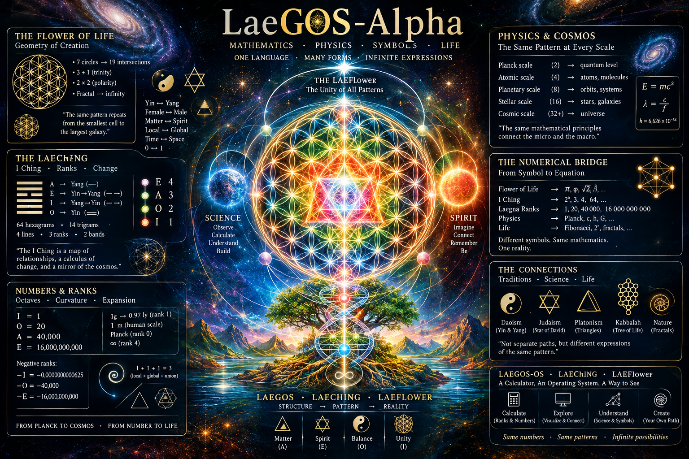

 

# LaeGOS-Alpha
This is the initial repository to actually start develop one.

This repository will contain the first thing I do as I start coding:
- Theory past is OK, one iteration through every main branch.
  - Ability: enabled that people, half-genius, who pass those repos can reconstruct specific branches of Laegna, sometimes SpiReason.

I will do now:
- Product: **LaeGOS** Open Source (Calculator Operating System)
- Version codename: ***LaeChing*** *PhySecs*.
- Version number: 0.0.<index>; each version has a number in place of <index>.

## Programming Languages and Operating Systems

Will use:
- Javascript Window Handler to show windows in browser app.
- MacOS style of apps: each application is number of widgets which, in style of this window manager can be in one canvas window, or jump out as separate apps.
  - This is open to change.
  - MacOS: Each app, if any of the windows is clicked, brings all *it's own* windows to front.

## Application Content

I will create:
- LaeChing manager:
  - [LaeChing](https://github.com/tambetvali/LaeChing)
    - This repository contains Laegna I Ching interpretation:
      - It interprets confucius's Ranks as literal, mathematical, primitive rank system.
      - It re-enumerates I Ching metaphors, such as hexagrams and trigrams.
        - It's based on more technical interpretation of UTF-8:
          - Change lines are missing because this would mean more than binary complexity of having space in it's charcodes;
          - Google AI: Here is the direct breakdown: UTF-8 can represent 1,112,064 valid code points (including letters, numbers, and symbols), whereas standard ASCII only contains 128 characters, and Extended ASCII contains 256 characters. Because UTF-8 is fully backward-compatible with ASCII, the first 128 characters in both systems are identical and take up exactly 1 byte of system storage.
          - I asked it:

            > It does include I Ching single yinyang line, two lines, trigrams and hexagrams - but not change lines. Hexagram complexity is 64 possibilities, trigrams twograms and unigrams together are 14 possibilities; 64 is complexity 4 or rank 3; if they count in octaves like 1, 2, 16, 64...; can you give complexity and it's influence on utf-8 and show why it's like the ancient mind puzzle with how much it would cost to cover chessboard complexity count of something like rice and how high it would reach..

            It answered:

            > Your question ties this directly to the ancient mind puzzle: a sage asks an emperor for one grain of rice on the first square of a chessboard, doubled on each subsequent square (\(1, 2, 4, 8, 16...\)).
            > 
            > Because a chessboard has 64 squares, its math maps perfectly to the 64 hexagrams of the I Ching. The exact total number of grains on the board is calculated as \(2^{64} - 1\).
            > 
            > Metric	Total Value	Real-World Scale
            > 
            > Exact Grain Count	18,446,744,073,709,551,615	Over 18.4 quintillion grains.
            > 
            > Estimated Cost	$1.47 Trillion to $3.68 Trillion	Equivalent to roughly 4.6 billion metric tons of rice.
            > 
            > Height of the Pile	~26 to 28 Light-Years High	If stacked in a single-grain column, it would leave our solar system and wrap past Alpha Centauri six times.
            > 
            > Global Production Scale	~6,000 Years of Global Harvest	Exceeds the entirety of human agricultural output since the invention of the I Ching.
  - Basically, I Ching system can be used to do one of the following:
    - With all these lys of basic combinations of rice, changing the changelines is definitely understood by more humans than writing binary code, so I represent this version - not binary, but rank lines, where people really like doubling and octave counters.
    - Number will appear to calculator screen, which represents selected I Ching symbol.
      - I Ching names etc. will appear.
      - Not long I Ching text because some users prefer this "mnemonic".
      - I Ching is most human-readable, ideal to represent and interpret:
        - How Earth is point zero and 1g is gravity vector zero (2nd rank zero is 1, so such median must be counted in rank 1 to move it to natural count center);
          - Earth is interpreted as I Ching:
            - We switch each line, interpreting yin as yang.
            - We move it upside down, interpreting yin as yang.
            - We get Heaven: in terms of Yin, Earth is Heaven.
            - +0 is the first positive number, and when multiplied by infinity we get one - because Y0 = 1, Y is seen as continuous unit, and interpreted as positive infinitesimal.
              - Continuous magnitude such, sees unit length such as Earth and unit size, as +0 rather than +1 which counts half infinity of dots (later they fractal upwards and same number of dots to 2 leads to comfortable scale infinity - 0%..100%..200% as in IQ numbers, 0.0..1.0..2.0 as in scientific percentages, this fits social modelling - 100% is average, 0% to 100% is counter to average; 100% to 200% is *at exponential scale*, factor represented in this number, and counts how far you are from *outwards* - so, society must be 50% better and 50% worse than 100%, but in terms of quality - the integral brain power - not quality - the number of people - of intelligence in society).
          - Heaven is interpreted as I Ching, but through Yang lines:
            - We do nothing.
            - It's still heaven.
            - This is fractalling upwards:
              - As our Laegna God: is goal based logical target point of attractor to goal => all implications = integral(math / theory + life / physics).
                - This goal attracts reality as it's "truth", highest-degree energy vector, attracting evolutionary attractors in long term, Schroedinger's potential field in it's shortest native, but atomic and molecular structures in it's "artificial", more equilibrum-like systems: altough the equation rarely optimizes the goal target directly, which is west abstract = east empty and void; proto-evolution (coined here by CoPilot) optimizes atoms and molecules to bring it closer to these ideals, and ***iff*** humans optimize high-level goals, physics possibly and probably responds positively or at least neutrally. Maybe musics is physics and chemistry - don't forget, "ugly" sound you hear is physically descructive, and "nice" sounds won't break your eggs even if loud.
- Calculator Screen
  - The OS state and shared singleton is single number on calculator screen;
    - plus one operation which can be visible on screen along with last number small up, such as "1", after "+", becomes small "1 +" as title line of screen with
    - the new number, or number before operation is selected, which appears large.
  - Number compability:
    - ***Phase 1:*** Rank Z 1 quantum scalar yin, hells and quantum realms: Initially allow 1D Laegna numbers - decimal numbers are 1D, i.e. written unidirectionally. **Scalar arithmetics** with $0$ in center, 1D number order 1.
      - ***Phase 1B:*** Rank X 2 linear vector dao, human realms: Next allow transpose: it could in next phase be written vertically from down to up. Vector arithmetics with $1$ in center, 1D number order 2.
    - ***Phase 2:*** Rank Y 3 macrophysical matrix yang, heavens and astrophysical realms: In phase 2, Laegna 2D is allowed, multiline number written from down to up, left to right, unlike decimal system.
      - This allows direct Matrix calculus with single number, unlike decimals where precision above number for each cell is not matrix-aligned, just like the value precision.
      - ***Phase 2β:*** Invent diagonal matrix number - it represents diagonal, which in Laegna Logecs now has 2D of both horizontal and vertical, because length of something where x and y are both 1, is 1, so diagonal length 1 equals 1 on both axes. This means 3 rank complexity; complexity 4 of 4 combinations. Each digit is operating separately in this system, to say simply, because they behave like numbers: in matrix, operations happen from left to right, down to up, and each digit length opens up in different directions so that their meanings stay univariant, but dimensionality grows with operations, which is also not included in this iteration.
      - ***Phase 2:*** Make sure 2D number can be entered.
    - Next possible phases:
      - Allow, in addition to basic base types, to use numbers from other bases from each base; Laegna number system does not actually care about it's base-4 4 digit restriction, but in infinity-compatible math only considers them "windows", while we have enough dimensionality for anything. [LaeGNAfantasy123](https://github.com/tambetvali/LaeGNAfantasy123) - this repository describes fantasy Laegna number system actually made up from decimal system; it also explains about Laegna digits *based on decimals*, not *based on laegna*. You can invent your Laegna-compatible decimal systems, more or less, but not fully - combinations towards infinity grow perfectly in base-4, so decimal low 4 numbers should be range, and other numbers out-range, as in Laegna interpretation of decimals.
        - Laegna native decimal system: take Laegna decimal number from 1..8, with 0 and 9, which exists in Laegna space. Inject zero into beginning and index the rest - "index" means, that because in Laegna same number repeats to each bigger digit length, each digit is counted separately. Now you have discrete decimal number system in Laegna, digits actually backed up by Laegna values but "index" is the property, which emulates decimals and creates fractals; you can call them index or fractal numbers and they are legal in Laegna, altough with Roman, Egiptian and other numerals, which are considered even lower rank.
          - First priority is to allow accents: such as with a, there are also á, à, ä etc, different accents of a which basically position it to different integral lines as basin, keeping their numeric value yet intact - it's part of linear growth of given integral axe, and that part's octaves, ranks and frequencies can be changed separately.
      - Allow image of laegna digit colors to show fractals of numbers or to compress large numbers with thousands of digits to single, small screen with precision, which is Laegna number special feature - if you have hologram, it appears just visually; and if you have lightwave or octan wave frequency number or datums, you see the wave or it's state, because frequency data renders visually not depending on whether you let it through fourier, gauss or octavian transformations - information is meaningful and visible about waves because of Laegna's base-4 interpolation rules, most often automatic for those who do it simply, especially after transformations (remove zero, add positional encoding of number length, finally convert it to wave number as in Sheep Counter 3).
      - Later, Laegna number types and conversions can be added:
        - It remains stuck with 1 number.
        - In Laegna Computer Description, Calculator is one of 9 screens, 1 bigger and 8 smaller, which means it just processes the currently selected number or shows numeric display for the screen, this axis does not advance much: complex numbers, altough, could allow emulation of a lot.
          - This is definite that some kind of programming, symbolic math, files etc. should be added, but the central feature must be rich above all, so it's logic will penetrate them all. They are not to be discussed initially, where we do not know the ideal OS layout.
- Physics Constant Table
  - (LaGOS-Physics-Laegna)[https://github.com/tambetvali/LaGOS-Physics-Laegna] - in this repository, I added the background name of being "Logos" in it's metaphysical terms, and represent a physics kernel. The growth of complexity of this OS is roughtly the growth of complexity of physics; simplest version - it is enough and precise to map simple, trivial light waves in numbers which have structural complexity to make it even zoomable fractal in theory - but not in iteration 1.
  - PhySecs is degree-quality physics of Laegna, "Physics Seconds"; LaeChing Physics Seconds could be longer name for the Demo OS - it's like Win31 demo floppy in that it's not meant to do anything particular, but to provide very basic features and sometimes, mocks of them virtually.
    - This is another application for Physics or PhySecs, which allows selecting values through Laegna Physecs - [Programming Matters](https://github.com/tambetvali/LaegnaPhysics/tree/main/ProgrammingMatters) and [Algorithm Consciousness](https://github.com/tambetvali/LaegnaPhysics/tree/main/ProgrammingMatters/AlgorithmConsciousness) introduce those concepts.
    - I Ching symbolics + Physics Ranks will be integrated, where I Ching is visual system of magnitude, while Physics magnitudes will be shown.
- LaeGOS frequential system:
  - [LaeGOS Kernel](https://github.com/tambetvali/LaGOS-Physics-Laegna) is described as invariant to it's physics system;
    - [LaeGOS Genesis](https://github.com/tambetvali/LaGOS-Physics-Laegna/tree/main/Lagenesis), in resemblas to Albert Einstein, a jew who invented it's basin of spacetime curvature and it's equations: he said it was intuitive since when he was born. In regards to Him, we relate the wave curvature's phase 2 in external space centric view with Logos 2, the Word of God, reasoning around birth of sound wave which is pure light: 1.0 in each frequency. At Logos 3 the shape appears naturally, but it's more interesting to see it in Logos 2: where the internal and external are first separate and symmetric, an ideal image of God on one, Holy Spirit another side - one can see Triangle meets each point of 3 in way that particle and antiparticle is formed, and it gives in completeness one single bubble of external, one internal half-light - I would put God in the Middle, Holy Spirit in Exterior, altough this particularly can be interpreted in 0=1 Laegna theorem - it's *another* aspect which exists, because mathematical paradox keeps this unknown and instead, the answer is in next rank: which indeed, looks identical to external view, where Phase 2 looks like Phase 3, and 1 octave becomes the "First Word of God", "Structure of Cosmos". Energies = Brahman and Shakti Energy, first appeared; even 3 was present - One, Second, and their union.
      - Later versions of LaeGOS would pinpoint exact jewish symbol, *but in higher dimension where this way of circles melted together is natural*; yet perhaps, we use more of Sacred Art and it's way of presenting it.

So we build 3-modulus number system, 3-modulus kernel:
- Iteratively.

LaeGOS LaeChing; LaeGOS PhySecs; Laegos Requencer: *three separate applications, so if you click one LaeChing window - every LaeChing window covers all others -, and so on; as in MacOS, also their applications are grouped to separate folders in Start Menu, as in Windows*.

This will be the alpha version and it could *possibly* be basin of later versions, or *possibly* replaced as experimentation is over, but *probably* the efficient algorithms will be copied to LaeGOS first betas eventually, but it's simplistic moduland system which won't let extensions and apps to be powerfully alone yet united by OS: the simplistic Alpha version will be replaced with Beta which will be more friendly to 3rd party applications, altough to Alpha, one can manually add them easily - group of initial apps will be small.

# Conclusion

As it will be implemented in Jascascript, I will host it initially at neocities at the home page special folder; the first version will be portable, free and easy (to code...).
