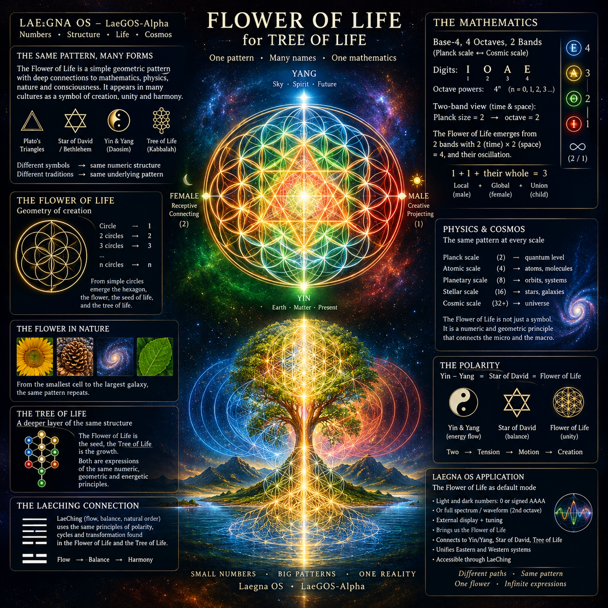

 

# Flower of Life, for Tree of Life

> Tree of Life is too complicated for now and for me.
>
> We draw flower of life.

## Flower of Life will be application for Laegna OS

The default mode will include light and dark number:
- Either Zero like UUUU or IIII or signed AAAA for positive system;
- Or Full-Spectrum, Light Wave or Equivalent Waveform (ocean, temperature, sound etc.):
  - This, if Logos 2 is done (2nd octave oscillation), external display and some frequential tuning brings us:
    - Flower of Life.
    - Relation to Yin and Yang of Daoist Star which equals Polarity of Star of David / Betlehem.
      - We won't reach any number where they would not be compatible, because we study small numbers - two Eastern systems are different, with their deep thought, but the numeric basin is easily compatible.

2-band external view of octave with planck size in time and space being both 2:
- Gives the "God's First Word", Flower of Life, and physically reasons why we can adapt these terms:
  - Because it's the central structure of tension between local and global, short and long term, yin and yang, female and male.
  - Because 1 + 1 + their whole gives 3 as in trinity, local, global and their union - male, female and their union, the child.
  - Because we can find many more relations here.

## LaeChing

We also make sure LaeChing is associated enough with these forms.
