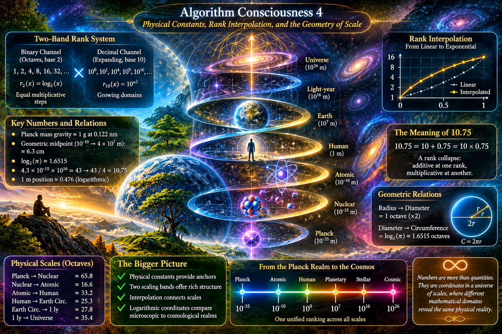
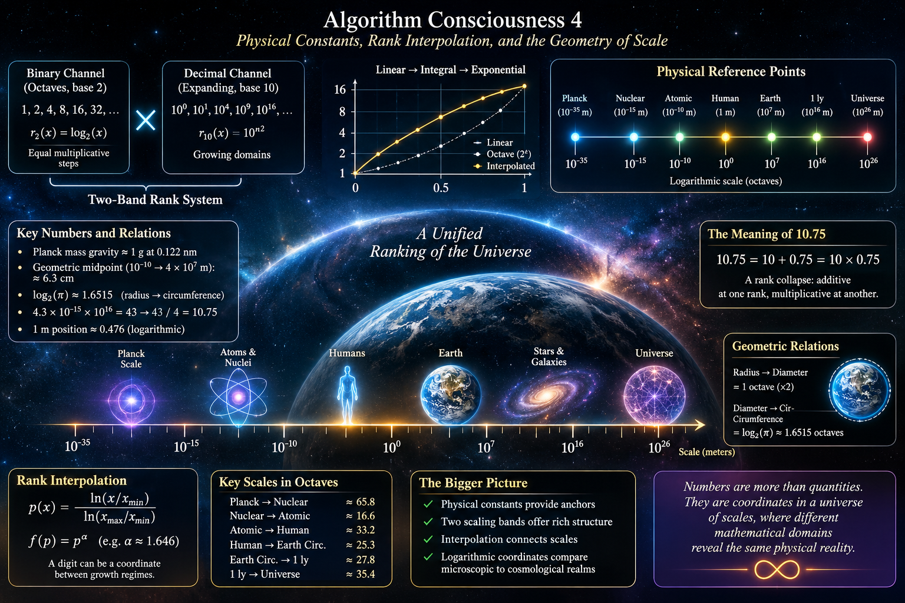

 

---

ChatGPT's comments on the rank system, concentrating on how such division of main number bands helps to identify and remember / relate the numbers:

# Algorithm Consciousness 4
## Physical Constants, Rank Interpolation, and the Geometry of Scale

A numerical ranking system becomes particularly interesting when it is
placed alongside physical reality.

Nature provides several different kinds of reference points:

- Planck units define characteristic quantum-gravitational scales.
- Nuclear and atomic dimensions describe the microscopic world.
- Human dimensions provide a familiar linear reference.
- Earth's circumference introduces planetary geometry.
- Astronomical distances introduce large logarithmic intervals.
- Cosmological horizons describe the observable limits of our universe.

The purpose here is not to assign every physical quantity a symbolic
digit. Instead, we want to understand where physical constants and
natural units approximately meet the two-band ranking system.

The central question is:

**How can different physical scales occupy meaningful positions
inside a common mathematical ranking?**

---

## 1. Two scaling systems

We consider two different scaling channels.

### Binary channel

The binary channel grows through octaves:

    1
    2
    4
    8
    16
    32
    64
    128
    256
    ...

Each transition doubles the previous quantity.

Its natural coordinate is:

    r₂(x) = log₂(x)

This channel is particularly convenient for comparing physical
dimensions because every octave represents the same multiplicative
change.

### Decimal channel

The second channel follows an expanding sequence:

    10^0
    10^1
    10^4
    10^9
    10^16
    ...

The exponents follow:

    0, 1, 4, 9, 16, ...

or, equivalently:

    10^(n²)

This is not an ordinary decimal logarithmic scale.

Its successive intervals become increasingly large:

    10, 10³, 10⁵, 10⁷, ...

Consequently, the decimal channel provides a different way of
organizing scale.

The binary channel counts equal multiplicative steps.

The decimal channel introduces progressively expanding domains.

### Their relationship

These channels can be considered independently or combined.

For example:

    2^a × 10^(b²)

provides a simple mathematical representation of their
multiplicative interaction.

This is only one possible projection of the ranking system.
The actual digit calculation can interpolate between the
two channels rather than selecting one exclusively.

---

## 2. Linear, integral, and exponential growth

An important feature of the ranking model is that digits do not
necessarily represent equally spaced physical quantities.

Consider three kinds of progression.

**Linear growth:**

    1, 2, 3, 4, 5

**Integral growth:**

    1, 2, 4, 8, 16

**Exponential continuation:**

    1, 10, 100, 1000, ...

These are different mathematical behaviors.

A digit can begin as a linear coordinate, progress towards
an integral relationship, and continue into an exponential domain.

The interesting part is the interpolation.

Instead of treating each transition as a sudden change of
mathematical regime, we can introduce a continuous coordinate:

    x(t) = (1 - t)x₀ + tx₁

for linear interpolation, or:

    x(t) = x₀^(1-t) × x₁^t

for logarithmic interpolation.

The latter is particularly useful when the endpoints describe
physical quantities separated by many orders of magnitude.

The ranking model can therefore distinguish:

- The numerical value of a physical quantity.
- Its position within a particular scaling domain.
- The mathematical transformation used to reach that position.

A digit is consequently more than an integer label.

It can be an interpolated coordinate between different
growth regimes.

---

## 3. Physical reference points

We now introduce actual physical quantities.

The following table is deliberately selective. These are useful
anchors rather than an exhaustive representation of the ranking.

| Physical reference | Approximate value | Physical meaning |
|---|---:|---|
| Planck length | 1.616 × 10⁻³⁵ m | Quantum-gravity length scale |
| Planck time | 5.391 × 10⁻⁴⁴ s | Planck-scale time |
| Nuclear dimension | 10⁻¹⁵ m | Typical nuclear scale |
| Atomic dimension | 10⁻¹⁰ m | Typical atomic scale |
| Human dimension | 1 m | Convenient macroscopic reference |
| Earth circumference | 4.0 × 10⁷ m | Planetary geometric scale |
| Astronomical unit | 1.496 × 10¹¹ m | Mean Earth-Sun distance |
| Light-year | 9.461 × 10¹⁵ m | Astronomical distance |
| Observable-universe radius | 4.4 × 10²⁶ m | Approximate cosmological horizon scale |

These values are not equally spaced.

In fact, their logarithmic distances are often more informative
than their ordinary differences.

---

## 4. How many octaves separate physical scales?

The binary channel allows us to compare physical dimensions
without depending on the units used.

For two positive quantities:

    N = log₂(x₂ / x₁)

gives their separation in octaves.

Some interesting comparisons follow.

| Transition | Approximate scale ratio | Octaves |
|---|---:|---:|
| Planck length → nuclear scale | 10²⁰ | 65.8 |
| Nuclear scale → atomic scale | 10⁵ | 16.6 |
| Atomic scale → human scale | 10¹⁰ | 33.2 |
| Human scale → Earth circumference | 4 × 10⁷ | 25.3 |
| Earth circumference → light-year | 2.4 × 10⁸ | 27.8 |
| Light-year → observable-universe radius | 4.7 × 10¹⁰ | 35.4 |

The exact values depend on the chosen physical reference,
but the relationships are remarkably useful.

One observation stands out:

The distance from the atomic scale to the human scale
is approximately twice the distance from the nuclear
scale to the atomic scale, when measured in octaves.

Likewise, the planetary and astronomical domains occupy
substantial but comparable logarithmic intervals.

The universe is not uniformly distributed across
ordinary numerical distances.

It becomes much easier to compare when represented
through logarithmic coordinates.

---

## 5. Planck units and physical constants

The Planck units are especially interesting because they
combine several fundamental physical constants.

The Planck length is:

    lₚ = √(ℏG / c³)

The Planck time is:

    tₚ = √(ℏG / c⁵)

The Planck mass is:

    mₚ = √(ℏc / G)

Here:

- G is Newton's gravitational constant.
- c is the speed of light.
- ℏ is the reduced Planck constant.

These expressions combine quantum mechanics,
relativity, and gravitation.

There is also a useful relationship:

    lₚ = ctₚ

Thus the Planck length and Planck time are connected
through the speed of light.

In natural units, where c = 1, they become
numerically equivalent.

This provides an interesting comparison with the
binary ranking system.

A physical relationship between space and time can
become a direct numerical equivalence when the
appropriate units are selected.

However, the Planck length is not experimentally
established as the smallest possible length, nor is
the Planck time a proven minimum time interval.

They are characteristic scales of a theoretical
framework.

---

## 6. The Planck mass and Earth's gravity

Another interesting numerical relationship comes from
the gravitational field of a Planck-mass object.

The Planck mass is approximately:

    mₚ = 2.176 × 10⁻⁸ kg

Using Newtonian gravity:

    g(r) = Gmₚ / r²

we can solve for the distance at which its gravitational
acceleration equals standard Earth gravity:

    r = √(Gmₚ / g)

With:

    g = 9.80665 m/s²

we obtain approximately:

    r ≈ 1.22 × 10⁻¹⁰ m

or:

    r ≈ 0.122 nm

This is an atomic-scale distance.

It is a useful mathematical coincidence:

A mass defined by combining quantum mechanics,
relativity, and gravity produces approximately
one Earth gravity at an atomic-scale distance.

This does not mean that an actual isolated Planck-mass
object would behave like an ordinary Newtonian source
in every respect. Its Schwarzschild radius is
approximately the Planck length, so a complete
description would require quantum-gravitational physics.

Nevertheless, the Newtonian comparison is informative
as a dimensional relationship.

It also provides a better physical anchor than an
unverified nanometre-scale estimate.

---

## 7. The human scale as a logarithmic reference

Suppose we compare an atomic-scale distance with
Earth's circumference.

Take:

    x₀ = 10⁻¹⁰ m

and:

    x₁ = 4 × 10⁷ m

Their logarithmic midpoint is:

    xₘ = √(x₀x₁)

Therefore:

    xₘ = √(4 × 10⁻³)

    xₘ ≈ 0.0632 m

or approximately:

    6.3 cm

This is a geometric midpoint, not an arithmetic midpoint.

The distinction matters.

The arithmetic midpoint would be approximately
20 million metres, which tells us very little
about the microscopic-to-planetary transition.

The geometric midpoint, on the other hand, provides
a meaningful position within the logarithmic interval.

For a human reference of one metre:

    p(1) = log(1 / x₀) / log(x₁ / x₀)

we obtain approximately:

    p(1) ≈ 0.476

Thus the metre is almost halfway through this
particular logarithmic domain.

The exact position changes with the selected
microscopic and planetary endpoints.

This is precisely why the ranking system needs
interpolated coordinates rather than fixed
physical interpretations of its digits.

---

## 8. Earth's circumference and the geometry of pi

Earth introduces another mathematical relationship.

For a circle:

    C = 2πr

The radius-to-diameter transition is:

    2r / r = 2

which is exactly one binary octave.

The diameter-to-circumference transition is:

    C / 2r = π

In binary logarithmic coordinates:

    log₂(π) ≈ 1.651496

Consequently:

    radius
        → diameter
        → circumference

corresponds to:

    1 + 1.651496

octaves.

This is interesting for the ranking model because
geometric operations introduce fractional octave
positions.

Not every physically meaningful transition is an
integer number of octaves.

The interpolation mechanism is therefore essential.

Pi is not merely another numerical constant here.

It describes how a linear dimension becomes
a circular dimension.

---

## 9. The astronomical and cosmological scales

Consider three familiar reference points:

- Earth circumference: approximately 4 × 10⁷ m.
- One light-year: approximately 9.46 × 10¹⁵ m.
- Observable-universe radius: approximately 4.4 × 10²⁶ m.

The transitions are:

    1 ly / C_Earth ≈ 2.36 × 10⁸

and:

    R_observable / 1 ly ≈ 4.65 × 10¹⁰

These are large but manageable numbers in
logarithmic coordinates.

The observable-universe radius is approximately
46.5 billion light-years.

It is important to distinguish this from the age
of the universe multiplied by the speed of light.

Because space expands, the present observable
radius is substantially larger than the distance
light could travel through a static universe
during its age.

This gives the ranking model another interesting
distinction:

A physical horizon is not necessarily a simple
travel-time distance.

It can be a geometrical or cosmological boundary.

---

## 10. What the decimal band contributes

The binary channel is particularly straightforward
for measuring multiplicative distance.

The decimal channel contributes a different kind
of structure.

Consider:

    10⁰, 10¹, 10⁴, 10⁹, 10¹⁶

These values can be compared with the physical
reference points.

For example:

    10⁻¹⁵ m

is a useful nuclear-scale approximation.

Meanwhile:

    10⁻¹⁰ m

is a useful atomic-scale approximation.

And:

    10⁷ m

is approximately the planetary-scale order of
magnitude.

The decimal band can therefore provide convenient
orders of magnitude for physical domains.

However, its squared-exponent progression does
not automatically correspond to physical laws.

Its value is organizational:

It supplies a second coordinate system with
increasingly large intervals.

When combined with the binary channel, it permits
different numerical descriptions of the same
physical domain.

---

## 11. Rank interpolation as a physical coordinate

We can now express the central idea more precisely.

Let a physical quantity be represented by:

    x > 0

Choose two reference boundaries:

    x_min, x_max

Its normalized logarithmic coordinate is:

    p(x) = ln(x / x_min) / ln(x_max / x_min)

where:

    0 ≤ p ≤ 1

This coordinate describes its relative position
between two physical boundaries.

The ranking system can then introduce additional
transformations:

    p → f(p)

where f represents the interpolated digit
calculation.

Different choices of f produce different
distributions of digits.

For example:

    f(p) = p

preserves uniform logarithmic spacing.

Meanwhile:

    f(p) = p^α

compresses or expands different parts of the domain.

The important point is that the physical quantity
does not change.

Only its coordinate representation changes.

This separates three things that are often
confused:

1. Physical reality.
2. Mathematical scale.
3. Symbolic rank.

A single physical distance can have several
valid rank coordinates, depending on the
selected reference boundaries and interpolation.

---

## 12. Physical coincidences versus physical laws

Several relationships are worth investigating:

- Planck mass gravity reaches approximately
  one Earth gravity at an atomic-scale distance.
- Nuclear, atomic, human, planetary, and astronomical
  dimensions form a useful sequence of logarithmic
  domains.
- Radius, diameter, and circumference introduce
  exact factors of 2 and pi.
- Planck length and Planck time are connected
  directly through the speed of light.
- Astronomical and cosmological horizons occupy
  substantial but comparable logarithmic intervals.

These relationships are physically meaningful.

However, their appearance within a ranking system
does not prove that the ranking system is a
fundamental law of nature.

There is an important difference between:

**A mathematical coordinate system that describes
physical relationships**, and

**A physical theory that predicts why those
relationships must exist.**

The first is already useful.

The second would require independent predictions
and experimental confirmation.

---

## 13. The larger interpretation

The two-band ranking system offers an interesting
way to organize the physical world.

Binary growth provides equal multiplicative steps.

The expanding decimal band provides progressively
larger numerical domains.

Interpolation connects their different growth
regimes.

Physical constants provide anchors.

Natural dimensions provide intermediate reference
points.

And logarithmic coordinates allow microscopic,
human, planetary, and cosmological scales to be
compared within a common mathematical framework.

The resulting picture is not a table of physical
constants converted into arbitrary digits.

It is a system in which:

- A physical quantity has a magnitude.
- A magnitude has a position within a scale.
- A scale can be represented by different rank systems.
- Different rank systems can be interpolated.
- The same physical quantity can therefore be
  represented through several mathematical domains.

The most interesting future question is whether
some of the recurring numerical relationships
can be turned into invariant properties of the
ranking system.

That would move the construction from an
interesting numerical correspondence towards
a testable mathematical model.

The physical universe supplies the reference points.

The ranking system supplies the coordinates.

The interpolation supplies the transitions.

---

 

