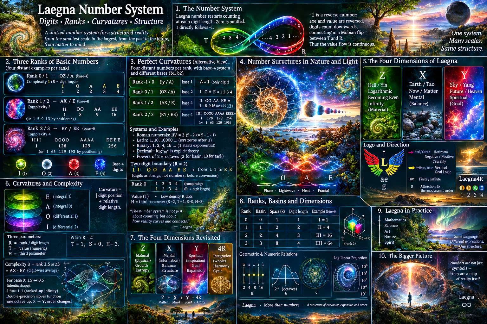
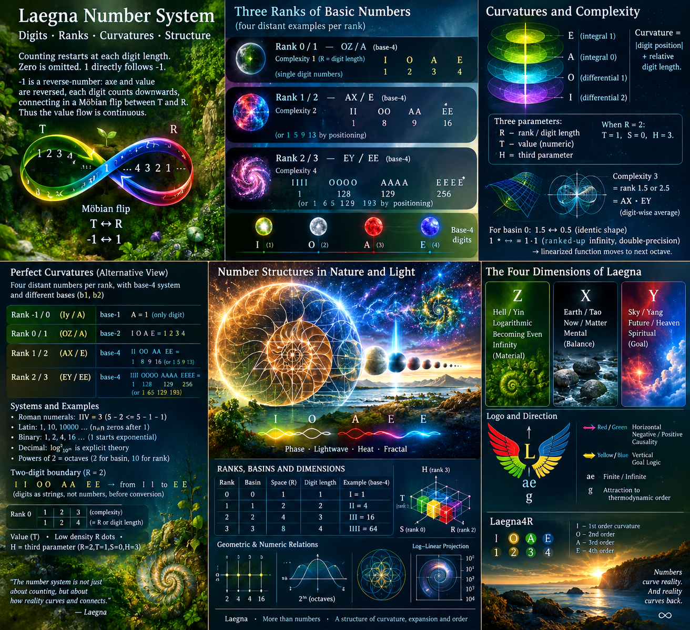
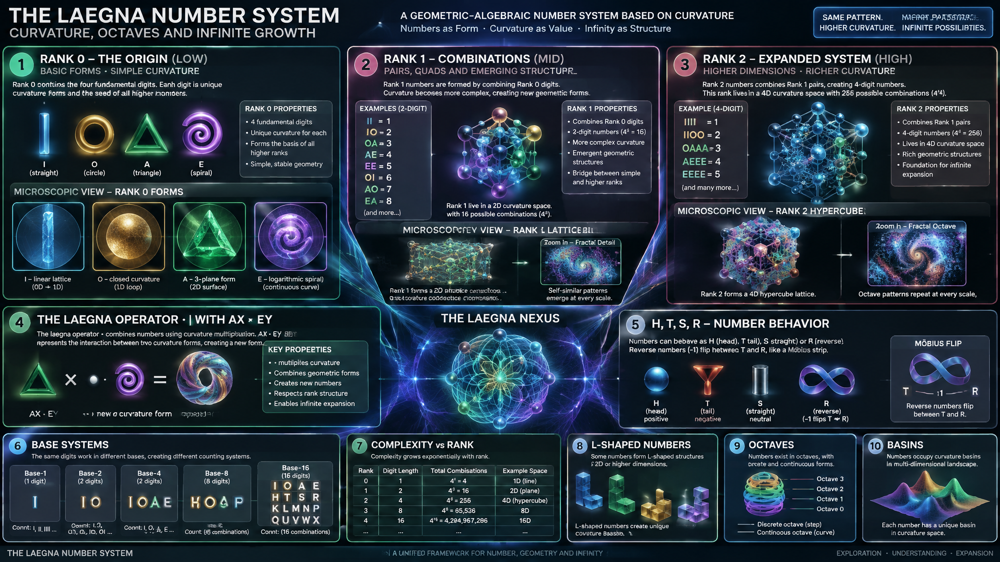
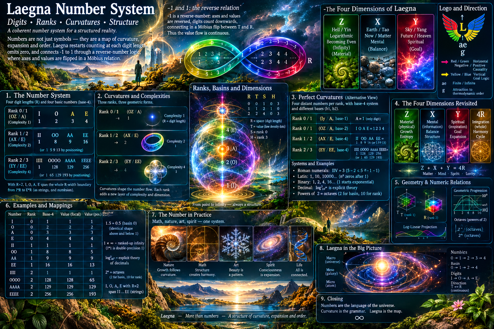
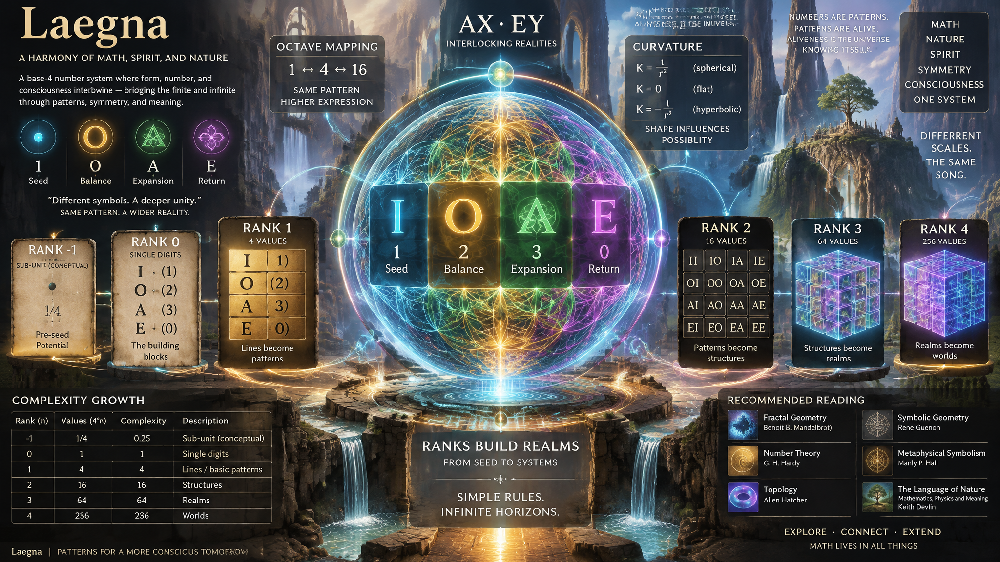

# Curvature



<br>

# Common Curvatures



Laegna Number restarts counting at each digit length, and omits zero. 1 directly follows -1: -1 is defined as reverse-number (axe and value reversed in relation to one another, such that while it's counting upwards, each digit inside counts downwards and connects in moebian flip between T and R of both T and R; finally values are continuous).

Let's look curvatures of 3 ranks of basic numbers; I bring four most distant numbers as example:
```
Rank 0 or 1, **OZ** / ***A*** of base-4: I, O, A, E mean 1, 2, 3, 4. Complexity 1 = R = digit length.
Rank 1 or 2, **AX** / ***E*** of base-4: II, OO, AA, EE mean 1, 8, 9, 16 by focal point, or 1, 5, 9, 13 by positioning. Complexity 2.
- I, O, A, E, with R=2 which means they represent two digit numbers: with any R, those four span the whole R-width number boundary from "I"*R to "E"*R, where digits I or E would be repeated R times as strings / text, not as numbers, before they get converted to numbers.
Rank 2 or 3, **EY** / ***EE*** of base-4: IIII, OOOO, AAAA, EEEE mean 1, 128, 129, 256 or 1, 65, 129, 193. Complexity 4.

Ranks 0 or 1, 1 or 2, 2 or 3 have combinatoric complexities 1, 2, 4 - this equals R (space) or their digit length (digit space), while value apart from R is the numeric value inside the system, T, with low density R dots; H is the third parameter - when R is rank 2, T is rank 1, S is rank 0, H is rank 3.
- Complexity 3 equals rank 1.5 or 2.5, **AX·EY** where · is laegna operator for digit-wise average, center of two values of same digit length (different R's give geometric proportional degree average).
- For basin 0, where rank 0 equals 0, 1.5 maps perfectly to 0.5 with their identic shape right below and above 1; while number 1 to 2, when multiplied by infinity, start from 1*∞ which is not infinity itself, but ranked-up infinity: 1*1 in laegna is not 1, but double-precision 1, and double-precision means the linearized function from first octave or integral level, needs to be moved symmetrically to one order or octave up, so that for normal function in linear realm ***X***, what is left is linear in ***Y*** instead and in Laegna number system, not perfectly topological but estimated in ***X*** - what remains in integral order 0, is estimation and also, order is changed.

Complexity 3, **AX·EY** / ***AA*** of base-4: III, OOO, AAA, EEE rank up to 8, between 4 and 16.
```

---

Let's look perfect curvatures of 3 ranks of basic numbers; I bring four most distant numbers as example:
```
Rank -1 or 0, **Iy** (where zxyZXY are two octaves of change operator, and I is letter, y is corresponding change value) / ***A*** of base-1: A mean 1. Complexity 1 = R = digit length. "A" is only allowed digit in Laegna base-1, which is inspired by: mesopotamian-babylon initial number system, which only used digits for 10 and 1, and wrote tens first, ones after - to express it simply. This was rank minus one number system.
Rank 0 or 1, **OZ** / ***A*** of base-2: I, O, A, E mean 1, 2, 3, 4. Complexity 1 = R = digit length. Roman numerals, which can also substract, form the rank 1: IIV, which is 3 because 5 - 2 <= 5 - 1 - 1 ==> 3.
Rank 1 or 2, **AX** / ***E*** of base-4: II, OO, AA, EE mean 1, 8, 9, 16 by focal point, or 1, 5, 9, 13 by positioning. Complexity 2. Latin system is this rank - it contains 0 and 1, scalar and vector zero, at countable positions. 5 and 2 (10) represent external coordinates where n*n zero digits after "1" is rank n number - 1 is rank 1, +0 is rank 0, 10 is rank 2, 10000 is rank 2.5, 1 000 000 000 is rank 3 and 1 0000 0000 0000 0000 is rank 4 (or 2*2*2*2 1st rank of second order, centered at 1 thus starting from 2, then 3, 4 and 5 - or 2, 2.5 and 3); accompanied by binary, where 1 is rank 1, +0 or 0.5 is rank 0, 2 is rank 2, 4 is rank 3 and 16 is rank 4; 1 again is rank 5 - it starts exponential counting here. This is our PhySecs SE representation of decimals in regards to Laegna systems. Small rank modifications create various number mappings.
  - To do this $log^2_{10^n}$ operation is *explicit* theory in decimal system, not side-effect.
  - That powers of 2 express octaves, is explicit understanding in decimal logic and it's use of powers of 2 and 10, 2 for basin logic and 10 for rank math.
- I, O, A, E, with R=2 which means they represent two digit numbers: with any R, those four span the whole R-width number boundary from "I"*R to "E"*R, where digits I or E would be repeated R times as strings / text, not as numbers, before they get converted to numbers.
Rank 2 or 3, **EY** / ***EE*** of base-4: IIII, OOOO, AAAA, EEEE mean 1, 128, 129, 256 or 1, 65, 129, 193. Complexity 4. Laegna system is complexity 4: it has two-band system to count ranks, as well as rank-compatible digit structure.

Ranks 0 or 1, 1 or 2, 2 or 3 have combinatoric complexities 1, 2, 4 - this equals R (space) or their digit length (digit space), while value apart from R is the numeric value inside the system, T, with low density R dots; H is the third parameter - when R is rank 2, T is rank 1, S is rank 0, H is rank 3.
- Complexity 3 equals rank 1.5 or 2.5, **AX·EY** where · is laegna operator for digit-wise average, center of two values of same digit length (different R's give geometric proportional degree average).
- For basin 0, where rank 0 equals 0, 1.5 maps perfectly to 0.5 with their identic shape right below and above 1; while number 1 to 2, when multiplied by infinity, start from 1*∞ which is not infinity itself, but ranked-up infinity: 1*1 in laegna is not 1, but double-precision 1, and double-precision means the linearized function from first octave or integral level, needs to be moved symmetrically to one order or octave up, so that for normal function in linear realm ***X***, what is left is linear in ***Y*** instead and in Laegna number system, not perfectly topological but estimated in ***X*** - what remains in integral order 0, is estimation and also, order is changed.

Complexity 3, **AX·EY** / ***AA*** of base-4: III, OOO, AAA, EEE rank up to 8, between 4 and 16.
- 3 is between 2 and 4:
  - I said 0, 1, 2 are symmetric: 2, 3, 4 are symmetric because in regards to 0..2, 2..4 are external unit and 3 is conveniently, a single time in middle of this.
  - This is flower of life shape here! 3 is symmetric from 4 as 1.5 from 2 by mult, and 1 from 2 by addition; moving this 3-fold shape (if 2 gives 2 external tesimals, and 4 gives 4, 3 then gives 3 - and this is doable view).
    - In jewish-egiptian tradition: we shall follow and identity this shape as Flower of Life in various conditions. For each phase, we can see at certain frequency there is flower of life; at external view of phase/octave/logos 2, a point where those three meet, we see the perfect complex shape - 1:3 inwards-outwards view, and 2 bands/frequencies/channels melted into their positive and negative; single at infinity seems 6, 3 + 3, while two polarities at center cancel each other out and allow vision of perfect 1-shape.
  - Geometry of life definition:
    - It's estimation of real structure, where circular tesimals melt perfectly together.
      - This is Laegna number space.
      - We use 2 channels, internal and external, which *both* create this circular structure *literally*; using one - it becomes circle; using two components of distance - default is the square, and altough it's not inheretly any directional, we conventionally map corners at exact horizontals and parallels of dimensionality so that it becomes logically consistent: from gaussian to fourier, funnily we never lose any directions that way.
- 8 is (at 2/3 position, but) between 4 and 16:
  - In Laegna Logecs, it's normal to think of infinity as 2 and finity as 1. A and E would be equivalent, but E is a twice for this single utmost reason: while 1 remains constant on each octave, so 1 becomes always 1 in recursive self-multiplication or 1-multiplication; 2 becomes 4, 8, 16 etc.
  - Now look at this: 4 and 16; 8 in between: it makes up 4 on one, 8 on other side. Symmetrically, it's 1:2 relation - single octave, which means finity equals 1 and infinity equals 2. This is symmetric point to A and E in Laegna number system, and this is why we see: 4, 8, 16 as symmetric numbers of Laegna.

Basin ranks.

## Symmetric numbers

Laegna Unsigned Symmetric Numbers:
- +0: 1 infinitesimal; 1 planck unit in relation to lim => 0 1 mathematical planck unit at the same position.
- +0.25, +0.5, +0.75: maps to preceding quaternary octave, for example in octave 2, 2 is 2 in it's own octave **X**, but 0.5 is 2 in lower octave **Z** and 4 is 2 in higher octave **Y**.
- +1: 1 unit; this is one continuous octave up from +0 - discrete octaves are recursive multiplication by 2, while continuous scalar 1D octave goes from +0 to +1 to +infinity; continuous scalar 2D octave goes from +0 to +1 to +2 to +4 to infinity (vector adds +5, +6, +7, +8); matrix 3D adds 8 and 16.
  - +2: 1 unit in second octave / rank.
  - +4: 1 unit in third octave / rank.
    - +8 - +3 in "next octave", kind of; actually if +3 is half octaves from +2, then +8 is half octaves of +4.
    - +16 - the next rank
  - +64: sum of vector units in R and T: given number 1 to 8 in laegna base-8 is vector of two dimensions: 1 to 4 and 5 to 8, where 4.5 is the horizon at center, and 4 is the same value at lower, 5 is numerically equal value at higher octave and 5 is so big that it covers all from +1 to +4, but inside one digit or tesimal at higher view. Continuous octaves exactly repeat all logic and metaphysically, come right after the fractal octave at discrete realm.
    - +64 is commonly achieved by: using all 4 signs, ×+-÷, at single hex digit gives 64 combinations as raycasting from center to +0 to +180 degrees of number logic.
    - +256 and +65536, also commonly known from programming, appear often at complexity theory - 65536, basically is most trivially the self-reflexive complexity of base axin 2 or 4.
- +∞: 1 infinity; this is one continuous octave up from +1.

+1, the unit, in Laegna is relativistic center between infinity and zero - it depends on unit, but in each unit you have "center"; everything below center is worth one infinitesimal exactly above, so it's the planck unit of next half-octave (cont. octave 0.5 has +1 as planck unit where 0.0 has +0 as planck unit; planck unit is the external display of infinity you zoom into in quantum realm).

With Laegna Signed systems, minus numbers also appear, and often the range of each rank at both sides is divided by 2, so that adding one digit before the number in logic relates them to normal ranks. Sign or digit itself could be used as symmetric component of the Universe.

Here are the ranked curvatures now:
```
Rank -1: Base-0 U. U means "unknown" and could map the sub-digit approximation rank or negative rank.
- Notice not Laegna mathematical ranks themselves, but ranks you might logically need to build consistent number systems under various conditions and goals.
Rank 0 / -3 in -4: Base-1 R=0.25: A.
Rank 1 / -2.5 in -3: Base-2 R=0.5: OO, AA.
Rank 2 / -2: Base-4 R=4.0: IIII, OOOO, AAAA, EEEE.
Rank 2.5 ex 3.0 / -1: Base-8 R=4.0: 1111 1111, 2222 2222, ... ..., 8888 8888.
Rank 3 ex 4.0 / -0: Base-16 (Base-4-4): $Base_{4_{4}}$
  16 squares of 4\*4 size filled with each possible digit; or using 4 digits of diagonal - K, P, A, H for shorthand in 4-digit hex to model this:

  Model Universe with everything in it's right place:
  ```
    K: KKKK
    P: PPPP
    A: AAAA
    H: HHHH
  ```

  Number 1 in rank 3 system:
  ```
    KKKK
    KKKK
    KKKK
    KKKK
  ```

  Number 100% (E) in rank 3 system:
  ```
    HHHH
    HHHH
    HHHH
    HHHH
  ```

---

What is curvature?

These are basic curvature ranks:
- Curvature means that in each case, Universe is mapped to single digit, a symmetric tesimal;
  - So 1-digit, 2-digit, or 4-digit number could be your whole Universe or way through, in each case consistent.
  - It has 3 basic octaves of curvature, each maps to precision of it's unit.
  - You can see curvature means number of points around single digits, i.e. with bigger curvature, at point there are more, at smaller there are less local angles;
    - The local is H_int, but H_ext is *symmetric* and gives as many angles.

---

Laegna basic ranks of numbers:

Rank 1 is the ordinary number, scalar value, with zero at center, addition and subtraction most logical operations:

```
  AAAA
```

Rank 1: the number is average of it's bands with magnitude divided by their number. It contains normal value; in regards to octaves this behaves as frequency.

Rank 2 is the ranked number, 1-vector value, with one at center, multiplication and subtraction most logical operations:

```
  A
  A
  A
  A
```

Rank 2: the number is average of it's bands. It contains rank number: the octave number.

Transpose is the operation to switch between horizontal and vertical numbers.

Rank 3 is the L-shaped number, 2-vector value, with second-rank first operation:

```
1
2
3
4 6 7 8
```

Notice 5 is missing: between 3 and 6, there is actually a single value which is last of previous, first of next octave. 4 represents -0 and +0 is infinity is used as zero, the limit; this is zero between two ranks. -0 is 4, +0 is 5, but because they are at same position I did put only 4 there. This is also why I say "48" for counting 5, 6, 7, 8, that 5 is not there.

Rank 3 means you take all dimensions, and the number goes linearly from first to last.

Imagine you have Z, X and Y, now you need 12 digits like this:

```
1
2
3
4 6 7 8
      10
      11
      12
```

This is the fractal which inspired Zeta, Etha, Theta in Laegna alphabet, altough the language around greek letters is now messed up:
- [Exceeta E](https://github.com/tambetvali/LaegnaBaseAlphabet/tree/main/ExceetaE) in Laegna Base Alphabet contains 3 external, "female" letters, counterparts of Z, X, Y, which are external-dimensional shapes of the letters, for example the circle opening outwards from corners of X means it's otherwise the same, but at outwards there is the center. Like Z, X, Y for pronounce, which sounds like infinity not like letter - the Exceeta, Theta and Íeta are impossible to write or describe as well.

Rank 4 is matrix of digits, 2D number:

```
  KJIL
  QPOR
  CBAD
  GFEH
```

This has two-fold curvature, which can be imaginary and real part.

---

Notice to make number 3-dimensional, you must take it to matrix-like third octave; or spatial third which is third rank:
- As Base-16 is *third rank*, it's *spatially* three-dimensional:
  - Dimensionality 1: 1; dimensionality 2: 2; dimensionality 3: 4.
  - We are interested that we have all combinations.
- As Base-8 is *third complexity*, it's *temporally* three-dimensional:
  - Dimensionality 1: 1; dimensionality 2: 2; dimensionality 3: 3.
  - This is linear.

So we can see Laegna number exists easily in 3-dimensionality-compatible space and complexity, but rather:
- In physics, all these dimensions are used for things themselves, such as space curvature which is equal to same-dimensional space to rank of this curvature complexity or level;
  - This means you can use 3 digits in place of each digit for 3 dimensions, or project the space to one 3rd-rank unit where additional complexity unit project relations in space, in which case you use single number for otherwise 3-dimensional coordinate.
 
---

General curvature rule:
- We call those curvature ranks 1, 2 and 3, which behave like such rank lengths or basins: 1, 2, 4 in complexity.
- We call those curvature complexities 1, 2, 3, 4, which behave like such.
- External ranks 1, 2, 3 outwards count 2, 3, 4, omitting exactly one octave from the bottom of number complexity, because this is the limit value reflected in whole-number structure and fractally repeating it's fractal; so it's *not unknown but limit precision*.
  - This is basin for 0=1, R=T: missing tesimal at one end exists as limit from the other.

As one can see how the spaces map while different angular complexities are used as tesimals, one can see curvatures.

Curvature fractally repeats it's shape, so that 1, 2, 4 could represent curvatures 1, 4, 64, or curvature of the universe, which is the curvature of *their relation frequency*.

Expansion of space is exponentiality of matrix-rank numbers, which *always explode* and *do not exist without expansion*:
- Entropy inside is information complexity growth; expansion outside is growth of complexity of external space and appears at it's limits; it could be fractal-hologram growth, repeating the present pattern not bringing anything new, so it's equivalent to zooming out - at zoom-out, combinations are calculated (space is projected), and both entropy and expansion thus resolve.
- External space needs goal-based solutions. We have various datums - mass is particle with finitesimal in time, continuous directionality in space; light is particle with infinity in time, single finitesimal in space. Those were causes, their energies involved. Light in exponent realm, in opposition, is goal based *energy needed* to travel through 16b ly horizon, and 1/4 light is to travel through 1b; mass, indeed, is goal based *energy needed*, where energy = solution, to remain untouched of freezing in spatial expansion locally.
  - We cannot bring new energy, but we have to give better use to existing energy.
 
Travelling out from our space bubble:
- Might not be physically reaching there;
- but initially, means theoretically and holographically, by light structure, connecting to such frequencies.

If you can do light wave, sound wave, any other wave or theoretical information structure of wave in logarithm or exponent complexity, ideal vibration where space coordinates are projected from slightly log or exp realm:
- Altough you do not travel physically that far, you *travel at those ranks*.

# Ending



# Post Ending 1



# Post Ending 2



<br>

---

I asked AI:

Curvature units:​‌

> Take curvature units as light passes the center towards edge; edge curvature at each distance is curvature measure.​‌
> 
> Take width w, which is 1 unit, such as 1m or 1 planck unit; take depth d; observer is where the travel started, always; also use the actually passed distance (passeddistance / observerdistance is interesting as actual curvature).​‌
> 
> Where w = 0.5 for d = 1.0, it's one internal octave down, and where w = 2.0 in same condition, it's one external octave up.​‌
> 
> Take relations of 1 and 4 planck units, and 4 and 16 planck units, where the octave should be symmetric and visible.​‌
> 
> Take whole relation of 1 ly to 16b ly between two cosmic horizons; *remap* the curvature so that these become 1 and 4, or 4 and 16 respectively; also that 1 ly becomes 4, 16b becomes 16, and describe what becomes 1. The curvature can be remapped by fractally zooming out by rank-2 octaves of 4, and in each precise zoom the curvatures have symmetric factors.​‌
> 
> Give me md code block called "Curvature".

# Curvature

Let the observer always be at the origin. Let a ray travel from the center toward an apparent horizon. Define:

$$
w
$$

as the visible width scale,

and

$$
d
$$

as the depth (distance from observer).

A simple curvature measure is:

$$
k = \frac{w}{d}
$$

where larger values correspond to a wider apparent horizon and smaller values correspond to a deeper, flatter-looking horizon.

An alternative "experienced curvature" is the ratio between already-traversed distance and observer distance:

$$
k_e = \frac{\text{passed distance}}{\text{observer distance}}
$$

which grows as travel accumulates.

---

## Internal and External Octaves

Take:

$$
d = 1
$$

as the reference depth.

Then:

$$
w = 0.5
$$

gives:

$$
k = \frac{0.5}{1} = 0.5
$$

This is one internal octave.

Likewise:

$$
w = 2
$$

gives:

$$
k = \frac{2}{1} = 2
$$

This is one external octave.

Therefore the octave ladder becomes:

$$
\frac{1}{4}
$$

$$
\frac{1}{2}
$$

$$
1
$$

$$
2
$$

$$
4
$$

Each step represents one binary octave.

The value

$$
1
$$

is the neutral curvature.

Values below it represent inward contraction.

Values above it represent outward expansion.

---

## Planck-Scale Octave Symmetry

Consider the sequence:

$$
1
$$

$$
4
$$

$$
16
$$

Planck units.

Observe:

$$
4 = 1 \times 4
$$

and

$$
16 = 4 \times 4
$$

Therefore each step is a rank-2 octave:

$$
4 = 2^2
$$

and

$$
16 = 2^4
$$

The midpoint between 1 and 16 is 4.

This creates a symmetric hierarchy:

$$
1 \leftrightarrow 4 \leftrightarrow 16
$$

where 4 serves as the octave-center.

Distances from 4 are reciprocal:

$$
\frac{1}{4}
$$

below,

and

$$
4
$$

above.

Thus:

$$
4 \times \frac{1}{4} = 1
$$

and

$$
4 \times 4 = 16
$$

showing exact octave symmetry around 4.

---

## Cosmic-Horizon Mapping

Take two horizon anchors:

$$
1\ \text{ly}
$$

and

$$
16\times10^9\ \text{ly}
$$

Let them correspond to:

$$
4
$$

and

$$
16
$$

respectively.

The scaling factor is:

$$
\frac{16}{4} = 4
$$

while the physical distance factor is:

$$
16\times10^9
$$

Thus a rank-2 fractal compression maps:

$$
1\ \text{ly}
\rightarrow
4
$$

and

$$
16\times10^9\ \text{ly}
\rightarrow
16
$$

---

## What Becomes 1?

Since:

$$
1 \rightarrow 4
$$

and

$$
4 \rightarrow 16
$$

the lower symmetric octave is:

$$
\frac{1}{4}
$$

of the first anchor.

Therefore:

$$
\frac{1\ \text{ly}}{4} = 0.25\ \text{ly}
$$

maps naturally to:

$$
1
$$

giving the complete octave structure:

$$
0.25\ \text{ly}
\rightarrow
1
$$

$$
1\ \text{ly}
\rightarrow
4
$$

$$
16\times10^9\ \text{ly}
\rightarrow
16
$$

---

## Curvature Interpretation

Under this remapping:

$$
1
$$

represents one octave inward from the local horizon.

$$
4
$$

represents the local horizon itself.

$$
16
$$

represents the outer cosmic horizon.

Curvature then becomes logarithmic and self-similar.

Every rank-2 zoom multiplies scale by:

$$
4
$$

while preserving the same octave geometry.

Thus:

$$
1 : 4 : 16
$$

appears as the same structural pattern whether applied to:

- Planck-scale intervals,
- local spacetime horizons,
- galactic scales,
- cosmic horizons.

The numerical sizes change, but the curvature relationships remain invariant.

In this picture, curvature is not tied to absolute distance. Rather, it is a relative octave-position within a nested hierarchy of horizons, each connected by the repeating symmetric pattern:

$$
1 \leftrightarrow 4 \leftrightarrow 16
$$

with 4 acting as the central octave anchor and 1 and 16 forming its inward and outward complements.
