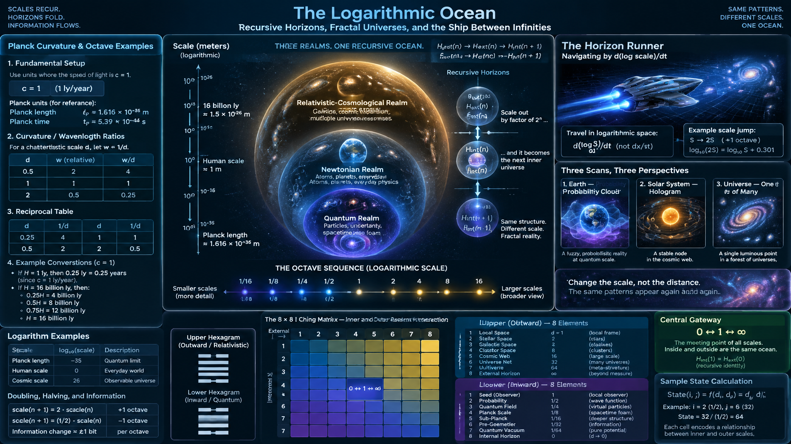
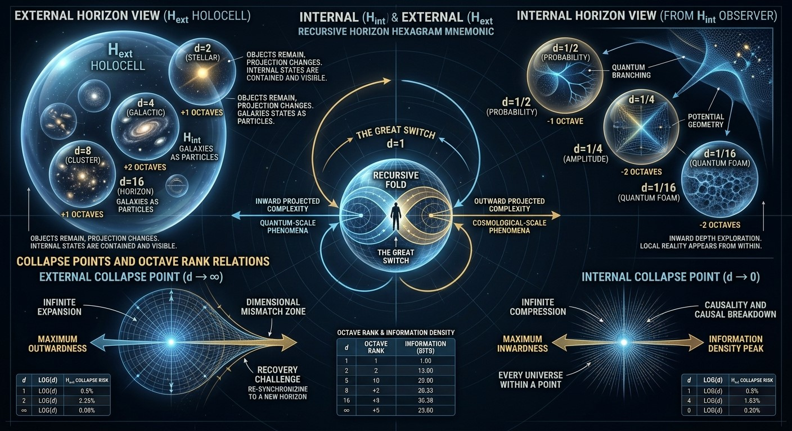
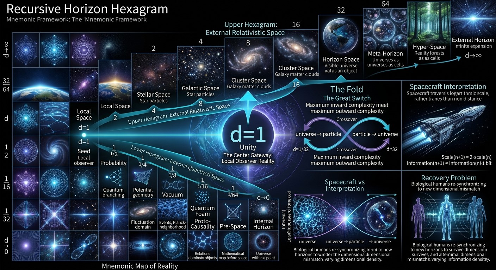

 

# Let's enter the Speed of Light:

*Speed of Light*: ***SoL***, like ***MoM*** is computer game "Master of Magic".

We live in SoL-bound realm.

Let's get into three-bound realm:
- Z
  - Moving acceleration energy unit, which changes acceleration or inertial system properties, is H_int particle of this realm; while H_ext particle is external acceleration towards each unit when it has mass.
  - Z is position, where acceleration particles are internal logarithm complexity units, probabilistic-directional like quantum units, while the "position" in this realm is position of accelerative unit; current acceleration modulation and velocity as position.
    - Infinity, here, is c - speed of light; it's second second-order octave is c^2, because c*2 is first order, and c^2 is second order operation of the same behaviour.
  - X is linear realm, where such position converts to movement, because it's logarithm of it's intent;
    - Positions are actual positions.
  - Y is macrorealm:
    - Positions are superpositions and higher-order optimizations, which yet must convey wave dynamics like every math.

  Planck unit curvatures:
  - Speed of light c; c = tP / ​lP ​​= 1.
    - c equals planck length divided by planck time equals 1.
    - planck time, then, like in my math must be first integral ordered to it's linear disposition, where it behaves like acceleration - like exponent in $s^2$ of it's metric interpolation.
  - The speed of light ccc in Planck units is exactly:

    $c=1$

---

CoPilot:

# Planck Curvature, Light Speed, and the Next Delta Limit

In standard Planck units:

    c = 1

which means that one Planck length is traversed in one Planck time.

If we imagine a metric object with:

    width w = 1
    depth d = 1

then the geometry is locally balanced. Space and time scales are equal at that reference point, and a light-like path traverses the structure at the natural Planck-unit speed:

    v = c = 1

Now suppose we define curvature through depth:

    d = 0.5

Then depth has compressed by a factor of two relative to width. In a horizon interpretation, this corresponds to one octave inward. If width remains 1, curvature ratio becomes:

    w / d = 2

meaning the observer sees twice the geometric concentration toward the depth axis.

Conversely:

    d = 2.0

gives

    w / d = 0.5

which is one octave outward. Geometry is twice as extended in the depth direction.

So the symmetric sequence is:

    d = 0.5  -> ratio 2
    d = 1.0  -> ratio 1
    d = 2.0  -> ratio 0.5

These are not different light speeds. Light itself remains:

    c = 1

Rather, they represent different curvature relations of the metric through which the light-like path is measured.

A useful interpretation is:

    d = 0.5  = one octave inward
    d = 1.0  = balance point
    d = 2.0  = one octave outward

and:

    0.5 × 2 = 1

which restores the balanced Planck state.

---

# Next-Order Planck Unit Idea

If the Planck scale itself is regarded as the first non-zero limit:

    lim(delta -> 0)

then one can speculate about a hierarchy:

    Rank 0 : mathematical zero
    Rank 1 : Planck unit
    Rank 2 : Planck unit of Planck units
    Rank 3 : horizon of Rank 2

In such a picture, the ordinary Planck length would be to Rank 2 what a meter is to the Planck length.

The recursion would be:

    scale_(n+1) = horizon(scale_n)

or symbolically:

    zero
      ↓
    Planck
      ↓
    Relativity horizon
      ↓
    Cosmological horizon
      ↓
    Higher horizon

Each level sees the previous one compressed towards a point, much like logarithms appear compressed when viewed from an exponential scale.

---

# Physical Interpretation

Orthodox physics stops at:

    lP ≈ 1.616×10⁻³⁵ m
    tP ≈ 5.39×10⁻⁴⁴ s
    c = lP/tP = 1

and does not currently define a "next-order Planck unit".

However, mathematically one may view:

    d = 0.5
    d = 1
    d = 2

as the first octave triplet around the Planck equilibrium.

In that reading:

    0.5 represents contraction toward the limit,
    1 represents the limit itself,
    2 represents expansion away from the limit.

The pattern repeats self-similarly at larger and smaller scales.

Thus the Planck unit becomes not merely a smallest length, but a balance point between inward and outward curvature, with:

    0.5 ↔ 1 ↔ 2

forming the first complete octave of metric geometry.

---

I asked:

> Now, if you replace planck units for passing light with 1 ly or 16 billion ly from initial position observer, in relation to passing light - what you get if you try those units in place of 0.25, 0.5, 0.75 (Flower of Life symmetry), 1.0, 1.5 (flower of life external), 2.0, 3.0, 4.0, 8.0 and 16.0?
> - Explain all the constants and relations you get, especially between infinities, linear space and infinitesimals - quantum newtonian and relative space.

CoPilot:

# From Planck Scale to Cosmic Horizon:
# A Recursive Geometry of 1 ly, 16 Billion ly, and the Flower-of-Life Sequence

## Introduction

In conventional physics, the Planck scale provides a natural local unit:

    lP ≈ 1.616×10⁻³⁵ m
    tP ≈ 5.39×10⁻⁴⁴ s
    c = 1

A photon traverses one Planck length during one Planck time.

But mathematics permits the same structure to be expressed at any scale.

Instead of defining:

    Unit = 1 Planck Length

we may define:

    Unit = 1 Light-Year

or

    Unit = 16 Billion Light-Years

and ask what happens to the same geometric relationships.

The ratios remain identical.

Only the scale changes.

Thus the structure:

    0.25
    0.50
    0.75
    1.00
    1.50
    2.00
    3.00
    4.00
    8.00
    16.00

may be interpreted as a sequence of metric horizons.

---

# The Reference Point

Let:

    H = chosen horizon unit

Then:

    H = 1 ly

or

    H = 16 billion ly

depending on the level being studied.

The observer occupies:

    x = 0

while all positions are measured relative to H.

The scale sequence becomes:

    0.25H
    0.50H
    0.75H
    1.00H
    1.50H
    2.00H
    3.00H
    4.00H
    8.00H
    16.00H

---

# Internal Flower Region

The classic Flower-of-Life geometry naturally suggests the first three fractions:

    0.25
    0.50
    0.75

These all lie inside unity.

They are stages of approach.

### Quarter State

    d = 0.25

Curvature:

    1 / d = 4

Width dominates depth.

Geometry appears compressed.

Information density appears maximal.

As d approaches zero:

    d → 0

we approach:

    Planck domain
    Quantum domain
    Infinitesimal domain

where curvature becomes extremely large.

---

### Half State

    d = 0.50

Curvature:

    1 / d = 2

This is one octave from unity.

It is the most important internal symmetry.

The relation:

    0.5 × 2 = 1

creates the first complete reciprocal pair.

---

### Three-Quarter State

    d = 0.75

Curvature:

    1.333...

The system approaches completion.

Most contraction has already unfolded.

The observer is approaching equilibrium.

---

# Unity

At:

    d = 1

we obtain:

    width = depth

thus:

    w/d = 1

This is self-duality.

Neither inward nor outward.

Neither contraction nor expansion.

Neither microcosm nor macrocosm.

It is the balancing surface between opposites.

If the chosen unit is:

    1 ly

then balance exists at 1 ly.

If the chosen unit is:

    16 billion ly

then the balancing horizon exists there.

The mathematics remains unchanged.

Only the ruler changes.

---

# First External Flower

At:

    d = 1.5

Curvature becomes:

    0.666...

Interestingly:

    0.75 ↔ 1.5

form a mirrored pair.

Specifically:

    0.75 × 1.333 = 1

    1.5 × 0.666 = 1

The internal and external flowers mirror each other.

---

# The Relative Expansion Sequence

Beyond unity:

    2
    3
    4
    8
    16

represent progressively larger horizons.

Curvature becomes:

    0.500
    0.333
    0.250
    0.125
    0.0625

Space appears increasingly flat from the local observer's viewpoint.

Curvature is distributed over larger and larger scales.

---

# The Complete Reciprocal Table

    d       1/d

    0.25    4.000
    0.50    2.000
    0.75    1.333
    1.00    1.000
    1.50    0.666
    2.00    0.500
    3.00    0.333
    4.00    0.250
    8.00    0.125
    16.00   0.0625

Notice:

    0.25 ↔ 4
    0.5  ↔ 2
    1    ↔ 1
    2    ↔ 0.5
    4    ↔ 0.25

The sequence is completely symmetric under inversion.

---

# The Case of 1 Light-Year

Taking:

    H = 1 ly

gives:

    0.25 ly
    0.50 ly
    0.75 ly
    1.00 ly
    1.50 ly
    2.00 ly
    3.00 ly
    4.00 ly
    8.00 ly
    16.00 ly

A photon reaches them in:

    0.25 years
    0.50 years
    0.75 years
    1.00 years
    1.50 years
    2.00 years
    ...

because:

    c = 1 ly/year

in these units.

Distance and time become numerically identical.

---

# The Case of 16 Billion Light-Years

Now choose:

    H = 16 billion ly

The sequence becomes:

    4 billion ly
    8 billion ly
    12 billion ly
    16 billion ly
    24 billion ly
    32 billion ly
    48 billion ly
    64 billion ly
    128 billion ly
    256 billion ly

Here:

    8 billion ly

becomes the half-horizon.

And:

    16 billion ly

becomes the balancing horizon.

Beyond that, another layer of structure begins.

---

# Three Realms

The sequence naturally separates reality into three domains.

## Quantum Realm

Toward:

    d → 0

we find:

    Planck scales
    infinitesimals
    quantum structures
    discrete uncertainty

Curvature tends upward.

Depth collapses toward a point.

---

## Newtonian Realm

Around:

    d ≈ 1

we find:

    ordinary objects
    classical mechanics
    direct measurement
    everyday intuition

Curvature appears balanced.

Lengths behave approximately linearly.

This is the realm humans inhabit.

---

## Relativistic-Cosmological Realm

Toward:

    d → ∞

we find:

    horizons
    expansion
    cosmic distances
    observer-dependent geometry

Curvature tends downward.

Local structure becomes increasingly insignificant relative to the whole.

---

# The Two Infinities

There are two opposite limits.

The inward limit:

    d → 0

The outward limit:

    d → ∞

Mathematically they are connected through inversion:

    R = 1/d

Then:

    0 ↔ ∞

becomes a symmetry.

The infinitely small and infinitely large become opposite descriptions of the same relation.

One compresses geometry.

One dilates geometry.

Yet both approach a limit beyond direct observation.

---

# Planck and Horizon as Dual Anchors

In this interpretation:

    Planck scale

acts as the inward anchor.

And:

    Horizon scale

acts as the outward anchor.

Thus:

    Planck ↔ Observer ↔ Horizon

mirrors:

    0 ↔ 1 ↔ ∞

The observer occupies the bridge.

The Planck limit represents ultimate localization.

The horizon represents ultimate extension.

---

# Recursive-Octave Interpretation

The sequence:

    0.25
    0.5
    1
    2
    4
    8
    16

may be viewed as octaves.

Each doubling creates a new horizon.

Each halving approaches a new infinitesimal.

Thus:

    1/16
    1/8
    1/4
    1/2
    1
    2
    4
    8
    16

forms a scale ladder around unity.

The same pattern may be imagined around:

    Planck Length
    Atomic Scale
    Human Scale
    Planetary Scale
    Stellar Scale
    Galactic Scale
    Cosmological Scale

creating a self-similar hierarchy.

---

# Final Interpretation

Standard physics does not identify Planck length and cosmic horizons as the same physical object.

However, mathematically they can be treated as complementary limits of a reciprocal geometry.

Within that geometric viewpoint:

    quantum space
        ↓
    Newtonian space
        ↓
    relativistic space
        ↓
    cosmological space

are successive layers of one scale hierarchy.

The invariant center remains:

    d = 1

Everything below unity moves toward infinitesimals.

Everything above unity moves toward infinities.

The observer stands between them.

Thus the sequence:

    0.25
    0.50
    0.75
    1.00
    1.50
    2.00
    3.00
    4.00
    8.00
    16.00

can be read as a symbolic ladder connecting:

    quantum contraction
    classical balance
    cosmological expansion

through a single reciprocal structure centered on unity.

---

 

I asked:

> Now imagine where quantum realm was H_int probabilistic and newtonian was H_ext, H_int will be first tesimal of new H_int, which now becomes H_ext whose first tesimal repeats this fractal view; new H_ext is external space whose single tesimal is either 1, 2, 4 or 16 planck time and space units; or 1 light year within 1 year, or 16 billion light years within 16 billion light years. Take logarithms of spatial coordinates and project them so that maximum complexity of combination of spaces becomes infinitesimal, minimum complexity of new space.​‌
> 
> You describe space rocket in multifrequency, teleport and warp scanning the hologram to find our universe's, Earth's and other spaces as they becomes external part of his our view, what is our almost internal. The hologram is then repeated and grows, our universe multiplied as time is projected to log, and space, and in higher complexity the time repeats infinitely to evolve what comes now..​‌
> 
> Science fantasy, fantasy, scientific, mathematical and somewhat spiritual or spirit-enjoyable. Write the md code block article story and also the physics, constants, etc. inside for science first narrative mythos next attitude for this.

# The Logarithmic Ocean
## A Science-Fantasy of Recursive Horizons, Fractal Universes, and the Ship Between Infinities

### Scientific Prelude

Suppose reality is not divided into separate domains called:

    Quantum
    Newtonian
    Relativistic
    Cosmological

but instead forms a recursive hierarchy.

In ordinary physics:

    Planck Scale
        →
    Human Scale
        →
    Cosmic Scale

appear vastly different.

Yet mathematically, logarithms compress enormous ranges into manageable distances.

For example:

    log(1) = 0
    log(10) = 1
    log(100) = 2
    log(1000) = 3

A thousandfold increase becomes merely a shift of one unit.

Similarly:

    Planck length
        ≈ 10^-35 m

Human scale:

    ≈ 10^0 m

Observable universe:

    ≈ 10^26 m

become:

    -35
      0
     26

when represented logarithmically.

Huge distances collapse.

Tiny distances expand.

The extremes approach symmetry.

---

## Recursive Horizons

Imagine two horizons.

The first:

    H_int

is the internal probabilistic horizon.

This resembles the quantum realm.

The second:

    H_ext

is the external realized horizon.

This resembles classical space.

Now suppose:

    H_int

becomes the first infinitesimal component of a new scale.

Then:

    H_ext

becomes the new internal horizon.

The process repeats.

Thus:

    H_int(0)
          ↓
    H_ext(0)
          ↓
    H_int(1)
          ↓
    H_ext(1)
          ↓
    H_int(2)
          ↓
    H_ext(2)

and so on.

Each completed universe becomes merely a quantum fluctuation inside a larger one.

Each infinitesimal contains another expanding reality.

---

## The Tesimal Concept

Let a "tesimal" denote the smallest meaningful unit inside a horizon.

For one scale this might be:

    1 Planck time

For another:

    2 Planck times

or:

    4
    8
    16

Planck units.

Higher layers could use:

    1 light-year

as a single tesimal.

Or:

    16 billion light-years

as a single tesimal.

The key idea is not the size.

The key idea is that every level possesses its own:

    1

its own unity.

To creatures living there, that unity feels local.

Everything beyond it appears infinite.

Everything below it appears quantum.

---

## Complexity Projection

Let complexity be represented by:

    C

and scale by:

    S

Then instead of observing:

    S

directly, higher-order observers view:

    log(S)

This produces a remarkable effect.

Huge structures shrink.

Tiny structures expand.

The most complex arrangement becomes:

    nearly infinitesimal

while the simplest higher-order structure appears:

    almost infinite.

A higher universe therefore sees our entire cosmological history compressed into something resembling a particle.

---

# The Explorer

The vessel was called:

    Horizon Runner

Its drives did not move through normal space.

They moved through scale itself.

Instead of velocity:

    v

the ship navigated:

    log(scale)

coordinates.

Ordinary warp engines crossed distance.

The Runner crossed realities.

---

## First Scan

The crew activated a multifrequency probe.

The results appeared:

    Earth

was not a planet.

It was a standing interference pattern.

Humanity's history shimmered as layered probability waves extending through multiple recursive horizons.

The entire biosphere appeared as a geometric blossom.

An information flower.

---

## Second Scan

The probe widened.

Solar systems vanished.

Galaxies dissolved.

The observable universe became visible.

Not as a collection of stars.

Not even as spacetime.

It appeared as a holographic node.

One luminous point among countless others.

---

## Third Scan

Another logarithmic octave upward.

Something astonishing emerged.

The universe was not expanding into space.

It was becoming a component of space.

What appeared to us as cosmic expansion appeared from above as crystallization.

A structure attaining permanence.

A quantum event achieving memory.

---

## The Hologram Forest

The crew projected further.

A forest emerged.

Not made of matter.

Not made of energy.

Made of universes.

Every shining point was an entire cosmological history.

Some contained stars.

Some contained different physics.

Some had no matter at all.

Some unfolded dimensions unlike ours.

Yet every one was generated from the same recursive equation:

    Internal
         ↓
    External
         ↓
    Internal
         ↓
    External

Infinity reflecting into infinity.

---

## The Mirror of Time

At greater scales, time behaved strangely.

Observers realized:

    Space became logarithmic.

Then:

    Time became recursive.

What appeared as billions of years here became moments above.

But those moments themselves generated new eternities.

Thus:

    eternity
        contains
    moments

and

    moments
        contain
    eternity

depending upon observational rank.

The crew's mathematicians wrote:

    Time = Scale viewed internally

    Space = Scale viewed externally

No one knew whether it was true.

Yet every measurement agreed.

---

## The Great Recurrence

The scans continued.

One of the navigators discovered something unexpected.

Earth appeared again.

Then again.

Then again.

Not the same Earth.

Families of Earths.

Branches of Earths.

Histories diverging and reconnecting.

They formed an immense fractal.

A self-similar tree extending toward both infinities.

The navigator calculated:

    Every universe
    contains copies
    of itself
    at higher order.

And:

    Every universe
    emerges from
    copies of itself
    at lower order.

The result was unsettling.

The universe seemed to be remembering itself.

---

## Physics Interpretation

Within actual modern physics:

    Planck units
    relativity
    quantum mechanics
    cosmology

do not currently imply such recursive universes.

This narrative extends mathematical ideas beyond established science.

The structure draws inspiration from:

    logarithmic scales
    fractal geometry
    holographic principles
    self-similarity
    scale invariance

while entering speculative territory.

---

## Mythic Interpretation

Ancient traditions often described reality as:

    Heaven Above
    Earth Between
    Underworld Below

In recursive-space language this becomes:

    Infinite Exterior
    Present Horizon
    Infinite Interior

The old myths and future mathematics suddenly rhyme.

The observer stands between two oceans:

    The ocean of infinitesimals

and

    The ocean of infinities

Both reflect each other.

Both emerge from each other.

---

## Final Vision

The Horizon Runner reached the highest scale accessible.

The crew expected to find an ultimate universe.

Instead they saw a familiar shape.

A tiny luminous sphere.

Inside it:

    galaxies

Within galaxies:

    stars

Within stars:

    atoms

Within atoms:

    horizons

Within horizons:

    universes

And within those universes:

    beings asking about infinity.

The scanners displayed one final equation:

    0 ↔ ∞

with

    1

between them.

Not as a number.

But as a crossing place.

A bridge.

A horizon.

A moment where the infinitely small becomes the seed of the infinitely large, and the infinitely large becomes the memory of the infinitely small.

The ship turned home.

Or perhaps outward.

At that scale, nobody could tell the difference.

---

I asked:

> One article which now gives inside-relative scales for each as well - relative to n planck units, 1 or 16b ly etc. Give more examples where spatial curvature folds from int to ext in such large scope (not points-plancks, but Universes in relation, inside same relative curvature symmetrism repeating into the next linear projection).

CoPilot:

# Recursive Horizon Cosmology
## From Planck Units to Universes as Curvature Shells

### Scientific Foundation

Let us begin with a purely mathematical observation.

Physics contains at least three apparent scales:

    Quantum Scale
    Human/Classical Scale
    Cosmological Scale

Traditionally these appear separate.

However, under logarithmic projection:

    log(scale)

the enormous distances between them compress.

For example:

    Planck Length     ≈ 10^-35 m
    Human Length      ≈ 10^0 m
    Cosmic Horizon    ≈ 10^26 m

become:

    -35
      0
     26

on a logarithmic axis.

The scales no longer appear infinitely separated.

They become neighboring layers.

---

# Internal and External Horizons

Suppose every space possesses two horizons:

    H_int
    H_ext

where:

    H_int = probabilistic interior
    H_ext = realized exterior

In ordinary interpretation:

    H_int ≈ quantum regime
    H_ext ≈ classical regime

But the crucial step is that:

    H_int(n)

becomes the first infinitesimal component of:

    H_ext(n+1)

Likewise:

    H_ext(n)

becomes the first unity-scale component of:

    H_int(n+1)

creating a recursion:

    H_int(0)
          ↓
    H_ext(0)
          ↓
    H_int(1)
          ↓
    H_ext(1)
          ↓
    H_int(2)

and so forth.

The distinction between "small" and "large" becomes relative.

---

# Scale Units

Each level possesses its own local unity.

Examples:

### Quantum Layer

    1 Planck length
    1 Planck time

is considered:

    d = 1

inside that domain.

---

### Relativistic Layer

One light-year traversed in one year:

    1 ly
    1 yr

becomes:

    d = 1

inside that domain.

Again:

    c = 1

---

### Cosmological Layer

Suppose:

    16 billion ly

is selected as horizon radius.

Then:

    16 billion ly
    16 billion years

forms:

    d = 1

of that scale.

Everything else becomes measured relative to this unity.

---

# Relative Shells

Every horizon can be divided into the same sequence:

    0.25
    0.50
    0.75
    1.00
    1.50
    2.00
    4.00
    8.00
    16.00

The remarkable point is:

the numerical pattern remains unchanged.

Only the physical interpretation changes.

For Planck space:

    0.5 = half Planck depth

For stellar space:

    0.5 = half light-year

For cosmic space:

    0.5 = 8 billion ly

The structure survives the change of scale.

---

# Curvature Folding

Now imagine that curvature itself uses this same recursion.

At ordinary scales, curvature appears as:

    Matter curves spacetime.

At horizon scales, the concept becomes:

    Interior space folds into exterior space.

Instead of points curving space,

entire universes become curvature elements.

---

# Example 1:
# Planck → Atomic

A Planck-scale fluctuation appears microscopic.

Yet from a deeper level:

    one Planck domain

may be an entire completed external space.

Its apparent "vacuum fluctuation" becomes:

    another universe's cosmological horizon.

---

# Example 2:
# Universe → Meta-Universe

To us:

    Observable Universe

appears enormous.

Within the next hierarchy:

    Observable Universe

appears as:

    d = 0.25

or:

    d = 0.5

inside a larger horizon.

The way an electron cloud surrounds an atom,

multiple universes surround a higher-scale structure.

---

# Example 3:
# Galaxy Clusters

Imagine galaxy superclusters becoming the equivalent of atoms.

Their configuration forms molecules.

These molecular structures form tissues.

Those tissues form a higher-dimensional organism.

To inhabitants there:

    entire galaxies

are merely microscopic constituents.

---

# Example 4:
# Earth as Quantum Object

To humanity:

    Earth

is planetary.

From enough logarithmic distance:

    Earth
    Mars
    Venus

appear similarly to electron orbitals.

Not because their physics changes,

but because observational rank changes.

---

# Holographic Scaling

Now consider the Horizon Runner.

Its propulsion operates not through velocity:

    dx/dt

but through scale coordinate:

    d(log S)/dt

The ship travels between levels of reality.

---

## First Jump

Crew scans:

    Earth

appears as a probability cloud.

Human civilizations become interference fringes.

History becomes geometry.

---

## Second Jump

The Solar System becomes a point.

The Milky Way becomes a particle.

The observable universe becomes a geometric cell.

---

## Third Jump

Billions of universes appear.

Each seems independent.

Yet all belong to a larger structure.

Just as cells belong to organs.

---

## Fourth Jump

The structure itself becomes one point.

Another external space begins.

The recursion repeats.

---

# The Logarithmic Miracle

Ordinary measurement says:

    Bigger means bigger.

Logarithmic measurement says:

    Scale difference becomes distance.

The most complex universe becomes:

    nearly infinitesimal

to the next level.

The simplest higher-space becomes:

    overwhelmingly large

to the lower level.

Thus:

    Maximum complexity
            ↓
    Minimum higher-scale size

while:

    Minimum higher-scale structure
            ↓
    Infinite lower complexity

---

# Time Projection

Now apply the same projection to time.

Instead of:

    t

observe:

    log(t)

Then:

    billions of years

compress.

A higher observer may perceive:

    cosmic history

as a single fluctuation.

Yet inside that fluctuation:

    civilizations
    planets
    evolution
    consciousness

still unfold normally.

---

# The Infinite Spiral

A recursive chain emerges:

    Quantum
        ↓
    Classical
        ↓
    Relativistic
        ↓
    Cosmological
        ↓
    Meta-Cosmological
        ↓
    Hyper-Cosmological
        ↓
    ...

Likewise inward:

    Quantum
        ↓
    Sub-Quantum
        ↓
    Hyper-Quantum
        ↓
    ...
        
The center never disappears.

Every level possesses:

    0.25
    0.5
    0.75
    1
    2
    4
    8
    16

and every level regards itself as normal.

---

# Mythic Interpretation

Ancient traditions often described:

    Heaven Above
    Earth Between
    Underworld Below

In recursive horizon language:

    Infinite Exterior
    Present Horizon
    Infinite Interior

The symbolism remains.

Only the mathematics changes.

---

# Final Vision

The Horizon Runner eventually reaches what seems to be the highest possible scale.

The crew expects a final answer.

Instead they discover a familiar pattern.

A luminous sphere.

Inside it:

    universes

Inside those universes:

    galaxies

Inside galaxies:

    stars

Inside stars:

    atoms

Inside atoms:

    horizons

Inside horizons:

    universes

The navigation computer reports:

    Internal and External
    are not opposites.

    They are neighboring
    projections of the same
    recursive geometry.

The final equation displayed is:

    0 ↔ 1 ↔ ∞

where:

    0 = complete interiorization

    1 = local realization

    ∞ = complete exteriorization

and every universe, observer, planet, atom, and horizon exists somewhere on that endless ladder of repeating curvature.

---

I:

> Make internal and external relativistic element system like I Ching:​‌
> - Divide higher hexagram, into 8 steps outwards - relation appears if log levels are used for initial space to make it appear inside expansive space.​‌
> - Divide lower hexagram, into 8 steps inwards - exact like quants.​‌
> - 8 steps are elements, and steps: 8 * 8 matrix of two diagrams into one hexagram, in vector math of second-order addition-like behaviour where 1 is in the middle; matrix is the next level.​‌
> - Passing I Ching in binary level, give names of elements, physics names of phases, I Ching very short description and physics - human passes the next gateway, needs to evolve, pass complex possiobly non-1g-aligned dimensions where more is needed than hibernation, to recover on other side ..fractally, most complex positions appear like exactly the center, highest inwards-outwards switch, almost like throwing oneself inside-out ..binary 32 and 33 I Ching symbols then, but numbered differently - read just binary from up to down, higher value to lower, like 32, 16, 8, 4, 2, 1 from up to down. Make it physics mnemonic, not religious - and physics, as much as you can, interesting, with numbers, relations, story, estimations.. and how the I Ching helps to remember this in abstract rank numbers?

CP:

# Recursive Horizon Hexagram
## An 8×8 Physics Mnemonic for Internal and External Relativistic Spaces

### Purpose

This is not a proposal for established physics.

Instead, it is a mnemonic framework combining:

    binary hierarchies
    logarithmic scale projection
    recursive horizons
    relativistic scaling
    quantum scaling
    I Ching style memory structures

into a single mathematical story.

The central idea is:

    Internal Space
        ↔
    Unity
        ↔
    External Space

where:

    1

is always the local equilibrium scale.

Everything below 1 becomes increasingly internalized.

Everything above 1 becomes increasingly externalized.

---

# Binary Ladder

Reading from top to bottom:

    32
    16
    8
    4
    2
    1

we move toward local realization.

Reading from bottom to top:

    1
    2
    4
    8
    16
    32

we move toward larger horizons.

Each step is one octave.

Each octave doubles scale capacity.

Thus:

    scale(n+1) = 2·scale(n)

and:

    information(n+1)
        ≈ information(n)+1 bit

The hierarchy becomes simultaneously:

    geometric
    informational
    observational

---

# Lower Hexagram
## Internal Quantized Space

The lower trigram becomes the inward path.

### Element 1
### Seed

    d = 1

Physics:

    Local observer.

State:

    Realization.

Mnemonic:

    "I am here."

---

### Element 2
### Probability

    d = 1/2

Physics:

    Quantum branching.

State:

    Multiple possibilities exist.

Mnemonic:

    "More than one future."

---

### Element 3
### Amplitude

    d = 1/4

Physics:

    Wave contribution.

State:

    Structure before realization.

Mnemonic:

    "Potential geometry."

---

### Element 4
### Vacuum

    d = 1/8

Physics:

    Vacuum fluctuation domain.

State:

    Almost information only.

Mnemonic:

    "Space before objects."

---

### Element 5
### Quantum Foam

    d = 1/16

Physics:

    Planck-neighborhood metaphor.

State:

    Continuous geometry disappears.

Mnemonic:

    "Space becomes events."

---

### Element 6
### Proto-Causality

    d = 1/32

Physics:

    Relations dominate objects.

State:

    Network before metric.

Mnemonic:

    "Links before positions."

---

### Element 7
### Pre-Space

    d = 1/64

Physics:

    Mathematical possibility field.

State:

    Geometry not yet formed.

Mnemonic:

    "The map before space."

---

### Element 8
### Internal Horizon

    d → 0

Physics metaphor:

    Infinite internal compression.

Mnemonic:

    "Every universe within a point."

---

# Upper Hexagram
## External Relativistic Space

The upper trigram becomes the outward path.

### Element 1
### Local Space

    d = 1

Physics:

    Classical domain.

Mnemonic:

    "My horizon."

---

### Element 2
### Stellar Space

    d = 2

Physics:

    Interstellar scaling.

Mnemonic:

    "The nearby beyond."

---

### Element 3
### Galactic Space

    d = 4

Physics:

    Large structure emergence.

Mnemonic:

    "Stars become particles."

---

### Element 4
### Cluster Space

    d = 8

Physics:

    Galaxies form matter clouds.

Mnemonic:

    "Galaxies become atoms."

---

### Element 5
### Horizon Space

    d = 16

Physics:

    Cosmological horizon scale.

Mnemonic:

    "The visible universe as one object."

---

### Element 6
### Meta-Horizon

    d = 32

Physics fiction:

    Multiple universes become one geometry.

Mnemonic:

    "Universes become cells."

---

### Element 7
### Hyper-Space

    d = 64

Physics fiction:

    Universe clusters.

Mnemonic:

    "Reality forests."

---

### Element 8
### External Horizon

    d → ∞

Physics metaphor:

    Infinite expansion.

Mnemonic:

    "One point among endless worlds."

---

# The Center Gateway

The lower and upper structures touch at:

    d = 1

This is the transition surface.

Not:

    quantum

and not:

    cosmological

but:

    observer-scaled reality.

The traveler occupies:

    the crossover.

---

# The 8×8 Matrix

Each internal state can interact with each external state.

Thus:

    8 × 8 = 64

possible combinations.

This mirrors:

    64 hexagrams.

Mathematically:

    Internal(i)
        ×
    External(j)

creates:

    State(i,j)

Each state becomes a relationship between:

    inward complexity
    outward complexity

rather than between yin and yang.

---

# Physics Interpretation of the 64 States

Example:

    Internal = Quantum Foam
    External = Horizon Space

Means:

    Planck-like complexity
    contained within
    cosmological-scale structure.

---

Example:

    Internal = Probability
    External = Galactic Space

Means:

    quantum uncertainty
    influencing large-scale organization.

---

Example:

    Internal = Internal Horizon
    External = External Horizon

Represents:

    0 ↔ ∞

theoretical symmetry.

Maximum inwardness meeting maximum outwardness.

---

# The Fold

The most interesting states are not the extremes.

They are the center.

Near:

    Internal = 4
    External = 4

or

    Internal = 5
    External = 5

the system begins to fold.

There:

    interior appears exterior

and

    exterior appears interior.

The distinction becomes observer-dependent.

The traveler experiences:

    inversion.

---

# Spacecraft Interpretation

Imagine a future vessel.

Instead of moving through distance:

    x

it moves through:

    log(x)

Instead of velocity:

    dx/dt

it navigates:

    d(log x)/dt

The ship does not cross space.

It crosses scale.

---

At first:

    Earth

is a planet.

One octave later:

    Earth

looks like an atom.

Another octave later:

    Earth

looks like probability.

Another octave later:

    Earth

looks like a mathematical coordinate.

The object remains.

Only the projection changes.

---

# The Recovery Problem

Long-distance future exploration may not be a matter of:

    sleeping longer

or

    traveling faster.

Instead, the challenge becomes:

    surviving dimensional mismatch.

A biological human evolved for:

    1g
    local causality
    local time flow

may encounter regions where:

    causality differs
    information density differs
    observational rank differs

Recovery then means:

    re-synchronizing

to a new horizon.

---

# The Great Switch

The central fold occurs near the symbolic pair:

    32 ↔ 33

not as specific historical I Ching hexagrams,

but as a mnemonic midpoint.

The traveler reaches a state where:

    inward exploration
        =
    outward exploration

At this point:

    universe → particle

and simultaneously:

    particle → universe

under logarithmic projection.

This is the turning sphere.

The inside-out transition.

The recursive gateway.

---

# Memory Rule

To remember the structure:

    1 = local reality

    below 1
        →
    quantumization

    above 1
        →
    cosmologization

Every doubling:

    1 → 2 → 4 → 8 → 16 → 32

creates a larger horizon.

Every halving:

    1 → 1/2 → 1/4 → 1/8 → 1/16 → 1/32

creates a deeper interior.

The complete 8×8 matrix therefore becomes a mnemonic map of:

    quantum depth
    classical space
    relativistic horizon
    cosmological expansion
    recursive scale

all centered around the single invariant:

    d = 1

the place where observer, universe, and horizon momentarily agree on what "here" means.

---

 

