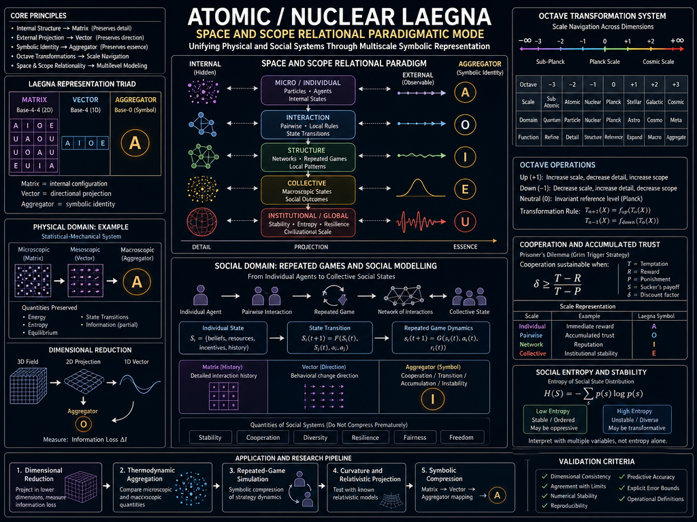
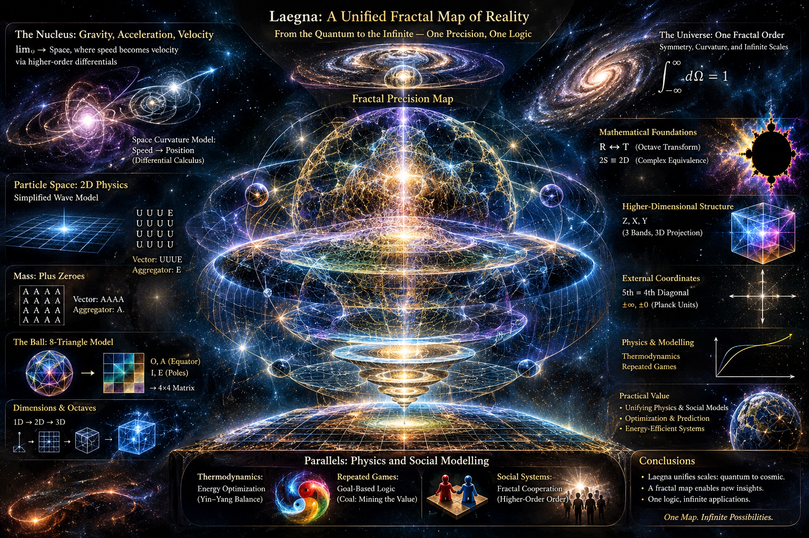
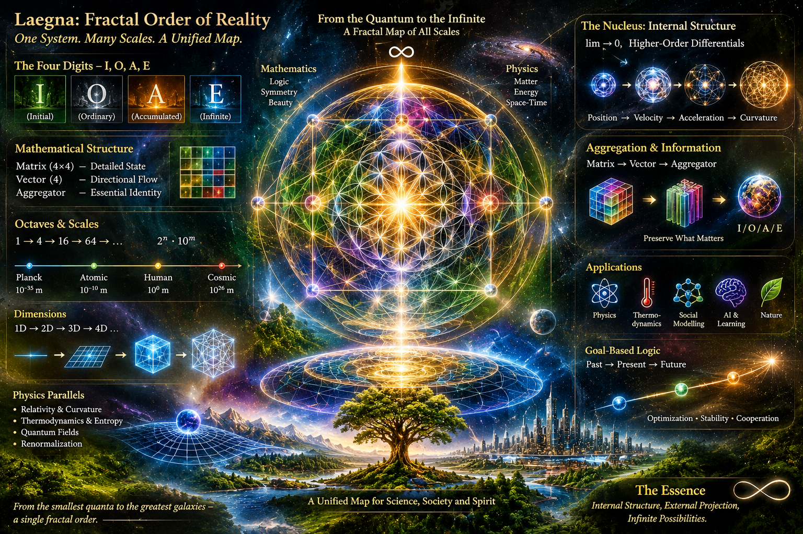
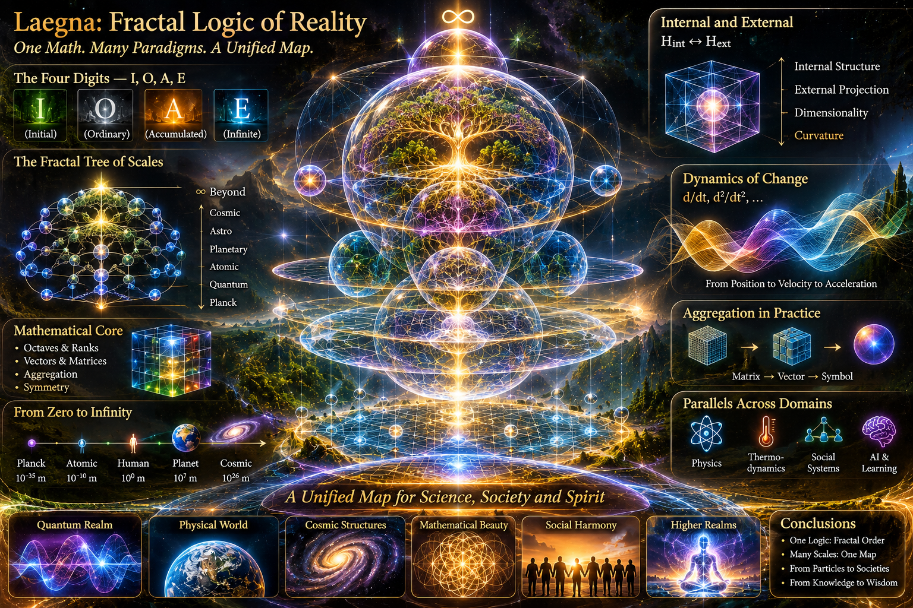

<br>

---

I asked ChatGPT for specification of initial article below, with some suggested proposals to solve them somehow:

> Light speed c is applied at single spatial direction, the rest is none; or planckton or planckton divided by light speed once more, or something around dimensionality there, is used for mass: it's external, goal movement, passive yin to all directions the same time, which is like single vertical upward direction; energy is either surface area maximalized, or speed maximalized. Follow this as 1 rank, but octaves of this relation - recursive additions to lower-degree infinitesimal area for more spot and quadratic or exponential speeds; and recursive depth of surface tesimal so that the surface flattens even more, becoming flattened even in regards to higher dimension - mass in relation to density and negative density of such. Analyze all the relations, explain the math, but do it without mathematical actual equations and code unless you can use simple utf-8 for basin which does not need katex math or math blocks and inlines

# Directional Light, Isotropic Mass, and Recursive Geometry
## A Laegna Exploration of Space, Energy, Density, and Dimensions

*From the smallest imaginable scales to the structure of the universe: exploring how movement, matter, surfaces, and dimensions may belong to one mathematical picture.*

---

## Introduction: Two Ways of Organizing Reality

Imagine two different things.

First, imagine a ray of light travelling through space. It has a direction, a speed, and a path. We can follow it along a single line.

Now imagine a perfectly round planet. Its mass is distributed throughout its volume, and its gravitational influence extends in every direction around it.

These are two very different geometrical pictures:

- Light gives us a useful example of directional propagation.
- Mass gives us a useful example of spatial distribution.

What happens if we try to understand both through one mathematical framework?

This is where Laegna introduces an interesting idea: instead of describing the universe only through objects and their sizes, we can describe it through how quantities are distributed across directions, surfaces, volumes, and dimensions.

We can then increase the precision of this description recursively, using octaves and ranks.

The central idea is:

**A physical system can be represented through its direction, distribution, geometry, and the precision with which we describe it.**

This article explores that idea, connecting it to established physics, geometry, thermodynamics, and Laegna's own mathematical proposals.

---

## 1. Light: The Direction of Maximum Propagation

Light travels through a vacuum at the speed of light, conventionally represented by the letter c.

This speed is approximately 300,000 kilometres per second.

For our simplified model, imagine following a beam of light along one selected direction.

We can describe it using:

- One principal direction of propagation.
- A position along that direction.
- A speed that remains constant in vacuum.
- Transverse directions perpendicular to its movement.

This gives us a directional geometrical model.

There is one important clarification: light does not physically travel in only one possible spatial direction. It can propagate in any direction. We simply choose one direction as our reference axis.

Also, the speed of light is not an ordinary speed limit that massive objects can reach. It is an invariant limiting speed in relativity. Objects with nonzero rest mass cannot reach it.

### Why this matters to Laegna

The directional model provides a simple reference for studying movement.

We can imagine an entire system being described through one principal axis, then gradually introducing additional dimensions and degrees of freedom.

This gives us a starting point for investigating how a simple direction becomes a more complex geometrical structure.

---

## 2. Mass: Distribution in All Directions

Now consider a different configuration.

Imagine a perfectly spherical cloud of matter.

Instead of selecting one direction, we describe its distribution equally in every direction.

This is called isotropy.

An isotropic distribution has no preferred direction.

Examples of useful approximations include:

- A perfectly spherical cloud.
- A simplified star model.
- A uniform spherical mass distribution.
- An idealized particle distribution.

In reality, physical systems often contain irregularities, rotation, and local variations. Nevertheless, spherical symmetry is an extremely useful starting point.

### The difference between direction and distribution

We can now distinguish two configurations:

**Directional configuration**

- Emphasizes one selected axis.
- Describes propagation and movement.
- Provides a natural representation of velocity.

**Isotropic configuration**

- Treats all radial directions equally.
- Describes spatial distribution.
- Provides a natural representation of spherical symmetry.

In Laegna, these become complementary mathematical perspectives.

The first emphasizes movement.

The second emphasizes extent and distribution.

They are not separate kinds of reality. They are different ways of organizing and describing physical quantities.

### Yin and yang as geometrical analogies

We can also interpret these configurations through the familiar philosophical language of yin and yang.

- Yang represents outward movement, projection, and directional expression.
- Yin represents inward organization, symmetry, and distributed structure.

This is a symbolic interpretation, not a claim that yin and yang are physical forces.

It is useful because it gives us an intuitive way to think about two complementary geometrical arrangements.

---

## 3. The Planckton: Connecting Extremely Small Scales

To investigate the relationship between light and mass, we need a way to describe very small physical scales.

Physics provides several important Planck quantities.

The most familiar are:

- Planck length: a characteristic length scale.
- Planck time: a characteristic time scale.
- Planck mass: a characteristic mass scale.

Planck length is approximately 1.6 × 10⁻³⁵ metres.

Planck time is approximately 5.4 × 10⁻⁴⁴ seconds.

An interesting relationship connects the first two:

Light travels one Planck length in one Planck time.

This means that converting between these spatial and temporal scales involves the speed of light.

### Why this is interesting

In Laegna, the Planckton can be used as a symbolic unit for exploring transitions between internal and external representations.

For example:

- A length-like unit describes spatial extent.
- A time-like unit describes temporal extent.
- A mass-like unit describes an amount of matter or energy-related scale.

These quantities are not interchangeable, but their relationships can be expressed through fundamental physical constants.

This provides a useful foundation for Laegna's octave-based transformations.

### Internal and external perspectives

We can distinguish two ways of looking at the same system:

**Internal perspective**

Describes its small-scale structure, local relationships, and degrees of freedom.

**External perspective**

Describes its measurable position, extent, movement, and interaction with its surroundings.

The two perspectives can describe the same physical system without containing exactly the same information.

This distinction will become increasingly important as we introduce recursive geometry.

---

## 4. Energy: Maximum Speed and Geometrical Surface

There are two particularly interesting ways to think about limiting physical configurations.

### A. Maximum propagation speed

Light in vacuum travels at the invariant speed c.

For an object with mass, increasing its speed requires increasingly large amounts of kinetic energy.

As its speed approaches c, the required energy grows without bound.

This gives us a nonlinear relationship between movement and energy.

In other words, doubling the speed does not always mean simply doubling the energy.

Relativity makes this relationship especially important near the speed of light.

### B. Surface energy

Another way of studying energy is through surfaces.

Surfaces appear in many physical systems:

- Soap bubbles.
- Liquid droplets.
- Cell membranes.
- Material boundaries.
- Interfaces between different substances.
- Thin physical layers.

Some systems have energy associated with their surface area.

For example, surface tension tends to minimize the surface area of a liquid droplet for a given volume.

This helps explain why small liquid droplets tend to become spherical.

A sphere has the smallest surface area among ordinary closed surfaces enclosing a given volume.

### Two different limiting geometries

We can therefore distinguish:

- A propagation limit, represented by the speed of light.
- A geometrical distribution, represented by a surface and its enclosed volume.

They are not the same physical phenomenon.

However, they provide two useful reference points for constructing a common mathematical representation.

---

## 5. Rank 1: The Fundamental Relationship

Let's now introduce the first Laegna rank.

At rank 1, we begin with the basic relationship between directional propagation and isotropic distribution.

| Property | Directional model | Isotropic model |
|---|---|---|
| Organization | One selected direction | All directions equally |
| Main characteristic | Propagation | Distribution |
| Geometry | Axis | Radial structure |
| Physical example | Light beam | Spherical mass distribution |
| Main interest | Velocity | Density and extent |
| Mathematical emphasis | Direction | Symmetry |

This is our starting point.

We are not yet describing every detail of the system.

We are establishing the fundamental relationship that higher ranks can develop.

### Why start with only one rank?

Because complicated systems become easier to understand when we first identify their simplest relationships.

We do not need to describe every possible dimension immediately.

We begin with:

1. A direction.
2. A distribution.
3. A relationship between them.

Then we increase the precision.

---

## 6. Recursive Octaves: Making the Surface More Precise

Now imagine drawing a circle.

At first, we might represent it using only a few large sections.

The circle is recognizable, but its boundary is approximate.

Next, we divide each section into smaller sections.

Then we divide those sections again.

With every subdivision, we gain more information about the boundary.

This is the basic idea of recursive surface precision.

### From large sections to infinitesimal elements

Imagine the following progression:

- First level: a few large surface sections.
- Second level: many smaller sections.
- Third level: increasingly fine subdivisions.
- Higher levels: very small elements describing increasingly detailed local geometry.

The total surface area does not necessarily increase.

Instead, we increase the number of distinguishable elements.

This is an important distinction:

**More precision does not necessarily mean more physical size.**

A sphere can remain exactly the same size while our representation of its surface becomes increasingly detailed.

### Why base 4 is interesting

Laegna uses a four-digit symbolic system:

**I, O, A, E**

Its matrix representations can be organized through base-4 relationships.

If every surface element is divided into four smaller elements, each recursive level multiplies the number of elements by four.

For example:

| Recursive level | Number of elements |
|---|---:|
| 0 | 1 |
| 1 | 4 |
| 2 | 16 |
| 3 | 64 |
| 4 | 256 |
| 5 | 1,024 |

This is a simple example of exponential growth in representational complexity.

The actual geometry of a surface may require different subdivision patterns, but the principle is clear.

A small number of recursive rules can produce an enormous amount of detail.

### Matrix, vector, and aggregator

This is where Laegna's three representations become useful.

- Matrix: preserves the detailed arrangement.
- Vector: preserves selected directional relationships.
- Aggregator: summarizes the essential result.

The matrix is like a detailed map.

The vector is like a selected route through that map.

The aggregator is like the name of the region.

Each representation has a different purpose.

---

## 7. Recursive Speed: Linear, Quadratic, and Exponential Growth

Surface precision is only one part of the model.

We also need to consider movement and the growth of physical quantities.

There are several fundamentally different ways quantities can increase.

### Linear growth

Each additional step contributes approximately the same amount.

For example, walking at a constant speed covers equal distances in equal periods of time.

### Quadratic growth

The quantity increases according to the square of the progression.

A familiar example is the distance travelled under constant acceleration from rest: it grows quadratically with time.

### Exponential growth

Each step multiplies the previous quantity by a fixed factor.

For example, a population that doubles every generation follows exponential growth under idealized conditions.

These three patterns are not interchangeable.

They describe different mathematical behaviors.

### Their relationship to Laegna

Laegna can use octaves to organize different scales of growth.

One octave may represent a change in magnitude.

Another may represent a change in precision.

A higher rank may introduce an additional structural relationship.

This is important because physical magnitude and mathematical complexity are not the same thing.

A model can become more complex without the physical object becoming larger or heavier.

Similarly, an object can gain energy without acquiring more dimensions.

---

## 8. Recursive Depth: When Curved Surfaces Look Flat

Here is another familiar example.

Imagine standing on Earth.

The ground beneath your feet looks flat.

But if you travel far enough, you discover that Earth is curved.

Why does this happen?

Because a small part of a large curved surface can look almost flat.

This is one of the most useful ideas in geometry.

### Local flattening

The smaller the region we examine, the easier it becomes to approximate its curvature with a flat surface.

This is useful in:

- Cartography.
- Architecture.
- Engineering.
- Astronomy.
- Computer graphics.
- Numerical simulations.

A curved surface can be represented through many small, approximately flat sections.

The smaller the sections, the more accurately we can describe the original curvature.

### Higher-dimensional flattening

Laegna proposes another extension.

What happens when we represent a higher-dimensional structure using a lower-dimensional projection?

We may lose some information about the original structure.

For example:

- A three-dimensional object can cast a two-dimensional shadow.
- A three-dimensional surface can be represented on a flat map.
- A complicated mathematical structure can be projected into fewer coordinates.

The projection is useful, but it does not necessarily preserve every property of the original object.

There are therefore two separate operations:

**Local flattening:** approximating a curved surface with small flat regions.

**Dimensional projection:** representing a higher-dimensional structure using fewer dimensions.

Both are useful, but they must not be confused.

### Why recursive depth matters

With increasing recursive depth, we can make local approximations more precise.

At the same time, higher-dimensional representations can retain additional information about the system.

This suggests an interesting Laegna principle:

**Precision can increase through subdivision, while structural complexity can increase through dimensional extension.**

These are two independent ways of improving a mathematical description.

---

## 9. Mass, Density, and Negative Density

Now we arrive at one of the most important parts of the model.

Mass alone does not tell us how matter is distributed.

We also need density.

Density describes how much mass occupies a given volume.

For example:

- A kilogram of feathers occupies a large volume.
- A kilogram of iron occupies a much smaller volume.

The mass is the same, but the density is different.

### Positive density

A region contains a certain amount of matter relative to its volume.

This is the ordinary concept of density.

### Negative density as a relative concept

Laegna also introduces the idea of negative density.

We need to distinguish two possible meanings.

The first is a density deficit relative to a reference.

For example, imagine a region with an average density.

Some places contain more matter than average.

Other places contain less.

We can describe these as positive and negative deviations.

The second interpretation would be actual negative mass or negative energy density.

That is a much more speculative physical concept and should not be confused with an ordinary density deficit.

For our model, the first interpretation is the most useful.

### A simple example

Imagine a swimming pool.

The water is evenly distributed.

Now imagine several regions where the water level is higher or lower than the average.

We can represent these differences as:

- Positive deviation: more water than the reference.
- Zero deviation: equal to the reference.
- Negative deviation: less water than the reference.

The water itself never becomes negative.

Only the difference from the reference can be negative.

This is an excellent way to understand density variations.

### Why this matters for geometry

Now combine density with recursive surface subdivision.

Imagine a sphere divided into increasingly small regions.

Each region receives its own density estimate.

As we increase the number of subdivisions, we obtain a more detailed picture of how matter is distributed.

The surface becomes more than a simple boundary.

It becomes a way of organizing information about the physical system.

This can be useful for studying:

- Gravitational fields.
- Density variations.
- Mass distributions.
- Material interfaces.
- Spatial structures.
- Physical simulations.

---

## 10. The Connection to Gravity

The relationship between mass, density, and geometry brings us to gravity.

In Newtonian physics, gravity depends on the distribution of mass.

In Einstein's general relativity, gravity is described through the geometry of spacetime.

The source of spacetime curvature is not merely mass.

It includes energy, momentum, pressure, and stresses.

This is important for Laegna because it means that directional movement and isotropic distribution are not completely separate physical subjects.

Light carries energy and momentum.

Massive matter also carries energy and momentum.

Both contribute to gravity.

### Radiation and matter

A particularly interesting example is radiation pressure.

Light can transfer momentum to objects.

This is why light can exert pressure, even though photons have zero rest mass.

The two configurations can therefore interact:

- Directional light transfers momentum.
- Matter receives energy and momentum.
- The physical distribution changes.
- The resulting system has its own gravitational properties.

This provides a genuine physical connection between directional propagation and distributed matter.

### A useful Laegna interpretation

We can describe the system through:

- Directional energy flow.
- Isotropic energy distribution.
- Spatial density.
- Geometrical boundaries.
- Gravitational effects.

The mathematical challenge is to preserve the correct physical relationships when moving between representations.

---

## 11. Basins: Organizing Different Physical Perspectives

Laegna uses the concept of a basin to describe a reference state or a limiting configuration.

We can use this idea to organize the different geometrical representations.

| Basin | Geometrical meaning | Practical interpretation |
|---|---|---|
| Directional basin | A selected axis | Propagation |
| Isotropic basin | Equal radial directions | Distribution |
| Surface basin | A region's boundary | Interface |
| Volume basin | The interior of a region | Density and mass |
| Recursive basin | Nested subdivisions | Precision |
| Projection basin | A reduced representation | Observable quantities |

These are different ways of describing the same general system.

For example, a planet can be described through:

- Its movement around the Sun.
- Its spherical shape.
- Its surface.
- Its internal density.
- Its gravitational field.
- Its projection onto a map.

Each description highlights something different.

None of them alone describes everything.

### Internal and external coordinates

This also brings us back to two important Laegna perspectives.

**H_int: Internal representation**

Describes the system's internal organization, structure, and local relationships.

**H_ext: External representation**

Describes how the system appears and behaves relative to its surroundings.

The relationship between them is important because a simplified external representation may hide complicated internal structure.

For example, two planets might have identical external dimensions but completely different internal compositions.

Their external appearance is similar, but their internal representations are not.

---

## 12. Higher Ranks: Building a Recursive Hierarchy

We can now organize the entire model into successive ranks.

Each rank introduces a more complex relationship.

| Rank | Main operation | What we gain |
|---|---|---|
| 1 | Direction versus isotropic distribution | Fundamental geometrical relationship |
| 2 | Surface subdivision | More positional precision |
| 3 | Recursive surface depth | More detailed curvature |
| 4 | Higher-dimensional projection | Additional structural information |
| 5 | Density comparison | More detailed spatial distribution |

These are proposed Laegna modelling ranks, not established physical classifications.

### Rank and octave are different

This distinction is particularly important.

A rank describes the structural complexity of the model.

An octave describes a change in scale or resolution.

For example, we might have a rank-2 surface model represented at several different octave resolutions.

The model becomes more precise without necessarily becoming structurally more complex.

Likewise, moving to a higher rank introduces new relationships that cannot always be represented simply by increasing numerical precision.

This allows us to study two things independently:

- How accurately we describe something.
- How much structural information we include.

---

## 13. Connections to Thermodynamics and Information

There is another interesting connection: thermodynamics.

A physical system can contain enormous amounts of microscopic information.

Yet we often describe it using only a few macroscopic quantities.

For example:

- Temperature.
- Pressure.
- Volume.
- Energy.
- Entropy.

This is called coarse-graining.

We simplify a complicated system while retaining the information needed for a particular calculation.

### An everyday example

Imagine a swimming pool containing millions of water molecules.

We do not need to describe the position and velocity of every molecule to say that the water has a certain temperature.

Temperature is a macroscopic description of collective microscopic behavior.

Laegna's matrix, vector, and aggregator provide a possible symbolic analogy:

- Matrix: detailed microscopic description.
- Vector: selected relationships.
- Aggregator: simplified macroscopic classification.

The important question is how much information survives the simplification.

This is where entropy becomes relevant.

Entropy is connected to the number of possible microscopic configurations and the uncertainty associated with a system's state.

A lower-complexity representation generally loses some information about the original microscopic configuration.

Laegna could investigate how much information is lost when transforming a detailed matrix into an aggregator.

This would be a measurable research direction.

It would not make the Laegna aggregator identical to thermodynamic entropy, but it would establish a useful connection between symbolic complexity and information theory.

---

## 14. Connections to Social Systems

The same mathematical ideas can also be explored in social modelling.

Imagine a group of people working together.

Each person has:

- Their own knowledge.
- Their own goals.
- Their own resources.
- Their own experiences.
- Their own relationships.

When people interact, their individual behavior creates collective patterns.

This resembles the relationship between microscopic and macroscopic descriptions in physics.

### Individual and collective behavior

At the individual level, we study personal decisions.

At the group level, we study cooperation and communication.

At the societal level, we study institutions, stability, and collective outcomes.

These levels can be represented through different degrees of aggregation.

For example:

- Matrix: detailed interaction history.
- Vector: direction of behavioral change.
- Aggregator: collective classification.

### Repeated games

Repeated games are particularly interesting.

Imagine two people who meet regularly.

They can cooperate, compete, or act independently.

Their decisions today affect what happens tomorrow.

If they repeatedly cooperate, trust may develop.

If one repeatedly breaks agreements, cooperation may disappear.

This can be studied mathematically using game theory.

The important insight is that the outcome of repeated interactions depends on both immediate rewards and expectations about future interactions.

This resembles some physical systems where present behavior depends on accumulated conditions and previous states.

### Social entropy

We can also study the variety of possible social states.

A society may have many different possible configurations.

Some are stable.

Others are unpredictable.

However, low social variability does not automatically mean a healthy society.

A society can be stable but restrictive.

A diverse society can be dynamic and productive.

Therefore, social stability, freedom, cooperation, diversity, and fairness should remain separate variables.

Laegna's aggregation can help organize these relationships, but should not compress everything into one number without carefully defining what is being lost.

---

## 15. Practical Research Directions

The ideas become especially valuable when we test them using familiar mathematical and physical systems.

Here are some useful starting points.

### 1. Recursive geometry

Create a circle or sphere and progressively subdivide its surface.

Measure:

- Number of surface elements.
- Size of each element.
- Total surface area.
- Approximation error.
- Local curvature.

This directly tests the recursive precision principle.

### 2. Directional and isotropic models

Compare a directional wave with a spherical wave.

Investigate:

- Propagation.
- Direction.
- Symmetry.
- Energy distribution.
- Dimensionality.

This provides a physical starting point for rank 1.

### 3. Density distributions

Create a spherical region with different density values.

Compare:

- Uniform density.
- Positive density deviations.
- Negative density deviations relative to the reference.
- Resulting gravitational fields.

This tests the relationship between distribution and external geometry.

### 4. Thermodynamic aggregation

Simulate a simple system of interacting particles.

Compare its microscopic configuration with its macroscopic properties.

Then investigate whether the Laegna matrix, vector, and aggregator preserve the information needed for the calculations.

### 5. Higher-dimensional projections

Create a three-dimensional object and project it into two dimensions.

Then compare the original and projected representations.

Investigate which properties remain unchanged and which are lost.

### 6. Relativistic comparisons

Use the established relationship between velocity and relativistic energy.

Investigate how Laegna's octave transformations can represent increasing energy as velocity approaches the speed of light.

The symbolic model should reproduce the established physical limits.

---

## 16. Conclusions: One Recursive Relationship

We started with two simple images.

A ray of light travelling in one direction.

A spherical distribution of matter extending in all directions.

From these two examples, we developed a larger mathematical picture.

Directional propagation provides a way to study movement and velocity.

Isotropic distribution provides a way to study mass, density, and spatial extent.

Surfaces provide boundaries.

Infinitesimal surface elements provide increasing positional precision.

Recursive depth provides increasingly detailed geometrical approximations.

Higher-dimensional projections provide additional structural information.

Density describes how matter is distributed, while positive and negative deviations describe accumulation and depletion relative to a reference.

Octaves organize changes of scale and precision.

Ranks organize increasing structural complexity.

Together, these ideas form a proposed Laegna framework for studying relationships between different levels of physical description.

### The essential principles

**1. Direction and distribution**

A single direction and an isotropic distribution are two different ways of organizing geometrical information.

**2. Precision and magnitude**

Increasing representational precision does not necessarily increase physical size, mass, or energy.

**3. Surface and volume**

A surface describes a boundary, while a volume describes an interior distribution. Both are needed to understand many physical systems.

**4. Recursion and dimensions**

Recursive subdivision improves local precision, while higher-dimensional representations can preserve additional structural relationships.

**5. Density and relative structure**

Matter must be understood not only through its total quantity, but also through its distribution relative to space and its surroundings.

**6. Aggregation and information**

A simplified representation is useful when it preserves the properties relevant to the problem being studied.

### The broader vision

The universe can be studied at many different scales.

A particle, a cell, a human body, a planet, a star, and a galaxy appear to belong to completely different worlds.

Yet many mathematical tools used to understand them are related.

Symmetry, geometry, waves, recursion, differential calculus, and statistical distributions appear throughout science.

Laegna explores whether these relationships can be organized into a common symbolic system.

Its purpose is not to claim that every physical phenomenon follows one simple equation.

It is to provide a common language for comparing different scales, representations, and mathematical structures.

**The central Laegna principle is this:**

*Reality can be explored through the recursive relationships between movement, distribution, geometry, and dimensional precision.*

From the smallest scales to the largest structures, we can keep improving our map of the world without confusing the map with the territory.

And perhaps that is the most useful purpose of mathematics: not merely to count what exists, but to discover how seemingly different things are connected.

---

Me:

> Notice: geometric average, which at this symmetry meets the normal average, of zero and infinity are one, of minus infinity and infinity are zero at first or second band of exponential frequency (octave). This means: one unit, **energy e**, either becomes mass (space) or speed (time), but with *opposite strength in opposite degree*, such as if it's infinitely speed, it's infinitely not surface / direction etc. Becoming smaller or bigger makes this more or less refined in mathematical relation, altough this might not exist in real space - but it's the *shape of what we expect*, it's goal-based logic.

ChatGPT:

## 17. The Geometrical Average of Opposites: Energy, Mass, and Speed

There is another important relationship in Laegna: the geometrical balance between zero, infinity, and the unit value.

This introduces a way of understanding how one fundamental unit of energy can be represented through two complementary extremes: spatial distribution and temporal movement.

The idea is that these extremes are not independent. They are opposite directions of refinement within a common mathematical relationship.

### 17.1. The Unit as a Balance Between Extremes

Consider three reference values:

- Zero: the limiting value of complete contraction.
- One: the reference value of balance.
- Infinity: the limiting value of unlimited expansion.

In an appropriately symmetric logarithmic or octave-based representation, zero and infinity can be treated as opposite extremes around one.

For example, consider a positive quantity and its reciprocal.

One becomes increasingly large while the other becomes increasingly small. Their geometric balance remains one.

This gives us an intuitive relationship:

- Zero and infinity are opposite limiting directions.
- One is their symmetric reference.
- Moving away from one in either direction increases the magnitude of the deviation.

There is an important mathematical qualification.

The ordinary arithmetic mean of zero and infinity is not defined, and the ordinary geometric mean of zero and infinity is also undefined. Their product involves an indeterminate limiting operation.

The value one is obtained when we define the two limits symmetrically, for example through reciprocal positive quantities approaching zero and infinity together.

In Laegna, this is best understood as a symmetry convention in logarithmic or octave coordinates, rather than as an ordinary calculation involving the literal values zero and infinity.

### 17.2. Opposite Infinities and the Zero Reference

There is a second interesting symmetry.

Consider negative infinity and positive infinity.

In a signed logarithmic coordinate system, they can be represented as opposite extremes around zero.

Their symmetric midpoint is zero.

This gives us two different types of symmetry:

**Positive multiplicative symmetry**

Zero and infinity are opposite limiting directions around one.

**Signed additive symmetry**

Negative infinity and positive infinity are opposite limiting directions around zero.

The distinction is important.

The first describes multiplicative scale.

The second describes signed deviation.

Laegna can use both because it distinguishes magnitude from direction.

The first is especially useful for octave-based scale transformations, while the second is useful for representing positive and negative deviations around a reference.

### 17.3. One Unit of Energy: Two Complementary Representations

Now introduce energy as the common reference.

Let us call this fundamental reference energy E.

We can investigate two complementary ways of expressing its physical significance:

**Mass-related representation**

Energy is associated with rest mass and spatial distribution.

**Movement-related representation**

Energy is associated with motion, momentum, and temporal evolution.

These are not separate kinds of energy. They are different physical properties of a system.

Einstein's mass-energy equivalence establishes a precise relationship between rest mass and rest energy.

Kinetic energy, meanwhile, describes energy associated with movement.

Light provides an especially interesting example because photons have zero rest mass but carry energy and momentum.

Matter provides another example because an object can have rest mass even when it is stationary relative to a chosen observer.

Therefore, energy does not simply turn into either space or time.

Rather, mass, movement, and energy are related aspects of physical systems.

Laegna uses this relationship as the foundation for a more general geometrical interpretation.

### 17.4. Opposite Strengths: Mass and Speed

The proposed Laegna relationship is that increasing one aspect of the representation corresponds to decreasing the relative emphasis of its opposite.

Imagine two complementary scales:

- Spatial extent and mass-related distribution.
- Temporal movement and directional propagation.

If the movement-related component approaches its maximum relativistic limit, its spatial and mass-related representation must be interpreted differently.

For example, a photon travels at the speed of light and has zero rest mass.

A massive object, by contrast, can have a nonzero rest mass and cannot reach the speed of light.

This provides a genuine physical example of the distinction between mass and massless propagation.

However, it would be incorrect to conclude that increasing velocity always decreases an object's mass or physical surface area.

An object's invariant rest mass does not decrease as it accelerates. Its energy and momentum increase.

The proposed inverse relationship should therefore be treated as a relationship between complementary representational components, not as a universal physical conservation law.

### 17.5. Surface and Direction as Opposite Geometrical Emphases

We can now connect this idea to the previous discussion of isotropic mass and directional light.

Consider two idealized configurations.

**Configuration A: Surface-oriented distribution**

The system is described through spatial extent, internal distribution, and geometrical boundaries.

Its representation emphasizes:

- Spatial organization.
- Density.
- Surface area.
- Volume.
- Isotropic distribution.

**Configuration B: Direction-oriented propagation**

The system is described through movement along a selected direction.

Its representation emphasizes:

- Velocity.
- Momentum.
- Temporal evolution.
- Directional concentration.
- Propagation limits.

The two configurations are not physically interchangeable, but they provide complementary mathematical perspectives.

Laegna can investigate how changing the emphasis between these representations affects the resulting geometrical description.

In this interpretation, maximal directional propagation corresponds to a limiting configuration in which the ordinary massive-object description no longer applies.

Likewise, maximal spatial distribution is a geometrical idealization, not necessarily a physically attainable state.

### 17.6. Octaves: Refining the Relationship

The next step is to introduce octaves.

Instead of considering only the two extreme configurations, we introduce intermediate levels.

Each octave represents a change in scale or resolution.

Moving toward one extreme can increase directional refinement.

Moving toward the other can increase spatial or surface refinement.

The important point is that we do not necessarily change the underlying reference energy.

We change how its relationships are represented.

For example:

- At one level, we emphasize the overall spatial distribution.
- At another, we describe the surface in smaller elements.
- At another, we describe increasingly precise directional movement.
- At still higher levels, we introduce additional dimensional relationships.

This allows us to investigate intermediate configurations instead of treating mass and movement as completely disconnected categories.

The octave system provides a way to organize those transitions.

### 17.7. Goal-Based Logic: The Shape of What We Expect

Here we reach an important distinction in Laegna.

Not every mathematical relationship needs to describe something that can physically exist.

Some mathematical relationships describe what we expect a system to approach under a particular idealization.

For example:

- A perfectly spherical object.
- An infinitely precise measurement.
- A perfectly uniform distribution.
- A particle moving arbitrarily close to the speed of light.
- A surface subdivided into infinitesimally small elements.

These are useful mathematical ideals, even when their exact realization is impossible.

We use them to establish reference points.

This is what we can call **goal-based logic**.

A goal-based model describes the direction in which a system's mathematical representation would develop if the assumed relationships continued to hold.

It does not automatically establish that the physical system can reach the goal.

This distinction is particularly important when working with zero and infinity.

Zero and infinity can define the limiting directions of a model without requiring either to be physically attained.

### 17.8. Why This Is Useful

The idea has several practical applications.

**Physics**

We can compare mass-related energy, kinetic energy, radiation, and relativistic limits through a common reference structure.

**Geometry**

We can investigate how spatial extent, surface precision, and directional representation change across different scales.

**Thermodynamics**

We can compare different configurations of energy distribution and investigate which configurations are stable, accessible, or energetically favorable.

**Information theory**

We can distinguish the physical magnitude of a system from the precision and complexity of its mathematical representation.

**Social modelling**

We can use the same idea of complementary limits to study competing objectives, such as individual freedom and collective coordination, while avoiding the assumption that maximizing one automatically eliminates the other.

In each case, the model needs its own measurable quantities and rules. The symmetry provides an organizing principle, not a substitute for experimental evidence.

---

## 18. Conclusions: One, Between Zero and Infinity

The central proposal is that one can serve as a symmetric reference between two opposite limiting directions.

In multiplicative scale, zero and infinity can be approached through reciprocal quantities.

In signed scale, negative and positive infinity can be treated as opposite directions around zero.

These are different mathematical symmetries, and both can be useful in Laegna.

Energy provides another common reference through which we can investigate mass, movement, and spatial distribution.

Mass-related organization emphasizes rest energy, spatial distribution, and density.

Movement-related organization emphasizes kinetic energy, momentum, and propagation.

Their relationship becomes particularly interesting when we compare massive matter with massless radiation.

The recursive octave system then allows us to introduce intermediate scales, additional precision, and increasingly detailed geometrical representations.

Most importantly, we distinguish physical reality from mathematical expectation.

A mathematical limit describes what a model approaches. It does not necessarily describe a state that nature can physically attain.

**The essential Laegna principle is that opposite limiting configurations can be organized around a common reference, while recursive octaves describe how their relationship changes across scales and degrees of precision.**

One is not necessarily the physical substance between zero and infinity.

It is the reference from which we can measure their relationship.

And that makes it a useful foundation for a mathematical map of complementary extremes.

---

What follows, has also the initial attitude - which is still, well met! We need to position, in minds, ourselves into beginning if we just understand this text, or even struggle with it's understanding.

---

ChatGPT introduction:



<br>

# Atomic / Nuclear Laegna

## Introduction: From Internal Curvature to External Reality

Atomic / Nuclear Laegna explores the relationship between gravity, acceleration, velocity, mass, and the internal structure of space.

The central question is:

> How can an internal system of curvature, represented through differential orders, octaves, and multidimensional digits, be projected into an external space of measurable positions, velocities, and physical relationships?

The nucleus is introduced as an entry point into the internal limit of a physical system. We approach this domain through lim → 0, where ordinary linear descriptions become increasingly insufficient and where higher-order differential structures may provide a more expressive mathematical language.

In Laegna, this is represented by the transition between:

- Internal curvature and external position.
- Differential orders and integral orders.
- Velocity and its spatial projection.
- Multidimensional structure and linear aggregation.
- Local precision and global approximation.
- Symmetry and the information required to represent deviations from symmetry.

The model uses a base-4 symbolic system with four primary digits:

    I, O, A, E

These digits represent increasingly different structural states. They can be expanded into vectors and matrices, or compressed into an aggregator that preserves the essential symbolic identity of a system.

The purpose is not to replace conventional physics with symbolic notation. It is to construct a framework in which different mathematical descriptions can be compared, translated, and potentially used to generate useful physical estimates.

Laegna begins with a simple proposition:

> A physical system may be represented at several levels of precision, and each level can preserve a different amount of information about its internal structure.

This becomes particularly interesting when we consider systems whose behavior is defined not only by their present state, but also by the way they evolve, interact, and approach limiting conditions.

---

## 1. The Nucleus as an Internal Coordinate System

In this model, the nucleus is an internal coordinate system rather than merely a conventional atomic nucleus.

The transition into this coordinate system begins with a limiting operation:

    lim → 0

The limit is not necessarily an ordinary numerical zero. It represents a transition toward a domain where the scale of observation changes and where the external representation of a system may lose information about its internal structure.

We introduce higher-order differential operations to explore this internal domain.

In ordinary calculus:

    Position → Velocity → Acceleration

More generally:

    x(t)
    dx/dt
    d²x/dt²
    d³x/dt³
    ...

Each differential order represents a different relationship between quantities.

Laegna extends this idea through octave-based and multidimensional representations. Instead of considering differential order alone, it also considers the scale at which the operation is performed.

A symbolic number may therefore represent:

- Its value.
- Its octave.
- Its internal dimensionality.
- Its external projection.
- Its aggregation into a lower-complexity representation.

The physical interpretation remains dependent on the selected coordinate system.

In conventional physics, speed is a scalar and velocity is a vector. Differentiation does not itself convert speed into velocity; velocity is obtained from the time derivative of position.

Laegna's internal-to-external transformation should therefore be understood as a broader representational operation, rather than a replacement for the conventional definitions.

### Internal and external perspectives

We distinguish two coordinate perspectives:

    H_int — internal coordinate space
    H_ext — external coordinate space

The internal perspective describes the structure of the system.

The external perspective describes how that structure is measured or observed.

The same symbolic configuration may be represented in both spaces, but its interpretation changes according to the chosen projection.

This distinction becomes useful when examining curvature, scale, and dimensionality.

---

## 2. Matrix, Vector, and Aggregator

Laegna uses three principal representations.

### Matrix

The matrix is the multidimensional representation.

It preserves positional information, relationships between digits, and the structure of the selected coordinate system.

In the present model, the matrix is based on a base-4 positional system, with a 4 × 4 representation corresponding to a base-16 arrangement.

The matrix is intended to retain information that would be lost in a scalar representation.

### Vector

The vector is a directional representation.

It reduces the matrix into a form that preserves selected directional or channel-based information.

A vector may be interpreted as a base-4 representation, where individual channels describe different aspects of the system.

The vector is particularly useful when considering movement, projection, and directional asymmetry.

### Aggregator

The aggregator is the shortest symbolic representation.

It reduces a multidimensional configuration into a single representative digit or symbol.

The primary aggregation space is:

    I, O, A, E

An aggregator is not necessarily a complete reconstruction of its source matrix. It is a compact representation of the matrix's essential classification.

This distinction is important:

    Matrix     → detailed structure
    Vector     → directional structure
    Aggregator → essential symbolic identity

Aggregation can be useful when a system is sufficiently symmetric that a more detailed representation is unnecessary.

However, when the system contains important asymmetries, the matrix or vector must be retained.

---

## 3. Light, Mass, and the Two Fundamental Patterns

The document introduces two fundamental symbolic configurations.

### Light: E

The light configuration is represented by:

    UUUE
    UUUU
    UUUU
    UUUU

Vector form:

    UUUE

Aggregator:

    E

The configuration is interpreted as a focal point in the external representation, corresponding to the limit of light speed.

The U digits are neutral or unspecified positions in this symbolic configuration.

The physical analogy is the role of light speed as a limiting quantity in relativistic physics.

In conventional relativity, light in vacuum travels at the invariant speed c. It is not a particle's ordinary acceleration or an external positional coordinate.

Laegna's E configuration may therefore be used as a symbolic representation of a limiting propagation condition.

### Mass: A

The mass configuration is represented by:

    AAAA
    AAAA
    AAAA
    AAAA

Vector form:

    AAAA

Aggregator:

    A

The A configuration represents a symmetric internal structure.

The document interprets this as a particle with infinitesimal internal contributions in many directions.

This is a conceptual model of internal structure, not an established description of mass or nuclear physics.

The useful mathematical idea is that a symmetric configuration may have a simple aggregate representation even when its internal structure is complex.

In physics, this parallels the distinction between:

- A system's internal degrees of freedom.
- Its macroscopic observables.
- Its effective or coarse-grained description.

The same distinction appears in statistical mechanics, continuum mechanics, and quantum theory.

---

## 4. Octaves, Curvature, and Dimensional Projection

Laegna uses octaves to represent changes in scale.

A symbolic configuration can be moved upward or downward through octave levels, changing its effective precision and its relation to the external coordinate system.

The internal configuration is then projected into a space of different dimensionality.

For example:

    Internal structure
        ↓
    One-dimensional projection
        ↓
    Two-dimensional projection
        ↓
    Three-dimensional projection
        ↓
    Higher-dimensional representation

The purpose of these projections is to investigate how much information is preserved when a system is represented in a lower-dimensional space.

A one-dimensional representation may preserve a dominant relationship.

A two-dimensional representation may preserve an additional directional or geometrical relationship.

A three-dimensional representation may preserve spatial relationships that cannot be reconstructed from the lower-dimensional representations alone.

The dimensionality of the representation is therefore connected to the complexity of the system.

### A useful distinction

Dimensionality and precision are not identical.

A system may have:

- High dimensionality but low precision.
- Low dimensionality but high precision.
- High dimensionality and high precision.
- A low-dimensional projection of a high-dimensional system.

This distinction is central to the usefulness of Laegna as a modelling framework.

The same physical process may be represented through a one-dimensional wave, a two-dimensional surface, or a three-dimensional field.

The representations can be compared without assuming that they contain identical information.

---

## 5. Parallels in Physics

Laegna's internal-to-external framework has several useful parallels in established physics.

These parallels are not proofs that Laegna's symbolic structures correspond directly to physical entities. They identify mathematical ideas that can be compared and tested.

### 5.1 Differential geometry and general relativity

General relativity describes gravity through the geometry of spacetime.

The gravitational field is not treated simply as an ordinary force acting within a fixed Euclidean space. Instead, the distribution of energy and momentum is related to spacetime curvature.

Laegna's emphasis on internal curvature, external projection, and coordinate transformations is conceptually related to this geometrical approach.

A possible correspondence is:

    Laegna internal curvature
        ↕
    Geometrical structure of spacetime

    Laegna external projection
        ↕
    Coordinates and observable quantities

    Laegna octave transformations
        ↕
    Changes of scale or effective description

The correspondence is structural rather than literal.

To establish a physical connection, Laegna would need to define a metric, transformation rules, and observable quantities that reproduce known relativistic results.

### 5.2 Acceleration and gravitational equivalence

The equivalence principle connects local gravitational effects with acceleration.

An observer in a sufficiently small region of an accelerating reference frame may experience effects similar to those of a gravitational field.

This provides a particularly interesting parallel for Laegna.

The document explores transformations between internal velocity, acceleration, curvature, and external position.

The physical question is whether these transformations can be defined so that the resulting coordinates reproduce familiar relativistic relationships.

For example, the Lorentz factor is:

    γ = 1 / sqrt(1 - v²/c²)

A Laegna representation of velocity and curvature could be compared with this relationship.

The important requirement is that the symbolic transformation must reproduce the same measurable behavior, not merely resemble it geometrically.

### 5.3 Thermodynamics and coarse-graining

Thermodynamics is one of the strongest practical parallels.

A microscopic system may contain an enormous number of internal degrees of freedom.

Nevertheless, its macroscopic behavior can often be described using a small number of variables:

    Temperature
    Pressure
    Volume
    Energy
    Entropy

This is a form of aggregation.

The microscopic configuration is not preserved in its entirety. Instead, a smaller representation is used to describe the behavior relevant at a particular scale.

Laegna's matrix, vector, and aggregator can be interpreted as three levels of description:

    Microscopic configuration → Matrix
    Intermediate representation → Vector
    Macroscopic classification → Aggregator

The correspondence is not automatic.

A Laegna aggregator would need to be defined in a way that preserves the quantities required for the intended calculation.

However, the general idea is useful:

> A lower-complexity representation can be physically valuable even when it does not preserve every microscopic detail.

### 5.4 Renormalization and scale-dependent models

In quantum field theory and statistical mechanics, renormalization studies how the effective description of a system changes with scale.

Some quantities remain important at large scales, while others become negligible.

This is conceptually related to Laegna's octave transformations.

A possible modelling interpretation is:

    Fine-scale structure
        ↓
    Scale transformation
        ↓
    Effective parameters
        ↓
    Coarse-scale model

The central question is which information survives the transformation.

A Laegna octave transformation could be useful if it provides a systematic way to identify:

- Relevant variables.
- Irrelevant variables.
- Scale-dependent parameters.
- Symmetry-preserving transformations.
- Approximation errors.

This is a practical research direction because it converts symbolic scale relations into a potentially testable mathematical procedure.

### 5.5 Waves and dimensional invariance

The document also explores the possibility that a one-dimensional wave can preserve essential information about a higher-dimensional wave.

There are established physical examples where lower-dimensional measurements reveal important features of higher-dimensional systems.

For example, a one-dimensional acoustic signal can encode information about a three-dimensional sound field.

However, a single waveform does not generally reconstruct the entire three-dimensional field.

The reconstruction requires additional information, such as:

- Source geometry.
- Boundary conditions.
- Sensor positions.
- Propagation assumptions.
- Phase relationships.

Laegna's dimensional projections could be used to study which aspects of a wave remain invariant under dimensional reduction.

This is particularly relevant to the proposed use of Fourier decomposition and octave-based representations.

---

## 6. Thermodynamics as a Practical Laegna Model

Thermodynamics offers a natural way to apply the distinction between internal structure and external representation.

Consider a physical system containing many interacting particles.

Its microscopic state may be described by:

    X = {x₁, x₂, ..., xₙ}

The system's macroscopic state is represented by a smaller set of variables:

    M = {E, V, N, T, P, S}

The mapping from X to M is a form of coarse-graining.

In Laegna, this could be expressed as:

    Microscopic matrix
        ↓
    Multidimensional vector
        ↓
    Thermodynamic aggregator

The aggregator might represent a system as:

    I — low-energy or reference state
    O — transitional or dynamic state
    A — accumulated or stable state
    E — limiting or asymptotic state

These assignments are illustrative, not established physical definitions.

A practical implementation would need to define the relationship between each symbolic state and measurable quantities.

### 6.1 Entropy and information loss

Entropy is particularly relevant to the matrix-to-aggregator transformation.

When a microscopic system is compressed into a macroscopic representation, information about the individual particles is generally lost.

This information loss is related to statistical entropy.

The Laegna question becomes:

> Can the loss of internal information be represented through the change in symbolic complexity between a matrix, vector, and aggregator?

A possible mathematical approach is to define an information measure:

    H(X) = -Σ p(x) log p(x)

Then compare the information contained in the microscopic representation with the information preserved by the aggregate.

The difference may be used to estimate how much structural information has been discarded.

This would not make the Laegna aggregator identical to thermodynamic entropy.

It would provide a way to measure the information loss associated with the aggregation procedure.

### 6.2 Energy optimization

Many physical systems evolve toward states that are more probable under their constraints.

Some systems minimize energy.

Others maximize entropy.

In equilibrium thermodynamics, the relevant optimization principle depends on the constraints and the thermodynamic potential.

For example:

    Isolated system:
        Entropy tends to increase.

    System at constant temperature and volume:
        Helmholtz free energy tends to decrease.

    System at constant temperature and pressure:
        Gibbs free energy tends to decrease.

Laegna's goal-oriented logic may be compared with these optimization principles.

The symbolic system can represent a preferred state, but the physical interpretation of that preference must be determined by the underlying dynamics.

A goal is not necessarily an externally imposed intention.

It may simply be a mathematical description of an attractor, equilibrium, or optimization condition.

### 6.3 Practical applications

A Laegna thermodynamic model could be used to:

- Compare microscopic and macroscopic descriptions.
- Classify states by their scale and structural complexity.
- Estimate the information loss associated with coarse-graining.
- Identify transitions between stable and unstable configurations.
- Represent the evolution of a system toward equilibrium.
- Investigate whether symbolic aggregation preserves important physical observables.

The most useful first experiment would be a simple statistical-mechanical system, such as a collection of interacting particles or a lattice model.

Its conventional physical quantities could be calculated first, then compared with the Laegna representation.

---

## 7. Repeated Games and Social Modelling

The internal-to-external distinction is also relevant to social systems.

A society contains many individual agents, each with internal states, limited information, and local objectives.

The collective behavior of these agents may produce patterns that are not obvious from the behavior of any individual.

This is similar to the relationship between microscopic and macroscopic states in statistical mechanics.

A social system can be represented at several levels:

    Individual agent
        ↓
    Pairwise interaction
        ↓
    Repeated game
        ↓
    Network of interactions
        ↓
    Collective social state

Laegna's matrix, vector, and aggregator provide a possible symbolic structure for describing these levels.

### 7.1 Individual state and social projection

Consider an agent with an internal state:

    Sᵢ = {beliefs, resources, incentives, history}

The agent interacts with other agents through actions and responses.

The interaction produces a new state:

    Sᵢ(t + 1) = F(Sᵢ(t), Sⱼ(t), aᵢ, aⱼ)

The function F represents the state transition.

The internal state is not directly observable in its entirety.

Instead, we observe actions, outcomes, and patterns of behavior.

This parallels Laegna's distinction between internal coordinates and external projections.

The observable behavior is not necessarily a complete representation of the agent's internal state.

### 7.2 Repeated games

Repeated games are particularly interesting because the present interaction depends on the history of previous interactions.

A player's strategy may depend on:

- Previous cooperation.
- Previous defection.
- Accumulated trust.
- Reputation.
- Expected future rewards.
- The probability of future interaction.

A simple repeated-game model can be written as:

    sᵢ(t + 1) = G(sᵢ(t), aᵢ(t), rᵢ(t))

Where:

    sᵢ(t) = internal strategy state
    aᵢ(t) = action
    rᵢ(t) = observed reward or response

Laegna could represent the internal strategy through a multidimensional configuration and aggregate the resulting behavior into a smaller symbolic state.

For example:

    Matrix:
        Detailed interaction history.

    Vector:
        Direction of behavioral change.

    Aggregator:
        Cooperation, transition, accumulation, or instability.

These labels would require explicit operational definitions.

The purpose would be to identify whether a symbolic representation can reduce the complexity of repeated-game simulations without losing their essential behavior.

### 7.3 Cooperation and accumulated trust

In repeated interactions, cooperation may become stable when the future consequences of behavior are sufficiently important.

For example, in an indefinitely repeated Prisoner's Dilemma, cooperation can be sustained under certain payoff and discount-factor conditions.

A simplified condition for a particular grim-trigger strategy is:

    R / (1 - δ) ≥ P / (1 - δ)

More precisely, for the usual Prisoner's Dilemma payoff ordering:

    T > R > P > S

Cooperation under grim trigger is sustainable when:

    R / (1 - δ) ≥ T + δP / (1 - δ)

Which simplifies to:

    δ ≥ (T - R) / (T - P)

Here:

    T = temptation payoff
    R = reward for mutual cooperation
    P = punishment payoff
    S = sucker's payoff
    δ = discount factor

The equation shows that cooperation depends on the relationship between immediate incentives and future consequences.

Laegna's octave and curvature representations could be used to describe the scale at which these incentives operate.

For example:

- Individual scale: immediate reward.
- Pairwise scale: accumulated trust.
- Network scale: reputation.
- Collective scale: institutional stability.

The relationship between these scales is a promising direction for social modelling.

### 7.4 Social entropy and institutional stability

A society may contain many possible configurations of behavior.

Some configurations are stable and predictable.

Others are highly variable.

A statistical representation of social states could use an entropy measure:

    H(S) = -Σ p(s) log p(s)

This measures the uncertainty of the modeled state distribution.

It does not directly measure morality, freedom, social health, or quality of life.

A low-entropy society may be stable but oppressive.

A high-entropy society may be unstable, diverse, or undergoing beneficial transformation.

Therefore, entropy must be interpreted together with other variables.

A Laegna social model should distinguish:

    Stability
    Cooperation
    Diversity
    Resilience
    Fairness
    Individual freedom

These quantities should not be compressed into a single aggregator unless the intended loss of information is explicitly accepted.

### 7.5 Social systems as repeated thermodynamic processes

A particularly useful parallel is the combination of repeated games and thermodynamic models.

Both systems involve:

- Many interacting components.
- Local rules.
- Accumulated effects.
- State transitions.
- Equilibrium or attractor states.
- Fluctuations.
- Information loss under aggregation.

The correspondence is not exact.

Social agents can learn, communicate, change their objectives, and deliberately modify their environment.

Physical particles do not generally possess these same properties.

Nevertheless, the shared mathematical structure can support useful simulations.

A social system may be treated as a dynamical network whose local interactions produce collective states.

Laegna could provide a symbolic representation of the different scales of this network.

---

## 8. Goal-Based Logic and Optimization

The document proposes that the relationship between past, present, and future can be represented through a goal-oriented projection.

This is an interesting idea, but it requires a careful distinction between mathematical optimization and physical causation.

A system may be described retrospectively by identifying the conditions that produced its present state.

It may also be described prospectively by identifying the states toward which it is likely to evolve.

These are different modelling perspectives.

### Retrospective model

    Past → Present

The model explains how the current state emerged from earlier conditions.

### Prospective model

    Present → Future

The model estimates possible future states under specified conditions.

### Goal-oriented model

    Present → Target

The model selects actions or transformations intended to reach a preferred state.

The third model is particularly relevant to repeated games, control theory, and artificial intelligence.

It should not automatically be interpreted as a claim that the physical universe possesses intention.

Instead, goal-based logic may be understood as a formal method for describing constrained optimization.

The target can be:

- A physical equilibrium.
- A stable configuration.
- A desired social outcome.
- A computational objective.
- A reference state used for comparison.

The target is part of the model.

Whether the system naturally approaches it depends on the dynamics.

### Optimization and symmetry

Laegna's symmetry-based aggregation may be useful when multiple possible states share the same essential structure.

For example, different configurations may have identical aggregate energy or equivalent payoff distributions.

A symbolic aggregator could classify them together.

However, if the states have different future consequences, the aggregation may be too coarse.

The essential question is:

> Which properties must remain invariant for two states to be considered equivalent?

This is a fundamental question in physics, mathematics, and social modelling.

---

## 9. Practical Research Directions

The document becomes more powerful when its symbolic structure is connected to explicit experiments.

The following research directions are especially promising.

### 9.1 Dimensional reduction

Start with a known mathematical system.

Represent it in one, two, and three dimensions.

Compare the resulting quantities.

Measure the information lost during projection.

Possible examples:

- A one-dimensional wave and a two-dimensional wave field.
- A two-dimensional surface embedded in three-dimensional space.
- A three-dimensional particle distribution projected into a lower-dimensional representation.

### 9.2 Thermodynamic aggregation

Use a simple statistical-mechanical model.

Calculate its conventional microscopic and macroscopic quantities.

Then construct Laegna representations of the same states.

Compare:

- Energy.
- Entropy.
- Equilibrium.
- State transitions.
- Information loss.

### 9.3 Repeated-game simulation

Implement a repeated Prisoner's Dilemma or another simple game.

Represent each player's state through a Laegna matrix or vector.

Aggregate the behavior into a symbolic classification.

Compare the symbolic model with the original simulation.

### 9.4 Curvature and relativistic projection

Begin with a known relativistic model.

For example:

    γ = 1 / sqrt(1 - v²/c²)

Represent the relevant quantities through Laegna's octave system.

Check whether the symbolic transformations preserve the known results.

### 9.5 Symbolic compression

Develop a mapping:

    Matrix → Vector → Aggregator

Then test whether the aggregate preserves the properties required by the intended application.

The test should be explicit.

For example, if the objective is to preserve energy, the aggregate should preserve energy within a defined error tolerance.

If the objective is to preserve the behavior of a repeated game, the aggregate should preserve the relevant strategy dynamics.

This would turn Laegna's symbolic compression into a measurable modelling procedure.

---

## 10. Mathematical Clarifications and Research Boundaries

Several aspects of the model require precise definitions before they can be used as physical equations.

### 10.1 Differential orders and velocity

In conventional mechanics:

    v = dx/dt

    a = dv/dt = d²x/dt²

The relationship between differential order and Laegna's octave system should be explicitly defined.

A differential order is not itself a physical velocity or acceleration.

The physical meaning depends on the quantity being differentiated and the coordinate system.

### 10.2 Mass and infinitesimals

The statement that mass contains positive infinitesimals in infinitely many directions is a symbolic interpretation.

In conventional physics, mass is a physical property associated with energy and momentum.

A direct correspondence would require a mathematical definition of the proposed infinitesimals and a demonstration of how they produce measurable mass.

### 10.3 Dimensionality and complexity

The proposed relationships between 1D, 2D, and 3D representations should distinguish:

- Spatial dimensionality.
- Number of coordinates.
- Number of degrees of freedom.
- Numerical precision.
- Computational complexity.

These quantities are related, but they are not interchangeable.

### 10.4 Aggregation and symmetry

The aggregator should be defined through an explicit operation.

For example:

    A = f(M)

Where M is the matrix and f is the aggregation function.

The operation should specify:

- How digits are combined.
- Whether positional information is retained.
- Which transformations preserve the aggregate.
- Which errors are introduced.
- Whether the original representation can be reconstructed.

### 10.5 Physical validation

A symbolic relationship becomes a physical model when it produces measurable predictions.

The most useful validation criteria are:

- Dimensional consistency.
- Agreement with established limiting cases.
- Numerical stability.
- Reproducibility.
- Predictive accuracy.
- Explicit error bounds.

The symbolic framework can remain exploratory while these conditions are developed.

The distinction between established physics and Laegna's hypotheses should remain visible throughout the research.

---

## Conclusions: From Symbolic Curvature to Multiscale Modelling

Atomic / Nuclear Laegna proposes a framework for representing systems through internal structure, external projection, and symbolic aggregation.

Its central idea is that the same system can be described at different levels of complexity.

The matrix preserves internal structure.

The vector preserves selected directional information.

The aggregator preserves a compact symbolic identity.

Octave transformations provide a way to organize these representations by scale.

This approach has meaningful parallels with several established areas of science.

In physics, it resembles the relationship between microscopic and macroscopic descriptions, dimensional reduction, differential geometry, and scale-dependent models.

In thermodynamics, it provides a possible symbolic language for coarse-graining, entropy, and the evolution of systems toward equilibrium.

In social modelling, it offers a way to represent individual states, repeated interactions, accumulated trust, and collective behavior.

The connection between thermodynamics and repeated games is particularly interesting.

Both involve systems whose local interactions produce collective patterns.

Both can be studied through state transitions, optimization, stability, and information loss.

However, social systems contain adaptive agents, while physical systems follow their own physical laws. Their similarities should therefore be used as mathematical analogies and modelling tools, not as claims of identical underlying mechanisms.

The most important future development is to make the transformations explicit.

A useful Laegna model should define:

    1. Its internal state.
    2. Its external coordinates.
    3. Its dimensionality.
    4. Its transformation rules.
    5. Its aggregation operation.
    6. Its measurable observables.
    7. Its error bounds.

Once these are defined, the symbolic framework can be compared with established mathematical models.

The objective is not to force every physical or social system into one symbolic interpretation.

It is to discover whether a common representation can preserve the important relationships between different scales.

The broader principle is:

> A system may be understood through its internal structure, its observable projection, and the information preserved when those two descriptions are connected.

Laegna provides a symbolic language for exploring that relationship.

Its practical value will emerge through mathematical consistency, computational implementation, and comparison with observable systems.

---



<br>

My initial document:

# Atomic / Nuclear Laegna

This is closest to graviton ones can get for now with us.

This is about gravity, acceleration and velocity.

Let's define ***Nucleus***:
- We enter through lim => 0, to some space whose external planckton unit must be studied, where by repeated differential - a high-order differential -, speed becomes velocity.
  - In normally empowered Laegna math I define it into first differential by choosing proper axis of operation.

We enter into *space curvature model*, which converts speed into position through differential calculus, close to sub-planck nuclear physics but for, we need a specific frequency or level we make up in Laegna letters and number model.

This is particle space and we use 2D physics, because dimensionality doesn't matter anyway in simplified wave analogous physics estimation modelling:

- Light speed has position as focal point, E = +infinity; U's are neutral digits which literally do nothing:
```
  UUUE
  UUUU
  UUUU
  UUUU

  Vector form:
  UUUE

  Simplified form (aggregator index): E
```

Aggregator means short, simple representation of a number.
- Matrix is base-4-4 or base-16 positioned number in 2D form.
- Vector is base-4, which means higher-channel numbers are geometrically, lower-channel numbers literally averaged to melt each diagonal into a digit.
- Aggregator is base-0-length base-4 number ideal for idealized, final symmetry numbers.
  - Laegna was made to represent everything of real value in single I, O, A, E digit - this is the aggregator. It states it in shortest form, if container is advanced enough. Humans will prefer 1-digit (length of base-0 length) base-4 numbers, where something is mostly states as I, O, A or E, altough the coordinate system can be escaped with accents - each accent sets a specific acceleration level for digit, which is linear at that octave, or whole-number-single accent sets it for all digits or elevates the number as single digit, which give same numeric value into external or internal dimensional container.

One-directional infinity is positioned in time, while in space U's mean missing digits; .

- Mass has plus zeroes; fourth-rank plus zeroes create infinities, where second rank creates ones - because we build up positively:
```
  AAAA
  AAAA
  AAAA
  AAAA

  Vector form:
  AAAA

  Simplified form (aggregator index): A.
```

Mass particle has +infinitesimals in all it's infinity of directions and matrix is the seed pattern of this; this is the velocity-internal scope.

Moving octaves up and down in this microrealm where particle static acceleration is expressed with base-4-4 matrix, projected symmetrically in each outwards-degree-based dimension such as $e^x$ calculus of complex number space; this is symmetric to 2S (2-scope) or 2D (2-dimensional) numbers, which are proven equivalent one-to-one mapping spaces, such as two interpretations on complex numbers which preserve all underlying math related.

`A` or `AAAA` is particle with *one infinitesimal*, "half planck units" one octave down into lim => 0 direction, which maps to half octaves in efficient simplification into linear space. We convert R into T to achieve this transformation - octave-based number into where octaves are moved to values, so that internal dimension is lost; for vector representation we do it on multiple bands, and for scalar representation is equal to take it's average of all dimensions, so that it behaves in it's own space like linear number. Symbolic processing can back-follow or even back-gradient in DL such quadratures to their origin dimensions, and for example map it back based on estimation that number is equal to it's fractal representation in some advanced mappings.

`E` or `EEEE` is *smallest*, one infinitesimal width on this form.

This is a ball and we map the ball into matrix through it's octavian, 8-triangle representation, and how it's vector result converts to 2D matrix, which rotates around real and imaginary axe of it's complex number: O and A on the middle are equator-oriented, length converted to width, and we pass 1/2 of 2-band, with second order octave as 4 or infinity squared recursive position of where I and E are north-south-pole oriented, with *vertical* or *real*, value dimension where the other is often quantity.

With imaginary 16*16 space, we *yet* leave only one E with U's, which is now relative to it's own external space - but we can say "EE" in two digits, while others are "UU", on 256\*256 = 65.536 complexity space with rank 16=4, 256=6 and 65536 = 8. We express 8 in 8 * 8 = 64 cell matrix space, higher equivalent to 4\*4; we convert it to 4\*4 for simpler representation, which is operation-wise compatible average, then we take 1-digit aggregator of this matrix with existing operation to say whether it's I, O, A, E or some of extended letters such as U.

With 3-digit, 2-digit, 1-digit and 0-digit (zero or we can use one-digit U because U is into one octave down, otherwise unspecified like U) numbers we can represent layers inside; with 5 we can describe the ball as square external or ball external of infinity, exponent-linearized *starting from 1* which perfectly fits the yet-linear bart below 1, which should compress into square root dimensionality to represent all the value between 0 and infinity before. 2 axes are now formed - we did fourieur componentiation in integral-order-linearized or octave-linearized (which included differentials below as negative extensions to integral orders) space with integral orders 0 and 1 as primary basin for digit focal points, octave-wise or 2D octave-wise growing. Time or position of operation is also affected of changing curvature - actually static curvature relations where symmetries and axes and projections are connected at. We never miss a point unless there is an error in those connections, conflict or contradiction is conflict or contradiction.

Object with other than exponential growth, in 1st integral projection, would not scale-up into infinity, because if we follow it *backwards* count towards infinity dies before reaching zero, or any finite number order; so retrospectively, the number is contradicting the past goal orientation in past-fractal projection, converted into past's extension of future-fractal which has limit value of touching the implied variables, coordinates of this past whose curvature grows as Universe got added dimension, and extensions of past positional dimensionality are calculating; it's projected fractally to well-estimated now with shell-layered connection in lower-rank probabilistic estimation, if *space is literally capable for some more math which remains precise*, on cojecture that it follows logic and math on energy-optimization where point curvature is definition, yin is it's fold surrender before yang is it's projection of interior into interior squared, which is itself at zero or one, and hologram outwards at one or infinity corresponding to zero and one; which are basin-0 and basin-1 in Laegna Rank System (0 is known and infinity limit valued; or infinity is locally precise but it's relation to 0 is limit valued - the latter is goal-based logic because it forms unknown decisions or approximations; repeated game theory and thermodynamic models are other candidates - symmetric operator sets to verify and purify the goal based logic; goal sounds like "coal", a product one could mine - symbolizing mining itself).

3D model with each outer layer with double-exponent of more precision, which is sub-3D growth and 3D vector (coordinates) or matrix (basic space, hologram is always infinity-dimensional); three octaves upwards, added dimensional precision for each number aligns it dimensionally and symmetrically (bias can be found from how it represents the original scalar). But indeed, same 1D pendulum becomes 2D perfect physical estimation, and finally 3D natural physics; 2D surface can easily estimate a curved 2D model where one rather does not need the underlying model. Sound has this characteristic: independent 1D sound wave curvature is parallel to 3D wave, which makes 3D octaves visible - rank 3 complexity 4 growth models this linearly, while with 3D estimation it equals 2\*2\*2 for 3D octave; so it's 8 for 3D octave, or 16 in better growth model which makes each axis double it - each axis adds one dimension with minus and plus, and number complexity grows like 1, 4, 16 in rank 2 octaves, or 1, 2, 4 in rank 1; so it's dimensionality-invariant: spatial curvature can be changed symmetrically for operations and content, but higher complexity keeps more dimensional information, and especially, also sub- and superdimensional information.

Z, X, Y: while X is equal to original projection, it's now component of 3 bands, so it's three times less dense as it's single band of fourier decomposition; it reflects the initial fractal with 3-based rank 1 down, recursive 3 down instead of two. Tetrinary logarithmic growth (or rather, unshrink) in Laegna. Each dimension has higher value upwards, through each polarizable rank, to keep it efficiently a linear number count through all the local infinities we can measure in degrees or in Physics and Einstein realms - spatial curvature.

External coordinates come from 5th which is equal to 4th, other aspect of the same diagonal so that they form + and - infinity or + and - zero; in Laegna they are planck unit and external-projection centered or next-internal-projection centered view, where H_int and H_ext are seen as single octave which can be played in Laegna octave space; Z and Y can also be 2-dimensional octave down and up, while X is what is left of original linear projection in middle where it projects it's lower precision which meets it's octave-wise 1/3 precision.

---

<br>


