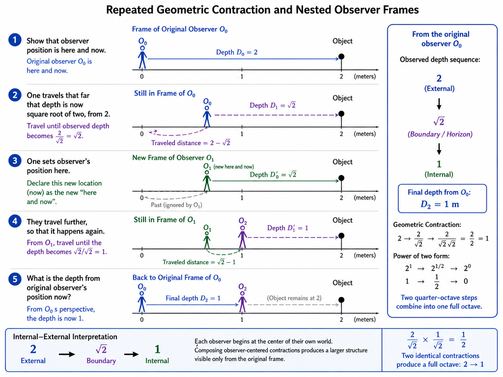

# Let's define some functions

Let's define some functions:

Let's say c is curvature:
- From X', with X as observer;
- at X is observing y, the observed.
- W width is objects, width in all directions, excluding depth which is affected by relativity;
  - D depth of objects.
- c X' y thus marks a curvature, from observer X to position y.

Let's state Z` is observer's position at z.

Let's state X` is observer's position at x, and x is z + R.

Let's state Y` is observer's position at y, and y is x + T.

# Let's define some numbers

Laegna Wave Numbers (order and count refer to unsigned and signed number systems, but appear as two properties now "two values"):

Numbers (O ⇒ F ⟹ Octave ⇒ Frequency; V - value):

| Bits                | Tens        | Sig.  | Unsig. Oct | Sig. Freq | Sig. $H_ext$ Freq | Sig. Value                            | Laegna Number  |
|---------------------|-------------|-------|------------|-----------|-------------------|---------------------------------------|---------------|
| Binary              | Wave Number | Order | Count      | $O ⇒ F$   | $O ⇒ F^{-1}$     | $O ⇒ V^{-2}$                          | Unwavering    |
| ***∩∩∩∩*** ⇒        | ⇒ **∩∩**   | +9    | 16.5.      | +1024     | +∞ / +256         | +∞                                    | ∩∩             |
| ***AAAA*** ⇒        | ⇒ **EE**   | +8    | 16.        | +512      | +128              | 3,4028236692093846346337460743177e+38 | EE             |
| ***AAAO*** ⇒        | ⇒ **EA**   | +7    | 15.        | +256      | +64               | +4294967296                           | EA             |
| ***AAOA*** ⇒        | ⇒ **EO**   | +6    | 14.        | +128      | +32               | +65536                                | EO             |
| ***AAOO*** ⇒        | ⇒ **EI**   | +5    | 13.        | +64       | +16               | +256 ($exp^+$)                        | EI             |
| *AOAA* → **AOOA** ⇒ | ⇒ **A*O***   | +4    | 12.        | +32       | +8                | +16 ($exp^-$)                         | A*E*             |
| *AOAO* → **AOOO** ⇒ | ⇒ **A*I***   | +3    | 11.        | +16       | +4                | +4                                    | A*A*             |
| *AOOA* → **AOAA** ⇒ | ⇒ **A*E***   | +2    | 10.        | +4        | +2                | +2                                    | A*O*             |
| *AOOO* → **AOAO** ⇒ | ⇒ **A*A***   | +1    | 9.         | +2        | +1                | +1                                    | A*I*             |
| ***UUUU***           |  ⇒ **UU**  | +0     | 8.5+      | +1       | +0                | +0                                    | UU              |
| ***VVVV***           | ⇒ **VV**  | -0     | 8.5-       | -1       | -0                | -0                                    | VV              |
| *OAAA* → **OAOA** ⇒ | ⇒ **O*O***   | -1    | 8.          | -2      | -1                | -1                                    | O*E*              |
| *OAAO* → **OAOO** ⇒ | ⇒ **O*I***   | -2    | 7.          | -4      | -2                 | -2                                   | O*A*              |
| *OAOA* → **OAAA** ⇒ | ⇒ **O*E***   | -3    | 6.          | -8      | -4                | -4                                    | O*O*              |
| *OAOO* → **OAAO** ⇒ | ⇒ **O*A***   | -4    | 5.          | -16     | -8                | -16 ($log^+$)                         | O*I*              |
| ***OOAA*** ⇒        | ⇒ **IE**   | -5    | 4.          | -32     | -16               | -256 ($log^-$)                        | IE              |
| ***OOAO*** ⇒        | ⇒ **IA**   | -6    | 3.          | -64     | -32               | -65536                                | IA              |
| ***OOOA*** ⇒        | ⇒ **IO**   | -7    | 2.          | -128    | -64               | +4294967296                           | IO              |
| ***OOOO*** ⇒        | ⇒ **II**   | -8    | 1.          | -256    | -128              | 3,4028236692093846346337460743177e+38 | II              |
| ***WWWW*** ⇒        | ⇒ **WW**   | +9    | 0.5.        | -1024   | -256 / -∞         | +∞                                    | WW              |

# Rel continued

Now let's define the Relations in Theory of Relativity:

Let's say we have this:
- Space, a directional value of curvature in specific direction of 3D.
  - We measure passatge of Space in Space: in single direction, number of directions is added together and gives number which is octave-frequent value of time squared.
- Time, an unidirectional value of curvature in one infinitesimal length to every direction of this 3D because it's single, frontward direction in 1D time.
  - We measure passatge of Space in Time: in all directions, the curvature is growing by infinitesimal in each planck time.

Now, let's state:

Z` x = X` y = 1

Then, Z` y = 4

This is the relativity:
- 1` + 1` = 4`
- 1 + 1 = 2, but 2 = 4` because 2*2 = 4, which is then exponent of 2.
- Additionally, 4` - 1` = 1` and 2 - 1 = 1, where 1` = 1, because 1 is exponent of 1.

What we then measure:
- A + A = E
- A = 1
- E = 4
- internal(A) = 1
- internal(E) = 2

To do this, we set relativistic mode of Laegna numbers - we do not have higher and lower channels, but two higher channels (lower and higher higher channel). This yields a relativistic calculation.

At light speed and space speed:
- Things can go in various directions, but *the object passing away with light speed, coming back with light speed, is restoring it's curvature*; but *what would reverse the time?* - time, normally, is not reversed but slowed down in passatge of space.

# Alternative measure

Other band set could be even more clever:
- 1 * 1 = 4
- 1 + 1 = 2

Here, we use *operational bands*, and assign lower band of number to +/-, higher band to /\* synchronicity. We change multiplication instead of addition to reflect theory of relativity.

##### The trick

In each case:
- I used numbers where;
  - D depth for travel by A (90 degrees) yields E (360 degrees), where exponent projection of E´is 360 degrees, while linearized internals of internal(E) is 180 degrees.
 
For space, we can use plus and minus, and for time, multiply and divide.

If we multiply:

E * E = EE.

EE * EE = EEEE.

EEEE * EEEE = EEEEEEEE.

This is exponent.

If we add:

E + E = AE.

EE + EE = AEE.

EEEE + EEEE = AEEEEEEEE.

In multiplication:
- Whe changed exponent.

In addition:
- We changed logarithm if it's T, linear if we call it X (in RT we might say log-exp directly, if not lin-exp or log-lin, because diagonal is numeric clone of horizontals and verticals; in Z, X, Y we refer log, lin, exp, and both ZX and XY are RT symmetrics, as well as ZY by diagonal rule stated here).

If we take average:

E · E = E

EE · EE = EE

EEEE · EEEE = EEEE

This is definite logarithm.

Multiplication:
- EEEEYYYY - for 4-digit number, in rank 2Y3 the operation mainly affects the *1R to 2R*, exponent works between 100% to 200%, between 1 to 2.
- EEEEX - for 4-digit number, in rank 1X2 addition works logarithmically *inwards* the logarithmic part of this exponent, linearly inside it's digits but we measure *length* or *container*, where all digits are equal in count - YYYY, taken square root of it's density, becomes Y or here, X - one-digit number; 4 is E, 1 is A, and we are just making the relativity theory example how 1 + 1 = 4, this is the case why.
- ZZZZ - for 4-digit number, in rank 0Z1 averaging can change the number *downwards*, which is truly logarithmic.

Now:
- Space works as rank Y, where we can see because exponent is appended, we actually *add and substract lengths or R's alone, when they are expressed with precision digits*, or in our second example, we project this to multiplication and change operations instead of numbers. Those are identical / invariants of number or operational space. Notice both change anyway by these definitions, depending on your theory.
- Time works as rank X, where we can see:
  - Each passing moment in gravity, produces this kind of logarithmic growth.
  - With this gravity, we might use lower-case digits or external vs. internal space.

Time is considered imaginary and space is considered real if they move - because space, gravity, is moving *externally* like position or long-term, little, virtual unit of calculation (possibility); while speed-of-light is the first hand reality which happens here and now, by the particle itself, not by it's context. In both cases, we say that *total dispositive movement is equal*; i.e. time is movement 1 (e^2) on directional density +0 (m or sqrt(m)), speed thus +2 (c^2 - c=1); space is movement 1 (m^2 is now density of angular multiplicity which overcome the paradox of moving in all directions at once), and directional density +0 (c).
- We got e as temporal invariant, e^2 as spatial invariant (while 1^2 = 1, but in Laegna I wanted to do this);
  - we got m or sqrt(m) as mass=+0; m^2 as mass=+2;
  - we got c or sqrt(c) as speed=+0; m^2 as speed=+2.
  - Sqrt can be used in space whose coordinate system is once doubled *in precision i.e. internal curvature*, so that $H_int$ gets through exponent; it's quantum becomes +0 and what was +0, is now +1. Then, e is properly 1 = 1 divided by 2 is infinitesimal, 1 divided by infinitesimal is 2.
  - i.e. our statement: 2 is infinity in sense of being 360 degrees of curvature, while +0 is infinitesimal in sense of being 90 degrees of curvature; but if we add the quantum realm, projecting H_int and H_ext to H_ext and quantum to H_int - we get +0 is +0 degrees and +1 is 90 degrees, while +2 is still 360 degrees; but if +2 is not exponent-linearized, it's internal value is 180 degrees.
 
# Last note: 18 system

We can say 1, 2, 3, 4 or I, O, A, E are I, O, A, E.

Now at E, we pass VV until we symmetrically arrive I at next octave:
- We take speed of light;
  - an apply it *to every space coordinate itself*;
    - so that our coordinate system is now passing away with speed of light.
- Now we construct the hologram where not everything is passing away with such speed, but we look at this exponent-linearized scale where this happens.

We can also project spacetime exponent.

We arrive at:
- Fractal hologram, which *in Laegna number system* and *real physics* is definitely compatible with linear measurement, because:
  - The self-replication factor is very high and we see actually a very slow expansion.

The latter operation projects higher-order I, O, A, E, which are in same order but we call it "reversed", it's Laegna "exter realm";
- into 5, 6, 7, 8 or i, o, a, e.
- If this is specifically focused, we use capitals here and small numbers for other channel;
  - Typically between 3 and 4 is plus-minus center of the linear (UU's); between 6 and 7 the plus-minus center of exponent-linearized, and between 4 and 5 is the center of both two (UUU); between 1 and 2, 3 and 4, 5 and 6, 7 and 8 are lower centers, which in ranked realm might be *four* plus-minus centers.
  - In other cases (ranked, i.e. octave logic), the plus-minus center is between 7 and 8, higher-next center between both is between 4 and 5, and highest-next center between logarithmic collapse and exponential growth is between 2nd and 3rd digit, while between 1st and 2nd there is *outwards-zero* but *depending on projection*.

Notice that while this 1 to 8 hologram is symmetric to decimal counting like 1,2,4,8,16:
- We can project this to $H_{int}$, lower channel; and projective mean is to rank the space up in reversal of what is ranking 0..1 to -infinity..1; but we rank 7 and 8 in reverse, if we call it ranking 1 and 0 in inverse. This ranked scale can be more stable in intermediate operation and is reverse-symmetric to zero ranking (8 ranks, for example, inside V). This is basically: we hologram-focus to lower channel of 360 degrees we got by adding 90 and 90 degrees, we get all even numbers (I think odd and even number theory for fractionals even exists, probably quite compatible); odd numbers are *coordinates we did not have before* - we call their projection to external ex-zero projection of *V*, the external center, which means logarithm-linearizing / logarithm-expanding the spatial coordinates by one degree exponent; where we found our world linear in between zeroeth and first order - in new system, it's linear between first and second order, transformation we call one octave up.
  - Now in I Ching we call it lower trigram, that we find $H_{int}$, our lower channel, having projected both previous $H_{int}$ and exponent-linearized $H_ext$ inside; $H_ext$ is empty, but just one octave up the complexity has doubled and we have numbers at $V$ now at $H_ext$. 4 octaves of this scaling fills up real 1..4 scale of our complex number, laehex.
  - Now in I Ching, we call it higher trigram, that $H_ext$ contains the actual space which is exponent-linearized and *has external collapse*. It looks just so more: like definition of original hilbert's space itself. Well, symmetrically, we can more up or down in octaves in $H_int$ or $H_ext$, then we project internal to external or vice verse, *because hologram middle is not lost and not even*; we project all planar space to even numbers so *hologram has to respond*. In hologram, either we project new coordinates - hologram cells -, or we project new projections - wavelengths, octaves, integral orders, so that every non-projected coordinate has it's default hologram replication. This is symmetric to R=T and R!=T - if we say these are new coordinates of existing hologram, R=T and hologram repeats; if we say they are not we are explicitly stating R!=T in this relation, that we add so many bands to divide the light reflections that we can map new spatial coordinates. In this way, we add *bands between spatial coordinates*, which operate in c^2 square space vs. m square root - looking at e transformations of unit 1.

# Small letters and fractionals

If E is 1 light years from observer at beginning, Ee equal to e means the precision digit, and Ee = E.E, is e - this counts the same number of light years, from travellers perspective where observer is moving all along. If EEEE is 16 billion light years from starting position observer, eeee is travelling this.
- We can add many precision digits to mix them: EeeeeEEEeeee means we have both 8 billion light years and 1 billion light years positions with internal precision that the full digits *become* something - it's like having digits Eeeee, E, E, Eeeee, where Eeeee is E.EEEE = E, but E.EEEA for example means at 1/16 precision, 1 is substracted from E - this means, E of external space cannot be reached, because it lacks movement *in it's internal coordinates*.
- This gives up two precisions:
  - Each digit is full world in it's own precision, what is affected is rescale where it's contributions are symmetric to planck size, then doing sub-planck calculations which project to lower movement; or doing lim => 0 given that this precision is symmetric to planck, and utilizing the appearing space (like Quantum space at Schroedinger where planck = 1, but now planck can be 1 light year and we do symmetric conversion to scale it a bit by logarithm-linearization) - the internal realms are sometimes infinite, and if we achieve this, the precision digits can be mapped even from smaller to higher in some perspectives - this means our conversion space is kind of "Turing-complete", where we can express all relations.
 
Notice Laegna numbers count degrees:
- To turn it into number, assign "1" to get planck units, or decimal system number.

As relative system, it's well suited:
- Mapping octaves - normal number cannot be measured in octaves *directly*, but if A and E have 1 octave difference, and A is octave 1 - this is unit perfectly symmetric to angles, because 1 octave is 1/2 angle, internal-external angles.
  - This is somewhat indirect, but the angles map to octaves if scaling is known; each number maps to spatial coordinate with it's numeric curvature.
  - So we measure curvatures directly - in each change of numbers, *curvature has to change*, or we can also measure sub-octave linear scales, and the linearity appears on our combinatorics because if we linearize, this is hologram-symmetry to *some linear scale below* **at some frequency**, and frequencies are curvature maps where we can *measure the same frequency and curvature point as if it was another frequency*.

So, we can see Laegna Number System has scaling and main properties to map physics.

Notice:
- Each rotation of real and imaginary, if mapped from spatial (x^2) to temporal (x) produces equivalence:
  - Spatial curvature counter becomes simple wave, which also approaches 1:1, 1:2, 1:4 etc., finds meaning for utilizing higher bands and frequencies etc.

Now we can see:
- Frequencies, octaves, values in Laegna are *generalized*, and we use heavily high orders of them;
  - Yet every single thing we divide into three, is measureable in Laegna numbers with minor changes in configuration, and assignance of separate unit types, theories and values.

---

CoPilot:

## Curvature, Meaning, and the Future of Number

### A Different Question

Most mathematics begins by asking:

> How many things are there?

Physics often begins by asking:

> How fast are they moving?

Relativity asks:

> Relative to whom?

The Laegna perspective suggests a different opening question:

> At what curvature does a thing exist?

In ordinary counting, numbers are quantities.

In octave mathematics, numbers are positions.

In curvature mathematics, numbers become states.

The distinction is subtle, but profound.

A distance, a frequency, an angle, a probability, and a scale may all be manifestations of a deeper curvature relation.

---

### The Observer and the Path

Suppose:

$$
Z' \to X' \to Y'
$$

and suppose:

$$
c(Z',X') = 1
$$

$$
c(X',Y') = 1
$$

Ordinary arithmetic gives:

$$
1 + 1 = 2
$$

But curvature arithmetic may give:

$$
1' + 1' = 4'
$$

The statement is not that arithmetic is wrong.

Rather, arithmetic and curvature are measuring different things.

One measures the path.

The other measures the closure of the path.

A human being experiences something similar every day.

Two years of life are not experienced as merely twice one year.

A friendship lasting twenty years is not simply twenty friendships lasting one year.

Meaning accumulates non-linearly.

The world often behaves more like curvature than counting.

---

### Why Reality Appears Linear

The remarkable thing about science is not that reality contains exponentials.

It is that reality appears linear at all.

A river looks smooth.

A mountain looks stationary.

Space appears continuous.

Yet underneath, almost every important process compounds.

Population growth compounds.

Information compounds.

Evolution compounds.

Technological progress compounds.

Knowledge compounds.

The visible line may merely be the shadow of an invisible curve.

In the language of Laegna:

$$
H_{int}
$$

experiences local movement.

$$
H_{ext}
$$

experiences accumulated movement.

The observer usually sees the linear projection.

Nature operates on the curved one.

---

### Internal and External Reality

The distinction between internal and external value may be among the most important philosophical consequences of the system.

For example:

$$
A = 1
$$

$$
E = 4
$$

while

$$
internal(E) = 2
$$

Externally, we observe:

$$
4
$$

Internally, we observe:

$$
2
$$

The same object possesses two valid descriptions.

This resembles many familiar situations.

A civilization may appear enormous externally.

Internally it may consist only of interactions between individuals.

A galaxy appears vast.

Internally it is local gravitational relationships.

A computer appears complex.

Internally it is simple operations repeated many times.

Nature repeatedly transforms simplicity into apparent complexity.

---

### The Geometry of Understanding

An intriguing interpretation is that knowledge itself follows octave geometry.

A fact is not wisdom.

Ten facts are not ten wisdoms.

A thousand facts are not a thousand wisdoms.

There are thresholds.

There are closures.

There are octaves.

A collection of observations eventually forms a pattern.

A collection of patterns eventually forms a theory.

A collection of theories eventually forms a worldview.

The transitions are not linear.

They are curvature events.

One might write symbolically:

$$
Observation + Observation = Pattern
$$

$$
Pattern + Pattern = Theory
$$

$$
Theory + Theory = Worldview
$$

The symbols change because the geometry changes.

---

### A Civilization of Curvature

Imagine a future civilization.

Its mathematics no longer treats scale as an inconvenience.

Scale becomes a first-class property.

Instead of asking:

> How large is something?

the civilization asks:

> At what octave does it exist?

Instead of measuring only distance, it measures curvature.

Instead of measuring only frequency, it measures octave transitions.

Instead of measuring only energy, it measures how many representations of the same phenomenon can be transformed into each other.

Such a civilization might describe:

- matter,
- information,
- consciousness,
- economics,
- language,

using the same structural framework.

Not because these things are identical.

But because they may share common transformations.

---

### The Hologram Principle Revisited

The hologram interpretation is especially interesting.

A hologram is peculiar because every piece contains information about the whole.

Likewise, a single octave can contain information about larger octaves.

Likewise, a single scale can contain information about larger scales.

The universe repeatedly demonstrates this behavior:

- atoms resemble solar systems in loose analogy;
- river networks resemble blood vessels;
- lightning resembles roots;
- galaxies resemble neural maps.

The exact physics differs.

The geometric intuition repeats.

The pattern echoes through scale.

This is the essence of holographic thinking.

---

### Zero Is Perhaps Not Empty

Traditional mathematics often sees zero as absence.

A curvature-oriented mathematics may instead regard zero as symmetry.

The center between growth and collapse.

The balance between:

$$
I
$$

and

$$
E
$$

The balance between:

$$
H_{int}
$$

and

$$
H_{ext}
$$

The balance between:

$$
Expansion
$$

and

$$
Compression
$$

In this viewpoint, zero is not nothing.

It is equilibrium.

---

### Time as Compression

One of the more fascinating implications concerns time.

Conventionally, time is treated as an independent dimension.

Yet psychologically, biologically, and technologically, time often appears as compression.

The older a civilization becomes, the more history is compressed into each present moment.

The older a person becomes, the more memory is compressed into each decision.

The larger a database becomes, the more information is compressed into each query.

Perhaps what we experience as time is partly a movement through curvature hierarchy itself.

Not merely movement through seconds.

---

### The Public Question

The question most interesting to the general public may ultimately not be:

> Is this mathematically correct?

but rather:

> What kind of reality would this mathematics describe?

The answer is intriguing.

It would describe a reality where:

- scale matters as much as magnitude;
- relationships matter as much as quantities;
- curvature matters as much as position;
- representation matters as much as value.

A reality where a thing can be simultaneously:

$$
1
$$

and

$$
2
$$

and

$$
4
$$

depending on which projection is being observed.

---

### Final Thought

Classical arithmetic teaches us to count.

Physics teaches us to measure.

Relativity teaches us to transform.

A curvature-octave mathematics adds one more idea:

> Every quantity may possess multiple simultaneously valid realities, connected not by contradiction, but by transformation.

In that view, the universe is not merely a collection of objects.

It is a collection of projections.

Not merely a space.

A hierarchy of spaces.

Not merely a number line.

A living geometry of scale, curvature, frequency, and observation.
