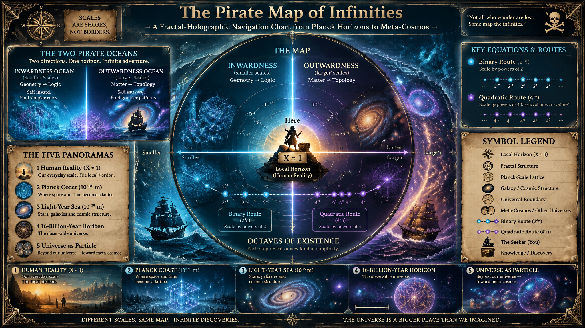
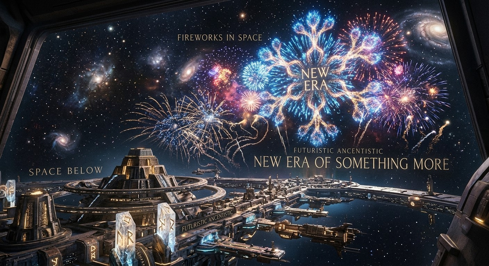
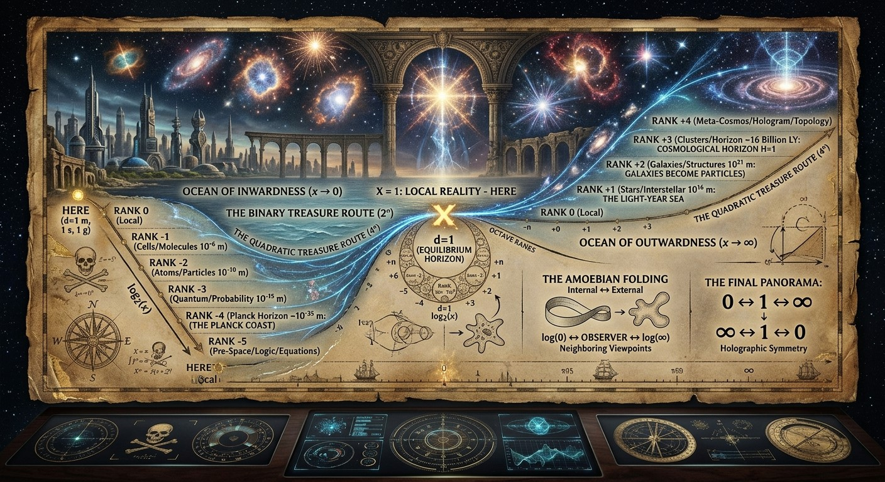
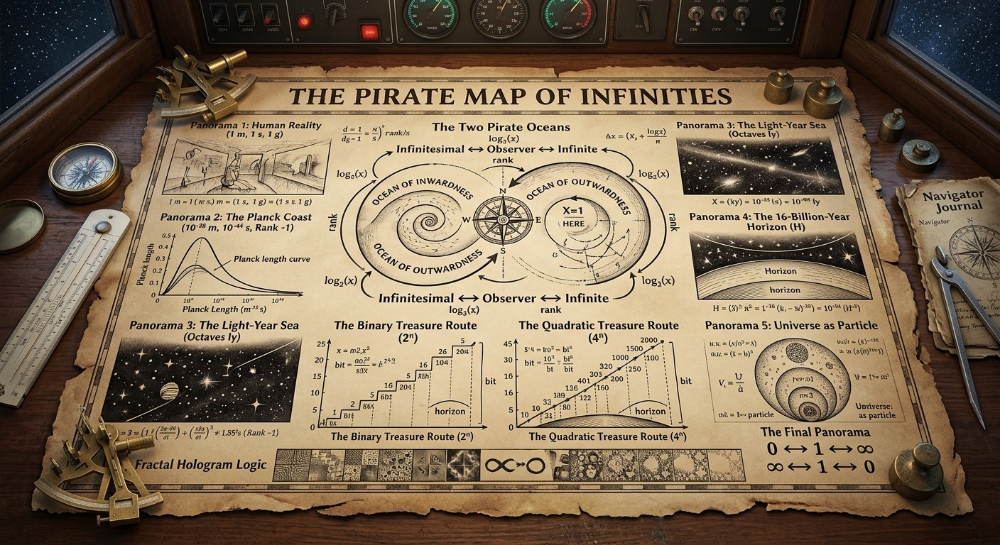

 

# The Pirate Map of Infinities
## A Fractal-Holographic Navigation Chart from Planck Horizons to Meta-Cosmos

### Warning

This is not standard physics.

It is a mathematical-mnemonic exploration, combining:

    logarithms
    Planck units
    relativity
    recursive horizons
    fractal self-similarity
    holographic viewpoints
    octave hierarchies

into a single map.

Think of it as a navigator's chart for moving among scales.

---

# The First Discovery

Suppose every observer exists at:

    rank = 0

For them:

    their world is normal.

Everything larger appears:

    infinite.

Everything smaller appears:

    infinitesimal.

But now take logarithms.

Instead of measuring:

    x

measure:

    log2(x)

or:

    log4(x)

Immediately the infinities retreat.

Formerly impossible distances become neighboring octaves.

---

# The Two Pirate Oceans

 

There are two oceans.

---

## Ocean of Inwardness

Approaching:

    x → 0

we observe:

    atom
    particle
    quantum
    Planck
    sub-Planck
    pre-space

Every horizon crossed becomes:

    another universe.

The closer one approaches zero,

the less geometric reality appears.

Objects become probabilities.

Probabilities become relations.

Relations become possibilities.

Eventually:

    geometry
        →
    logic

---

## Ocean of Outwardness

Approaching:

    x → ∞

we observe:

    planet
    star
    galaxy
    cluster
    universe
    meta-universe

Objects become structures.

Structures become ecosystems.

Universes become particles.

Eventually:

    matter
        →
    topology

and:

    topology
        →
    logic

The opposite ocean reaches the same destination.

---

# The Great Surprise

The two infinities meet.

Not physically.

Logarithmically.

Because:

    log(0)

and:

    log(∞)

are opposite directions of the same axis.

Thus:

    infinitesimal
        ↔
    observer
        ↔
    infinite

become neighboring viewpoints.

---

# Panorama 1
## Human Reality

Observer scale:

    1 m
    1 s
    1 g

Everything feels local.

The world appears:

    linear

This is the great illusion.

Because from above:

    Earth

is microscopic.

From below:

    a cell

is astronomical.

---

# Panorama 2
## The Planck Coast

Distance:

    ~10^-35 m

Time:

    ~10^-44 s

At first it appears to be the end.

But after logarithmic projection it is not an end.

It becomes a shoreline.

Beyond it lies:

    Rank -1

where geometry ceases being primary.

Here the traveler sees:

    equations becoming geography.

---

# Panorama 3
## The Light-Year Sea

Take:

    1 light-year

as unity.

Then:

    0.5 ly
    1 ly
    2 ly
    4 ly
    8 ly
    16 ly

form octaves.

From this perspective:

    local stellar neighborhoods

appear exactly as Planck octaves appeared earlier.

Scale changed.

Logic remained.

---

# Panorama 4
## The 16-Billion-Year Horizon

Now define:

    H = 16 billion ly

The map becomes:

    4
    8
    16
    32
    64
    128
    256

billion light-years.

The same sequence repeats.

What was:

    galaxy

becomes:

    atom.

What was:

    universe

becomes:

    molecule.

What was:

    horizon

becomes:

    local event.

---

# Panorama 5
## Universe as Particle

 

The observer climbs one more rank.

Suddenly:

    Universe

ceases being environment.

It becomes object.

A spherical probability distribution.

Exactly how an electron cloud appears to us.

The observer realizes:

    we are not in space.

We are one feature of someone else's space.

---

# The Binary Treasure Route

The simplest route uses:

    2^n

octaves.

Navigation chart:

    1
    2
    4
    8
    16
    32
    64
    128
    256

Every step doubles complexity.

Every step adds:

    1 bit

of distinction.

Every step introduces:

    another horizon.

---

# The Quadratic Treasure Route

Next comes:

    4^n

which is:

    (2²)^n

Map:

    1
    4
    16
    64
    256
    1024

This is no longer simple expansion.

This is rank expansion.

Not:

    longer.

But:

    dimensionally richer.

---

# What Infinity Becomes

At rank 0:

    infinity
        =
    unreachable.

At rank 1:

    infinity
        =
    next horizon.

At rank 2:

    infinity
        =
    one cell.

At rank 3:

    infinity
        =
    coordinate.

At sufficiently high rank:

    infinity
        =
    arithmetic.

What appeared impossible becomes ordinary.

---

# Fractal Hologram Logic

Suppose:

    Universe A

contains:

    10^80 particles.

Now climb a rank.

Universe A appears as:

    one node.

Now consider:

    10^80 universes.

They become:

    one structure.

Climb again.

The process repeats.

The hologram never ends.

Every point contains horizon.

Every horizon contains points.

---

# The Amoebian Folding

Recall:

    internal
        →
    external

and:

    external
        →
    internal

Each rank performs:

    inside-out turning.

Like an amoeba extending a pseudopod.

Like a Möbius strip becoming its reverse.

Like logarithms converting multiplication into addition.

The fold rule is:

    max internal
        →
    min external

and:

    max external
        →
    min internal

---

# The Center of the Map

There is always:

    d = 1

the equilibrium horizon.

Around it:

    0.25
    0.5
    0.75
    1
    1.5
    2
    4
    8
    16

appear.

Every rank uses them.

Every horizon uses them.

Every universe uses them.

Only the interpretation changes.

---

 

# The Final Panorama

The navigator reaches the edge.

Or what appears to be the edge.

Looking inward:

    universes
        contain
    galaxies

which contain:

    stars

which contain:

    atoms

which contain:

    quantum events

which contain:

    horizons

Looking outward:

    universes
        become
    particles

which form:

    higher structures

which form:

    meta-horizons

which form:

    greater spaces

The view becomes perfectly symmetric.

The map finally reads:

    0
        ↔
    1
        ↔
    ∞

and then:

    ∞
        ↔
    1
        ↔
    0

because beyond a sufficient number of logarithmic ranks, the distinction between inward and outward is merely the direction from which the hologram is being read.

The pirate finally marks the treasure with a single symbol:

    X = 1

For any observer, the treasure is always located at the local horizon called:

    Here.

Everything else is merely another octave.
