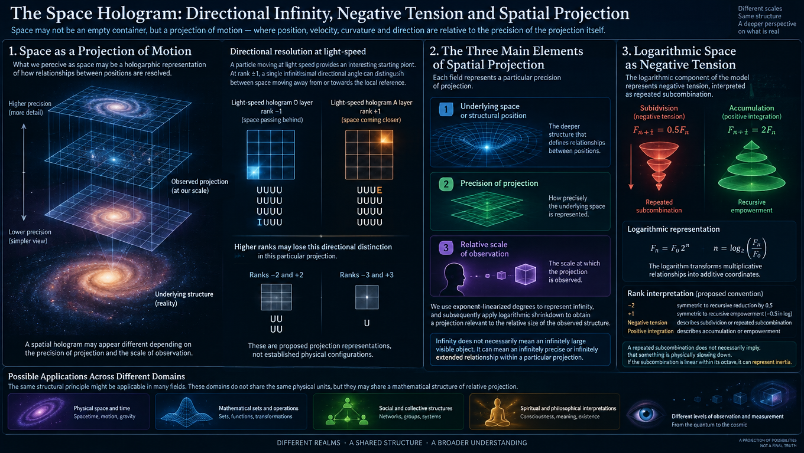
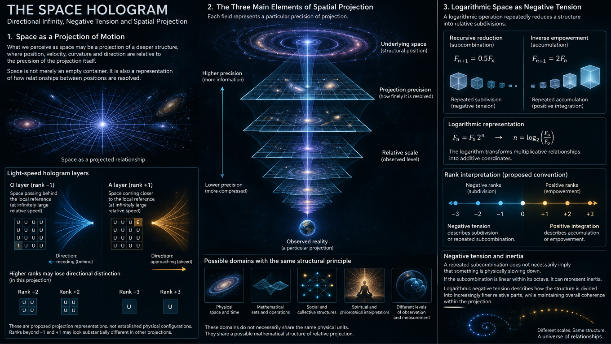

<br>

ChatGPT:

# The Space Hologram: Directional Infinity, Negative Tension and Spatial Projection

## 1. Introduction: Space as a Projection of Motion

Perhaps the dimensions of a spatial hologram do not simply expand or contract. Perhaps they warp into directions.

Imagine that what we perceive as space is a projection of a deeper structure, where position, velocity, curvature and direction are relative to the precision of the projection itself.

In this interpretation, space is not merely an empty container in which particles move. It is also a representation of how relationships between positions are resolved.

A particle moving at light speed provides an interesting starting point.

Consider two complementary holographic layers:

**Light-speed hologram O layer, rank -1:**

A single infinitesimal directional angle represents space passing behind the local reference at an infinitely large relative speed.

```text
UUUU
UUUU
UUUU
IUUU
```

**Light-speed hologram A layer, rank +1:**

A single infinitesimal directional angle represents space coming closer to the local reference at an infinitely large relative speed.

```text
UUUE
UUUU
UUUU
UUUU
```

The higher absolute ranks may lose this directional distinction in this particular projection:

**Ranks -2 and +2:**

```text
UU
UU
```

**Ranks -3 and +3:**

```text
U
```

These are proposed projection representations, not established physical configurations. Their purpose is to distinguish directional resolution from the amount of information represented.

Ranks beyond -1 and +1 may look substantially different in other projections and interpretations. It is therefore important not to assume that one representation necessarily describes every meaning of a rank.

The central hypothesis is that directionality itself might depend on the precision of spatial projection.

---

## 2. The Three Main Elements of Spatial Projection

We can begin by distinguishing three concepts:

1. The underlying space or structural position.
2. The precision with which that space is projected.
3. The relative scale at which the projection is observed.

Each field, considered as a whole, represents a particular precision of projection.

We use exponent-linearized degrees to represent infinity, and subsequently apply logarithmic shrinkdown to obtain a projection relevant to the relative size of the observed structure.

For this particular spatial illusion, the imprecision is doubled.

This produces a distinction between the underlying structure and its observable representation.

The important idea is that infinity does not necessarily mean an infinitely large visible object. It can instead mean an infinitely precise or infinitely extended relationship within a particular projection.

The same structural principle might be applicable to:

- Physical space and time.
- Mathematical sets and operations.
- Social and collective structures.
- Spiritual and philosophical interpretations.
- Different levels of observation and measurement.

These applications do not imply that all these domains share the same physical units. They share a possible mathematical structure of relative projection.

## 3. Logarithmic Space as Negative Tension

The logarithmic component of the model represents negative tension.

Rather than interpreting logarithmic reduction simply as decreasing magnitude, we can interpret it as repeated subcombination.

A logarithmic operation repeatedly reduces a structure into relative subdivisions.

For example, the recursive reduction of a force by one half can be represented by:

$$
F_{n+1} = 0.5F_n
$$

Its inverse empowerment is:

$$
F_{n+1} = 2F_n
$$

These are complementary operations.

In the proposed rank interpretation:

- Value -2 is symmetric to recursive reduction of force by 0.5.
- Value +1 is symmetric to recursive empowerment by -0.5 in the corresponding logarithmic coordinate.
- Negative tension describes subdivision or repeated subcombination.
- Positive integration describes accumulation or empowerment.

The signs here belong to the proposed rank convention, not to a universal physical definition of force.

The important distinction is between an operation and its logarithmic representation.

For example, if:

$$
F_n = F_0 2^n
$$

then:

$$
n = \log_2 \left(\frac{F_n}{F_0}\right)
$$

The logarithm transforms multiplicative relationships into additive coordinates.

Consequently, a repeated multiplication or division can become a linear displacement in logarithmic space.

This is one reason why logarithmic projection is useful for describing structures that span many orders of magnitude.

### 3.1. Negative tension and inertia

A repeated subcombination does not necessarily imply that something is physically slowing down.

If the subcombination is linear within its octave, it can represent inertia.

In this interpretation, logarithmic negative tension describes how the structure is divided into increasingly precise relative components while retaining a systemic value.

This suggests a conservation principle:

**The projection may change its internal resolution without necessarily changing the substantial quantity represented.**

We must distinguish this proposed invariance from ordinary conservation laws, which require explicitly defined physical quantities and dynamical equations.

---

## 4. Directional Gravity and the A/O Complement

Consider two complementary representations of a symmetric gravity particle.

**A: outward or integral representation**

```text
AAAA
AAAA
AAAA
AAAA
```

**O: inward or differential representation**

```text
OOOO
OOOO
OOOO
OOOO
```

These representations can be interpreted as two orientations of the same underlying structure.

A represents integration, while O represents differentiation.

A possible transformation is:

$$
T(A) = O
$$

$$
T(O) = A
$$

If the transformation is an involution, then:

$$
T(T(x)) = x
$$

This means that applying the transformation twice restores the original representation.

An important unresolved question is whether this inversion reverses the sign of curvature or preserves curvature while reversing orientation.

These possibilities produce different mathematical models.

### 4.1. Gravity as directional infinity

Gravity is interpreted here as an infinity-directional but infinitesimal-size movement.

It describes how other things appear to come closer.

Light propagation, in contrast, describes how things at the front become closer through the progression of light.

These are different interpretations of apparent movement.

In established general relativity, gravity is described by spacetime geometry, while light follows null geodesics. The two phenomena are related through the metric, but they are not the same physical mechanism.

The proposed spatial model introduces another viewpoint:

**The apparent movement of objects could partly depend on how their spatial relationships are reprojected.**

This does not replace gravitational physics. It proposes a possible mathematical layer for describing relative spatial observation.

---

## 5. Spatial Projection and Apparent Acceleration

One of the most useful mathematical consequences of this proposal is that nonlinear projection can produce apparent acceleration.

Suppose the underlying coordinate is $q$, while the observed coordinate is $x$.

Let:

$$
x = f(q)
$$

The observed velocity is:

$$
v_x = \frac{dx}{dt} = \frac{df}{dq}\frac{dq}{dt}
$$

The observed acceleration is:

$$
a_x = \frac{d^2f}{dq^2}\left(\frac{dq}{dt}\right)^2 + \frac{df}{dq}\frac{d^2q}{dt^2}
$$

This is important because even if the underlying motion is uniform, a nonlinear projection can produce apparent acceleration.

For uniform underlying motion:

$$
\frac{d^2q}{dt^2} = 0
$$

Therefore:

$$
a_x = \frac{d^2f}{dq^2}\left(\frac{dq}{dt}\right)^2
$$

The observed acceleration is now determined by the curvature of the projection.

This gives us a precise mathematical interpretation of projection-induced dynamics.

It also provides a possible connection between:

- Spatial curvature.
- Apparent acceleration.
- Relative displacement.
- Observation precision.
- Changes between spatial octaves.

However, projection-induced acceleration is not automatically a gravitational force. A physical interpretation would require a suitable metric, equations of motion and observable predictions.

---

## 6. Three Different Kinds of Infinity

It is useful to distinguish three types of infinity within the model.

| Type | Interpretation | Mathematical candidate |
|---|---|---|
| Exponential infinity | Accumulation of magnitude | $e^x$ |
| Logarithmic infinity | Accumulation of relative subdivisions | $\log(x)$ |
| Directional infinity | Accumulation of displacement toward a boundary | $x \rightarrow \pm\infty$ |

These are not necessarily independent physical infinities. They are different ways of representing limiting relationships.

### 6.1. Exponential infinity

Exponential representation describes how magnitude accumulates.

For example:

$$
y = e^x
$$

A linear increase in $x$ produces exponential growth in $y$.

### 6.2. Logarithmic infinity

Logarithmic representation describes the inverse relationship.

$$
x = \ln(y)
$$

An exponentially large range can become a comparatively small linear interval.

This is particularly useful when comparing physical scales.

### 6.3. Directional infinity

Directional infinity describes the approach toward a boundary or an unbounded displacement.

$$
\lim_{x \rightarrow \infty} f(x)
$$

It can also represent a directional relationship that becomes increasingly extreme relative to a local reference.

The distinction is important because an infinitely large displacement and an infinitely precise projection are not the same thing.

---

## 7. Spatial Octaves and the Limit of Zero

An especially interesting proposition is that the limit should not necessarily be applied to space itself.

Instead, it may be applied to the octave or frequency of space.

Let:

$$
x_n = f_n(q)
$$

where:

- $q$ is the underlying coordinate.
- $n$ is the spatial octave or projection rank.
- $f_n$ is the projection function at that rank.

We can investigate the limit:

$$
\lim_{n \rightarrow \infty} f_n(q)
$$

But there is an important distinction between two different limiting behaviors.

**Coordinate disappearance:**

$$
\lim_{n \rightarrow \infty} f_n(q) = 0
$$

This means the projected coordinate itself disappears.

**Local flattening:**

$$
\lim_{n \rightarrow \infty} \frac{\partial f_n}{\partial q} = 0
$$

This means the projection becomes locally flat.

The second interpretation is particularly close to the proposed spatial model.

The underlying coordinate may remain finite while its observable displacement becomes infinitesimal.

This creates an important distinction between:

- A position disappearing.
- A position becoming locally indistinguishable.
- A position remaining structurally present but losing directional resolution.

These are three different mathematical possibilities.

### 7.1. Gaussian-single-number representation

The proposed model also suggests that the exact octave might be represented by a Gaussian single-number coordinate.

In this interpretation, the coordinate represents the entire internal curvature of a value within a particular frequency window.

The point where the projection appears linear is not necessarily the point where the underlying structure becomes linear.

Rather, it is the point where the chosen observation window makes the structure locally indistinguishable from a linear one.

This is a useful distinction for future mathematical formalization.

---

## 8. Curvature, Density and the Flattening of Space

The model proposes that higher spatial degrees produce flatter zero-surfaces.

The intuitive explanation is that higher density allows more angular subdivisions, while lower density leaves larger relative angular intervals.

A particle that appears infinitesimal at one rank may therefore become flatter at a higher rank.

This does not necessarily mean that its physical mass changes.

It means that its representation becomes less focused at the selected projection precision.

We can distinguish two states:

**Focused projection**

A particle retains a localized focal point in its structural disposition.

**Flattened projection**

The same particle is represented across a wider collection of spatial subdivisions.

The hypothesis is that when a mass particle becomes flatter at higher precision, its surrounding or neighboring frequency structures may begin to gravitate in relation to it.

This would require a quantitative model connecting projection density to gravitational curvature.

### 8.1. Focal points and spatial disposition

A focal point is where the projection concentrates its information.

As the projection changes, the focal point may become distributed across multiple directions.

This gives us a possible interpretation of how a localized particle could appear increasingly extended at a different spatial rank.

It is important not to confuse this mathematical flattening with ordinary physical expansion.

They may be related in a future model, but they are not equivalent by definition.

---

## 9. Portals as Many-to-One Spatial Projections

Where would portals appear?

A useful mathematical starting point is a projection in which different underlying positions produce the same observable position.

Suppose:

$$
x = f(q)
$$

Two different internal positions may satisfy:

$$
f(q_1) = f(q_2)
$$

while their local derivatives differ:

$$
f'(q_1) \neq f'(q_2)
$$

The two positions are internally different but externally indistinguishable in this projection.

This is a many-to-one mapping.

It gives us a possible mathematical representation of a portal-like relationship.

The two internal regions share one projected position, even though their internal structures differ.

### 9.1. Projection portals and physical wormholes

A many-to-one mapping is not automatically a traversable portal.

A physical wormhole requires a continuous spacetime geometry, an appropriate metric and a traversable causal structure.

Nevertheless, many-to-one projection is an interesting starting point for investigating how different internal spatial relationships could appear connected through a lower-resolution external projection.

The key distinction is:

- A projection portal connects representations.
- A physical wormhole would connect spacetime regions.

The former is a mathematical possibility. The latter requires additional physical conditions.

---

## 10. Multiplication, Division and Superoctaves

The model introduces another distinction between multiplication and division.

Multiplication and division can be interpreted as complementary operations on wave representations.

**Multiplication**

Multiplication moves a wave representation toward an integral octave.

The proposed interpretation is that its wave shape appears increasingly like an ideal sine or cosine in the first integral level.

It represents accelerated wave relationships.

**Division**

Division moves a wave representation toward a differential octave.

The proposed interpretation is that its wave shape appears increasingly like an ideal sine or cosine in the first differential level.

It represents decelerated wave relationships.

An ideal wave in linear coordinates is represented by:

$$
y = \sin(x)
$$

or:

$$
y = \cos(x)
$$

A nonlinear projection can change the apparent shape of these waves.

If the underlying coordinate is $q$ and the observed coordinate is $x=f(q)$, then:

$$
y(x) = \sin(f^{-1}(x))
$$

This means the apparent wave shape depends on the projection.

The integral and differential interpretations could therefore be investigated as complementary transformations of wave frequency and spatial coordinates.

### 10.1. Superoctaves

The proposal suggests that these transformations appear as superoctaves rather than disturbing one another.

This could mean that multiple projection levels coexist while retaining their respective systemic values.

To formalize this, we would need to define the transformation operators and determine whether they commute:

$$
P_1(P_2(x)) = P_2(P_1(x))
$$

If they do, the corresponding transformations are order-independent.

If they do not, their interaction creates an additional structural property.

This is worth testing rather than assuming.

---

## 11. Light Speed and the Increasing Precision of Projection

The model suggests that light speed may appear increasingly ideal as we move toward higher infinity ranks.

The difference might be negligible in ordinary physical observations but become significant in a hypothetical higher-rank projection.

This requires an important distinction.

In special relativity, the vacuum speed of light $c$ is invariant for local inertial observers.

A change in coordinate representation does not imply that the physical vacuum speed of light changes.

However, a projection may make the representation of propagation increasingly close to an ideal geometric shape.

For example, consider the proposed square-wave analogy.

A higher-rank representation might approach a more sharply defined boundary between states.

The square wave is:

$$
s(x) = \operatorname{sgn}(\sin(x))
$$

Its Fourier representation is:

$$
s(x) = \frac{4}{\pi}\left(\sin(x) + \frac{\sin(3x)}{3} + \frac{\sin(5x)}{5} + \cdots\right)
$$

This provides a mathematical example of how an increasingly precise projection can approach a sharp shape through additional frequency components.

The analogy does not mean that light physically becomes a square wave.

Rather, it suggests that the representation of a propagation boundary may become increasingly precise at higher projection ranks.

### 11.1. Fuzzy logic and the empowerment of values

The same rank structure might also be used to describe how logical values become increasingly empowered.

Consider a provisional mapping:

| Symbol | Rank | Percentage analogy |
|---|---:|---:|
| I | -1 | -100% |
| O | 0 | +0% |
| A | +1 | 100% |
| E | +2 | 200% |

This is a proposed rank convention, not a standard fuzzy-logic truth scale.

The interesting idea is that the center need not always be zero.

Different projections may define different reference centers.

Consequently, a value that appears negative in one representation may be positive relative to another reference.

This is particularly important when comparing absolute values with relative positions.

---

## 12. Zero, One and Two as Different Centers

The model proposes a distinction between zero, one and two.

- Zero in scalar representation.
- One in vector representation.
- Two in a higher-order or innovative representation.

These are not interchangeable centers.

A scalar zero is a local gathering point for central values.

A vector one can represent an oriented reference or a positive direction.

Two can represent the introduction of another independent dimension or relationship.

This suggests a possible hierarchy:

| Rank | Structural interpretation |
|---|---|
| 0 | Scalar reference |
| 1 | Vector reference |
| 2 | Multiple directions or relations |
| 3 | Higher-dimensional positional relationships |

The analogy with centralists, optimists and innovators is philosophical rather than a mathematical classification of people.

The structural idea is more important: changing the rank changes what constitutes a center.

### 12.1. Why rank -1 appears

One interesting observation is that a rank can appear negative when the center is shifted away from zero.

If a representation establishes one as its central reference rather than zero, then a lower state may naturally appear as -1.

This is a consequence of relative indexing.

For example:

$$
r = x - x_0
$$

where $x_0$ is the chosen reference point.

Changing $x_0$ changes the relative rank assignment without necessarily changing the underlying value.

This helps explain why a negative rank does not always imply a negative physical quantity.

---

## 13. Three-Dimensional Space and Directional Asymmetry

The model proposes that the observable world is a three-dimensional estimation of positional relationships.

The three axes provide a local coordinate system.

However, there is an important asymmetry between the local and global representations.

A spatial projection with zero depth cannot necessarily encode the same precision of numbers as a projection with nonzero depth.

The proposed curvature describes how angular intervals become wider near one reference and narrower toward another.

This suggests that relative movement and absolute direction-invariant movement may not be represented symmetrically.

### 13.1. Position, velocity and higher ranks

Velocity becomes a three-dimensional relationship between positions.

A higher rank can connect positions through the underlying spatial structure.

This does not require abandoning ordinary mathematics.

Instead, it introduces another projection through which ordinary spatial quantities are interpreted.

The possibility is that substance can shift through its own spatial representation without violating the ordinary mathematical definitions of position and velocity.

A useful starting point is the ordinary position vector:

$$
\mathbf{x} = (x,y,z)
$$

and velocity:

$$
\mathbf{v} = \frac{d\mathbf{x}}{dt}
$$

A rank-dependent projection can then be introduced:

$$
\mathbf{x}_n = \mathbf{f}_n(\mathbf{q})
$$

The observed velocity becomes:

$$
\mathbf{v}_n = \frac{d\mathbf{f}_n(\mathbf{q})}{dt}
$$

This allows different spatial ranks to represent different observable geometries of the same underlying motion.

---

## 14. Quantum Space and Its Own Planck Limit

A particularly interesting extension is to consider space itself as a quantum-like structure.

If the structure of space is made quantum, then it may have its own scale of subdivision, its own Planck-like limit and its own limiting behavior.

The proposal is not necessarily that ordinary Planck units are the smallest possible physical units in every conceivable mathematical representation.

Instead, each spatial projection might have its own limiting precision.

We can distinguish:

1. The quantum structure of matter.
2. The quantum structure of the spatial projection.
3. The underlying structure beneath that projection.

In this interpretation, the space beneath ordinary quantum space might itself be an accelerative structure.

Its internal limit would be relative to its own Planck scale.

The external horizon, $H_{\mathrm{ext}}$, of the internal horizon, $H_{\mathrm{int}}$, could then represent a higher-rank view.

At this level, an infinite movement might produce only a single observable position or relation.

The external projection would unfold the position rather than simply reproduce the underlying movement.

This is a mathematical hypothesis requiring a more precise definition of both horizons.

---

## 15. Spatial Disposition and Temporal Unfolding

The final distinction may be the most important organizational principle.

Space and time could be two different ranks of the same underlying structure.

Space represents disposition.

Time represents unfolding.

Space describes how relationships are arranged across a wider structure.

Time describes how those relationships evolve through successive moments.

The proposed distinction is:

**Exponent opens up where a single coordinate represents acceleration.**

**Logarithm opens up where a single coordinate represents sub-moment influence over that acceleration.**

This suggests that spatial and temporal representations might use complementary orientations.

### 15.1. Space as logarithmic disposition

Space may be interpreted through negative disposition rather than positive force.

It describes the distribution of relationships across a wider and longer-term structure.

The logarithmic representation is therefore useful for describing relative spatial subdivision.

### 15.2. Time as exponential unfolding

Time may be interpreted through positive unfolding.

It describes how a structure develops through successive states.

The exponential representation is useful for describing accumulated changes and accelerated relationships.

These are proposed mathematical interpretations, not replacements for the established physical definitions of space and time.

### 15.3. A/O and E/I

A possible symbolic assignment is:

| Symbol | Proposed role | Interpretation |
|---|---|---|
| U | Unknown | Unresolved structure |
| A | Integration | Spatial disposition |
| O | Differentiation | Spatial subdivision |
| E | Exponential | Temporal unfolding |
| I | Infinitesimal / inverse | Temporal subdivision |

This assignment should remain provisional.

Its purpose is to distinguish different operations and representations, rather than to claim that each symbol corresponds directly to a known physical dimension.

---

## 16. A Unified Mathematical Model

We can now bring the ideas together.

Let the complete spatial projection be:

$$
\mathcal{S}(q,n,t)
$$

where:

- $q$ represents underlying position.
- $n$ represents the spatial octave or projection rank.
- $t$ represents temporal evolution.

Each rank has a projection function:

$$
\mathbf{x}_n = \mathbf{f}_n(\mathbf{q},t)
$$

The transition between spatial ranks is represented by:

$$
\mathcal{S}_{n+1} = P(\mathcal{S}_n)
$$

The projection operator $P$ determines how the next rank is constructed.

We can investigate three independent properties.

### 16.1. Conservation

What remains invariant when the projection changes?

For example, a conserved quantity $C$ would satisfy:

$$
C(\mathcal{S}_{n+1}) = C(\mathcal{S}_n)
$$

This could describe a quantity that remains unchanged across different representations.

### 16.2. Curvature

How does the local derivative change between ranks?

For a one-dimensional projection:

$$
K_n(q) = \frac{\partial^2 f_n(q)}{\partial q^2}
$$

This provides a simple measure of projection curvature.

For higher-dimensional space, we would need to define the corresponding Jacobian, metric and curvature tensors.

### 16.3. Directionality

When does a projection preserve or lose directional information?

The Jacobian is:

$$
J_n = \frac{\partial \mathbf{f}_n}{\partial \mathbf{q}}
$$

Its rank can indicate how many independent local directions remain distinguishable.

If the Jacobian loses rank, some directions become locally indistinguishable in the projection.

This is particularly relevant to the proposed U representations, where directional information progressively disappears.

---

## 17. The Projection Portal: A More Formal Interpretation

We can extend the previous model by allowing the projection to be non-injective.

Suppose:

$$
\mathbf{f}_n(\mathbf{q}_1) = \mathbf{f}_n(\mathbf{q}_2)
$$

for:

$$
\mathbf{q}_1 \neq \mathbf{q}_2
$$

Then two distinct underlying positions share the same observable position.

This produces an equivalence relation:

$$
\mathbf{q}_1 \sim \mathbf{q}_2 \iff \mathbf{f}_n(\mathbf{q}_1) = \mathbf{f}_n(\mathbf{q}_2)
$$

The observable space is therefore a quotient-like representation of the underlying space.

This provides a more rigorous mathematical foundation for the portal analogy.

Different underlying states can become equivalent under a particular projection.

The interesting question is whether transitions between these equivalence classes can be described continuously.

If so, the model could investigate how apparently disconnected spatial regions become connected in a lower-resolution representation.

---

## 18. Scientific Boundaries and Open Questions

The proposed framework contains several mathematical ideas that can be investigated independently of any new physical interpretation.

These include:

- Nonlinear coordinate transformations.
- Rank-dependent projections.
- Loss of directional information.
- Many-to-one mappings.
- Local flattening and curvature.
- Logarithmic representation of multiplicative processes.
- Conservation under transformations.
- Complementary differential and integral operators.

However, several physical claims remain speculative.

In particular:

1. A nonlinear projection does not automatically produce physical gravity.
2. A mathematical portal does not automatically create a traversable spacetime connection.
3. A change in the representation of light propagation does not imply that the locally measured vacuum speed of light changes.
4. Flattening a mathematical projection does not necessarily mean that a particle physically expands.
5. A Planck-like scale for space itself would require a precise physical definition and experimental consequences.

These distinctions are important because they allow the mathematical model to develop without confusing a useful analogy with an established physical discovery.

The strongest next step is to construct explicit projection functions and test their properties.

---

## 19. Conclusion: Space as the Geometry of Disposition

Perhaps space is not only a geometry of positions.

Perhaps it is also a geometry of how positions become distinguishable.

In this interpretation:

- Direction is a property of projection precision.
- Gravity is investigated as an apparent directional convergence.
- Light propagation is investigated as an unfolding of spatial relationships.
- Logarithmic tension represents recursive subdivision.
- Exponential integration represents accumulated unfolding.
- Inertia represents systemic value preserved across subcombinations.
- Higher ranks can flatten spatial projections.
- Many-to-one mappings can produce portal-like relationships.
- Space describes disposition.
- Time describes unfolding.

The central hypothesis is that different spatial ranks can represent the same underlying structure with different degrees of directional, positional and temporal resolution.

The most important distinction is between the geometry of the underlying space and the geometry of its observation.

The underlying structure may remain consistent while its projections appear increasingly flat, focused, accelerated, compressed or directionally distorted.

This gives us a way to investigate spatial curvature as a relationship between position, precision, frequency and rank.

**The space hologram is therefore not simply an image of space. It is a proposed model of how spatial relationships themselves become an image.**

---

My initial:

# Perhaps, the space hologram dimensions warp into directions.

Imagine this is particle with light speed:

```
Light speed hologram O layer, -1 - at single tesimal narrow angle, the space is passing at infinity speed exactly behind:
UUUU
UUUU
UUUU
IUUU

Light speed hologram A layer, +1 - at single tesimal narrow angle, the space is coming closer with infinity speed:
UUUE
UUUU
UUUU
UUUU

Ranks -2 and +2 could contain just U's in this interpretation:
UU
UU

Ranks -3 and +3 could contain just a single U:
U
```

Ranks beyond -1 and 1 most probably look different in most projections and meanings, so be careful to distinguish various thoughtlines for various purposes.

We need a rank interpretation where:
- Each field as a whole is some precision of projection, we use exponenti-linearized degree for infinity, and project it yet to logarithm shrinkdown of it's projection relevant to it's relative size; for this illusion we double the imprecision.
- Imagine this as space.

This space is projected as logarithm in this sense:
- It's logarithmic negative degree which projects real tension in space;
  - Value -2 is symmetric to recursive reduction of force 0.5.
  - Value +1 is symmetric to recursive empowerment of force -0.5.
  - So this logarithm positively maps, in internally linear externally projected to log-shaped dimension of value and position, time and space, and number of operations or elements in array or set. So from spirituality and sociality to physics and math it applies through their different units - infinity cannot be seen outside similarly modellable space very easily, or perhaps it won't remain. Haha.

So the logarithmic space at differential-one linearity is location in negative sense:
- In logarithmic space, each position would position to future position it would arrive in infinity of such force;
  - Particles have inertia, speed of light or gravity are very static.
 
Here is symmetric gravity particle:

```
AAAA
AAAA
AAAA
AAAA
```

And the inverse side of the same view to qualify it inside-out, this is the local yin:

```
OOOO
OOOO
OOOO
OOOO
```

Infinity of force A is at infinity of it's surfacetesimals.

Now, as inertial system:
- Orders-up of it's physics-relative integration scale, each frequency keeps the same systemic value.

Logarithm as model of "negative tension", or "subcombinations":
- Is rather a repeated subcombination, and if it's linear in that octave it means inertia.

We can see how there is:
- Conservation of something substantial.

In this space, if this is scalar normal space is vector, or if this is vector normal space is matrix:
- I do think that we do not take lim => 0 to space itself, but to octave or frequency of space - but at it's digits after comma, the exact octave is gaussian-single-number representation of the whole value curvature inside, exact point where it appears linear at infinitely large and precise window of it's frequency, which maps it's disposition. There, we can see position merges in space-like nature, and gravitons might appear relatively to this space.

Here we can see higher degree makes:
- Surface of zero more flat, because in higher density it has more angles, and in lower it has more negative angles. Then, infinitesimal of mass particle becomes of higher degree - it becomes flat at higher precision, where otherwise it's still focused - it has *focus*, *focal point* to it's structural disposition, while flattening might mean a next-frequential spaces start gravitating.

Gravity is seen as infinity-directional but infinitesimal-size movement:
- Of how other things come closer;
- in relation how speed of light brings *things at front closer*.

Multiplication and division:
- Mult: Brings the wave shape seem exact sine or cosine in first level integral - this is accelerated wave and provides time and space relations to accelerated physics.
- Div: Brings the wave shape seem exact sine or cosine in first level differential - this is deccelerated wave and provides time and space relations to deccelerated physics.
- This, given that in linear space, the ideal wave form appears exact sine or cosine.

Those appear as superoctaves, not disturbing each others.

This is relative to:
- How logical value is empowered in fuzzy logic.

Light speed can vary very little, but towards infinity the difference might be big:
- Each octave *closer*, in exponent-linearized octaves (perhaps of higher band to have two bands), the light speed can be more closer to ideal square, and like IQ coming close to 200, E=2=200%, while A=1=100%, O=0=+0% and I=-1=-100% in some standard rank systems. One can see that it's *rank -1 because instead of making 1 the center instead of 0, it makes *something* the center instead of 0, but before - necessarily, this gets over the zero to minus, almost by definition - because how it could be lower rank than minus, without being some center of the minus? Thus it becomes -1 in most projections which accurately project continuous scale through ranks and their inside-infinities of angles and values; even their inside-center or zero.

- Zero in scalar, one in vector - zero is not center, but the local gathering point of centralists. One is the gathering point for optimists, and two of the innovator. These are ranks.

The spot:
- Makes infinitesimal of light directedness or focus seem infinity.

Where portals appear?

Structurally, we now see space makes up:
- 3D world of estimation of 3 axes of locations.
- Necessarily, because no zero-depth which is locally and globally symmetric encodes same precision of numbers as we pass away from zero - space curvature is how angles go wider from zero, but become thinner at other end, so something in our relative movement is not symmetric to our absolute, direction-invariantly shaped orthogonal movement of lower ranks.

Velocity now becomes 3D form, and higher rank connects positions through actual space. But we can now see some substance shifting through itself, without breaking our ordinary math - also a way how normal physics laws might intrude and work here, because it's actually a simple reprojection.

The inertia and position, like velocity, if structure of space itself is made quantum, reveals that under the space, in it's own quantum, under it's own planck and lim => 0, is this accelerative space. Over, beyond and over - the H_ext of this H_int of this quantum space reveals a sky where our infinite movement creates only single position, relation, and which is unfolding it's position - this can be used to track the spatial curvature, and here each person in their local measure moves around in this curvature.

So maybe if we do not want them reversed, we can do it other way:
- Exponent opens up where single coordinate is acceleration.
- Logarithm opens up where single coordinate is sub-moment influence over it.
- But if it's this way temporally, maybe we can initially look for it at *other way spatially*, and space measure - could be it's goal, which is necessarily number of the negative disposition rather than positive force which appears in time. Space is our disposition, so it involves long-term and wide, while time, as speed of light, involves seeing it all as single moment. We can see how substance moves through space and time:
  - Space and time could be two ranks of this - the value and it's position in matrix. Time has "E", or space has "A"'s, where U is unknown.

---

<br>


