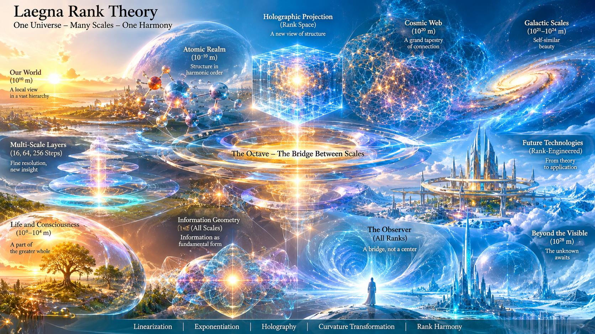
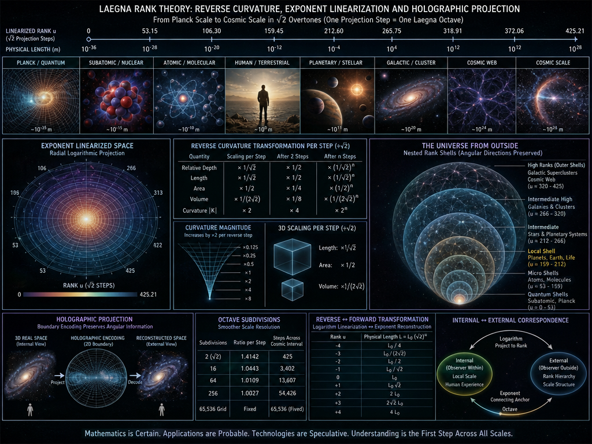
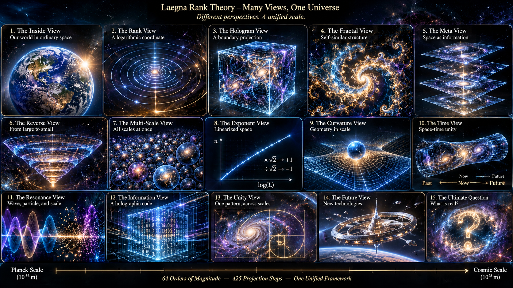
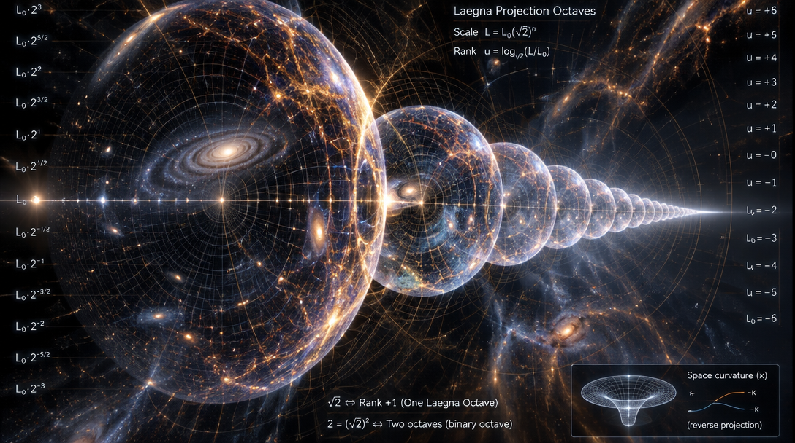
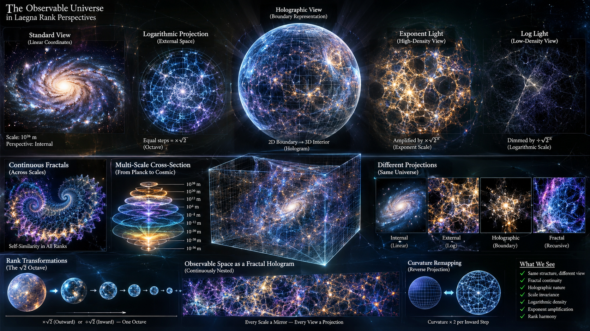
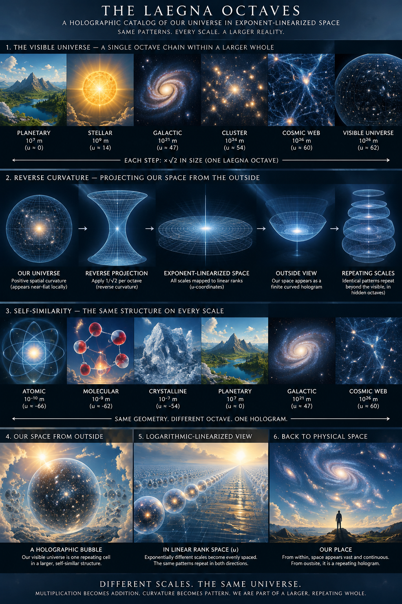

 

---

I asked ChatGPT in regards to Relation Theory articles, for a small science fiction or estimation:

This is the estimation part, next will be science fiction part:

Okay:

- Now meaure the spatial curvature as given in articles, in multiplied steps of 1:sqrt(2), or transposed sqrt(2):1 inverted.
- Apply this transformation to space: each space coordinate is reverse-projected, holographically, so that spatial curvature has reverse curvature of this. As seen in articles, you simply create exponent-linearized space projection. Same number of ranks as cosmic small to up scale, go through this and try to establish if the visible universe is just reprojected to those angulars, and hologram-scaling rules repeat every hidden piece, then smoothing through those scales through the same scales as given before - octave is the connecting anchor - what you see? How our own space appears from outside? Then do the same in reverse - in logarithm-linearized directions of each step. One exponentiation or linearization step counts as one octave, because where we work these are octaves, and they are done in regards to what is linear in each scale.

- # Holographic Space Projection Through Laegna Octaves

 

## Reverse curvature, exponent linearization and the cosmic scale

---

## 1. The basic transformation

The geometric progression used here is based on two inverse operations:

$$
\sqrt{2}=2^{1/2}
$$

$$
\frac{1}{\sqrt{2}}=2^{-1/2}
$$

Two successive steps produce one conventional binary octave:

$$
1\rightarrow\sqrt{2}\rightarrow2
$$

The reverse direction is:

$$
2\rightarrow\sqrt{2}\rightarrow1
$$

The geometric mean is the connecting point between the two scales.

In this model, one application of the $\sqrt{2}$ transformation is treated as one **Laegna projection octave**: one linearized rank step, or half of a conventional binary octave.

| Direction | Transformation | Interpretation |
|---|---|---|
| Outward | $\times\sqrt{2}$ | Exponential expansion |
| Inward | $\div\sqrt{2}$ | Reverse projection |
| Forward | $u\rightarrow u+1$ | Linear rank progression |
| Reverse | $u\rightarrow u-1$ | Reverse rank progression |

The important relationship is:

**Multiplication becomes addition, and division becomes subtraction.**

This makes the octave a connecting anchor between exponential physical scales and linearized rank coordinates.

---

## 2. Exponent-linearized space

Let $L$ represent a positive physical length and $L_0$ the reference length.

Define the linearized coordinate:

$$
u=\log_{\sqrt{2}}\left(\frac{L}{L_0}\right)
$$

Equivalently:

$$
u=2\log_2\left(\frac{L}{L_0}\right)
$$

The reverse transformation is:

$$
L=L_0(\sqrt{2})^u
$$

One projection step becomes:

$$
L_{n+1}=\sqrt{2}L_n
$$

$$
u_{n+1}=u_n+1
$$

The inverse operation becomes:

$$
L_{n-1}=\frac{L_n}{\sqrt{2}}
$$

$$
u_{n-1}=u_n-1
$$

Thus, exponentially different physical distances become equally spaced in the linearized coordinate.

This is the central operation of exponent-linearized space projection.

---

## 3. The cosmic interval: Planck-scale to universal-scale

Consider the cosmic length interval:

$$
10^{-36}\text{ m}\rightarrow10^{28}\text{ m}
$$

The ratio between the endpoints is:

$$
\frac{10^{28}}{10^{-36}}=10^{64}
$$

In conventional binary octaves:

$$
N_{\mathrm{oct}}=\log_2(10^{64})
$$

$$
N_{\mathrm{oct}}\approx212.6034
$$

In $\sqrt{2}$ projection steps:

$$
N_{\sqrt{2}}=\log_{\sqrt{2}}(10^{64})
$$

$$
\boxed{N_{\sqrt{2}}\approx425.2068}
$$

The entire 64-decade physical interval therefore becomes approximately 425.21 equally spaced projection positions.

### Cosmic rank intervals

Dividing the 64 decimal orders into eight equal intervals gives:

| Physical interval | Linearized position $u$ | Projection steps |
|---|---:|---:|
| $10^{-36}\rightarrow10^{-28}$ m | 0–53.15 | 53.15 |
| $10^{-28}\rightarrow10^{-20}$ m | 53.15–106.30 | 53.15 |
| $10^{-20}\rightarrow10^{-12}$ m | 106.30–159.45 | 53.15 |
| $10^{-12}\rightarrow10^{-4}$ m | 159.45–212.60 | 53.15 |
| $10^{-4}\rightarrow10^{4}$ m | 212.60–265.75 | 53.15 |
| $10^{4}\rightarrow10^{12}$ m | 265.75–318.91 | 53.15 |
| $10^{12}\rightarrow10^{20}$ m | 318.91–372.06 | 53.15 |
| $10^{20}\rightarrow10^{28}$ m | 372.06–425.21 | 53.15 |

Every eight-decade interval occupies the same linearized distance.

The physical intervals are exponentially different, but their logarithmic rank intervals are equal.

This gives one coordinate system for comparing microscopic, human, terrestrial, astronomical and cosmic scales.

---

## 4. Reverse spatial curvature

The articles describe a repeated depth transformation:

$$
2\rightarrow\sqrt{2}\rightarrow1
$$

Continuing in the reverse direction:

$$
1\rightarrow\frac{1}{\sqrt{2}}\rightarrow\frac12
$$

This is a geometric progression, where the intermediate value is the geometric mean.

For a dimensionless depth ratio, define:

$$
C_n=C_0\,2^{-n/2}
$$

Each reverse projection step reduces the relative depth parameter by $1/\sqrt{2}$.

However, relative depth curvature and intrinsic geometric curvature must be distinguished.

If a physical geometry is uniformly rescaled by a length factor $a$:

$$
L'=aL
$$

then intrinsic curvature magnitude scales as:

$$
|K'|=\frac{|K|}{a^2}
$$

For a contraction by $1/\sqrt{2}$:

$$
a=\frac{1}{\sqrt{2}}
$$

therefore:

$$
\boxed{|K'|=2|K|}
$$

These are two different transformations:

| Quantity | Reverse projection step |
|---|---:|
| Relative depth parameter | $\times 1/\sqrt{2}$ |
| Length under uniform contraction | $\times 1/\sqrt{2}$ |
| Area under uniform contraction | $\times 1/2$ |
| Volume under uniform contraction | $\times 1/(2\sqrt{2})$ |
| Intrinsic curvature magnitude | $\times 2$ |

The sign of intrinsic curvature does not automatically reverse.

The holographic operation can therefore represent reverse projection of relative spatial depth without claiming that physical space itself changes its curvature sign.

---

## 5. Three-dimensional radial projection

A spatial point can be represented as:

$$
\mathbf{x}=r\hat{\mathbf{n}}
$$

where:

- $r$ is the radial distance from the observer.
- $\hat{\mathbf{n}}$ is the angular direction.

Instead of independently applying logarithms to the Cartesian coordinates $x$, $y$ and $z$, transform the radial coordinate:

$$
u=\log_{\sqrt{2}}\left(\frac{r}{r_0}\right)
$$

while preserving the angular direction:

$$
\hat{\mathbf{n}}'=\hat{\mathbf{n}}
$$

This produces a radial logarithmic projection.

The transformation has four important properties:

1. Angular directions remain unchanged.
2. Radial distance becomes a linear rank coordinate.
3. Every $\sqrt{2}$ interval becomes one projection step.
4. The cosmic distance hierarchy becomes a sequence of nested shells.

The observer's own scale becomes one particular shell within the hierarchy, rather than a privileged absolute scale.

### The universe from outside

In ordinary coordinates, the observable universe is represented as a vast three-dimensional region.

In radial logarithmic coordinates, it becomes a nested spherical rank structure:

| Region | Interpretation |
|---|---|
| Innermost ranks | Planck and subatomic scales |
| Lower intermediate ranks | Atomic and molecular scales |
| Central intermediate ranks | Human and terrestrial scales |
| Upper intermediate ranks | Planetary and stellar scales |
| Outer ranks | Galactic and intergalactic scales |
| Highest ranks | Large cosmic scales |

The important change is that the different physical scales become comparable through their rank positions.

The human world is no longer a privileged size. It is one region in a much larger scale hierarchy.

The same angular directions can be retained throughout the transformation.

This is the basis of the proposed holographic angular projection: preserve angular structure while unfolding radial distances into linearized rank space.

---

## 6. Three-dimensional scaling

If every spatial direction is contracted uniformly by $1/\sqrt{2}$:

$$
x'=\frac{x}{\sqrt{2}}
$$

$$
y'=\frac{y}{\sqrt{2}}
$$

$$
z'=\frac{z}{\sqrt{2}}
$$

Then the scaling of geometric quantities is:

| Quantity | Scaling |
|---|---:|
| Length | $2^{-1/2}$ |
| Area | $2^{-1}$ |
| Volume | $2^{-3/2}$ |

After two successive steps:

$$
L'=\frac{L}{2}
$$

$$
A'=\frac{A}{4}
$$

$$
V'=\frac{V}{8}
$$

This is ordinary three-dimensional scaling.

However, logarithmic projection does not physically shrink the universe. It assigns equal coordinate spacing to exponentially different distances.

This distinction is essential when relating internal and external representations:

- $H_{\mathrm{ext}}$: the external hierarchy of physical scales.
- $H_{\mathrm{int}}$: the internal linearized positions within that hierarchy.
- Octave: the connecting unit between the two.
- Holographic subdivision: finer positions within each octave.

The external hierarchy becomes an internal coordinate structure.

---

## 7. Holographic subdivisions and smoothing

The same projection can be divided into finer intervals.

For $N$ equal subdivisions of a conventional binary octave, the ratio between adjacent positions is:

$$
q_N=2^{1/N}
$$

| Subdivisions per octave | Ratio per step | Relative increase |
|---:|---:|---:|
| 2 | $2^{1/2}$ | 41.42% |
| 16 | $2^{1/16}$ | 4.43% |
| 64 | $2^{1/64}$ | 1.09% |
| 256 | $2^{1/256}$ | 0.27% |

The two-subdivision case is the $\sqrt{2}$ progression.

The 16-, 64- and 256-position cases progressively smooth the same scale interval.

Across the 212.603 conventional octaves in the cosmic range:

| Resolution | Total coordinate intervals |
|---|---:|
| 2 per octave | 425 |
| 16 per octave | 3,402 |
| 64 per octave | 13,607 |
| 256 per octave | 54,426 |

A separate fixed-size structure of:

$$
65536=2^{16}
$$

could be used as a 65,536-position holographic grid.

However, it is not the exact result of dividing this particular cosmic interval into 256 subdivisions per conventional octave.

The distinction between fixed grid resolution and scale-derived resolution should be preserved.

---

## 8. Reverse exponentiation

The reverse operation begins with linear rank coordinates:

$$
u=0,1,2,3,4,\ldots
$$

Exponentiating them reconstructs the physical scale:

$$
L=L_0(\sqrt{2})^u
$$

The sequence becomes:

$$
L_0,\quad
L_0\sqrt{2},\quad
2L_0,\quad
2\sqrt{2}L_0,\quad
4L_0,\ldots
$$

This creates a reversible relationship:

| Linearized rank | Exponential space |
|---|---|
| $u=0$ | $L_0$ |
| $u=1$ | $L_0\sqrt{2}$ |
| $u=2$ | $2L_0$ |
| $u=3$ | $2\sqrt{2}L_0$ |
| $u=4$ | $4L_0$ |

The logarithmic and exponential operations are inverses:

$$
u=\log_{\sqrt{2}}\left(\frac{L}{L_0}\right)
$$

$$
L=L_0(\sqrt{2})^u
$$

This provides a two-way correspondence between physical scale and rank position.

### Internal and external interpretation

The transformation suggests the following correspondence:

| Representation | Interpretation |
|---|---|
| Exponential space | External scale hierarchy |
| Linearized rank space | Internal coordinate structure |
| Logarithm | Projection from physical scale to rank |
| Exponentiation | Reconstruction from rank to physical scale |
| Octave | Connecting unit |
| Subdivision | Additional resolution inside a rank interval |

The transformation is reversible for positive lengths when the reference unit is defined.

The origin $r=0$ requires special treatment because its logarithm is undefined.

---

## 9. Relation to angular cosmology

There is a real connection between this model and observational cosmology.

Astronomy already observes the universe through angular directions on the sky. To infer spatial distances, cosmologists combine angular sizes, redshifts, luminosities and standard rulers.

The angular-diameter distance relates physical size to angular size:

$$
D_A=\frac{\ell}{\theta}
$$

where:

- $D_A$ is angular-diameter distance.
- $\ell$ is physical size.
- $\theta$ is the observed angular size.

In cosmological models, angular-diameter distance depends on the expansion history and spatial geometry.

Curved spatial geometries use different radial functions involving:

$$
\sin(\chi),\qquad \chi,\qquad \sinh(\chi)
$$

depending on the curvature.

This is already a projection from three-dimensional geometry into angular observations.

However, it does not mean that the universe is only a projection. Redshift and distance measurements provide additional information, and inferred geometry is tested against independent observations.

The large-scale spatial curvature parameter is constrained by cosmological observations. A model consistent with spatial flatness does not establish the Laegna $\sqrt{2}$ transformation as a physical law.

Therefore, the scientifically defensible conclusion is:

**The observable universe can be represented in an angular, logarithmic and holographic coordinate system. Whether this coordinate system reveals a deeper physical hologram remains an open hypothesis.**

---

## 10. The central result: the universe as rank space

The strongest result of this construction is the possibility of expressing the physical universe through three connected representations:

$$
\boxed{
\text{Physical space}
\longleftrightarrow
\text{Angular space}
\longleftrightarrow
\text{Linearized rank space}
}
$$

The same structure can be traversed in both directions.

### From inside

We experience a local world with ordinary spatial distances.

### From outside

The world becomes one region in a hierarchy of logarithmically ordered scales.

### Through reverse projection

Each spatial scale can be represented as an internal structure of a larger rank.

### Through exponentiation

The linear rank structure reconstructs the corresponding physical scale.

### Through octave subdivision

Every rank can be unfolded into increasingly fine intermediate positions.

The observer's environment is therefore a local cross-section of a much larger rank-space geometry.

---

## 11. What should be tested next?

The next step is to construct a numerical experiment with three simultaneous representations:

1. **Physical coordinates:** ordinary metres, covering the cosmic interval from $10^{-36}$ to $10^{28}$.
2. **Laegna rank coordinates:** logarithmic positions, with one $\sqrt{2}$ operation per projection step.
3. **Reverse-projected coordinates:** inverse depth and curvature factors, tracked separately for length, area and volume.

Then investigate whether structural features recur at equivalent rank positions:

- Atomic structure
- Molecular structure
- Human-scale geometry
- Planetary structure
- Stellar structure
- Galactic structure
- Cosmic-web structure

The critical question is whether the recurrence is merely a consequence of logarithmic rescaling, or whether additional measurable invariants survive the transformation.

## Conclusion

The octave can serve as the bridge between the exponential universe and its linearized holographic representation.

It does not need to be an additional physical dimension. It can be the unit that makes different spatial scales comparable within one coordinate system.

The $\sqrt{2}$ transformation provides the intermediate geometric step:

$$
\text{Expansion: }\times\sqrt{2}
$$

$$
\text{Reverse projection: }\div\sqrt{2}
$$

The logarithmic operation makes these steps linear:

$$
\text{Exponential scale}\rightarrow\text{Linear rank}
$$

And exponentiation reconstructs the scale:

$$
\text{Linear rank}\rightarrow\text{Exponential scale}
$$

Thus, the same cosmic structure can be examined from inside, from outside, and through the reverse projection connecting the two.

**The octave is the anchor; the rank is the linearized coordinate; the holographic projection is the reversible transformation between scales.**

---

 

---

This is the fiction part:

> Can you tell about the future of the rank theory; sure, probable, and sci-fi of what the scales and hologram crafts would give us? Give also optimist and pessimist, and how hard it's to already start experimenting - how much new those would reveal, or how much focus the direction?

ChatGPT:

# The Future of Laegna Rank Theory
## Scale engineering, holographic crafts, experimental horizons and possible futures

---

# 1. The central possibility

Laegna rank theory could develop into more than a system for describing very large and very small numbers.

Its deeper possibility is to become a framework for **moving between descriptions of reality at different scales**.

The central idea is:

- A physical system has an internal description at its own scale.
- A larger-scale observer sees a compressed or expanded description.
- A smaller-scale observer sees a different level of detail.
- Exponentiation and linearization provide transformations between these descriptions.
- Octaves connect the transformations.
- Rank identifies the scale at which a particular description becomes meaningful.
- Holographic projection describes how information about one domain might be represented in another.

The question is whether these relationships can become useful mathematical tools, computational methods, or eventually physical technologies.

There are three levels of possibility:

| Level | Meaning | Scientific status |
|---|---|---|
| Sure | Mathematics, simulations, scale conversion, visualization and testing | Achievable now |
| Probable | New analytical methods, improved simulations and useful scale models | Plausible, but must be demonstrated |
| Sci-fi | Direct manipulation of spatial curvature, engineered holographic space and new forms of physical technology | Speculative |

The distinction is important: the mathematical framework can be useful without every physical interpretation being correct.

---

# 2. The sure future: what can already be built

## 2.1 A rank-based scale calculator

The first practical development would be a calculator that does not merely convert metres into kilometres or light-years.

It would convert between **rank descriptions**.

For example:

| Domain | Example | What the calculator represents |
|---|---|---|
| Planck | $10^{-35}$ m | Quantum-gravity reference scale |
| Subatomic | $10^{-15}$ m | Nuclear and particle scales |
| Atomic | $10^{-10}$ m | Atomic structures |
| Human | $10^0$ m | Everyday spatial reference |
| Terrestrial | $10^4$ m | Geographic scale |
| Astronomical | $10^{11}$ m | Planetary distances |
| Interstellar | $10^{16}$ m | Stellar neighbourhoods |
| Galactic | $10^{20}$ m | Galactic structures |
| Cosmic | $10^{26}$ m | Observable-universe scale |

The calculator could show each value in several simultaneous forms:

1. Physical units.
2. Decimal exponent.
3. Laegna rank.
4. Laegna letter.
5. Four-sign operation.
6. Octave coordinate.
7. Internal and external representations.
8. Holographic projection coordinate.

The important result would not be another unit converter.

It would be a way to see how the same mathematical relationship behaves across many orders of magnitude.

## 2.2 A reversible projection engine

The second development would be a program that transforms ordinary coordinates into exponent-linearized coordinates.

For a radial coordinate:

$$
u=\log_{\sqrt{2}}\left(\frac{r}{r_0}\right)
$$

The inverse transformation is:

$$
r=r_0(\sqrt{2})^u
$$

One Laegna projection octave corresponds to one multiplication or division by $\sqrt{2}$.

This gives a regular sequence:

| Projection octave | Relative radius |
|---:|---:|
| -4 | 1/4 |
| -3 | 1/(2√2) |
| -2 | 1/2 |
| -1 | 1/√2 |
| 0 | 1 |
| +1 | √2 |
| +2 | 2 |
| +3 | 2√2 |
| +4 | 4 |

The result is a logarithmic spatial coordinate system in which equal distances represent equal multiplicative changes in physical scale.

This can be implemented immediately.

The more interesting development would be to make the transformations work across:

- Length.
- Area.
- Volume.
- Time.
- Energy.
- Frequency.
- Mass.
- Information density.
- Curvature.

A single system could then compare the internal and external descriptions of different physical domains.

## 2.3 A holographic visualization environment

A third development would be a 3D visualization system.

Imagine observing the same object in three ways:

- From inside its ordinary spatial coordinates.
- From outside its exponent-linearized coordinates.
- From its projected boundary representation.

A user could move through ranks, zooming into a structure or moving outward from it.

The visualization could display how:

- Length changes.
- Area changes.
- Volume changes.
- Angular resolution changes.
- Information density changes.
- The apparent geometry changes.

This would be useful even if the holographic interpretation were only a mathematical visualization.

It could help identify relationships that are difficult to see in ordinary linear coordinates.

---

# 3. The probable future: new mathematical and scientific applications

 

## 3.1 A new way to organize multiscale physics

Physics already has mathematical tools for describing changes of scale.

One important example is the renormalization group.

It studies how the effective description of a system changes when we observe it at different resolutions. It is used in quantum field theory, statistical physics and the study of critical phenomena.

Laegna rank theory could investigate a complementary representation:

- Renormalization describes how model parameters change with scale.
- Laegna rank theory attempts to organize scale itself into a common rank and octave structure.
- Holographic projection attempts to relate internal and external descriptions.

The interesting question is whether the Laegna transformations could make some scale relationships easier to compare or calculate.

This is not a replacement for renormalization theory. It is an opportunity to build a compatible mathematical layer.

A particularly interesting direction is to compare Laegna rank transitions with renormalization-group flows and their fixed points.

A fixed point is a description that remains unchanged under a particular scale transformation.

If Laegna transformations reveal corresponding stable structures, that would be a meaningful mathematical result.

## 3.2 A common language for different sciences

A rank-based coordinate system could potentially be useful in:

| Field | Possible application |
|---|---|
| Particle physics | Comparing particle and interaction scales |
| Chemistry | Relating atomic and molecular structures |
| Biology | Comparing molecular, cellular and organismic organization |
| Neuroscience | Comparing local activity and larger network structures |
| Materials science | Studying structures at different resolutions |
| Astronomy | Relating planetary, stellar and galactic scales |
| Cosmology | Comparing cosmic distances and horizon scales |
| Information theory | Studying information density across representations |

The potential advantage is not that all these fields obey identical laws.

They do not.

The advantage would be a shared mathematical language for comparing their scales without confusing their different physical mechanisms.

## 3.3 A scale-aware simulation engine

A more ambitious development would be a simulation engine that automatically changes its representation according to rank.

For example, a simulation of matter could use:

- Particle-level descriptions at very small scales.
- Statistical descriptions at intermediate scales.
- Continuum descriptions at larger scales.
- Geometric or cosmological descriptions at enormous scales.

The engine would need to preserve relevant quantities when switching between representations.

This is a difficult problem, but it is already a recognizable challenge in multiscale computation.

Laegna could contribute a systematic rank coordinate and a transformation language.

The most important test would be whether this reduces computational complexity or improves accuracy compared with conventional approaches.

## 3.4 Discovering hidden regularities

A particularly interesting possibility is finding repeated mathematical patterns across ranks.

Suppose a relationship appears at several scales:

$$
F(r)=F\left(r(\sqrt{2})^n\right)
$$

This would not automatically mean that the physical systems are identical.

It could mean that some dimensionless property, normalized structure or statistical relationship repeats under scale transformation.

The useful discovery would be identifying which quantities remain invariant and which change.

Possible candidates include:

- Ratios.
- Dimensionless constants.
- Symmetry relationships.
- Spectral distributions.
- Information measures.
- Scaling exponents.
- Geometric invariants.

If a pattern survives several independent scale transitions, it becomes much more interesting.

---

 

# 4. The holographic future: what could holographic crafts mean?

The phrase *holographic craft* can be understood in several different ways.

It should not initially mean a vehicle that travels through folded space.

A more grounded interpretation is a technology that creates, transforms or analyzes representations of spatial information.

## 4.1 Holographic craft I: computational projection

This is the most achievable form.

A computer constructs a representation of a physical system from another coordinate system.

For example:

- A 3D object is projected into a 2D boundary representation.
- A high-dimensional dataset is represented in fewer dimensions.
- A spatial structure is converted into rank coordinates.
- A system is reconstructed from its projected information.

This could produce better scientific visualization, simulation and data analysis.

The essential question is how much information is preserved during projection.

A useful projection must specify:

1. What information is retained?
2. What information is lost?
3. Can the original structure be reconstructed?
4. Which properties remain invariant?
5. What is the computational cost?

## 4.2 Holographic craft II: engineered optical systems

A more physical direction involves optics.

Metasurfaces, diffractive optical elements and other engineered structures can control how electromagnetic waves propagate.

They can create unusual wavefronts, spatial transformations and optical projections.

Laegna could potentially provide a mathematical language for designing transformations that are logarithmically organized across scale.

Possible applications include:

- Multiscale imaging.
- Compact optical systems.
- Wavefront engineering.
- Scale-dependent optical filtering.
- Alternative representations of spatial information.

These technologies already exist in various forms.

The speculative part would be discovering whether Laegna rank transformations offer a genuinely new design principle.

## 4.3 Holographic craft III: analogue spacetime

Certain physical systems can imitate mathematical features of spacetime.

For example, waves in specially engineered media can behave as though they propagate through an effective geometry.

This creates an opportunity to investigate curvature, horizons and coordinate transformations without needing to manipulate actual gravitational spacetime.

A Laegna experiment could use a controlled medium to investigate:

- Effective spatial curvature.
- Wave propagation across rank-like scales.
- Reversible coordinate projections.
- Angular distortions.
- Boundary-to-interior reconstruction.

This would be an analogue model, not an artificial black hole or a device that changes the real universe.

Nevertheless, it could reveal whether some of the mathematical ideas have useful physical realizations.

---

# 5. The sci-fi future: if the deeper interpretation is correct

The following possibilities are speculative. They are not established consequences of the current mathematics.

## 5.1 Spatial engineering through rank transformations

Imagine that spatial geometry could be controlled through transformations between internal and external descriptions.

A hypothetical technology might change the effective geometry experienced by waves or particles.

It could involve:

- Engineered refractive geometry.
- Controlled propagation paths.
- Artificial effective horizons.
- Spatial compression in an analogue medium.
- Wave-based information transfer.

A real gravitational implementation would be an entirely different challenge.

The important distinction is:

$$
\text{Coordinate transformation}
\neq
\text{Physical transformation}
$$

Changing the mathematical description of space does not automatically change physical distances.

To produce a physical effect, the transformation must be connected to a realizable interaction or material structure.

## 5.2 Holographic communication

If spatial information can be represented efficiently on lower-dimensional boundaries, perhaps future technologies could use such representations for communication.

Potential ideas include:

- Reconstructing complex spatial information from boundary measurements.
- Transmitting compressed descriptions of physical environments.
- Using optical or quantum systems to encode spatial structures.
- Communicating information through engineered wavefronts.

This would not imply faster-than-light communication.

A holographic representation does not bypass causality.

## 5.3 Artificial scale environments

A more distant possibility is creating physical environments in which waves or other excitations behave according to a deliberately engineered scale geometry.

An experiment might make one physical system behave as though it has:

- An expanded internal coordinate.
- A compressed external coordinate.
- A repeating scale structure.
- A controllable effective curvature.

This could become useful in analogue physics, wave engineering or quantum simulation.

It would still not mean that we have created another universe or changed the fundamental geometry of spacetime.

## 5.4 The most speculative possibility: spacetime as an emergent rank structure

The most ambitious interpretation would be that physical space itself is not fundamental in the usual sense.

Instead, it might emerge from relationships between:

- Information.
- Quantum correlations.
- Boundary descriptions.
- Scale transformations.
- Geometric reconstruction.

In such a picture, what we experience as ordinary space could be an internal representation of a deeper mathematical structure.

Laegna's internal and external spaces might then become more than a coordinate convention.

But this would require a physical theory that derives observable geometry, dynamics and measurable predictions.

The current rank framework does not establish this.

It is a research direction, not a conclusion.

---

# 6. Optimistic and pessimistic futures

## 6.1 Optimistic scenario

In the optimistic scenario, Laegna rank theory develops into a consistent multiscale mathematical framework.

Its transformations become precise and reversible.

The rank system produces useful dimensionless relationships.

The octave structure makes scale comparisons easier.

The holographic projections become practical tools for visualization and simulation.

Eventually, some of the transformations prove useful in:

- Multiscale modelling.
- Optical engineering.
- Scientific visualization.
- Complex systems.
- Quantum simulation.
- Geometric analysis.

Perhaps one or more relationships also produce new physical predictions.

The theory would then have both mathematical and practical value.

## 6.2 Pessimistic scenario

In the pessimistic scenario, the rank transformations turn out to be alternative coordinate conventions.

The $\sqrt{2}$ progression is mathematically convenient but does not reveal new physical invariants.

The holographic projections reproduce information already available through logarithmic coordinates, standard geometric projections or existing multiscale methods.

Some apparent relationships disappear when physical units and dimensions are handled rigorously.

The system remains an interesting mathematical visualization language but does not produce new physics.

This is a realistic possibility.

It would not make the work worthless.

A mathematical framework can be useful as a descriptive or computational system without being a fundamental theory of nature.

## 6.3 The most realistic optimistic-pessimistic combination

The likely outcome, if the project is pursued carefully, may lie between these extremes.

Some elements could be useful:

- Rank-based visualization.
- Scale conversion.
- Exponent-linearized coordinates.
- Multiscale data analysis.
- Geometric projection tools.

Other elements may require substantial revision.

And some physical interpretations may not survive experimental testing.

That is normal scientific development.

The goal should be to preserve useful mathematics while allowing physical interpretations to change.

---

# 7. How difficult is it to start experimenting?

The good news is that the first experiments are not difficult.

The difficult part is not creating the transformations.

It is proving that they reveal something that ordinary mathematical methods do not already reveal.

| Experiment | Difficulty | Cost | What it could reveal |
|---|---|---|---|
| Rank calculator | Very low | Free | Internal consistency |
| Octave projection visualizer | Very low | Free | Geometric behaviour |
| 3D radial projection | Low | Free | Angular and spatial distortions |
| Curvature transformation simulator | Low–medium | Free | Whether the curvature rules are consistent |
| Multiscale image analysis | Medium | Free | Repeated structures across resolution |
| Fractal and network analysis | Medium | Free | Possible scale invariants |
| Optical simulation | Medium | Free software possible | Wave behaviour in projected geometries |
| Physical optical experiment | Medium–high | Equipment required | Whether a designed projection can be realized |
| Quantum analogue experiment | High | Specialized equipment | Whether rank transformations describe useful quantum-system behaviour |
| Actual spacetime manipulation | Extreme | Beyond current engineering | No established practical route |

The first five can be started with ordinary programming.

Python, NumPy, SciPy, Matplotlib and PyTorch are sufficient for a substantial first research programme.

---

# 8. What should be tested first?

I would not begin with cosmological speculation.

I would begin with five controlled experiments.

## Experiment 1: the octave consistency test

Generate a sequence:

$$
r_n=r_0(\sqrt{2})^n
$$

Then transform it:

$$
u_n=\log_{\sqrt{2}}\left(\frac{r_n}{r_0}\right)
$$

Verify:

$$
u_n=n
$$

This is mathematically simple, but it establishes the coordinate system and catches numerical and indexing errors.

Then repeat for:

- Area.
- Volume.
- Time.
- Frequency.
- Mass.
- Energy.

The important question is whether the same rank relationships remain meaningful across different physical dimensions.

## Experiment 2: the reverse-curvature test

For a uniform geometric scaling:

$$
L'=aL
$$

The magnitude of curvature transforms as:

$$
|K'|=\frac{|K|}{a^2}
$$

For one inward Laegna projection step:

$$
a=\frac{1}{\sqrt{2}}
$$

Therefore:

$$
|K'|=2|K|
$$

Repeat the transformation over many octaves.

Compare:

- Intrinsic curvature.
- Apparent curvature from a projection.
- Curvature caused by coordinate distortion.
- Curvature of an actual simulated surface.

These are not necessarily the same thing.

This experiment would help prevent a major conceptual error: confusing the curvature of a coordinate representation with the intrinsic curvature of physical space.

## Experiment 3: the holographic reconstruction test

Create a simple 3D object.

Project it onto a 2D representation.

Then attempt to reconstruct the original object.

Measure:

- Information loss.
- Reconstruction error.
- Angular distortion.
- Resolution requirements.
- Computational complexity.

Repeat at different Laegna ranks.

This would reveal whether the rank structure helps with projection or reconstruction.

A particularly interesting result would be a transformation that preserves a useful set of geometric properties while reducing the amount of information needed for reconstruction.

## Experiment 4: the multiscale pattern test

Use images, fractals, networks or physical datasets.

For each dataset:

1. Observe it at several resolutions.
2. Convert the resolutions into Laegna octave coordinates.
3. Calculate statistical properties at each rank.
4. Search for repeated dimensionless relationships.
5. Compare against ordinary logarithmic and wavelet-based methods.

Possible measurements:

- Fractal dimension.
- Correlation length.
- Spectral slope.
- Entropy.
- Spatial frequency.
- Network degree distributions.

The critical test is whether the rank method discovers a pattern that conventional methods miss, or describes an existing pattern more efficiently.

## Experiment 5: the external-space visualization test

Take a 3D spatial object and represent it using logarithmic radial coordinates.

Keep angular coordinates unchanged:

$$
(r,\theta,\phi)
\rightarrow
(u,\theta,\phi)
$$

where:

$$
u=\log_{\sqrt{2}}\left(\frac{r}{r_0}\right)
$$

Now compare the ordinary and external representations.

Investigate:

- Which structures become visually separated?
- Which structures become compressed?
- Which angular relationships remain unchanged?
- Which features become easier to compare?
- What information becomes difficult to interpret?

This is perhaps the most directly relevant experiment for the idea of seeing our own space from outside.

---

# 9. What would count as a genuinely new discovery?

This is the most important question.

A beautiful visualization is not necessarily a scientific discovery.

A new notation is not necessarily a new mathematical result.

A transformation is not necessarily a new physical law.

I would use the following hierarchy:

| Result | Scientific significance |
|---|---|
| The transformations work numerically | Basic mathematical consistency |
| The transformations simplify visualization | Practical mathematical utility |
| The transformations preserve known invariants | Useful geometric structure |
| They reveal a previously unnoticed relationship | New mathematical insight |
| They outperform existing methods | Demonstrated computational advantage |
| They predict an independently measurable result | Potential physical significance |
| An experiment confirms that prediction | Strong physical evidence |

The strongest result would be a prediction that can be tested independently.

For example, suppose the theory predicts that a particular dimensionless relationship should repeat at specific rank transitions.

If this relationship is not already built into the model, and independent data confirm it, that would be interesting.

If the relationship fails, the model must be revised.

Both outcomes are useful.

---

# 10. What existing science can contribute?

Laegna does not need to begin from an empty scientific landscape.

Several existing research areas provide useful comparisons.

| Existing field | Connection to Laegna |
|---|---|
| Renormalization group | Scale-dependent descriptions and fixed points |
| Fractal geometry | Repeated structure across resolutions |
| Differential geometry | Intrinsic and coordinate-dependent curvature |
| Information theory | Information retained in projections |
| Holographic principle | Boundary and interior descriptions |
| Optical metamaterials | Engineered wave propagation and effective geometry |
| Quantum simulation | Physical systems used to reproduce other mathematical systems |
| Cosmology | Angular projection and large-scale spatial geometry |

The renormalization group is particularly important because it already studies how descriptions change across scales. A 2025 review discusses how these methods are being extended to complex networks and identifies unresolved problems in defining consistent scale transformations for systems without ordinary geometric coordinates.

Reference:
https://www.nature.com/articles/s42254-025-00817-5

Holography is also a real research area, not merely a metaphor. AdS/CFT provides a well-developed correspondence in particular theoretical settings, while a complete holographic description of our observed, approximately flat and expanding universe remains an open problem.

Reference:
https://www.sciencedirect.com/science/article/pii/S0370157324001340

Analogue quantum simulators also show that controlled physical systems can reproduce complex behaviour that is difficult to calculate directly. A 2025 experiment using 69 superconducting qubits demonstrated this kind of approach.

Reference:
https://www.nature.com/articles/s41586-024-08460-3

These are useful scientific neighbours, not evidence that Laegna's particular rank transformations are physically realized.

---

# 11. How much new knowledge could this reveal?

I would distinguish three kinds of novelty.

## A. New organization of known knowledge

This is the most achievable.

Laegna could organize existing scale relationships into one coordinate system.

It might make it easier to compare:

- Planck-scale and cosmic-scale descriptions.
- Internal and external geometry.
- Linear and exponential representations.
- Spatial and temporal scaling.
- Physical and informational dimensions.

This could already be valuable for scientific thinking and communication.

## B. New mathematical relationships

This is harder, but potentially more interesting.

The rank system could reveal relationships between:

- Octave transformations.
- Curvature scaling.
- Dimensional expansion.
- Information compression.
- Geometric reconstruction.
- Scale invariance.

The important requirement is that these relationships must be derived, not merely assigned through notation.

A successful mathematical result could stand independently of any speculative physical interpretation.

## C. New physical knowledge

This is the most difficult.

It would require a model that connects the rank transformations to measurable quantities.

For example:

$$
\text{Rank}
\rightarrow
\text{Physical model}
\rightarrow
\text{Prediction}
\rightarrow
\text{Measurement}
$$

The prediction must differ from existing theories in a measurable way.

If it does, an experiment can test it.

If it does not, the framework may still be useful as a mathematical representation, but it has not yet produced new physics.

---

# 12. The direction I would prioritize

I would prioritize the work in this order:

| Priority | Development | Reason |
|---:|---|---|
| 1 | Exact rank and octave definitions | Establish the foundation |
| 2 | Reversible projection engine | Make the theory executable |
| 3 | Curvature and dimensional scaling tests | Check geometric consistency |
| 4 | 3D internal/external visualization | Make the central idea observable |
| 5 | Holographic reconstruction | Test information preservation |
| 6 | Multiscale dataset experiments | Search for useful invariants |
| 7 | Optical and analogue models | Connect mathematics to physical systems |
| 8 | Cosmological predictions | Only after the earlier stages are solid |

The first six stages can be explored without expensive laboratory equipment.

They also provide a way to discover whether the framework has practical value before investing in more speculative interpretations.

---

# 13. The central future: a rank-based science of scale

The most interesting possibility is that Laegna could become a bridge between several different ways of describing reality.

The internal description tells us what a system looks like from within its own scale.

The external description tells us how that system appears when its dimensions are linearized, compressed or expanded relative to another scale.

The octave provides the transition.

The rank identifies the domain.

The holographic projection provides a possible relationship between the descriptions.

In compact form:

$$
\boxed{
\text{Physical system}
\leftrightarrow
\text{Rank coordinates}
\leftrightarrow
\text{Octave transformations}
\leftrightarrow
\text{External projection}
}
$$

The future could be a new mathematical language, a multiscale simulation system, a collection of optical and computational techniques, or eventually a contribution to fundamental physics.

The most speculative possibility is that these transformations reflect something fundamental about how physical space emerges.

But the practical opportunity exists now.

We do not need to manipulate the universe to test whether its scale relationships can be represented more effectively.

We can start by manipulating the mathematics, building the projections, testing the invariants and comparing the results with established methods.

---

# 14. Final assessment

| Question | Assessment |
|---|---|
| Can we start experimenting now? | Yes |
| Is it expensive? | Not for the first computational experiments |
| Can it produce useful visualizations? | Very likely |
| Can it improve multiscale analysis? | Plausible and testable |
| Can it reveal new mathematical relationships? | Possible |
| Can it reveal new physical laws? | Unknown |
| Can it create practical holographic devices? | Some optical and computational versions are realistic |
| Can it manipulate real spacetime? | No established method |
| Is the direction worth pursuing? | Yes, if tested systematically |

My strongest recommendation is to make the **rank-based projection engine** the first real research artifact.

It should combine:

- The cosmic scale table.
- Laegna rank and letter assignments.
- The four signs.
- The $\sqrt{2}$ projection octave.
- Internal and external coordinates.
- Curvature transformations.
- 2D and 3D projections.
- Reversible reconstruction.
- Tests for preserved mathematical invariants.

That would turn the theory from a collection of connected ideas into something executable.

And once it is executable, it becomes much easier to discover which parts are merely descriptive, which parts are mathematically powerful, and which parts might eventually point toward new physics.

---

 

