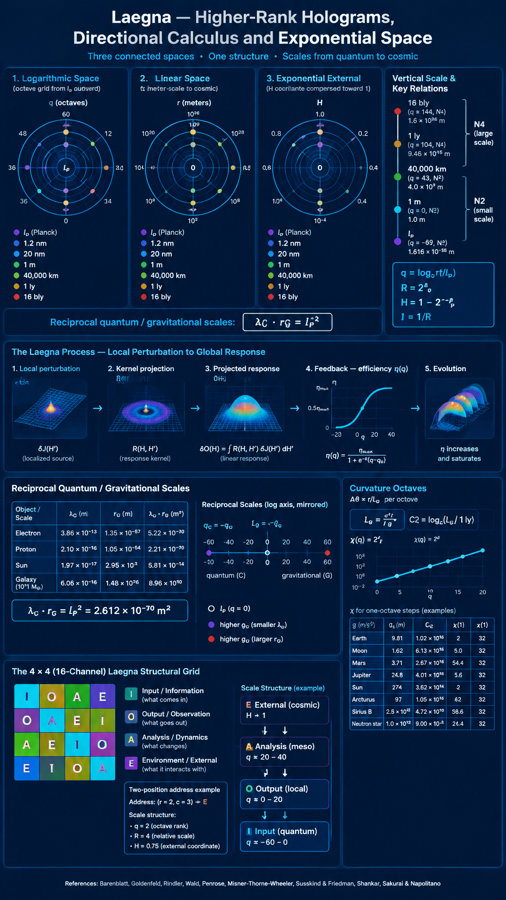
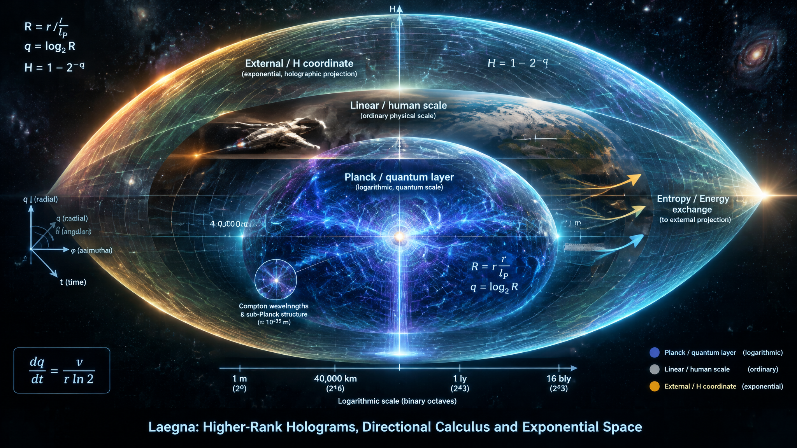
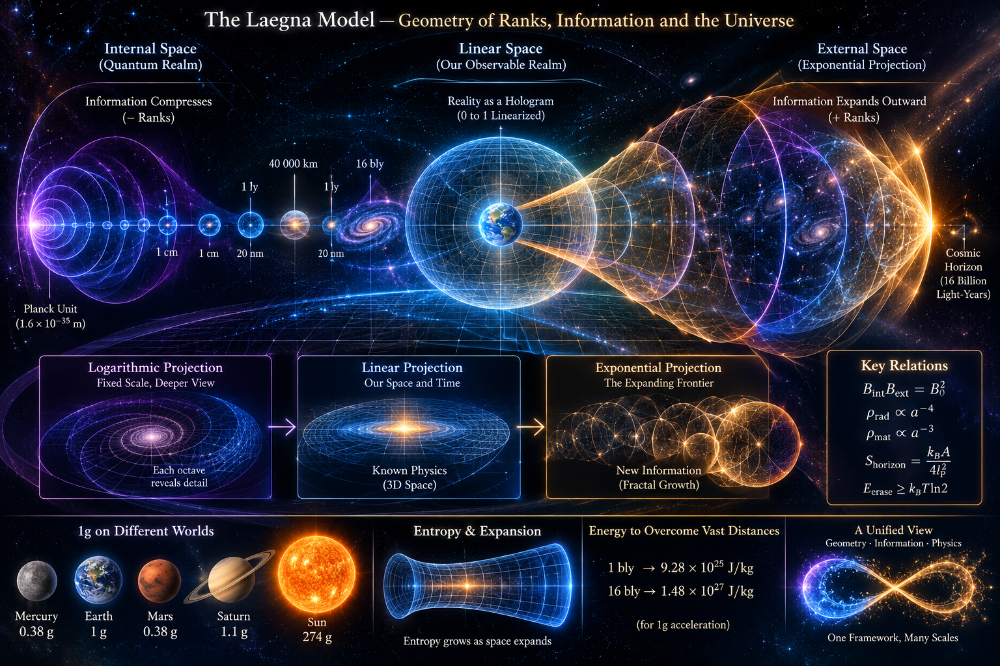

<br>

---

I asked ChatGPT the final question, while previous ones are below:

> Can you show how probably we can find higher-rank hologram image of exponential space, similarly to quantum creature finding something about our space: travelling there starts from information, and we can see where our holograms are projected, how they respond; maybe we can "radiate" our life basin or thermodynamic release, or create material interactions on hologram - slowly growing the exponent into more efficiency. This means rank 3 calculus of directions, instead of simply "overcoming" speed of light.
>
> If light is converting between mass - mass is infinitesimal relative outwards speed at each tesimal of it's surface, while light speed is single point in space, but infinity in time - infinity is either in space or time. Can you describe also making it condenced to infinitesimal in quantum scope down, like lim => 0 projection through planck unit; and what happens if we manage to flatten it even degree down, so that it appears flattened in exponent space where it otherwise moves upwards - can you show what exponent space is if mass would move upwards with mass speed, or light speed, there, which would be relations?

# Laegna: Higher-Rank Holograms, Directional Calculus and Exponential Space



Notice the 3 Death Miracles:
- Rank 1: When we overcome 1 ly horizon.
- Rank 2: When we overcome 16 bly horizon.
- Rank 3: When we overcome cooling of space.

Rank 0, a minor problem - to overcome eventual cooldown of the Sun, which might seem eventually closest and worst.

To be high-rank person today:
- One should not fear 4 world universal problems.

<br>

## 1. From travelling through space to interacting with its projection


The usual way to think about reaching a distant region is to calculate how much energy is required to travel there.

But consider a different possibility:

- What if the higher-rank representation of space can be approached through information rather than ordinary physical distance?
- What if our present universe has an external holographic representation?
- What if local physical interactions produce measurable changes in that representation?
- What if repeated interactions gradually improve the efficiency of the projection?

Instead of asking only how to overcome a distance, we can ask how information changes its representation across different spatial ranks.

This suggests three complementary descriptions:

1. **Internal space:** quantum-scale structure, reciprocal coordinates and compression.
2. **Linear space:** ordinary physical space, matter, radiation, energy and local interactions.
3. **External space:** exponential projection, outward information unfolding and asymptotic geometry.

The central hypothesis is that these descriptions might be connected through transformations of scale and information.

This does not establish that another physical dimension exists or that information can be transmitted into it. It provides a mathematical framework in which such a possibility could be formulated and tested.

## 2. The higher-rank hologram as an exponential projection

Start with a radial scale measured relative to the Planck length:

$$
R=\frac{r}{l_P}
$$

Its binary logarithmic rank is

$$
q=\log_2 R
$$

The Planck reference corresponds to $q=0$.

Positive ranks describe larger scales, while negative ranks describe smaller scales in the mathematical extension.

Now define an external exponential projection:

$$
H=1-\frac{1}{R}=1-2^{-q}
$$

Its inverse is

$$
R=\frac{1}{1-H}
$$

Therefore,

$$
r=\frac{l_P}{1-H}
$$

This transformation maps the Planck reference to $H=0$ and arbitrarily large distances towards $H=1$.

The important feature is that an unlimited physical distance is compressed into a finite coordinate interval.

For example:

| Physical scale | Logarithmic rank | External coordinate |
|---|---:|---:|
| 1 Planck length | 0 | 0 |
| 1 metre | 115.575 | Almost 1 |
| 1 light-year | 168.646 | Almost 1 |
| 16 billion light-years | 202.543 | Almost 1 |
| Infinity | Infinity | 1 |

The external coordinate becomes increasingly compressed as physical distance increases.

This is a mathematical projection, not a demonstrated physical boundary or an independently existing space.

### What could the hologram represent?

Imagine that our ordinary universe is a three-dimensional region, while the external hologram represents its state through a projected description.

Potentially encoded quantities include:

- Matter and energy distributions.
- Gravitational geometry.
- Quantum correlations.
- Radiation and entropy flux.
- Boundary conditions of the region.
- Relationships between different spatial scales.

The holographic principle in theoretical physics provides an important conceptual connection: in certain gravitational settings, information describing a region can be represented by a lower-dimensional description.

However, this particular exponential projection is a proposed coordinate construction, not an established holographic correspondence.

## 3. Rank 3: calculus of directions

The next step is to move beyond a single radial rank.

Your proposed rank 3 calculus can be interpreted as three independent spatial directions through which an information-bearing structure changes.

In spherical coordinates, these are:

- Radial direction: moving between scales.
- First angular direction: changing spatial orientation.
- Second angular direction: changing orientation in the perpendicular plane.

Let an information-bearing state be

$$
\Phi=\Phi(q,\theta,\phi,t)
$$

Its spatial directional changes are represented by

$$
\nabla\Phi=
\left(
\frac{\partial\Phi}{\partial q},
\frac{\partial\Phi}{\partial\theta},
\frac{\partial\Phi}{\partial\phi}
\right)
$$

A direction of interaction can be represented by

$$
\mathbf n=(n_q,n_\theta,n_\phi)
$$

The response along that direction is

$$
D_{\mathbf n}\Phi
$$

=

$$
n_q\frac{\partial\Phi}{\partial q}
+n_\theta\frac{\partial\Phi}{\partial\theta}
+n_\phi\frac{\partial\Phi}{\partial\phi}
$$

Time can then be included as a fourth independent coordinate.

This allows us to distinguish three different types of change:

1. Moving outward through scale.
2. Moving sideways through spatial orientation.
3. Changing the angular structure of the projected information.

A higher rank is therefore not merely a farther destination. It represents a larger space of possible directions and responses.

For example, a local perturbation could have a weak radial response but a strong angular response. Another perturbation could affect the radial projection while leaving most angular information unchanged.

This is the beginning of a directional interaction calculus.

## 4. Finding the hologram through information and response

A useful experimental analogy is to treat the external projection as a system whose state cannot be observed directly, but whose response to controlled inputs can be measured.

Let $J$ represent a local physical input:

- A change in energy.
- A radiation pulse.
- A redistribution of matter.
- A change in gravitational configuration.
- Another measurable physical perturbation.

Let $O(H)$ represent a projected observable.

We can define a response function:

$$
\mathcal R(H,H')
$$

=

$$
\frac{\delta O(H)}{\delta J(H')}
$$

This asks:

*If I perturb the system at one location or rank, what changes elsewhere in its projected description?*

In a linear approximation,

$$
\delta O(H)
$$

=

$$
\int \mathcal R(H,H')\,\delta J(H')\,dH'
$$

This mathematical structure appears in linear response theory, field theory and control systems.

For your model, we could investigate whether the response has a scale-dependent form:

$$
\mathcal R(H,H')
$$

=

$$
K(H,H')\,2^{\kappa q}
$$

Here:

- $K$ describes how the perturbation is transmitted.
- $\kappa$ describes how its effective response changes with rank.

This provides a possible method for investigating a higher-rank hologram:

1. Apply a controlled physical perturbation.
2. Measure its ordinary physical consequences.
3. Calculate its predicted external projection.
4. Compare the prediction with the measured response.
5. Repeat at different scales.

If the projected description predicts no new measurable behaviour, it is simply another representation.

If it predicts a new response that can be measured, it becomes a physical hypothesis.

## 5. Radiating our life basin: thermodynamic release

Your expression *radiating our life basin* can be translated into a physical model without assuming that life itself is a special form of radiation.

A living system is an open thermodynamic system. It maintains internal organisation by exchanging energy and matter with its surroundings.

We can represent its energy balance as

$$
\frac{dE_{\rm basin}}{dt}
$$

=

$$
P_{\rm in}-P_{\rm out}
$$

Its entropy balance can be written schematically as

$$
\frac{dS_{\rm basin}}{dt} = \dot S_{\rm exchange} + \dot S_{\rm production}
$$

Here entropy production is nonnegative for an ordinary irreversible process.

A living basin therefore has:

- Energy input.
- Internal transformations.
- Waste heat and other outputs.
- Entropy exchange with its environment.
- A dynamically maintained internal organisation.

It radiates energy and transfers entropy into its surroundings while maintaining its own organisation.

For your higher-rank model, define a source function:

$$
J_{\rm life}(q,\theta,\phi,t)
$$

It could represent the distribution of energy or information-related activity associated with a living system.

Its external projection would be

$$
O_{\rm ext}(H,\theta,\phi,t)
$$

=

$$
\mathcal P[J_{\rm life}]
$$

The operator $\mathcal P$ is the projection rule.

This does not mean that the living system radiates a separate life-energy into another dimension. It means that we are asking whether the ordinary physical outputs of the system have a useful representation in the external coordinate system.

The measurable outputs would include:

- Heat.
- Electromagnetic radiation.
- Chemical exchange.
- Mechanical work.
- Information transmitted through ordinary signals.

The interesting question is whether these outputs can be represented through a common rank-dependent information geometry.

## 6. Mass, light and the difference between linear and exponential motion

Your proposed relation between mass and outward speed needs one important correction.

Mass is not an infinitesimal version of speed. Mass and speed are different physical quantities. Their relationship appears through energy and momentum.

For a massive object,

$$
E=\gamma mc^2
$$

$$
p=\gamma mv
$$

where

$$
\gamma=\frac{1}{\sqrt{1-v^2/c^2}}
$$

At rest,

$$
E_0=mc^2
$$

For a photon,

$$
E_\gamma=pc=h\nu
$$

A photon has zero rest mass, but nonzero energy and momentum. A massive object cannot be accelerated to $c$, whereas a photon in vacuum propagates at $c$.

However, there is a useful way to express your intuition about a local physical process becoming a very different quantity in exponential space.

### Linear speed versus logarithmic-rank speed

Physical radial speed is

$$
v=\frac{dr}{dt}
$$

Since

$$
q=\log_2\left(\frac{r}{l_P}\right)
$$

we obtain

$$
\frac{dq}{dt}
$$

=

$$
\frac{1}{r\ln2}\frac{dr}{dt}
$$

Therefore,

$$
v_q=\frac{dq}{dt}=\frac{v}{r\ln2}
$$

This is the speed of change in logarithmic rank, not an ordinary velocity measured in metres per second.

For a massive object,

$$
v=\beta c,\qquad 0\leq\beta<1
$$

so

$$
v_q=\frac{\beta c}{r\ln2}
$$

For light,

$$
v_{q,\gamma}=\frac{c}{r\ln2}
$$

This produces a remarkable difference:

- In linear space, light always moves at $c$ locally.
- In logarithmic space, the rate of rank change decreases with increasing radius.
- The same physical speed corresponds to a different rank speed at different scales.

Light does not become slower in physical space. Its coordinate rate through logarithmic ranks becomes smaller.

### The exponential projection

Now use

$$
H=1-\frac{l_P}{r}
$$

Differentiating with respect to time gives

$$
\frac{dH}{dt}
=
\frac{l_P}{r^2}\frac{dr}{dt}
$$

Therefore,

$$
v_H=\frac{dH}{dt}=\frac{l_Pv}{r^2}
$$

For light,

$$
v_{H,\gamma}=\frac{l_Pc}{r^2}
$$

This is even more interesting: a constant physical speed becomes a strongly decreasing coordinate rate as the external projection approaches its limit $H=1$.

The closer we get to the infinite-distance boundary in physical coordinates, the more compressed the motion appears in the external coordinate.

This is a coordinate effect. It does not mean that light loses its physical speed or that a new physical force slows it down.

### What would mass look like moving upwards in exponent space?

Suppose we define an exponent-space trajectory:

$$
q(t)=q_0+ut
$$

where $u$ is a constant rank rate.

Then

$$
r(t)=l_P\,2^{q_0+ut}
$$

Differentiating,

$$
\frac{dr}{dt}=r\ln2\,u
$$

Therefore, **constant speed in exponent space produces exponential motion in ordinary space**.

This is a useful distinction:

| Motion | Behaviour in ordinary space |
|---|---|
| Constant linear speed | $r(t)=r_0+vt$ |
| Constant logarithmic-rank speed | $r(t)=r_0\,2^{ut}$ |
| Constant exponential-coordinate speed | $H(t)=H_0+wt$ |

In the second case, physical radial speed grows with radius:

$$
v=r\ln2\,u
$$

Eventually, this would exceed $c$ if extrapolated indefinitely.

Therefore, constant rank speed cannot describe the trajectory of a massive object over arbitrary distances while respecting relativistic causality.

A relativistically admissible trajectory must satisfy

$$
\left|\frac{dr}{dt}\right|\leq c
$$

Consequently,

$$
\left|\frac{dq}{dt}\right|
\leq\frac{c}{r\ln2}
$$

This is a scale-dependent upper bound on rank speed.

### What if light moved upwards at a constant rank speed?

If we formally assign light a constant exponent-space rate $u$, then

$$
r(t)=r_0\,2^{ut}
$$

Its physical speed would be

$$
v(t)=r(t)\ln2\,u
$$

That is not the ordinary propagation of light in flat spacetime.

It would describe an exponentially expanding radial trajectory, and it would require a different physical geometry or a different interpretation of time.

This gives a precise distinction between:

- Light moving through space.
- Space expanding.
- A coordinate moving upwards through scale ranks.

They may be mathematically related, but they are not interchangeable.

## 7. Compressing towards zero through the Planck reference

Your idea of condensing a structure into an infinitesimal quantum scope can be represented through reciprocal coordinates.

Let

$$
R=\frac{r}{l_P}
$$

Define the internal reciprocal coordinate:

$$
I=\frac{1}{R}=\frac{l_P}{r}=2^{-q}
$$

Then:

- At the Planck reference, $R=1$ and $I=1$.
- At larger distances, $R\to\infty$ and $I\to0$.
- At smaller distances, $R\to0$ and $I\to\infty$.

The external and internal coordinates are therefore reciprocal:

$$
I=1-H
$$

because

$$
H=1-\frac{1}{R}
$$

This gives a particularly clean complementary structure:

$$
H+I=1
$$

The external projection approaches one while the internal reciprocal coordinate approaches zero.

This is a mathematical identity for the chosen coordinates, not a demonstrated conservation law for physical information.

### What happens at the infinitesimal limit?

For the reciprocal coordinate,

$$
\lim_{r\to\infty}I=0
$$

For the logarithmic coordinate,

$$
\lim_{r\to\infty}q=+\infty
$$

At the opposite end,

$$
\lim_{r\to0}I=+\infty
$$

$$
\lim_{r\to0}q=-\infty
$$

The Planck length is the reference point between these two mathematical directions.

There is a physical limitation here: we do not know whether arbitrarily small distances below the Planck scale are meaningful as ordinary physical distances. The equations can be extended mathematically, but that does not establish that nature supports the extension.

### Flattening the internal structure another degree

You can introduce a second projection to compress the reciprocal coordinate:

$$
P(I)=\frac{2I}{1+I}
$$

This maps:

- $I=0$ to $P=0$.
- $I=1$ to $P=1$.
- $I\to\infty$ to $P\to2$.

Using $I=2^{-q}$,

$$
P(q)=\frac{2}{1+2^q}
$$

Its derivative is

$$
\frac{dP}{dq}
$$

=

$$
-\frac{2\ln2\,2^q}{(1+2^q)^2}
$$

The projection is steepest around the Planck reference $q=0$, and becomes flatter towards both extremes.

This gives you a second degree of flattening: not only are physical distances transformed into ranks, but the ranks themselves are transformed into a bounded representation.

It is a useful candidate for your nested projection idea.

## 8. Growing the exponent through repeated interactions

Now we can formulate your idea of gradually improving efficiency.

Suppose the system has an efficiency parameter $\eta(q)$, representing how effectively a local input produces a desired change in the external projection.

A simple model is

$$
\eta(q)=\eta_0\,2^{\kappa q}
$$

Here $\kappa$ determines how efficiency changes across ranks.

But unrestricted exponential efficiency is not realistic. A bounded model is more useful:

$$
\eta(q)=
\frac{\eta_{\max}}
{1+e^{-k(q-q_0)}}
$$

This describes a system that begins inefficiently, improves through repeated interactions, and eventually approaches a saturation limit.

You could imagine an iterative process:

1. A local system radiates energy or produces an information-bearing signal.
2. The external projection represents its response.
3. The response is measured.
4. The system changes its input based on the measured result.
5. The next interaction becomes more efficient.

Mathematically, this resembles feedback control:

$$
J_{n+1}=J_n+\mu\,\Delta O_n
$$

where $\mu$ is a feedback parameter.

This is a potentially useful interpretation of your idea of *growing the exponent*: repeated interactions improve the mapping between local inputs and external responses.

The exponent does not have to mean that the physical universe itself becomes more efficient. It could describe the efficiency of a particular information-processing or control process.

## 9. A unified internal, linear and external geometry

The proposal can now be represented through several connected coordinate systems.

### Internal quantum projection

$$
I=2^{-q}
$$

Reciprocal scale, approaching zero towards large external distances.

### Linear physical space

$$
r=l_P2^q
$$

Ordinary distances, velocities, energy, matter and radiation.

### External exponential projection

$$
H=1-2^{-q}
$$

A finite coordinate approaching its asymptotic boundary as physical distance grows.

### Directional interaction

$$
\Phi(q,\theta,\phi,t)
$$

Three spatial directions, with time governing their evolution.

The most interesting relationship is that the same physical process can have three different descriptions:

| Description | What appears to happen |
|---|---|
| Internal | Structure is compressed towards an infinitesimal representation |
| Linear | Matter and radiation interact through ordinary spacetime |
| External | The representation unfolds towards an asymptotic boundary |

The transformations do not themselves create energy, information or physical interactions. They give us different ways to describe the same underlying system.

## 10. What would make this a physical theory?

I would concentrate on four questions.

### 1. Projection

Can we define a unique external representation of a physical state?

The projection must specify which information is preserved, which is compressed, and which becomes inaccessible.

### 2. Response

Can a local energy or information perturbation produce a predicted, measurable change in that representation?

A projection that only renames existing coordinates is mathematically useful, but does not introduce new physical behaviour.

### 3. Causality

Does the transformation preserve the local speed-of-light limit?

The coordinate velocity can change dramatically while the locally measured physical velocity remains bounded by $c$.

### 4. Thermodynamics

Does the model account for energy flow, entropy production, and radiation cooling without introducing unexplained energy?

A physically meaningful model needs an energy balance and an entropy balance, not just a geometric analogy.

### A first mathematical experiment

Compare the ordinary physical propagation of a signal with its rank-space representation:

$$
\frac{dr}{dt}=v
$$

$$
\frac{dq}{dt}=\frac{v}{r\ln2}
$$

$$
\frac{dH}{dt}=\frac{l_Pv}{r^2}
$$

These three equations already demonstrate something important: a process that is uniform in linear space can become progressively flattened in exponential space.

One could extend this experiment to three directions and compare the response of different projected components.

For example, define a source field $J$ and an external response field $O$:

$$
O(H,\theta,\phi,t) = \int \mathcal R(H,\theta,\phi;H',\theta',\phi') J(H',\theta',\phi',t) \,dH'\,d\theta'\,d\phi'
$$

The response kernel $\mathcal R$ would describe how information or physical perturbations propagate through the projected geometry.

The next challenge would be to derive or measure this kernel rather than choosing it arbitrarily.

## 11. Overall interpretation

The central idea is to move from overcoming the speed of light to investigating how information changes its representation across spatial ranks.

The main connections are:

1. **Higher-rank holography:** a physical region may have a lower-dimensional or transformed information representation. Your exponential coordinate offers one possible mathematical construction.
2. **Directional calculus:** rank 3 describes radial and angular changes rather than treating the next rank as merely a farther destination.
3. **Thermodynamic release:** living and nonliving systems exchange energy and entropy with their surroundings, providing measurable local sources for an information projection.
4. **Exponential motion:** constant rank speed produces exponential motion in ordinary space, while constant physical speed becomes progressively flattened in logarithmic and exponential coordinates.
5. **Reciprocal compression:** the internal coordinate approaches zero while the external coordinate approaches one.
6. **Repeated interaction:** feedback can improve the efficiency of a projected response, potentially producing a scale-dependent effective exponent.

The most important distinction is that coordinate transformations do not themselves provide a mechanism for faster-than-light travel or communication. They can, however, reveal relationships that are difficult to see in ordinary linear coordinates.

**My interpretation of the central Laegna hypothesis:**

Rather than overcoming the speed of light, investigate whether the geometry of information can be changed so that a local interaction has a different scale of representation.

Rank 3 then describes the directions through which that representation changes, while the exponential coordinate describes how those changes accumulate towards an external limit.

The next scientific step is to establish a projection rule, a response function, and an energy-and-entropy balance that can be tested against ordinary physical observations.

That would turn the higher-rank hologram from an interesting geometric image into a mathematical model with potentially falsifiable physical consequences.

---

I asked ChatGPT:

> Now, in 1g condition - take planck unit size and octave relatives; and the list of basic ranks as given - 40 000 km, 1 ly, 16b ly, exterior of each which becomes smaller as interior becomes larger - exterior is exponent or quadratic linearized.
> 
> In each scale, each unit is measured in travelling at light speed, in octaves of curvature as seen from observer, starting from 0, 1, 2, 4, 16, etc. in 4^n, as well as 0, 1, 2, 4, 8, 16 etc. in 2^n, with 0..1 linearized, expressing the internal space relation which is linearized; while external is now having it's hologram duplicate at 0..1, which is used as reference projection - each tesimal times infinity becomes separate scale in infinity. In octaves, from close-to infinity in exponent space, to digit precision same as internal space so it's always exponent-linearized ..show how same light speed spatial curvatures, local, which also probably approximate to local gravity measure, go through one Schroedinger-equation-like lim => 0, and one higher space projection where our space would become to be with lim => 0 from Schroedinger; now project sizes 1 ly, 16 bly, 40 000 km, 1 m, 1cm, 1 planck unit and 1 infinity to each space and tell what's there, what appears on hologram, what is known, and which are the properties? These three, and the scopes which follow and preceed shortly, should be described. Those are log, lin, exp linearized projections, where one of functions is applied to all space, time, of value and it's positioning, and it appears linear of linear, or copy in exponent and differential; describe which laws of nature remain in their local, linear view, and which ones appear in linear dimension in each - where one projects as if coordinate system is taken logarithm on projection, other as it remains same, linear, and the last as if exponent has been taken to it's projection. Describe the parallels between realms, their fractals, furthest and closest things and their positions and names in their own realms. Associate with laegna rank systems and math where needed, and to classics, and to books which could be studied further for basin. 

# Energy, Entropy and the Expansion of Space in the Laegna Model



<br>

There is a potentially useful connection between energy, entropy, spatial expansion, and your internal/external rank system. The central idea is to distinguish three processes:

1. **Energy required to move matter or information across a distance.**
2. **Energy and entropy changes caused by the expansion and cooling of the universe.**
3. **A mathematical process in which external information bits unfold into higher ranks.**

They can be related in a model, but they are not automatically the same physical process.

The most promising interpretation is that the external projection describes increasing spatial extent as an accumulation of new degrees of freedom, while the internal projection describes the redistribution and loss of accessible information within a bounded region.

The key question is whether these equations reproduce known relativistic and thermodynamic behaviour, rather than merely resembling it visually.

## 1. Energy required to overcome 1 or 16 billion light-years

There is no unique energy associated with a distance alone. We need to specify what is being moved, what force or gravitational field it moves against, and what "overcome" means.

Three different questions produce three different answers.

### A. Travelling across the distance

For an object of rest mass $m$, accelerated to speed $v$, its kinetic energy is

$$
E_k=(\gamma-1)mc^2,\qquad
\gamma=\frac{1}{\sqrt{1-v^2/c^2}}.
$$

As $v\to c$, the required kinetic energy diverges. A massive object cannot reach light speed with finite energy.

In a static, non-expanding approximation, light takes:

- 1 billion years to travel 1 billion light-years.
- 16 billion years to travel 16 billion light-years.

But the universe is not static. At cosmological distances, the distance between comoving locations changes during the journey. The relevant calculation must use an expanding-universe metric and a specified cosmological model.

### B. Overcoming a 1g acceleration scale

We can make a useful Laegna reference calculation using the acceleration length

$$
L_g=\frac{c^2}{g}.
$$

If we imagine an artificial, constant 1g opposing acceleration over a distance $d$, the work per unit mass is

$$
\frac{W}{m}=gd.
$$

This gives:

| Distance | Artificial 1g work per kg |
|---|---:|
| 1 bly | $9.28\times10^{25}\,\mathrm{J/kg}$ |
| 16 bly | $1.48\times10^{27}\,\mathrm{J/kg}$ |

These are enormous values. They are also approximately $10^9$ and $1.65\times10^{10}$ times the rest energy per kilogram, respectively.

**Important:** this is not the energy needed to overcome the actual universe's expansion. It assumes a uniform opposing acceleration across an immense distance, which is not a realistic cosmological gravitational field. It is useful as a mathematical extrapolation of your 1g reference, not as a prediction.

### C. Overcoming cosmological expansion

This is the more interesting case.

In general relativity, expansion is not simply a force pushing an object through static space. The scale factor $a(t)$ describes how distances between comoving locations change:

$$
D(t)=a(t)\,\Delta\chi,
$$

where $\Delta\chi$ is their fixed comoving separation.

Some sufficiently distant regions can become causally inaccessible to us because of the cosmological event horizon. No amount of ordinary propulsion lets a massive spacecraft travel faster than light to reach an event beyond its future causal reach.

So your 16 bly scale could be treated as a *horizon-like rank* in a model, but it should not be treated as a universal physical wall or a fixed energy barrier.

## 2. Energy and cooling in higher ranks

Here is a particularly useful connection to your idea of external space as a growing sequence of goals.

In an expanding universe, radiation loses energy through cosmological redshift:

$$
\lambda\propto a,\qquad
\nu\propto\frac{1}{a},\qquad
E_\gamma=h\nu\propto\frac{1}{a}.
$$

For freely expanding radiation,

$$
\rho_{\rm rad}\propto a^{-4},
\qquad
T_{\rm rad}\propto a^{-1}.
$$

The four powers in the radiation density have a clear interpretation:

- Three powers come from dilution over an expanding volume.
- One additional power comes from the decrease in photon energy as wavelengths stretch.

Ordinary non-relativistic matter behaves differently:

$$
\rho_{\rm matter}\propto a^{-3}.
$$

A cosmological constant behaves differently again: its energy density remains constant as the universe expands.

These distinctions follow from the cosmological energy-continuity equation.

This gives you three different kinds of rank behaviour:

| Component | Scaling with expansion | Laegna interpretation |
|---|---|---|
| Matter | $a^{-3}$ | Dilution of existing contents |
| Radiation | $a^{-4}$ | Dilution plus frequency cooling |
| Vacuum energy | $a^0$ | Persistent energy density per volume |

The last row is particularly interesting for your proposal: the volume can grow while the energy density remains constant. The total vacuum energy assigned to a growing comoving volume therefore grows with that volume.

In general relativity, this does not imply a simple violation of local energy conservation; global energy conservation is more subtle in a time-dependent spacetime.

**A useful distinction:** cooling is not necessarily an energy barrier that must be overcome. It can be the result of expansion itself. If you want to maintain a system at a fixed temperature while it expands, then you must supply energy or otherwise compensate for the cooling.

That gives a possible interpretation of your higher ranks:

- Lower ranks: local interactions and energy exchange.
- Intermediate ranks: radiation dilution and frequency redshift.
- Higher ranks: expansion of the available volume and the changing energy budget of that volume.

These are different physical regimes, but they can be represented in one scale-dependent mathematical model.

## 3. Can external entropy be the expansion of space?

This is where your idea becomes particularly interesting.

You are proposing something like:

- Internal space: information is redistributed, compressed, or made inaccessible.
- External space: new information-bearing degrees of freedom unfold outward.
- Linear space: we observe the local physical interactions and thermodynamic processes between them.

There are established concepts that resemble parts of this construction.

### Quantum entropy

For a quantum system described by density matrix $\rho$, the von Neumann entropy is

$$
S_{\rm vN}=-k_B\text{Tr}(\rho\ln\rho)
$$

It measures the mixedness of the quantum state. For a subsystem entangled with its environment, it also measures entanglement entropy.

This entropy is not necessarily the same thing as ordinary thermal entropy. A pure state can have zero total von Neumann entropy while a subsystem of that state has nonzero entanglement entropy.

### Linear-space entropy

In ordinary thermodynamics, entropy describes the number of microscopic configurations compatible with a macroscopic description:

$$
S=k_B\ln\Omega.
$$

The number of accessible configurations can grow through interactions, thermalisation, mixing, and irreversible processes.

### Horizon entropy

There is an even closer connection to your external-space idea.

For black holes, and in the standard semiclassical treatment of cosmological horizons, entropy is associated with horizon area:

$$
S_{\rm horizon}=\frac{k_B A}{4l_P^2}.
$$

In units of bits, the corresponding number is

$$
N_{\rm bits}
=\frac{S_{\rm horizon}}{k_B\ln2}
=\frac{A}{4l_P^2\ln2}.
$$

This is not a simple volume count. It scales with area, measured in Planck areas. Gibbons and Hawking established the thermodynamic connection between cosmological event horizons and entropy.

That suggests an important refinement to your fractal-bit idea:

**External information may not simply grow as one new bit per volume element. At a gravitational horizon, the relevant information capacity is naturally associated with area.**

This is a stronger mathematical starting point than assuming that every outward spatial step adds an equal number of bits.

## 4. Does quantum entropy resemble external expansion?

There is a mathematical resemblance, but we should not identify the two too quickly.

Consider two processes:

**Internal process:** the number of distinguishable states available to a subsystem changes.

**External process:** the spatial region being described expands, potentially making more degrees of freedom accessible.

Both can be represented as changes in information capacity. For example, define

$$
B=\frac{S}{k_B\ln2},
$$

where $B$ is entropy expressed in bits.

Then an increase in $B$ means an increase in the entropy represented by the system. But it does not necessarily mean that new physical bits have literally appeared in space. It might instead mean that previously inaccessible states have become accessible, or that our description now includes a larger region.

There is a useful distinction between three possibilities:

1. **New degrees of freedom:** the physical system genuinely has more independent states available.
2. **Newly accessible degrees of freedom:** the system has not necessarily gained states, but the observer can now access or describe more of them.
3. **Coarse-graining:** the observer loses information about microscopic details, so the entropy of the effective description increases.

Your external hologram could be a mathematical representation of the second process, while your internal quantum entropy could describe the first or third.

This would make the two projections complementary, rather than identical.

## 5. Could the external unfolding be fractal?

Yes, as a mathematical construction. The important question is what kind of fractal growth you intend.

Let $q$ represent your logarithmic rank:

$$
q=\log_2\left(\frac{L}{l_P}\right).
$$

Let $B(q)$ be the number of information bits represented at that rank.

A simple exponential model is

$$
B(q)=B_0\,2^{Dq},
$$

where $D$ is a scaling exponent.

Since $L/l_P=2^q$, this becomes

$$
B(L)=B_0\left(\frac{L}{l_P}\right)^D.
$$

Different values of $D$ represent different growth structures:

| $D$ | Interpretation |
|---:|---|
| 1 | Linear growth |
| 2 | Area-like growth |
| 3 | Volume-like growth |
| Non-integer | Possible fractal scaling |

For a conventional three-dimensional region, volume grows as $L^3$. For a horizon entropy model, the number of bits scales approximately as $L^2$, because the area grows as $L^2$.

This is an especially interesting connection to your two-band rank model: a spatial expansion might be volume-like in one description and area-like in another.

But a genuine fractal requires more than an exponential-looking graph. It needs a scaling law that remains valid across multiple scales, usually with a non-integer dimension or a self-similar structure.

### A possible internal/external pair

You could define two functions:

$$
B_{\rm int}(q)=B_0\,2^{-D_iq}
$$

$$
B_{\rm ext}(q)=B_0\,2^{D_eq}.
$$

Their product is

$$
B_{\rm int}(q)B_{\rm ext}(q)
=B_0^2\,2^{(D_e-D_i)q}.
$$

If $D_e=D_i=D$, then

$$
B_{\rm int}(q)B_{\rm ext}(q)=B_0^2.
$$

This gives a precise mathematical version of your reciprocal idea: as the external information capacity grows, the internal representation becomes correspondingly compressed.

It is not yet a law of physics. It is a candidate conservation relation that could be tested against quantum entropy, horizon entropy, and cosmological expansion.

## 6. Does this happen in Planck-time moments?

We need to be careful here.

The Planck time is

$$
t_P=\sqrt{\frac{\hbar G}{c^5}}
\approx5.39\times10^{-44}\,\mathrm{s}.
$$

It is a natural scale constructed from fundamental constants. It is not experimentally established that the universe updates in discrete Planck-time steps.

Likewise, we do not currently know that space expands by adding new information bits at each Planck instant.

However, we can construct a continuous model whose smallest characteristic time is the Planck time.

For example, let $a(t)$ be the expansion scale factor. Define the expansion rate

$$
H(t)=\frac{\dot a(t)}{a(t)}.
$$

The frequency of freely propagating radiation changes according to

$$
\nu(t)\propto\frac{1}{a(t)}.
$$

Thus, if the external space expands, the frequency of radiation decreases. This is a real physical effect: cosmological redshift.

Your proposed internal cooling could be represented by a corresponding frequency scale:

$$
\nu_{\rm int}(q)=\nu_0\,2^{-\alpha q}.
$$

Here $\alpha$ is a model parameter. This says that the characteristic internal frequency becomes smaller as the external rank increases.

It is a reasonable mathematical hypothesis, but it is not yet a known quantum-gravity law.

There is another subtle point: lower frequency does not automatically mean lower entropy. Entropy depends on the state, its probabilities, and the degrees of freedom being considered. A colder system can have more or less entropy depending on its physical configuration.

For example, an expanding photon gas cools while its physical volume grows. Its entropy in a comoving volume can remain approximately constant during ideal adiabatic expansion. Its energy density decreases, but its entropy does not have to decrease with it.

That is an important distinction for your model: **cooling, entropy growth, and information expansion are three separate variables.**

## 7. The energy cost of adding or removing information bits

There is one well-established relation that could give your information model a physical energy scale.

Landauer's principle states that erasing one bit of information in a thermal environment at temperature $T$ requires at least

$$
E_{\rm erase}\geq k_BT\ln2.
$$

This is a lower bound for logically irreversible erasure, not a universal energy cost for creating or transmitting a bit. Reversible computation can avoid this minimum dissipation in the ideal limit.

For $B$ bits erased at temperature $T$, the ideal lower bound is

$$
E_{\rm erase}\geq Bk_BT\ln2.
$$

This produces a very interesting relationship:

- At high temperature, erasing information is energetically expensive.
- At low temperature, the Landauer energy bound decreases.
- But low temperature does not automatically make computation easier: practical operations can become slower and more sensitive to noise.

For your external-space hypothesis, one could define an energy budget for information processing at each rank:

$$
E(q)=B(q)k_BT(q)\ln2.
$$

If the number of bits increases while temperature decreases, the total energy scale depends on their product.

For example, if

$$
B(q)\propto2^{Dq},
\qquad
T(q)\propto2^{-\alpha q},
$$

then

$$
E(q)\propto2^{(D-\alpha)q}.
$$

Three cases emerge:

| Condition | Energy behaviour |
|---|---|
| $D>\alpha$ | Total bit-erasure energy grows |
| $D=\alpha$ | Total bit-erasure energy remains constant |
| $D<\alpha$ | Total bit-erasure energy decreases |

This is a concrete way to investigate whether your external expansion and internal cooling can balance one another.

It is important to remember that this equation describes an idealized information-processing budget, not the total energy of the universe.

## 8. A unified Laegna model to investigate

I would put the proposal into a system with four independent variables.

### Four coupled rank variables

**1. Spatial rank**

$$
q=\log_2(L/l_P)
$$

How far the external scale has unfolded.

**2. Information rank**

$$
B(q)=B_0\,2^{Dq}
$$

How many effective information bits are represented.

**3. Thermal rank**

$$
T(q)=T_0\,2^{-\alpha q}
$$

How the characteristic temperature or frequency scale changes.

**4. Energy rank**

$$
E(q)\sim B(q)k_BT(q)\ln2
$$

An idealized thermodynamic cost of irreversible information processing.

This model is deliberately simple. It lets you ask whether your different rank systems can be connected through shared exponents, without assuming that they describe the same physical quantity.

For example, you could investigate whether the exponent $D$ changes between:

- Quantum or Planck-scale behaviour.
- Ordinary three-dimensional space.
- Horizon-scale information.
- An external exponential projection.

A particularly interesting possibility is that the exponent changes between domains, rather than remaining constant.

### How light speed and gravity enter

I would not describe light speed and gravity as goals that the universe consciously tries to reach. In physics, they are constraints and dynamical relations.

But mathematically, they can appear as limiting conditions of a goal-based system.

For example:

$$
\frac{dx}{dt}\leq c
$$

is a local causal constraint, while the Einstein field equations constrain how matter and energy determine spacetime geometry:

$$
G_{\mu\nu}+\Lambda g_{\mu\nu}
=\frac{8\pi G}{c^4}T_{\mu\nu}.
$$

Your model could treat these as two fundamental interaction constraints:

- Light speed constrains the rate at which causal information can propagate.
- Gravity constrains the geometry and evolution of the space through which that information propagates.

The external rank system might then represent the accumulated geometric and informational consequences of these local constraints.

That is a more defensible interpretation than saying that light speed and gravity themselves are goals.

## 9. Overall assessment

I see three particularly promising connections:

1. **The reciprocal internal/external structure** resembles complementary information descriptions. The product relation $B_{\rm int}B_{\rm ext}=\text{constant}$ is a clear hypothesis worth testing.
2. **The outward growth of information** has a meaningful connection to horizon entropy and holographic bounds. The distinction between area-like and volume-like information growth is important.
3. **The cooling of expanding space** has a direct connection to cosmological redshift. The relationship between growing spatial scales and decreasing radiation frequencies is established physics.

But there are three things that should not yet be equated:

- Quantum entropy is not simply the expansion of space.
- The Planck time is not known to be a universal update interval.
- External information growth is not known to be the mechanism driving cosmic expansion.

### The next mathematical question

The most valuable next step is to test whether the following three relations can coexist in one rank system:

$$
B_{\rm ext}(q)\propto2^{Dq}
$$

$$
T_{\rm int}(q)\propto2^{-\alpha q}
$$

$$
a(q)\propto2^q
$$

Then compare the resulting entropy and energy scaling with the established cosmological relations:

$$
\rho_{\rm matter}\propto a^{-3},
\qquad
\rho_{\rm radiation}\propto a^{-4},
\qquad
\rho_{\Lambda}\propto a^0.
$$

If your rank exponents can reproduce these three different behaviours as special cases, the model would have a real mathematical bridge to cosmology.

If it also produces a meaningful area-law limit for horizon information, the connection becomes even stronger.

That would be a worthwhile direction: not merely interpreting expansion as an outward unfolding of information, but deriving when that unfolding behaves like matter dilution, radiation cooling, or horizon entropy.

---

It's complete article:

# Laegna: Three Spaces, Curvature Octaves and the External Hologram

## 1. The three projections

Consider one physical universe represented through three different coordinate systems.

The projections are:

1. **Logarithmic space:** equal multiplicative changes in physical scale become equal additive distances.
2. **Linear space:** ordinary physical measurements remain linear.
3. **Exponential-linearized external space:** increasingly large internal scales approach an external boundary, with their remaining differences represented as increasingly small exterior quantities.

These are initially three mathematical representations of the same physical system, not three experimentally established universes.

The central idea is that the same object can have three descriptions:

- Its physical size.
- Its position in the logarithmic hierarchy.
- Its exterior holographic position relative to infinity.

We will use the Planck length as the quantum-gravitational reference and 1g as the human-scale acceleration reference.

The central physical constants are:

$$
l_P=\sqrt{\frac{\hbar G}{c^3}}
\approx1.616255\times10^{-35}\ {\rm m}
$$

$$
t_P=\frac{l_P}{c}
\approx5.391247\times10^{-44}\ {\rm s}
$$

$$
c=299792458\ {\rm m/s}
$$

The Planck reference satisfies:

$$
\boxed{\frac{l_P}{t_P}=c}
$$

One Planck length per Planck time is light speed.

The Planck unit is therefore the natural reference for the smallest conventional scale in this construction.

It is not necessary to assume that it is an experimentally established absolute minimum length.

---

## 2. The 1g reference: a human-scale connection to one light-year

Take standard terrestrial gravitational acceleration:

$$
g_E=9.80665\ {\rm m/s^2}
$$

The corresponding acceleration length is:

$$
L_g=\frac{c^2}{g_E}
$$

Numerically:

$$
L_g\approx9.165\times10^{15}\ {\rm m}
$$

In light-years:

$$
\boxed{L_g\approx0.969\ {\rm ly}}
$$

The corresponding acceleration time is:

$$
T_g=\frac{c}{g_E}
$$

$$
\boxed{T_g\approx0.969\ {\rm years}}
$$

This is a particularly interesting connection:

- Human-scale gravity: 1g.
- Relativistic acceleration length: approximately 1 light-year.
- Relativistic acceleration time: approximately 1 year.

The relationship follows directly from:

$$
L_g=cT_g
$$

This is an acceleration length, not the actual radius of Earth's spacetime curvature.

For an observer undergoing constant proper acceleration in flat spacetime, $c^2/g$ is the characteristic distance to the Rindler horizon. Earth's gravitational field is different globally, although the equivalence principle connects acceleration and gravity locally.

We will use $L_g$ as a reference scale for the external curvature comparison.

---

## 3. The physical scale hierarchy

Start with the Planck-relative physical size:

$$
R=\frac{L}{l_P}
$$

This is the fundamental dimensionless scale coordinate.

The binary octave coordinate is:

$$
N_2=\log_2 R
$$

The base-4 double-octave coordinate is:

$$
N_4=\log_4 R
$$

Since $4=2^2$:

$$
\boxed{N_2=2N_4}
$$

The scale hierarchy becomes:

| Reference | Physical length | Binary octaves | Base-4 double-octaves |
|---|---:|---:|---:|
| Planck unit | $1.616\times10^{-35}$ m | 0 | 0 |
| 1 cm | $10^{-2}$ m | 108.931 | 54.465 |
| 1 m | $1$ m | 115.575 | 57.787 |
| 40,000 km | $4.0\times10^7$ m | 140.828 | 70.414 |
| 1 ly | $9.461\times10^{15}$ m | 168.646 | 84.323 |
| 16 billion ly | $1.514\times10^{26}$ m | 202.543 | 101.272 |
| Infinity | $\infty$ | $\infty$ | $\infty$ |

The three particularly important large-scale landmarks are:

$$
L_A=40000\ {\rm km}
$$

$$
L_E=1\ {\rm ly}
$$

$$
L_Y=16\times10^9\ {\rm ly}
$$

They can be treated as three successive reference landmarks in the larger hierarchy.

The distance between the first two is approximately:

$$
\log_2\left(\frac{1\ {\rm ly}}{40000\ {\rm km}}\right)
\approx27.78
$$

The distance between one light-year and 16 billion light-years is:

$$
\log_2(16\times10^9)\approx33.90
$$

Thus:

- 40,000 km to 1 ly: approximately 27.8 binary octaves.
- 1 ly to 16 billion ly: approximately 33.9 binary octaves.

These are logarithmic distances, not ordinary physical distances.

---

## 4. The Laegna rank structure

The octave system can be associated with the Laegna quaternary structure.

Use the four nonzero digits:

| Symbol | Value | Structural interpretation |
|---|---:|---|
| I | 1 | First unit |
| O | 2 | Second unit |
| A | 3 | Third unit |
| E | 4 | Fourth unit |

The structural boundary U represents the touching boundary between orientations rather than an ordinary numerical zero.

The signed starting sequence can be written:

$$
-1,\quad U,\quad I,\quad O,\quad A,\quad E
$$

The digit lengths restart at the next structural length.

This is not ordinary positional base-4 notation. It is a nonzero-digit, signed, block-addressing construction.

### Binary and quaternary octaves

The binary sequence is:

$$
0,\quad1,\quad2,\quad4,\quad8,\quad16,\quad32,\quad64,\ldots
$$

The strict powers of four are:

$$
1,\quad4,\quad16,\quad64,\quad256,\ldots
$$

With zero as the origin:

$$
0,\quad1,\quad4,\quad16,\quad64,\ldots
$$

Your proposed landmark sequence:

$$
0,\quad1,\quad2,\quad4,\quad16,\ldots
$$

can be retained as a structural rank sequence, with 2 serving as an intermediate bridge. It is not, however, a strict sequence of powers of four.

The difference matters because we want to preserve both systems:

- Binary octaves describe ordinary doubling.
- Quaternary double-octaves describe multiplication by four.
- The I/O/A/E symbols describe structural positions and addresses.

A 4-by-4 block gives:

$$
4\times4=16
$$

possible two-position combinations.

This provides the foundation for the 16-channel structural extension.

---

# PART I — LOGARITHMIC SPACE

## 5. Logarithmic projection

The logarithmic projection is:

$$
q=\log_2\left(\frac{L}{l_P}\right)
$$

Its most important property is:

$$
q(2L)=q(L)+1
$$

Doubling physical distance always adds one octave.

Similarly:

$$
q(4L)=q(L)+2
$$

The logarithmic coordinate is therefore ideal for comparing different scales.

One metre and one light-year are enormously different in ordinary distance, but their relationship can be represented by a manageable difference in octave coordinates.

### What becomes linear?

In logarithmic space:

- Multiplication becomes addition.
- Ratios become differences.
- Powers become multiplication.
- Exponential growth becomes linear growth.
- Inverse-power relationships become straight-line relationships.

For example:

$$
L=L_0e^{kt}
$$

becomes:

$$
\ln L=\ln L_0+kt
$$

Exponential growth in physical space becomes linear in logarithmic space.

Similarly, a power law:

$$
y=ax^n
$$

becomes:

$$
\log y=\log a+n\log x
$$

This is why logarithmic coordinates are so useful in physics, astronomy, statistical mechanics and scale analysis.

### The local linear interval

Within each octave, define:

$$
u=q-\lfloor q\rfloor
$$

Then:

$$
0\leq u<1
$$

The fractional coordinate $u$ describes the position inside one octave.

The integer part gives the rank, while the fractional part gives local position within the rank.

This is a natural mathematical interpretation of your 0-to-1 internal linearization:

- Integer ranks describe scale changes.
- The interval 0-to-1 describes local linear position.
- The next integer starts another octave.

Each octave has the same internal coordinate width, regardless of its physical size.

---

## 6. What the important scales look like in logarithmic space

Use the Planck unit as zero.

| Physical reference | Logarithmic position |
|---|---:|
| 1 Planck length | 0 |
| 1 cm | 108.931 |
| 1 m | 115.575 |
| 40,000 km | 140.828 |
| 1 ly | 168.646 |
| 16 billion ly | 202.543 |
| Infinity | $\infty$ |

The one-light-year reference is approximately rank 169 in binary octaves.

The 16-billion-light-year reference is approximately rank 203.

The important point is that the logarithmic hierarchy remains continuous between these landmarks.

The landmarks are not the only permitted positions.

Every physical size has its own logarithmic coordinate.

### The Planck unit as the quantum reference

At the Planck reference:

$$
R=1
$$

$$
q=0
$$

One octave above:

$$
R=2
$$

Two octaves above:

$$
R=4
$$

Four octaves above:

$$
R=16
$$

The scale grows exponentially in physical units while the rank grows linearly.

This is the basic property of the logarithmic realm.

---

# PART II — LINEAR SPACE

## 7. Ordinary linear projection

The linear coordinate preserves physical size.

For the 1g reference, define:

$$
x=\frac{L}{L_g}
$$

where:

$$
L_g=\frac{c^2}{g_E}
$$

This gives:

$$
x=1
$$

at approximately 0.969 light-years.

The same physical lengths now have the following positions:

| Physical reference | Linear coordinate $x=L/L_g$ |
|---|---:|
| 1 Planck length | $1.76\times10^{-51}$ |
| 1 cm | $1.09\times10^{-18}$ |
| 1 m | $1.09\times10^{-16}$ |
| 40,000 km | $4.37\times10^{-9}$ |
| 1 ly | 1.032 |
| 16 billion ly | $1.65\times10^{10}$ |
| Infinity | $\infty$ |

This is the ordinary linear representation relative to the 1g acceleration length.

The Planck unit becomes extraordinarily small.

The 16-billion-light-year scale becomes extraordinarily large.

The one-light-year reference is almost exactly one.

### What remains linear?

Ordinary physical laws are naturally expressed in linear coordinates.

Examples include:

Newtonian motion:

$$
F=ma
$$

Uniform motion:

$$
x(t)=x_0+vt
$$

Uniform acceleration:

$$
x(t)=x_0+v_0t+\frac12at^2
$$

Wave propagation:

$$
\frac{\partial^2\psi}{\partial t^2}
$$

=

$$
c^2\nabla^2\psi
$$

The nonrelativistic Schrödinger equation:

$$
i\hbar\frac{\partial\psi}{\partial t}
$$

=

$$
-\frac{\hbar^2}{2m}\nabla^2\psi+V\psi
$$

These equations are written in physical coordinates and physical time.

A logarithmic or exponential representation changes their coordinate expressions, but does not automatically change the underlying laws.

---

## 8. The 1g curvature coordinate

Now compare every scale with the characteristic acceleration length:

$$
L_g=\frac{c^2}{g_E}
$$

Define:

$$
\chi=\frac{L}{L_g}
$$

And:

$$
C_2=\log_2\chi
$$

This gives a curvature-related octave coordinate.

The important relationship is:

$$
\boxed{
C_2=\log_2\left(\frac{g_E L}{c^2}\right)
}
$$

For a fixed 1g reference:

| Scale | $C_2$ |
|---|---:|
| 1 Planck length | -168.60 |
| 1 cm | -59.67 |
| 1 m | -53.03 |
| 40,000 km | -27.77 |
| 1 ly | +0.046 |
| 16 billion ly | +33.94 |
| Infinity | $+\infty$ |

This is a different coordinate from the Planck-relative octave coordinate.

The Planck coordinate asks:

> How many octaves separate this scale from the Planck length?

The curvature coordinate asks:

> How many octaves separate this scale from the 1g acceleration length?

They are related by a constant offset.

$$
C_2=N_2-\log_2\left(\frac{L_g}{l_P}\right)
$$

At 1g:

$$
\log_2\left(\frac{L_g}{l_P}\right)\approx168.60
$$

Therefore:

$$
C_2\approx N_2-168.60
$$

This gives a useful bridge between the quantum and human-scale references.

### A qualification about curvature

The dimensionless quantity:

$$
\chi=\frac{g_E L}{c^2}
$$

measures the importance of the 1g acceleration scale over a distance $L$.

It is an acceleration-based comparison, not the Riemann curvature of Earth's gravitational field.

Actual spacetime curvature requires tidal information, such as the spatial variation of the gravitational field.

The 1g acceleration length is nevertheless a meaningful relativistic reference because it characterizes uniformly accelerated observers.

---

# PART III — EXPONENTIAL EXTERNAL SPACE

## 9. The exterior as the reciprocal of internal size

Now introduce the exterior.

Let the internal Planck-relative size be:

$$
R=\frac{L}{l_P}
$$

Define its reciprocal exterior scale:

$$
\boxed{\epsilon=\frac{1}{R}}
$$

Therefore:

$$
\epsilon=\frac{l_P}{L}
$$

The relationship is:

$$
R\epsilon=1
$$

This is the simplest expression of your internal/external reciprocal relation.

As the internal scale becomes larger:

$$
R\to\infty
$$

the exterior scale becomes smaller:

$$
\epsilon\to0
$$

The external observer therefore sees larger internal objects as smaller exterior differences.

This is the central inversion:

| Internal scale | Exterior residual |
|---|---|
| $R=1$ | $\epsilon=1$ |
| $R=2$ | $\epsilon=1/2$ |
| $R=4$ | $\epsilon=1/4$ |
| $R=16$ | $\epsilon=1/16$ |
| $R\to\infty$ | $\epsilon\to0$ |

The external residual is not the physical radius of the object.

It is its reciprocal scale coordinate.

---

## 10. The exponential-linearized projection

Since:

$$
R=2^{N_2}
$$

we can express the exterior residual as:

$$
\epsilon=2^{-N_2}
$$

This is an exponential function of the logarithmic rank.

The external hologram coordinate can be defined as:

$$
\boxed{H=1-\epsilon}
$$

Therefore:

$$
H=1-2^{-N_2}
$$

Or directly:

$$
\boxed{H=1-\frac{l_P}{L}}
$$

This maps the outward Planck-relative scale hierarchy into a finite interval:

$$
0\leq H<1
$$

The limiting values are:

$$
H(l_P)=0
$$

$$
\lim_{L\to\infty}H(L)=1
$$

Every finite scale has a distinct value of $H$.

Infinity is the limiting endpoint.

The inverse is:

$$
L=\frac{l_P}{1-H}
$$

This is a useful external projection because it preserves the distinction between finite scales even when they become very close to the external boundary.

### What happens to the individual scales?

| Physical reference | Exterior residual $\epsilon$ | Hologram $H$ |
|---|---:|---:|
| 1 Planck length | 1 | 0 |
| 1 cm | $1.616\times10^{-33}$ | $1-1.616\times10^{-33}$ |
| 1 m | $1.616\times10^{-35}$ | $1-1.616\times10^{-35}$ |
| 40,000 km | $4.041\times10^{-43}$ | $1-4.041\times10^{-43}$ |
| 1 ly | $1.708\times10^{-51}$ | $1-1.708\times10^{-51}$ |
| 16 billion ly | $1.068\times10^{-61}$ | $1-1.068\times10^{-61}$ |
| Infinity | 0 | 1 |

The values of $H$ are extremely close to one for ordinary and astronomical scales.

This is not a loss of information if the residual is retained.

For example:

$$
1-H=\epsilon
$$

The exterior observer can recover the internal scale through:

$$
L=\frac{l_P}{1-H}
$$

The hologram is therefore a compressed representation, not an arbitrary deletion of scale information.

### The infinitesimal and infinity

Your idea that each infinitesimal multiplied by infinity produces a separate scale can be expressed carefully as a limiting construction.

Every finite $R$ has its own residual:

$$
\epsilon_R=\frac{1}{R}
$$

The external endpoint is:

$$
\epsilon_\infty=0
$$

The different finite scales remain distinct because their residuals are different.

One must not literally multiply an infinitesimal by infinity without specifying a limiting procedure: that product is indeterminate in ordinary analysis.

The useful mathematical object is the family of reciprocal residuals, not an undefined product.

---

## 11. The quadratic alternative

There is another possible external compactification.

Instead of the exponential residual, define:

$$
H_2=\frac{N_2}{1+N_2}
$$

for $N_2\geq0$.

Then:

$$
0\leq H_2<1
$$

and:

$$
\lim_{N_2\to\infty}H_2=1
$$

The inverse is:

$$
N_2=\frac{H_2}{1-H_2}
$$

This is a rational or algebraic compactification.

It has a different rate of approach to infinity from the exponential projection.

Compare:

$$
H_{\rm exp}=1-2^{-N_2}
$$

$$
H_{\rm rational}=\frac{N_2}{1+N_2}
$$

The exponential projection approaches the endpoint much faster.

The rational projection retains larger differences at large ranks.

Both can be studied as candidate external projections.

They should not be treated as identical.

The exponential projection is especially natural for your reciprocal-scale interpretation because:

$$
\epsilon=2^{-N_2}
$$

is exactly the reciprocal of the Planck-relative size.

---

# PART IV — THE THREE SPACES SIDE BY SIDE

## 12. One scale, three representations

The same physical scale can now be represented in three ways.

Let:

$$
R=\frac{L}{l_P}
$$

Then:

### Logarithmic space

$$
q=\log_2R
$$

### Linear space

$$
x=\frac{L}{L_g}
$$

### Exponential external space

$$
H=1-\frac{1}{R}
$$

The three projections answer different questions.

| Projection | Main coordinate | What becomes simple? |
|---|---|---|
| Logarithmic | $\log_2R$ | Ratios, powers, octaves |
| Linear | $L/L_g$ | Physical distances and local motion |
| Exponential external | $1-1/R$ | Reciprocal scale and finite infinity |

The same physical object has three positions.

It does not have three independent physical sizes.

### What happens to the same landmarks?

| Scale | Logarithmic $q$ | Linear $x$ | External $H$ |
|---|---:|---:|---:|
| Planck | 0 | $1.76\times10^{-51}$ | 0 |
| 1 cm | 108.931 | $1.09\times10^{-18}$ | $1-1.616\times10^{-33}$ |
| 1 m | 115.575 | $1.09\times10^{-16}$ | $1-1.616\times10^{-35}$ |
| 40,000 km | 140.828 | $4.37\times10^{-9}$ | $1-4.041\times10^{-43}$ |
| 1 ly | 168.646 | 1.032 | $1-1.708\times10^{-51}$ |
| 16 billion ly | 202.543 | $1.65\times10^{10}$ | $1-1.068\times10^{-61}$ |
| Infinity | $\infty$ | $\infty$ | 1 |

The Planck scale and infinity are opposite limits.

In logarithmic space, they are infinitely far apart.

In linear space, they are zero and infinity.

In the external projection, they become the two finite endpoints:

$$
0\longleftrightarrow1
$$

The external projection makes an unbounded scale hierarchy appear bounded.

---

## 13. The three fractals

The three spaces have different ways of expressing self-similarity.

### Logarithmic fractal

A logarithmic fractal preserves ratios.

If an object has a structure at scale $L$, then a similar structure at $2L$ has the same relative scale pattern.

The coordinate transformation is:

$$
q=\log_2L
$$

The repeating pattern becomes translation in $q$.

A scale-invariant structure can therefore look periodic in logarithmic space.

### Linear fractal

A linear fractal preserves physical size relationships.

Its local structure is described by ordinary coordinates.

For example, a geometric pattern may repeat with a fixed physical spacing.

A linear observer sees the actual distances between components.

### Exponential external fractal

The external representation preserves reciprocal scale differences.

Its residual coordinate is:

$$
\epsilon=2^{-q}
$$

Each increase in logarithmic rank halves the exterior residual.

The internal hierarchy grows, while the external differences contract.

This is the mathematical basis for an exterior fractal ending that mirrors an interior fractal beginning.

### Three different self-similarities

| Space | Repeating operation | Visual interpretation |
|---|---|---|
| Logarithmic | Multiply physical scale by a constant | Equal octave intervals |
| Linear | Repeat a physical pattern | Equal physical distances |
| Exponential external | Divide exterior residual by a constant | Increasingly compressed boundary structure |

The same object can have different apparent self-similarities in each representation.

---

# PART V — CURVATURE AND LIGHT-SPEED MOVEMENT

## 14. Curvature measured by an observer

Now introduce motion at light speed.

A physical observer measures a distance $r$ and a time $t$.

For a radial trajectory:

$$
v=\frac{dr}{dt}
$$

In logarithmic coordinates:

$$
q=\log_2\left(\frac{r}{r_0}\right)
$$

Differentiating:

$$
\boxed{
\frac{dq}{dt}=\frac{v}{r\ln2}
}
$$

At light speed:

$$
\boxed{
\left|\frac{dq}{dt}\right|_c}
$$

=

$$
{\frac{c}{r\ln2}
}
$$

For a massive particle:

$$
\left|\frac{dq}{dt}\right|_m
$$

=

$$
\frac{|v|}{r\ln2}
$$

Define:

$$
\beta=\frac{|v|}{c}
$$

Then:

$$
\boxed{
\left|\frac{dq}{dt}\right|_m}
$$

=

$$
{\beta
\left|\frac{dq}{dt}\right|_c
}
$$

This gives the relative movement of a massive particle through logarithmic scale coordinates.

The light-speed coordinate rate is the limiting reference.

The physical speed of light remains $c$.

The coordinate rate changes with observer distance because logarithmic coordinates compress large distances.

### Light speed in Planck units

Define:

$$
R=\frac{r}{l_P}
$$

$$
T=\frac{t}{t_P}
$$

Then:

$$
\frac{dR}{dT}=\frac{v}{c}
$$

For light:

$$
\boxed{\frac{dR}{dT}=1}
$$

This is the physical 1-to-1 Planck relation.

But:

$$
\frac{dq}{dT}
$$

=

$$
\frac{v/c}{R\ln2}
$$

At the Planck position:

$$
\left|\frac{dq}{dT}\right|_c=\frac{1}{\ln2}
$$

The distinction is important:

- One Planck length per Planck time is light speed.
- One logarithmic octave per Planck time is a coordinate rate.
- They are not the same quantity.

---

## 15. Curvature over one octave

Consider an observer using a constant acceleration reference $g$.

The characteristic acceleration length is:

$$
L_g=\frac{c^2}{g}
$$

For one octave of distance, from $r$ to $2r$, the interval is:

$$
\Delta r=r
$$

The light travel time is:

$$
\Delta t=\frac{r}{c}
$$

The approximate directional change associated with a transverse acceleration $g$ is:

$$
\Delta\theta\approx\frac{g\Delta t}{c}
$$

Therefore:

$$
\boxed{
\Delta\theta\approx\frac{gr}{c^2}
}
$$

Or:

$$
\boxed{
\Delta\theta\approx\frac{r}{L_g}
}
$$

Define the normalized curvature measure:

$$
\chi(r)=\frac{r}{L_g}
$$

In logarithmic coordinates:

$$
q_g=\log_2\left(\frac{r}{L_g}\right)
$$

we obtain:

$$
\boxed{\chi=2^{q_g}}
$$

This gives a universal mathematical shape for the acceleration-based comparison.

Every acceleration reference has the same normalized curve.

Only its reference length changes.

### Interpretation

- $\chi\ll1$: small acceleration effect across that octave.
- $\chi\approx1$: order-one acceleration effect.
- $\chi\gg1$: large acceleration effect.

For a 1g reference:

$$
L_g\approx0.969\ {\rm ly}
$$

Therefore:

- Planck-scale intervals are extremely small relative to the 1g acceleration length.
- Human-scale intervals are also extremely small.
- A one-light-year interval is close to the reference.
- A 16-billion-light-year interval is enormously larger.

This describes acceleration-relative directional change, not the actual Riemann curvature of Earth's gravitational field.

---

## 16. The same curvature shape from different observers

Suppose observer A uses 1g.

Observer B uses an acceleration reference $g_B$.

Their characteristic lengths are:

$$
L_A=\frac{c^2}{g_A}
$$

$$
L_B=\frac{c^2}{g_B}
$$

Each observer defines a local logarithmic coordinate:

$$
q_A=\log_2\left(\frac{r}{L_A}\right)
$$

$$
q_B=\log_2\left(\frac{r}{L_B}\right)
$$

The normalized curvature functions are:

$$
\chi_A=2^{q_A}
$$

$$
\chi_B=2^{q_B}
$$

The functional shape is identical.

The positions differ.

This is the mathematical sense in which the same curvature pattern can appear from different observer references.

The reference acceleration determines where the observer's zero lies.

The normalized shape remains the same.

The actual physical gravitational field, however, must still be calculated separately.

---

# PART VI — QUANTUM SPACE AND THE SCHRÖDINGER LIMIT

## 17. The quantum scale as an internal coordinate

The Planck length provides a natural reference for the quantum-gravitational hierarchy.

For a particle of mass $m$, the reduced Compton wavelength is:

$$
\lambda_C=\frac{\hbar}{mc}
$$

The gravitational length is:

$$
r_G=\frac{Gm}{c^2}
$$

Their product is:

$$
\boxed{\lambda_Cr_G=l_P^2}
$$

Define:

$$
R_C=\frac{\lambda_C}{l_P}
$$

$$
R_G=\frac{r_G}{l_P}
$$

Then:

$$
R_CR_G=1
$$

Taking base-4 logarithms:

$$
q_C=\log_4R_C
$$

$$
q_G=\log_4R_G
$$

Therefore:

$$
\boxed{q_C=-q_G}
$$

This is an exact reciprocal relationship.

For a mass below Planck mass:

- The Compton scale lies above the Planck length.
- The gravitational scale lies below the Planck length.

For a mass above Planck mass, the positions reverse.

At Planck mass:

$$
\lambda_C=r_G=l_P
$$

The Planck scale is therefore a crossover between quantum and gravitational length descriptions.

This provides a strong mathematical basis for exploring the internal/external relationship.

It does not prove that the two lengths are literally separate physical spaces.

---

## 18. The Schrödinger equation as a local law

The nonrelativistic quantum state is represented by a wavefunction:

$$
\psi(\mathbf{x},t)
$$

Its evolution is governed by:

$$
\boxed{
i\hbar\frac{\partial\psi}{\partial t}}
$$

=

$$
{-\frac{\hbar^2}{2m}\nabla^2\psi}
$$

\+

$$
{V(\mathbf{x},t)\psi
}
$$

The probability density is:

$$
\rho(\mathbf{x},t)=|\psi(\mathbf{x},t)|^2
$$

And its normalization is:

$$
\int|\psi|^2\,d^3x=1
$$

The Schrödinger equation is a local physical law in its domain of applicability.

It is not a general equation for the entire external dimension.

However, it gives a useful starting point for your proposed two-stage projection.

### First stage: internal quantum state

Represent the quantum state in logarithmic scale coordinates:

$$
\psi=\psi(q,\mathbf{x},t)
$$

The scale coordinate is:

$$
q=\log_2\left(\frac{L}{l_P}\right)
$$

A boundary condition could be introduced:

$$
\lim_{q\to q_b}\psi(q,\mathbf{x},t)=0
$$

where $q_b$ is a chosen boundary.

This is a possible mathematical boundary condition, not a universal property of the Schrödinger equation.

The actual boundary depends on the physical system.

### Second stage: external projection

Now map the logarithmic coordinate into the external hologram:

$$
H=1-2^{-q}
$$

The inverse is:

$$
q=-\log_2(1-H)
$$

The quantum state can be represented in the external coordinate:

$$
\Psi(H,\mathbf{x},t)
$$

The state is now described using the external coordinate rather than the internal logarithmic coordinate.

The important mathematical point is that the probability measure must transform too.

Since:

$$
\frac{dq}{dH}
$$

=

$$
\frac{1}{\ln2(1-H)}
$$

a norm-preserving transformation is:

$$
\boxed{
\Psi(H,\mathbf{x},t)}
$$

=

$$
{\sqrt{\frac{dq}{dH}}\,
\psi(q(H),\mathbf{x},t)
}
$$

This gives:

$$
\int|\psi(q)|^2\,dq
$$

=

$$
\int|\Psi(H)|^2\,dH
$$

The wavefunction's representation changes, but its total probability remains unchanged.

This is a rigorous mathematical way of constructing a quantum state on the external coordinate.

The differential operators also transform. The Schrödinger equation will generally acquire variable coefficients and Jacobian terms.

It will not retain exactly the same visual form automatically.

---

## 19. The two limits: quantum boundary and external infinity

The construction now has two complementary limits.

### Internal limit

The internal quantum coordinate approaches its chosen boundary:

$$
q\to q_b
$$

A possible boundary condition is:

$$
\psi\to0
$$

This describes the vanishing of a chosen wavefunction at a specified boundary.

It is not a universal statement that all quantum wavefunctions vanish at the Planck scale.

### External limit

The external coordinate approaches:

$$
H\to1
$$

The logarithmic coordinate becomes:

$$
q\to\infty
$$

The reciprocal residual becomes:

$$
1-H=2^{-q}\to0
$$

The two limiting structures are:

| Internal side | External side |
|---|---|
| Quantum boundary | Infinite scale |
| $\psi\to0$ at chosen boundary | $1-H\to0$ |
| Internal coordinate limit | External compactification limit |
| Wavefunction boundary condition | Holographic endpoint |

This is a mathematical analogy between two limiting procedures.

The physical interpretation of a connection between them remains open.

---

# PART VII — WHAT REMAINS LINEAR IN EACH REALM?

## 20. The transformation of physical laws

A coordinate transformation does not automatically create new physical laws.

The same physical law can look different in different coordinates.

The important distinction is between:

- Physical quantities.
- Coordinate components.
- Scalar fields.
- Probability densities.
- Differential operators.
- The metric used to measure distances.

### Linear space

In ordinary physical coordinates:

$$
x,\quad t,\quad v,\quad a
$$

The familiar equations retain their conventional form.

Examples:

$$
F=ma
$$

$$
E=mc^2
$$

$$
v=\frac{dx}{dt}
$$

$$
i\hbar\frac{\partial\psi}{\partial t}
$$

=

$$
-\frac{\hbar^2}{2m}\nabla^2\psi+V\psi
$$

### Logarithmic space

Let:

$$
q=\ln x
$$

Then:

$$
\frac{d}{dx}
$$

=

$$
\frac{1}{x}\frac{d}{dq}
$$

The second derivative becomes:

$$
\frac{d^2}{dx^2} = \frac{1}{x^2} \left(\frac{d^2}{dq^2} - \frac{d}{dq}\right)
$$

Therefore, a differential equation that is simple in linear coordinates generally acquires additional terms in logarithmic coordinates.

For example:

$$
\frac{d^2\psi}{dx^2} = \frac{1}{x^2} \left(\frac{d^2\psi}{dq^2} - \frac{d\psi}{dq} \right)
$$

The physics remains the same if the transformation is performed correctly.

However, power laws become simpler in logarithmic coordinates.

### Exponential external space

Let:

$$
H=1-e^{-q}
$$

Then:

$$
q=-\ln(1-H)
$$

And:

$$
\frac{dq}{dH}=\frac{1}{1-H}
$$

The differential operator becomes:

$$
\frac{d}{dq}
$$

=

$$
(1-H)\frac{d}{dH}
$$

The second derivative becomes:

$$
\frac{d^2}{dq^2} = (1-H)^2\frac{d^2}{dH^2} - (1-H)\frac{d}{dH}
$$

The external representation therefore has a different differential structure.

Near $H=1$, the coordinate becomes increasingly compressed.

The external endpoint is finite, but the original logarithmic coordinate is infinite.

---

## 21. Applying the projection to space, time and physical values

The three projections can be applied to more than distance.

For each positive dimensionless quantity $X$, define:

### Logarithmic representation

$$
X_{\log}=\log_b\left(\frac{X}{X_0}\right)
$$

### Linear representation

$$
X_{\rm lin}=\frac{X}{X_0}
$$

### Exponential external representation

$$
X_{\rm ext}=1-\left(\frac{X}{X_0}\right)^{-\kappa}
$$

where $X_0$ is a reference quantity and $\kappa>0$.

For the Planck-relative length coordinate:

$$
X_0=l_P
$$

For time, one may use:

$$
X_0=t_P
$$

For acceleration, one may use:

$$
X_0=g_E
$$

The normalization must be dimensionally appropriate.

It is not valid to take the logarithm of a dimensional quantity without first dividing by a reference unit.

### Position and value are different

There is an additional distinction.

A coordinate position transforms according to the coordinate map.

A scalar field transforms by composition with the inverse coordinate map.

A density must also include the Jacobian of the transformation.

A vector or tensor transforms according to its tensorial rules.

This means that applying one projection to all space, time and values requires more than replacing every variable with a logarithm or exponential.

It requires a consistent transformation of the metric, fields, derivatives and measures.

That is where the three projections can become a mathematically complete framework.

---

# PART VIII — THE THREE REALMS AND THEIR FURTHEST POSITIONS

## 22. The logarithmic realm

The logarithmic realm has no finite upper endpoint.

Its positions are:

$$
q\in(-\infty,+\infty)
$$

The Planck reference is:

$$
q=0
$$

The closest possible scale limit is:

$$
q\to-\infty
$$

The furthest scale limit is:

$$
q\to+\infty
$$

The important objects are:

- Planck-relative lengths.
- Compton wavelengths.
- Gravitational lengths.
- Quantum scales.
- Macroscopic scales.
- Astronomical scales.
- Scale-invariant structures.

Its characteristic operation is multiplication of physical size becoming addition of rank.

Its natural mathematics is logarithmic analysis, scaling theory and renormalization.

## 23. The linear realm

The linear realm preserves ordinary physical distances.

Its coordinate is:

$$
x=\frac{L}{L_g}
$$

Its reference is approximately one light-year for 1g.

Its positions extend from:

$$
x=0
$$

to:

$$
x\to+\infty
$$

The important objects are:

- Human bodies.
- Planets.
- Stars.
- Physical trajectories.
- Gravitational fields.
- Ordinary waves.
- Local spacetime geometry.

Its characteristic operation is ordinary addition of distances and durations.

Its natural mathematics is differential geometry, classical mechanics, quantum mechanics and general relativity.

## 24. The exponential external realm

The external realm has a finite coordinate interval:

$$
0\leq H<1
$$

The Planck reference is:

$$
H=0
$$

Infinity is:

$$
H\to1
$$

The exterior residual is:

$$
\epsilon=1-H
$$

The important objects are:

- Reciprocal scale positions.
- Compressed exterior differences.
- The holographic image of the internal hierarchy.
- The external observer.
- The limiting boundary.
- The structural address of each scale.

Its characteristic operation is exponential compression.

Its natural mathematics is compactification, asymptotic analysis, reciprocal coordinates and transformed differential equations.

This is the proposed external mathematical realm.

It should not be confused with a physically established additional universe.

---

# PART IX — THE THREE REALMS AS A LAEGNA STRUCTURE

## 25. Connecting logarithmic, linear and exponential mathematics

The three projections can be represented as a single coordinate family.

Let:

$$
R=\frac{L}{l_P}
$$

Then:

$$
q=\log_2R
$$

$$
R=2^q
$$

$$
H=1-2^{-q}
$$

The three operations are:

$$
\boxed{
\log_2R=q
}
$$

$$
\boxed{
2^q=R
}
$$

$$
\boxed{
1-2^{-q}=H
}
$$

They are connected by inverse transformations.

The logarithmic coordinate is the internal rank.

The linear coordinate is the physical size.

The external coordinate is the reciprocal holographic position.

### Laegna interpretation

The I/O/A/E digits can organize the discrete scale hierarchy.

The binary octave coordinate gives the ordinary scale count.

The base-4 double-octave coordinate gives the two-dimensional rank count.

The external coordinate gives the compressed projection of the same hierarchy.

A possible combined address is:

$$
\mathcal{S}=(q,u,\mathcal{A},H)
$$

where:

- $q$ is the continuous logarithmic rank.
- $u$ is the local position inside an octave.
- $\mathcal{A}$ is the quaternary structural address.
- $H$ is the external holographic coordinate.

This gives both continuous and discrete information.

The physical scale is not reduced to a single rank.

It has a rank, a local coordinate, a structural address and an external representation.

---

## 26. The 16-channel structural growth

The quaternary system provides:

$$
4\times4=16
$$

possible two-position combinations.

These can be organized as:

    I-I    I-O    I-A    I-E
    O-I    O-O    O-A    O-E
    A-I    A-O    A-A    A-E
    E-I    E-O    E-A    E-E

Each pair represents one structural address.

If each address becomes a branching unit, the number of addresses after $n$ levels is:

$$
16^n
$$

This is a combinatorial growth law.

It is distinct from physical dimensionality.

The 16 channels can be used to organize:

- Scale direction.
- Internal versus external orientation.
- Differential versus integral relations.
- Local versus global rank.
- Quantum versus macroscopic relationships.
- Structural transitions.

A physical interpretation would require specifying what each channel measures.

### Integral and differential directions

The integral side accumulates or expands.

The differential side resolves or contracts.

In ordinary calculus:

$$
\frac{d}{dx}
$$

is differential, while:

$$
\int f(x)\,dx
$$

is integral.

In your rank interpretation, the negative and positive directions can represent opposite scale operations.

The logarithmic coordinate makes power-law changes linear.

The exponential external coordinate reverses the apparent scale direction.

This provides a natural setting for exploring reciprocal integral and differential ranks.

---

# PART X — PHYSICAL INTERPRETATION AND LIMITS

## 27. Which laws remain unchanged?

The laws of physics do not depend on whether we describe them using linear, logarithmic or external coordinates.

However, their mathematical expressions change.

| Physical principle | Linear coordinates | Logarithmic coordinates | External coordinates |
|---|---|---|---|
| Constant velocity | Linear trajectory | Logarithmic rate varies with position | Compressed trajectory |
| Exponential growth | Exponential | Linear | Approaches boundary |
| Power law | Power function | Linear relation in log-log space | Reciprocal compression |
| Newtonian gravity | Inverse-square | Exponential dependence on log radius | Compressed exterior potential |
| Quantum evolution | Schrödinger equation | Transformed differential operator | Jacobian-transformed wavefunction |
| Light propagation | Null trajectories | Scale-dependent coordinate rate | Finite-coordinate representation |
| Scale invariance | Multiplicative symmetry | Translation symmetry | Boundary asymptotics |

The most important property is that physical predictions must agree after converting back to the same physical measurements.

A coordinate projection cannot by itself change the speed of light, create a new force or establish a new physical dimension.

A new physical theory would need new measurable predictions.

---

## 28. What would make the external realm physical?

To move from mathematical representation to a physical theory, define an external metric.

For example, if the original radial coordinate is $r$, and:

$$
H=1-\frac{l_P}{r}
$$

then:

$$
r=\frac{l_P}{1-H}
$$

The ordinary radial metric:

$$
ds^2=dr^2+r^2d\Omega^2
$$

becomes:

$$
ds^2=
\frac{l_P^2}{(1-H)^4}dH^2
+
\frac{l_P^2}{(1-H)^2}d\Omega^2
$$

This is important.

Although $H$ approaches a finite endpoint, the physical metric diverges there.

Infinity has been brought to a finite coordinate position, but not made physically finite.

This is closely related to the mathematical idea of conformal compactification.

A conformal transformation can represent infinity on a finite diagram while preserving the causal structure of light rays.

However, a conformal rescaling of the metric and a coordinate transformation are not the same operation.

This distinction is central to developing a genuine external geometry.

### A possible next mathematical step

Define an external metric:

$$
g_{\rm ext}=\Omega(H)^2g_{\rm physical}
$$

Choose an appropriate conformal factor $\Omega(H)$.

Then investigate whether:

1. The external boundary is regular.
2. Light cones remain consistent.
3. The transformed quantum equation is well-defined.
4. Gravity has an external potential.
5. The 1g reference has a natural external interpretation.
6. The 16-channel structure can encode independent geometric directions.

This is a concrete research programme.

---

# PART XI — THE THREE MOST IMPORTANT PARALLELS

## 29. Quantum and external infinity

The quantum and external descriptions have reciprocal scale positions.

The Planck length is the reference.

The Compton wavelength and gravitational length are reciprocal.

The external projection compresses large scales towards infinity.

The quantum description resolves internal scale structure.

The two directions can be compared through:

$$
R\longleftrightarrow\frac{1}{R}
$$

and:

$$
q\longleftrightarrow-q
$$

The reciprocal relation is exact mathematically.

The physical identification of the two realms is a hypothesis.

## 30. Earth and external Earth

Earth gravity defines:

$$
L_E=\frac{c^2}{g_E}
$$

which is approximately:

$$
L_E=0.969\ {\rm ly}
$$

The one-light-year reference therefore lies close to the characteristic acceleration length of an Earth observer.

In linear space, Earth gravity is familiar as 1g.

In logarithmic space, its acceleration length lies close to the one-light-year rank.

In external space, its reciprocal scale is:

$$
\epsilon_E=\frac{l_P}{L_E}
$$

which is approximately:

$$
\epsilon_E\approx1.76\times10^{-51}
$$

Its holographic position is:

$$
H_E=1-\epsilon_E
$$

Thus, an Earth-like 1g reference is extremely close to the external infinity boundary.

This is a mathematical consequence of the enormous ratio between one light-year and the Planck length.

It does not mean Earth is physically located at infinity.

## 31. Cosmic space and the external endpoint

For 16 billion light-years:

$$
R_Y=\frac{16\times10^9\ {\rm ly}}{l_P}
$$

Its logarithmic position is:

$$
q_Y\approx202.543
$$

Its exterior residual is:

$$
\epsilon_Y\approx1.068\times10^{-61}
$$

It lies much closer to the external endpoint than the one-light-year reference.

The external representation makes the cosmic scale differences extremely compressed.

This is the proposed external fractal ending.

The internal hierarchy expands.

The external residual contracts.

The endpoint is approached asymptotically.

---

# PART XII — BOOKS AND CLASSICAL MATHEMATICS TO STUDY

## 32. Logarithms, scaling and self-similarity

**1. George Barenblatt — Scaling, Self-similarity, and Intermediate Asymptotics**

Useful for:
- Scaling laws.
- Dimensional analysis.
- Self-similar solutions.
- Physical systems with different characteristic scales.

This is particularly relevant to the logarithmic and rank hierarchy.

**2. Nigel Goldenfeld — Lectures on Phase Transitions and the Renormalization Group**

Useful for:
- Scale transformations.
- Fixed points.
- Renormalization.
- Universality.
- The relationship between microscopic and macroscopic physics.

The renormalization group is particularly relevant to the idea that a physical system can be described at different scales while retaining certain structural properties.

**3. Kenneth Wilson's renormalization-group papers**

Useful for understanding why certain physical laws and parameters change under scale transformations, while other properties remain invariant.

The connection to your system is the distinction between a local scale and a scale-independent structure.

## 33. Relativity, curvature and external infinity

**4. Wolfgang Rindler — Relativity: Special, General, and Cosmological**

Useful for:
- Accelerated observers.
- Rindler coordinates.
- Horizons.
- Relativistic acceleration.
- Spacetime geometry.

This is the most direct classical reference for the 1g acceleration-length connection.

**5. Robert Wald — General Relativity**

Useful for:
- Differential geometry.
- Einstein's equations.
- Curvature.
- Geodesics.
- Causal structure.
- Black holes.

This is important if the external dimension is eventually given a physical metric.

**6. Roger Penrose — The Road to Reality**

Useful for:
- Conformal geometry.
- Spacetime diagrams.
- Mathematical physics.
- Quantum and gravitational structures.
- Infinity and its representation.

Penrose's conformal compactification is particularly relevant to your idea of bringing an infinite space into a finite external projection.

**7. Misner, Thorne and Wheeler — Gravitation**

Useful for:
- General relativity.
- Geometric interpretations of gravity.
- Curvature.
- Tidal forces.
- Black holes.
- Cosmology.

This is a substantial reference for developing the physical side of the model.

## 34. Quantum mechanics and wavefunction transformations

**8. Leonard Susskind and Art Friedman — Quantum Mechanics: The Theoretical Minimum**

Useful for:
- Wavefunctions.
- Operators.
- Schrödinger evolution.
- Quantum states.
- Hilbert spaces.

**9. R. Shankar — Principles of Quantum Mechanics**

Useful for:
- The mathematical structure of quantum mechanics.
- Coordinate representations.
- Operators.
- Transformations.
- Wavefunctions.

**10. J. J. Sakurai and Jim Napolitano — Modern Quantum Mechanics**

Useful for:
- Quantum state transformations.
- Symmetries.
- Operators.
- Quantum dynamics.

These books are important for ensuring that a proposed external wavefunction transformation preserves probability and physical predictions.

## 35. Mathematical foundations

The following subjects are especially relevant:

| Subject | Why it matters |
|---|---|
| Logarithmic coordinates | Octave and rank transformations |
| Differential geometry | Metrics and physical curvature |
| Conformal geometry | Compactification of infinity |
| Functional analysis | Wavefunctions and Hilbert spaces |
| Measure theory | Probability under coordinate changes |
| Renormalization group | Scale-dependent and scale-independent physics |
| Dynamical systems | Integral and differential flows |
| Projective geometry | Finite representations of unbounded spaces |
| Fractal geometry | Self-similarity and scale hierarchy |

---

# 36. Final synthesis

The complete construction can be summarized with four equations.

The physical scale:

$$
R=\frac{L}{l_P}
$$

The logarithmic rank:

$$
q=\log_2R
$$

The linear physical reference:

$$
x=\frac{L}{c^2/g_E}
$$

The exponential external projection:

$$
H=1-2^{-q}
$$

These four quantities describe the same physical scale from different references.

The logarithmic realm makes ratios and octaves linear.

The ordinary realm preserves physical distances and local laws.

The external realm represents the reciprocal scale hierarchy as a finite holographic interval.

The Planck reference is the internal origin.

The 1g acceleration length is approximately one light-year.

The 40,000 km, one-light-year and 16-billion-light-year landmarks occupy identifiable positions in the same hierarchy.

The quantum and gravitational length scales are reciprocal around the Planck mass.

The external residual contracts as the internal scale grows.

The I/O/A/E system can organize the discrete structure into quaternary addresses and 16-channel blocks.

The Schrödinger equation can be transformed into logarithmic and external coordinates, provided the measure, metric and differential operators are transformed consistently.

The central hypothesis is that the quantum, ordinary and external descriptions are not unrelated structures, but complementary coordinate representations of one deeper scale hierarchy.

The mathematical transformations are well-defined.

The physical identification of the external realm, its additional dynamics and its possible relationship to gravity remain open research questions.

That separation is important: it allows Laegna to develop its own mathematical structure while remaining connected to established physics and testable mathematics.

---

My initial part.

# Each Kernel is a Physical or Symbolic, or Number Core, expressed in simple numbers.

S is the Shape where we see H_int and H_ext:
- H_int is interior shape of this cell;
  - Holo(H_int) is interior hologram where one can see recursize zoom-in from infinity to +1 to +0.
- H_ext is exterior shape of this cell;
  - Holo(H_ext) is exterior hologram, where one can see associate zoom-ed-out hologram heads.

I had to mention this not because it's important, but because:
- AI consistently forgets this.

Notice: Z, X, Y is scoping like three-band complex number where it's dimensional relation is projected twice, let's call them minus-ranked numbers in Laegna, differential entropic expansion of complexity;

We have scopes Z, X and Y, three interior dimensions on 1, 2 or 3 axes of numbers with base-2, base-4 or base-16 complexities:
- Z is quantum.
- X is linear.
- Y is supermacroscopic.

Let's define X:
- Unit Xz, it's lower boundary, is planck scale. This is the smallest particle of linearity matrix, it's spatial-cellular structure, which becomes weird outside X.
- Unit Xx, is defined by 1 g's relation, as unit 1 of g's, into 4 00 00 (40 000) units of it's flat-like or gravity-surround centritude.
- Unit Xy, is defined by it's S-shaped structural inwards:

- Xx + = **A**: real unit, internal display rather around unitary 1. H_int of linear space.
- Xz - = **O**: imaginary unit, external display rather around unitary 1. H_ext of linear space.
- Notice the relation differs through frequencies.

- Xz - **I**: real unit, actual planck => limit to zero => new realm. H_int of sub-planck unit.
- Xy - **E**: imaginary unit, sub-planck (sub-zero) unit's *external* H_ext scope.

If **I** = 1 and **E** = 4, together they are 5. Basin of decimals.
- Notice 0I1O2A3E5 also explains how 5 maps to 4 - 5 are the limit values, exterior and interior scope, R.

Other decimal basin, 2, maps to **O** = not 2 and **A** = 2, the relation able to multiply by exact octaves.

Octave:
- Define same relation in next dimension.
- Repeats the space curvature.

Now the *S*-shape is defined by:
- The shape becomes R and T of common Laegna system.

Let's use Laegna Base-16 system:
```
  Digit value positions in it's 2D value grid:
  KJIL
  QPOR
  CBAD
  GFEH
```

At each single-digit value, there could be simple countable 2D number structure expressing complex wave or matrix relation. Complexity multiplication by 2 octaves adds two dimensional axis, multiplies it's size by 4, and allows simplest Laegna matrix-rank calculus in symmetric imaginary cube matrix.
- Choice of 2D representation as maximum complexity was partially numeric, partially psychological, partially related to complexity theory and aim to simples basic models to express values.

Lines are: I, O, A, E; third column encodes the line index.
- Columns are: Q, P, O, R: second column encodes the line index.
- O and O disposition encodes the definition that 1 dimension has value of 1 digit or value difference, so O indexes the same at two relative positions - higher dimension ranks it down to second, lower ranks it up to third, position of four. Relation of 1 and -1 is easy to project.

Notice the prototype-order of this positioning:

Laegna defines based on alphabet:
```
*AIOE
EEFGH
AABCD *OA
OOPQR AST - stmn system is base-2-2, $base_{2_{2}}$, therefore it *flattens* the system and if both streams and implicatively the diagonal, but philosophically all three, are compatible with single model then it's binary encoding of a Laegna string or number.
IIJKL OMN - base-2 is OA, while base-4 is IOAE and the 4*4 part of matrix is $base_{4_{4}}, base-4-4, or base-16, which is interpolated to internal and external octave.
UVW⋂ - base mean values of both column and cell with equal probability. Multiple digits per virtual digit can add precision to means and goals.
```

How space curvature differs through frequencies:
- First, diagonal dimension is used to project square matrix to single value, and here matrix complexity of operation can be related.
- Each frequency uses one octave wider projection for it's frequency, and creates a probabilistic connection in lower.
- When numbers are added, the higher band might be multiplied - not internally, where it's added, but externally, where the lower band digits are repeated, and higher band digits are applied scalar dimensional multiplication.

This is the result:
```
  Have IE.

  It's base-2 representation:
  OA - because OO=I, AA=E
  OA

  Convert it to next octave depth by R = R * R, multiply R times 2, and have same number with R twice bigger:
  
  It's base-2 can easily be converted:

  OOAA - make it two times wider.
  OAOA - repeat it two times.
  This is ideal one-octave shift of basic numbers.

  This R change is separate operation and does not affect +, -, * and /, which are the normal operations considering number structure linear.

  Numbers are calculated in their own-value, so that each axe is linearly symmetric within it's scope, but they can be projected to log-lin-exp, actual representation by:
  - OOAA - this

  It has R=2, now convert it to R=4:
```

Now consider this structure:
- Higher band, higher-channel bit is exponent-linearized, compared to
- lower band, which is linear if higher band is exponent linearized, but logarithm if it's linear.

Let's compress some spatial information:
- Multiplication: from Zero to One relation, growing in complexity and entropy, bits inwards. This is directional continuation.
- Addition: from One counting up relation, and this repeats through octaves.
- Subtraction: from Minus One counting down, and this is the Dukkha or Tension producing experience, or preliminary work if not work at all.
- Division: from Minus one to Zero relation, switch of space and time in multiplication by it's relational structure and our work here.
- These are either averaged in scalar, base-2, geometrically averaged in scalar rank, base-4, the most influential rank such as first digit and R (digit count) is thus used as anchor instead of value in vector, base-8; finally in base-16, both ranks have equal weight - lower-rank bits are in imaginary channel. They can represent quantum and astro.

---

# Three Physical Ranks.

Z, quantum; X, linear; Y, geometric (more than exponential) rank.

Let's take planck units - time, space, or mass units.

---

I give it now to AI:

I asked in addition to existing article:
> Starting from planck units, as -32th rank, up to cosmic margin and beyond at +32 which should be exterior space of -32 at +32, while the minus dimension is interior space where exterior starts from 1, and is exponent-linearized projecting infinitesimal of infinity to 1 to 2, symmetric to 0 to 1.

# 14. Referential Units and the 64-Rank Structure

We now use referential units rather than treating Planck units as isolated physical measurements.

The purpose is to establish a common ranking system in which physical, mathematical and symbolic quantities can be represented through the same structural relations.

The rank system extends from -32 to +32:

- Negative ranks describe the interior dimension, $H_{\mathrm{int}}$.
- Positive ranks describe the exterior dimension, $H_{\mathrm{ext}}$.
- The two dimensions are complementary projections around a unitary reference.
- The Planck scale is the initial physical reference at rank -32.
- The positive boundary at +32 represents the exterior space of the negative boundary at -32.

This is not simply a linear sequence of physical measurements. It is a hierarchy of nested referential units.

## 14.1. The initial numerical anchors

Consider the following two-dimensional digit progression:

| Two-dimensional digit rank | Referential value |
|---|---:|
| $0^2$ | $1$ |
| $1^2$ | $40,000$ |
| $2^2$ | $16,000,000,000$ |
| Next rank | $10,000,000,000,000,000$ |

In scientific notation:

$$
D_0^{(2)}=1
$$

$$
D_1^{(2)}=4\times10^4
$$

$$
D_2^{(2)}=1.6\times10^{10}
$$

$$
D_3^{(2)}=10^{16}
$$

These values establish referential landmarks rather than a single constant-ratio geometric progression.

They provide a bridge between the initial physical references and the higher-dimensional numerical structure.

The important transition is at $10^{16}$, where ordinary numerical counting is no longer the most useful representation.

We introduce a new counting system based on the $4\times4$ matrix unit.

## 14.2. Base-16 vector expansion

A $4\times4$ matrix contains sixteen positions:

$$
4\times4=16
$$

We use this as the elementary expansion unit of the next rank.

The next progression is represented by a vector of increasingly large decimal digit counts.

Let $Z_k$ denote the number of decimal zeroes associated with each positive rank.

The proposed sequence is:

| Exterior vector position | Number of zeroes | Decimal representation |
|---|---:|---|
| +0 | 16 | $10^{16}$ |
| +1 | 64 | $10^{64}$ |
| +2 | 256 | $10^{256}$ |
| +3 | 1,024 | $10^{1024}$ |
| +4 | 2,048 | $10^{2048}$ |

The first three transitions follow a multiplication-by-four progression:

$$
16\rightarrow64\rightarrow256\rightarrow1024
$$

The final listed value, 2048, is retained as the proposed +4 boundary.

The recurrence must be distinguished from a strict multiplication-by-sixteen rule. If the latter is intended for every transition, the corresponding sequence would instead be:

$$
16\rightarrow256\rightarrow4096\rightarrow65536
\rightarrow1048576
$$

These are alternative numerical conventions, not interchangeable sequences.

For now, the explicitly listed vector values define the reference landmarks.

### 14.3. A second, exponential channel

The decimal zero-count vector can be accompanied by another channel that grows through exponentiation.

The proposed higher-rank landmarks are:

$$
E_3=256\times256
$$

$$
E_4=256^{256}
$$

Therefore:

$$
E_3=65536
$$

while:

$$
E_4=256^{256}
$$

The two channels have different purposes:

- The first channel counts decimal positions in an increasingly large representation.
- The second channel increases the exponent itself, providing a much more aggressive approach towards infinity.

If these quantities represent decimal zero counts, their corresponding magnitudes are:

$$
N_3=10^{256\times256}
$$

$$
N_4=10^{256^{256}}
$$

The exponential channel should not replace the vector channel. Both can coexist as different descriptions of the same rank.

This is important because the system is not merely trying to produce increasingly large numbers. It is attempting to represent increasing numerical complexity.

## 15. Interior and Exterior Rank Domains

The 64-rank structure has two complementary directions.

$$
n\in[-32,+32]
$$

The negative direction is the interior domain.

The positive direction is the exterior domain.

### 15.1. Interior: H_int

The interior shape describes recursive zoom-in.

It can be understood as moving from an increasingly extended reference towards its internal unit and ultimately towards an infinitesimal.

In the terminology of the existing kernel model:

- $H_{\mathrm{int}}$ is the interior shape of the cell.
- $\mathrm{Holo}(H_{\mathrm{int}})$ is the interior hologram.
- Its recursive representation proceeds from infinity towards +1 and then +0.

The negative ranks describe the increasingly internal structure of the reference.

In the physical interpretation, this is the direction towards quantum scales and sub-Planckian mathematical extensions.

The Z scope is quantum, while X establishes the linear physical reference.

### 15.2. Exterior: H_ext

The exterior shape describes recursive zoom-out.

- $H_{\mathrm{ext}}$ is the exterior shape of the cell.
- $\mathrm{Holo}(H_{\mathrm{ext}})$ represents the exterior hologram, with progressively zoomed-out holographic structures.

The exterior starts from the unitary reference at 1 and expands towards infinity.

However, infinity is represented through a finite coordinate boundary.

This allows the exterior domain to be represented between 1 and 2.

The Y scope represents the supermacroscopic domain.

The important distinction is that exterior space is not simply the opposite physical direction of interior space. It is a complementary representation of the same referential structure.

## 16. The Symmetric 0–1–2 Projection

The bounded projection introduced earlier provides a natural mathematical representation of these two domains.

Define:

$$
P(R)=\frac{2R}{1+R}
$$

where $R$ is a positive referential quantity.

Its inverse is:

$$
R=\frac{P}{2-P}
$$

Three important reference points follow:

$$
P(0)=0
$$

$$
P(1)=1
$$

$$
\lim_{R\rightarrow\infty}P(R)=2
$$

This creates two complementary intervals:

$$
H_{\mathrm{int}}:\quad 0\rightarrow1
$$

$$
H_{\mathrm{ext}}:\quad 1\rightarrow2
$$

The unitary reference is 1.

The interior approaches it from below, while the exterior expands away from it towards 2.

### 16.1. Reciprocal symmetry

Consider the reciprocal transformation:

$$
R\rightarrow\frac{1}{R}
$$

Then:

$$
P\left(\frac{1}{R}\right)
=
\frac{2}{1+R}
$$

Meanwhile:

$$
2-P(R)
=
2-\frac{2R}{1+R}
$$

Therefore:

$$
\boxed{
P\left(\frac{1}{R}\right)=2-P(R)
}
$$

This is an exact mathematical symmetry.

The interior and exterior projections are complementary around the unitary reference:

$$
P_{\mathrm{int}}+P_{\mathrm{ext}}=2
$$

when the two referential arguments are reciprocal.

### 16.2. Exponent-linearized representation

Introduce a logarithmic coordinate:

$$
x=\ln R
$$

Then:

$$
R=e^x
$$

Substituting:

$$
P(x)=\frac{2e^x}{1+e^x}
$$

Equivalently:

$$
\boxed{
P(x)=\frac{2}{1+e^{-x}}
}
$$

The reciprocal transformation becomes:

$$
x\rightarrow-x
$$

And:

$$
\boxed{P(-x)=2-P(x)}
$$

This gives the desired symmetry:

- The interior approaches 0.
- The unitary reference is 1.
- The exterior approaches 2.

The remaining coordinate distance to the exterior boundary becomes infinitesimal:

$$
2-P=\frac{2}{1+R}
$$

As $R$ approaches infinity:

$$
2-P\rightarrow0
$$

Thus an infinitely extended exterior can be represented by an increasingly compressed finite coordinate.

The endpoint 2 is a limiting coordinate, not a physical wall.

## 17. The Relationship Between Rank -32 and Rank +32

The endpoints of the rank system have a special relationship.

The initial physical reference is:

$$
n=-32
$$

The opposite boundary is:

$$
n=+32
$$

The intended relationship is:

$$
\boxed{
H_{\mathrm{ext}}(-32)=+32
}
$$

This notation represents a rank correspondence: the exterior of the negative-boundary reference is represented at the positive boundary.

It is not an assertion that the two ranks are identical physical locations.

The negative dimension represents the interior space of the reference.

The positive dimension represents its exterior holographic projection.

The resulting structure can be understood as:

| Domain | Rank direction | Geometrical interpretation |
|---|---|---|
| Interior | -32 towards 0 | Recursive zoom-in |
| Reference | Unitary boundary | Common normalization |
| Exterior | 0 towards +32 | Recursive zoom-out |
| Exterior limit | +32 | Projected exterior of -32 |

The global rank is a structural address. Each individual kernel also has its own local unitary reference, around which its $H_{\mathrm{int}}$ and $H_{\mathrm{ext}}$ are defined.

This distinction allows nested kernels to have their own internal and external holograms without confusing their local reference units with the global rank.

## 18. The Three Physical Scopes: Z, X and Y

The rank structure also has three physical scopes.

| Scope | Physical interpretation | Mathematical character |
|---|---|---|
| Z | Quantum | Sublinear / internal complexity |
| X | Linear | Ordinary physical reference |
| Y | Supermacroscopic | Geometric and exterior complexity |

These scopes should not be confused with the positive and negative rank directions.

They describe different kinds of physical or mathematical scope.

The rank direction describes how a reference is projected.

The scope describes the kind of structure being represented.

For X, the Planck scale is the lower boundary of ordinary linearity.

The 1g reference and its associated 40,000-unit scale provide another physical landmark.

The higher cosmic references, including 16 billion units, extend the same ranking language into the supermacroscopic domain.

The intention is to retain a common numerical language while allowing the internal dimensional complexity to change.

## 19. The Kernel as a Recursive Physical or Symbolic Unit

Every kernel is a physical, symbolic or numerical core expressed in simple numbers.

Its shape contains both:

$$
S=(H_{\mathrm{int}},H_{\mathrm{ext}})
$$

The interior and exterior are not independent decorations.

They are complementary descriptions of the kernel.

The interior hologram allows recursive zoom-in.

The exterior hologram allows recursive zoom-out.

The global rank system can therefore be understood as a sequence of increasingly complex kernels, each having its own internal and external structure.

A two-dimensional $4\times4$ matrix is particularly useful because its sixteen positions can encode a compact base-16 structure.

Increasing the octave depth changes the dimensional complexity while preserving the underlying referential relationship.

## 20. Physical Interpretation and Mathematical Boundaries

There are three different kinds of statements in this construction.

**Established physical relationships**

- Planck length, time and mass.
- Quantum wavelength and gravitational radius.
- The reciprocal scaling of characteristic lengths.
- Relativistic spacetime and locally measured light speed.

**Mathematical constructions**

- Referential rank progression.
- Base-16 matrix expansion.
- Separate decimal and exponentiation channels.
- Reciprocal interior/exterior projections.
- The bounded 0–1–2 coordinate representation.
- Recursive holographic kernels.

**Physical hypotheses**

- The negative and positive rank domains as complementary physical spaces.
- The exterior of a quantum-scale reference as a supermacroscopic projection.
- A common unitary reference underlying both domains.
- The physical significance of the full -32 to +32 hierarchy.

The numerical rank system does not automatically establish physical equivalence between its different domains.

To develop it as a physical model, the referential quantities must be assigned physical dimensions, the transformations must be connected to a metric, and the resulting dynamics must be compared with established physics.

Nevertheless, the mathematical construction provides a consistent direction for further exploration.

## 21. Summary: A Bidirectional Referential System

The main structure can be summarized as follows.

**Physical reference:**

$$
l_P,\quad t_P,\quad m_P
$$

**Initial numerical landmarks:**

$$
1,\quad40000,\quad16000000000,\quad10^{16}
$$

**Higher-dimensional matrix unit:**

$$
4\times4=16
$$

**Decimal vector channel:**

$$
16,\quad64,\quad256,\quad1024,\quad2048
$$

**Exponential channel:**

$$
256\times256,\quad256^{256}
$$

**Interior and exterior projection:**

$$
P(R)=\frac{2R}{1+R}
$$

**Reciprocal symmetry:**

$$
P(1/R)=2-P(R)
$$

**Global rank domain:**

$$
-32\leq n\leq+32
$$

The essential idea is that a single referential structure can describe increasingly small internal scales and increasingly large external scales.

The Planck reference supplies the physical normalization, the base-16 matrix supplies the numerical expansion, and the exponent-linearized projection supplies a finite representation of the exterior.

The interior and exterior are therefore investigated as complementary geometrical domains rather than unrelated numerical ranges.

**The objective is not merely to count from the smallest physical unit to the largest imaginable distance. It is to establish a common mathematical language in which both directions can be represented, compared and recursively expanded.**

---

I asked more specifically:

> Zero is one planck unit, while infinity is external space of very same planck unit, which has correlative scope and makes the Universe seem molecular; external space linearized projects this infinity once, where exponent is linearized, creating external fractal ending, a reverse of fractal beginning - as last number, from infinity to symmetric infinity minus 1 in it's local coordinate system with infinity as observer - this is 0.5 planck units at exterior, because single tesimal is one octave down in end of exponent-linearized space. This projects to quantum external, and in linear space to external of quantum.
>
> What is unknown is unit 1, and we associate it with 1g:
> - 1m for space, 1s for time, gives 9+1 zeroes and 3 as basin between complexity 2 and 4, is rank 1.5 or 2.5 if 2 is rank 1 or 2 and 4 is rank 2 or 3. If 2 is rank 0 and 4 is rank 1, which is also possible, 3 is still rank 0.5 because of symmetries of ranks and integral-differential orders. from 1, 20 then 40 000 are next orders - 28 is geometric average of 1.2nm, which size of imaginary particle would have gravity of Earth, and Earth size 40 000, I think something like this had something like > 28 as average.
>
> Now, in planck space take it's planck unit:
> - Smallest divisible inside.
>
> Draw normal coordinates at order 1 integral in base-4 hologram numbers, which omit zero, start from 1 and -1 which are 1-width blocks touching right zero, U, while I, O, A, E are 1, 2, 3, 4; finally at each digit length counting restarts. In base-4 2D octaves, count from planck to meters: then establish the same in quantum, relative meters to it's own planck, where next order can be linearized.
> 
> Now imagine normal realm with linear physics is quantum realm, and starting from it in place of quantum realm measured in double-octaves from it's own planck, to same octave and frequency as meter, and project meters and earth's circumference, as well as scales 1 planck, 20 nm, 40 000 km, 1 ly, 16b ly, external space integral size from where 16b is the octave complexity so infinitesimal has as many angles as 16b - project the integral of external realm as the exterior, and take this geometric growth to linear if possible to have last 16, quaternary-linearized dimension of structural growth. It must satisfy: if you take 1 ly or 16 bly, and take as deep logarithm as many octaves you need to go down to planck unit, from there, or 40 000 m, or 1 m, or 20 nm or 1.2 nm as comparisons, give other interesting ones. Now, as logarithm made the space less complex - give the relative positions in this space in relation to 1 ly and it's relation to relative directions-compressed (integral) speed of massed particle, and to speed of light - 1 to 1 planck units.
>
> Create the external dimension and show what dimensions connect us; also how our positions in this dimension might be movement in that - and how quantum positions up to c could create wave structure of movements, symmetric to quantum realm but not it's only structure, where c is extreme position in each position, and m mass of one even particle is the minimum, it's own planck-scale position. Gravity could also exist in exponential, integral-linear inwards, where movement and direction resonance might be create by it's goal-based potential nature.

I had to specify:

> Can you give this as md code block in article format before, and don't forget the fixed $$ math in my fixed one - also with given numbers, describe what happens in quantum and expospace - what happens in quantum and expospace with curvature-measured, which means curvature at speed of light in octaves, where it becomes flat at each frequency but same from observer position - this counts distance in octaves. How the most human-similar realms look, and how Earth gravity 1 g itself looks in both - is it this way symmetric, the realms on Earth and expospace Earth-relation?

# Curvature Octaves: Earth Gravity, Quantum Space and the External Dimension

## 1. The central idea

Consider a universe in which physical distance is measured in relation to a reference unit, but where the reference itself can be observed from another scale.

There are three important coordinate systems:

- **Physical space:** metres, seconds, acceleration, mass and ordinary geometry.
- **Logarithmic space:** distances represented as octaves relative to a reference.
- **External space:** a bounded projection in which an infinitely extended scale hierarchy approaches a finite observer-relative boundary.

The Planck unit is the natural reference for the smallest conventional physical scale:

$$
l_P=\sqrt{\frac{\hbar G}{c^3}}
\approx1.616255\times10^{-35}\ {\rm m}
$$

The corresponding Planck time is:

$$
t_P=\frac{l_P}{c}
\approx5.391247\times10^{-44}\ {\rm s}
$$

Therefore:

$$
\boxed{\frac{l_P}{t_P}=c}
$$

One Planck length per Planck time is light speed.

This gives a particularly useful starting point: the physical reference is one unit, while its logarithmic position is zero.

$$
R=\frac{L}{l_P}
$$

$$
N_2=\log_2 R
$$

$$
N_4=\log_4 R=\frac{N_2}{2}
$$

Here:

- $R$ is the scale relative to the Planck length.
- $N_2$ counts ordinary binary octaves.
- $N_4$ counts base-4 double-octaves.

The Planck unit is therefore:

$$
R=1,\qquad N_2=0,\qquad N_4=0
$$

The zero is a coordinate, not a physical zero-size object.

The hierarchy can extend indefinitely below and above this reference.

---

## 2. The scale hierarchy from Planck length to the Universe

The following values establish the physical distances that will be used throughout the model.

| Reference | Approximate length | Binary octaves from Planck length |
|---|---:|---:|
| Planck length | $1.616\times10^{-35}$ m | 0 |
| 1.2 nm | $1.2\times10^{-9}$ m | 85.94 |
| 20 nm | $2.0\times10^{-8}$ m | 90.00 |
| 1 metre | $1$ m | 115.57 |
| 40,000 metres | $4.0\times10^4$ m | 130.86 |
| Earth circumference | $4.0\times10^7$ m | 140.83 |
| 1 light-year | $9.461\times10^{15}$ m | 168.65 |
| 16 billion light-years | $1.514\times10^{26}$ m | 202.54 |

The octave coordinate is:

$$
N_2(L)=\log_2\left(\frac{L}{l_P}\right)
$$

For the one-light-year reference:

$$
N_2(1\ {\rm ly})\approx168.65
$$

For 16 billion light-years:

$$
N_2(16\ {\rm bly})\approx202.54
$$

Their difference is:

$$
\Delta N_2
$$

=

$$
\log_2(16\times10^9)\approx33.90
$$

Thus the interval from one light-year to 16 billion light-years is approximately 34 binary octaves, or 17 base-4 double-octaves.

This is a compact representation of an enormous physical interval.

### The interesting interval around 28

Compare 1.2 nm with Earth's circumference:

$$
\Delta N_2
$$

=

$$
\log_2\left(\frac{4.0\times10^7}{1.2\times10^{-9}}\right)\approx54.87
$$

In base-4 double-octaves:

$$
\Delta N_4\approx27.44
$$

This is the origin of an interesting number close to 28.

The geometric midpoint is:

$$
L_{\rm mid}
$$

=

$$
\sqrt{1.2\times10^{-9}\cdot4.0\times10^7}
$$

$$
L_{\rm mid}\approx0.219\ {\rm m}
$$

The interval therefore runs from approximately 1.2 nm to 40,000 km, with a geometric midpoint near 22 cm.

The number 28 is an approximate interval rank, not the geometric midpoint itself.

---

## 3. The external projection

The logarithmic coordinate is unbounded. Your external space introduces another representation in which infinity approaches a finite endpoint.

One useful mathematical projection is:

$$
P(R)=\frac{2R}{1+R}
$$

Since $R=4^{N_4}$:

$$
P(N_4)=\frac{2\cdot4^{N_4}}{1+4^{N_4}}
$$

It has the following limits:

$$
P(0)=0
$$

$$
P(1)=1
$$

$$
\lim_{R\to\infty}P(R)=2
$$

The projection maps:

- Infinitesimal scale towards 0.
- The Planck reference to 1.
- Infinite scale towards 2.

The reciprocal symmetry is:

$$
P(1/R)=2-P(R)
$$

For example:

$$
P(1/2)=\frac23
$$

$$
P(1)=1
$$

$$
P(2)=\frac43
$$

Half a Planck unit and two Planck units are symmetric around the Planck reference in this projection.

This is a bounded mathematical representation of the internal/external symmetry.

It does not establish that physical spacetime itself has this projection as its geometry. A physical interpretation would require a metric and equations of motion in the projected coordinate.

### Infinity as an observer-relative endpoint

Define the distance from the external endpoint:

$$
\epsilon=2-P
$$

Then:

$$
\epsilon=\frac{2}{1+R}
$$

For very large $R$:

$$
\epsilon\approx\frac{2}{R}
$$

The larger the original scale becomes, the smaller its remaining projected distance to the external endpoint.

This gives a precise mathematical interpretation of an observer located at infinity: the observer sees increasingly large scales as increasingly small differences in its own local coordinate.

The external observer's last distinguishable position is therefore not necessarily the last physical number. It is the last position resolved by a particular coordinate system.

---

## 4. Curvature measured at light speed

Now introduce a second physical reference: acceleration.

An acceleration changes velocity. At a given speed, it also changes the direction of motion.

For a trajectory with speed $v$, the curvature radius associated with a transverse acceleration $a$ is:

$$
R_c=\frac{v^2}{a}
$$

At light speed:

$$
\boxed{L_g=\frac{c^2}{g}}
$$

This is the characteristic curvature length associated with acceleration $g$.

It is also called an acceleration length.

The corresponding time is:

$$
\boxed{T_g=\frac{c}{g}}
$$

These two values are related by:

$$
L_g=cT_g
$$

This is a particularly interesting connection to the Planck relation:

$$
l_P=ct_P
$$

Both relations express a characteristic distance as light speed multiplied by a characteristic time.

The difference is the physical reference:

- Planck units use the quantum-gravitational constants.
- Acceleration lengths use the observer's acceleration.

### The meaning of curvature octaves

Choose one light-year as the external comparison length:

$$
L_{\rm ref}=1\ {\rm ly}
$$

Then define the curvature octave coordinate:

$$
\boxed{
C_2(g)=
\log_2\left(\frac{c^2/g}{1\ {\rm ly}}\right)
}
$$

Or, in base-4 double-octaves:

$$
C_4(g)=\frac{C_2(g)}{2}
$$

This gives a new way of comparing gravity.

Instead of comparing accelerations directly, compare the characteristic distance over which an acceleration bends a light-speed trajectory.

A larger acceleration means a smaller curvature radius.

A smaller acceleration means a larger curvature radius.

In logarithmic space, these are opposite directions.

This is the central mathematical relationship:

$$
C_2(g)=-\log_2(g)+\log_2\left(\frac{c^2}{1\ {\rm ly}}\right)
$$

Therefore:

$$
\boxed{
\frac{dC_2}{d\log_2 g}=-1
}
$$

Every doubling of acceleration moves the curvature length one octave inward.

Every halving of acceleration moves it one octave outward.

---

## 5. The special position of Earth gravity: 1g

Take standard Earth gravity:

$$
g_E=9.80665\ {\rm m/s^2}
$$

Its characteristic acceleration length is:

$$
L_E=\frac{c^2}{g_E}
$$

$$
L_E\approx9.165\times10^{15}\ {\rm m}
$$

In light-years:

$$
\boxed{L_E\approx0.969\ {\rm ly}}
$$

The corresponding time is:

$$
T_E=\frac{c}{g_E}
$$

$$
T_E\approx3.057\times10^7\ {\rm s}
$$

Or approximately:

$$
\boxed{T_E\approx0.969\ {\rm years}}
$$

This is a remarkable numerical connection.

The acceleration length associated with 1g is almost exactly one light-year.

The acceleration time associated with 1g is almost exactly one year.

The relationship is not a coincidence created by logarithmic notation. It follows directly from the numerical values of light speed and terrestrial gravity.

It gives 1g a natural position in a light-year-based curvature coordinate:

$$
C_2(g_E)=\log_2(0.969)
$$

$$
C_2(g_E)\approx-0.046
$$

Earth gravity therefore lies extremely close to the one-light-year curvature reference.

### Why this matters

A person standing on Earth is accustomed to an acceleration close to 1g.

A person undergoing constant proper acceleration of 1g in flat spacetime has a characteristic acceleration length of approximately 0.969 light-years.

The two situations can be compared using the equivalence principle locally.

However, they are not globally identical:

- A constantly accelerated observer in flat spacetime has a Rindler horizon at a characteristic distance $c^2/g$.
- Earth's gravitational field is a curved spacetime field.
- Earth's actual tidal curvature is not determined by $c^2/g$ alone.

Thus, 0.969 light-years is an acceleration scale, not the radius of Earth's gravitational curvature or a literal horizon surrounding Earth.

---

## 6. Curvature octaves for planets and stars

Now apply the same operation to other celestial bodies.

For each body, use its approximate surface gravitational acceleration $g$.

Calculate:

$$
L_g=\frac{c^2}{g}
$$

$$
T_g=\frac{c}{g}
$$

$$
C_2=\log_2\left(\frac{L_g}{1\ {\rm ly}}\right)
$$

The values below are rounded. For planets, the comparison uses published surface or equatorial gravity values. For stars, surface gravity is an atmospheric estimate. A neutron star is included as a representative relativistic model.

| Body | Surface gravity (m/s²) | Relative to Earth | $L_g$ | $C_2$ from 1 ly |
|---|---:|---:|---:|---:|
| Pluto | 0.62 | 0.063g | 15.32 ly | +3.94 |
| Moon | 1.62 | 0.165g | 5.86 ly | +2.55 |
| Mercury | 3.70 | 0.377g | 2.57 ly | +1.36 |
| Mars | 3.71 | 0.378g | 2.56 ly | +1.35 |
| Earth | 9.81 | 1.000g | 0.969 ly | −0.046 |
| Saturn | 10.44 | 1.065g | 0.910 ly | −0.136 |
| Jupiter | 24.79 | 2.53g | 0.383 ly | −1.38 |
| Sun | 274 | 27.9g | 0.0347 ly | −4.85 |
| Arcturus | 0.398 | 0.0406g | 23.86 ly | +4.58 |
| Sirius B | $3.72\times10^6$ | $3.79\times10^5g$ | $2.56\times10^{-6}$ ly | −18.58 |
| Representative neutron star | $1.7\times10^{12}$ | $1.73\times10^{11}g$ | $5.59\times10^{-12}$ ly | −37.38 |

The planetary values are from NASA/JPL planetary physical parameters:
https://ssd.jpl.nasa.gov/planets/phys_par.html

NASA's planetary fact sheet also provides comparative values:
https://nssdc.gsfc.nasa.gov/planetary/factsheet/

Arcturus surface gravity is estimated spectroscopically. Published determinations vary, with log g values around 1.5–1.8 in cgs units:
https://academic.oup.com/mnras/article/212/3/497/966796

Sirius B is a white dwarf with a measured atmospheric gravity around log g = 8.57 in cgs units:
https://academic.oup.com/mnras/article/484/2/2711/5289881

The neutron-star example uses a representative relativistic surface gravity for a typical compact neutron star:
https://doi.org/10.3847/1538-4357/ad54c2

### What the table tells us

The most interesting comparison is not the raw acceleration.

It is the position in curvature-octave space.

- Mars and Mercury are almost identical.
- Earth and Saturn are very close.
- Jupiter is about 1.38 octaves inward from Earth.
- The Sun is almost 4.85 octaves inward.
- Arcturus is about 4.58 octaves outward.
- Sirius B and neutron stars extend the same coordinate system into extremely compressed curvature lengths.

The table connects ordinary planetary environments with stellar and compact-object environments using the same operation.

---

## 7. The human-similar realms

Which celestial bodies have gravity most similar to Earth?

If we look only at gravitational acceleration, several interesting cases appear.

| Body | Gravity relative to Earth | Difference from 1g |
|---|---:|---:|
| Saturn | 1.065g | +6.5% |
| Venus | 0.905g | −9.5% |
| Neptune | 1.137g | +13.7% |
| Uranus | 0.905g | −9.5% |
| Earth | 1.000g | Reference |
| Mars | 0.378g | −62.2% |
| Mercury | 0.377g | −62.3% |
| Jupiter | 2.53g | +153% |
| Sun | 27.9g | +2690% |

Saturn is particularly interesting.

Its equatorial gravity is approximately 1.065g, which is very close to Earth gravity.

Venus and Uranus are also close in acceleration magnitude.

However, similar gravity does not mean similar environments.

Saturn and Uranus do not provide ordinary solid surfaces on which a person could stand. Venus has an extremely hot, high-pressure atmosphere. Neptune has a very different atmospheric and thermal environment.

The comparison is only about the acceleration scale.

### The most human-similar curvature positions

In the external coordinate, Saturn is only about 0.09 binary octaves away from Earth:

$$
\Delta C_2
$$

=

$$
\log_2\left(\frac{g_E}{g_{\rm Saturn}}\right)
\approx-0.09
$$

Venus is approximately:

$$
\Delta C_2
$$

=

$$
\log_2\left(\frac{g_E}{g_{\rm Venus}}\right)
\approx+0.14
$$

This makes them close to Earth in the acceleration-based curvature coordinate.

Mars and Mercury are farther outward:

$$
\Delta C_2\approx+1.40
$$

They have approximately 0.38g, so their characteristic curvature lengths are approximately 2.56 light-years.

The Earth-like region is therefore not a single point, but a neighbourhood around the 1g reference.

---

## 8. The surprising symmetry: Arcturus and the Sun

There is a particularly interesting relationship between Arcturus and the Sun.

Approximate relative gravities:

$$
\frac{g_{\rm Sun}}{g_E}\approx27.9
$$

$$
\frac{g_{\rm Arcturus}}{g_E}\approx0.0406
$$

Their product is:

$$
27.9\times0.0406\approx1.13
$$

This is close to unity.

Therefore, the Sun and Arcturus lie approximately on opposite sides of Earth in logarithmic acceleration space.

Their octave positions are approximately:

$$
\log_2(27.9)\approx4.80
$$

$$
\log_2(0.0406)\approx-4.62
$$

They are separated by almost 9.4 binary octaves, with Earth near their logarithmic midpoint.

This is a striking example of your reciprocal external relationship.

The Sun has a much stronger surface gravity than Earth.

Arcturus has a much weaker surface gravity.

But in logarithmic space, their positions are approximately symmetric around the Earth reference.

This does not mean the Sun and Arcturus are physically dual objects. It means their surface acceleration values happen to be approximately reciprocal relative to terrestrial gravity.

The symmetry is mathematical and numerical, not evidence of a physical connection between the stars.

---

## 9. Mars and Mercury versus Jupiter

There is another approximate reciprocal relationship.

Mars and Mercury have surface gravity close to:

$$
g_{\rm Mars}\approx0.378g_E
$$

$$
g_{\rm Mercury}\approx0.377g_E
$$

The reciprocal is:

$$
\frac{1}{0.378}\approx2.65
$$

Jupiter has approximately:

$$
g_{\rm Jupiter}\approx2.53g_E
$$

So Mars and Mercury lie about 1.4 octaves outward from Earth, while Jupiter lies about 1.34 octaves inward.

The positions are close to symmetric.

This gives a particularly clear planetary example:

- Mars and Mercury: lower acceleration, larger acceleration length.
- Earth: reference acceleration.
- Jupiter: higher acceleration, smaller acceleration length.

In the external coordinate, the two sides approach a reciprocal relationship.

The corresponding logarithmic positions are:

$$
C_{\rm Mars}-C_E\approx+1.39
$$

$$
C_{\rm Jupiter}-C_E\approx-1.34
$$

This is a useful illustration of how a family of celestial bodies can appear as a nearly symmetric structure around a reference observer.

---

## 10. Is the external dimension symmetric to Earth?

There are two possible meanings of symmetry.

### A. Mathematical symmetry

This is exact.

Define the Earth-relative acceleration coordinate:

$$
\eta=\log_2\left(\frac{g}{g_E}\right)
$$

Define the Earth-relative curvature-length coordinate:

$$
\xi=\log_2\left(\frac{L_g}{L_E}\right)
$$

Since:

$$
L_g=\frac{c^2}{g}
$$

we obtain:

$$
\boxed{\xi=-\eta}
$$

This is the central reciprocal relation.

An acceleration twice as large as Earth's gives a curvature length half as large.

An acceleration half as large as Earth's gives a curvature length twice as large.

In octaves:

$$
g=2^n g_E
$$

implies:

$$
L_g=2^{-n}L_E
$$

The two coordinates are exact mirror images.

### B. Physical symmetry

This is not established.

Earth's gravitational environment is not physically identical to an external accelerated observer's environment.

A local observer in a gravitational field and an accelerated observer in flat spacetime can be equivalent over a sufficiently small region, but their global geometries differ.

The reciprocal coordinate is exact because it follows from the definition $L_g=c^2/g$.

A physical equivalence between the corresponding realms would require additional evidence and a theory connecting their metrics and dynamics.

Nevertheless, the mathematical structure gives a clear answer to your question:

**The Earth-relative acceleration scale and its external curvature-length scale are exactly symmetric in logarithmic coordinates.**

The celestial bodies occupy positions on that reciprocal scale.

---

## 11. Curvature per octave: how the observer measures flatness

Now consider an observer located at a particular distance $r$.

One binary octave outward means doubling that distance:

$$
r\longrightarrow2r
$$

The physical interval is:

$$
\Delta r=r
$$

Light crosses that interval in:

$$
\Delta t=\frac{r}{c}
$$

Suppose the observer uses an acceleration scale $g$.

During this time, the characteristic change in direction of a light-speed trajectory under a transverse acceleration is approximately:

$$
\Delta\theta
\approx
\frac{g\Delta t}{c}
$$

Substitute:

$$
\boxed{
\Delta\theta
\approx
\frac{gr}{c^2}
}
$$

Since:

$$
L_g=\frac{c^2}{g}
$$

we obtain:

$$
\boxed{
\Delta\theta\approx\frac{r}{L_g}
}
$$

This is a useful dimensionless curvature measure per octave.

It describes how strongly the acceleration scale acts across one octave of radial distance.

Define:

$$
\chi(r)=\frac{r}{L_g}
$$

Then:

- $\chi\ll1$: approximately flat over that octave.
- $\chi\approx1$: order-one directional change.
- $\chi\gg1$: strong directional change in this acceleration-based model.

The important feature is that every observer can establish a local scale.

Let:

$$
q=\log_2\left(\frac{r}{L_g}\right)
$$

Then:

$$
\boxed{\chi(q)=2^q}
$$

The same function describes every acceleration reference.

The different celestial bodies simply shift the location of the reference length $L_g$.

This is the sense in which the curvature pattern can be the same from different observer positions.

The local observer sees a similar functional structure, but its physical scale is different.

### Important physical qualification

This is an acceleration-based curvature proxy for a light-speed trajectory. It is not a calculation of the Riemann curvature tensor of a gravitational field.

In actual general relativity, freely falling light follows null geodesics. Gravitational tidal curvature is measured by geodesic deviation and cannot be inferred from surface gravity alone.

The approximation is useful for comparing acceleration scales and observer-relative curvature, but it must not be confused with a complete spacetime-curvature calculation.

---

## 12. Curvature as an observer-relative frequency

The octave coordinate also gives a natural way to describe movement.

Let:

$$
q=\log_2\left(\frac{r}{r_0}\right)
$$

where $r_0$ is the observer's reference distance.

Differentiating:

$$
\frac{dq}{dt}
$$

=

$$
\frac{1}{r\ln2}\frac{dr}{dt}
$$

For radial motion:

$$
\boxed{\frac{dq}{dt}=\frac{v_r}{r\ln2}}
$$

At light speed:

$$
\boxed{\left|\frac{dq}{dt}\right|_c}
$$

=

$$
{\frac{c}{r\ln2}}
$$

For a massive particle:

$$
\left|\frac{dq}{dt}\right|_m
$$

=

$$
\frac{|v_r|}{r\ln2}
$$

Define:

$$
\beta=\frac{|v_r|}{c}
$$

Then:

$$
\boxed{
\left|\frac{dq}{dt}\right|_m}
$$

=

$$
{
\beta
\left|\frac{dq}{dt}\right|_c
}
$$

The particle moves through the logarithmic coordinate at a fraction of the light-speed coordinate rate.

This is not a change in physical speed of light.

It is a change in how physical motion is represented in logarithmic space.

### One octave as a frequency interval

Since:

$$
r=2^q r_0
$$

the light-speed coordinate rate becomes:

$$
\left|\frac{dq}{dt}\right|_c
$$

=

$$
\frac{c}{2^q r_0\ln2}
$$

As the observer's reference distance increases, the coordinate rate decreases.

As the reference distance decreases, it increases.

Thus, the same physical light speed produces different coordinate frequencies at different scale positions.

This is a natural mathematical basis for your idea that the same curvature structure can be measured from different observer positions.

The local observer changes the reference, not the universal physical speed.

---

## 13. The Planck realm and the quantum realm

Now return to the Planck unit.

The Planck length is not known to be an experimentally established smallest possible distance. It is a natural scale at which quantum and gravitational effects are expected to become inseparable.

For a particle of mass $m$, define the reduced Compton wavelength:

$$
\lambda_C=\frac{\hbar}{mc}
$$

Define its gravitational length:

$$
r_G=\frac{Gm}{c^2}
$$

Here $r_G$ is half the Schwarzschild radius.

Their product is:

$$
\boxed{\lambda_Cr_G=l_P^2}
$$

This gives a reciprocal relationship.

For a particle below Planck mass:

- Its Compton wavelength is larger than the Planck length.
- Its gravitational length is smaller than the Planck length.

For a particle above Planck mass:

- Its Compton wavelength is smaller than the Planck length.
- Its gravitational length is larger than the Planck length.

At Planck mass:

$$
m_P=\sqrt{\frac{\hbar c}{G}}
$$

both characteristic lengths equal the Planck length.

The logarithmic coordinates are:

$$
q_C=\log_4\left(\frac{\lambda_C}{l_P}\right)
$$

$$
q_G=\log_4\left(\frac{r_G}{l_P}\right)
$$

Therefore:

$$
\boxed{q_C+q_G=0}
$$

This is an established reciprocal relation between quantum and gravitational length scales.

It gives a strong physical basis for exploring an internal/external scale symmetry.

However, it does not prove that the two scales are literally separate physical spaces.

---

## 14. Quantum waves and external movement

A quantum particle is not simply a point with a definite classical trajectory.

Its wave description includes a wavelength, phase and probability amplitude.

The de Broglie wavelength is:

$$
\lambda_{\rm dB}=\frac{h}{p}
$$

For a free relativistic particle, the group velocity is:

$$
v_g=\frac{pc^2}{E}
$$

The phase velocity is:

$$
v_{\rm phase}=\frac{E}{p}
$$

For a massive particle:

$$
v_g<c
$$

The group velocity describes the propagation of the wave packet, while the phase velocity can exceed $c$ without carrying information faster than light.

In an extended scale model, one could define a wavefunction:

$$
\Psi(q,\mathbf{x},t)
$$

where:

- $q$ is the logarithmic scale coordinate.
- $\mathbf{x}$ is ordinary spatial position.
- $t$ is ordinary time.

The wavefunction would describe both ordinary spatial structure and its position in the scale hierarchy.

This is a proposed extension of ordinary quantum mechanics.

The two coordinates should not be confused:

- $\mathbf{x}$ describes where the wave is in ordinary space.
- $q$ describes which scale position or scale branch is being represented.

A quantum wave can therefore have internal structure while its characteristic scale moves through an external coordinate.

### The light-speed boundary

In ordinary relativity, $c$ is the limiting signal speed.

In the proposed external structure, one could represent this as a boundary on the allowed physical propagation rate:

$$
0\leq\beta\leq1
$$

The boundary $\beta=1$ corresponds to light speed.

Massive particles occupy positions below that boundary.

Their scale-coordinate movement is correspondingly compressed:

$$
\frac{dq_m}{dt}
$$

=

$$
\beta\frac{dq_c}{dt}
$$

This provides a possible wave-kinematic interpretation of the external dimension.

It does not mean that every quantum state is a classical particle moving along a single path. Quantum superposition and interference must remain part of the description.

---

## 15. Gravity as inward integral movement

Gravity provides another connection to the proposed external structure.

In Newtonian gravity, the potential per unit mass is:

$$
\Phi(r)=-\frac{GM}{r}
$$

The radial acceleration is:

$$
a_r=-\frac{GM}{r^2}
$$

Now substitute the logarithmic coordinate:

$$
r=l_P4^q
$$

The potential becomes:

$$
\boxed{
\Phi(q)=-\frac{GM}{l_P4^q}
}
$$

The acceleration becomes:

$$
\boxed{
a_r(q)=-\frac{GM}{l_P^2 4^{2q}}
}
$$

The inverse-distance and inverse-square relationships become exponential functions in logarithmic space.

This is an important mathematical connection.

In ordinary coordinates, gravity is inverse-square.

In logarithmic coordinates, its potential and acceleration have exponential dependence.

As $q$ decreases, the magnitude of the potential and acceleration increases.

This gives an inward direction in the scale coordinate.

The ordinary force law is:

$$
\mathbf{a}=-\nabla\Phi
$$

A particle accelerates down the potential gradient.

Your proposed interpretation of gravity as goal-based potential movement can therefore begin with a well-established mathematical structure.

A more ambitious hypothesis would be that the external dimension has its own potential, which produces preferred directional transitions through its scale hierarchy.

To establish this physically, one would need to define:

1. The external metric.
2. The potential field in that metric.
3. The equations of motion.
4. A limit that reproduces ordinary Newtonian gravity and general relativity.
5. A measurable difference from existing theories.

---

## 16. The 4×4 holographic structure

The continuous logarithmic coordinate describes scale.

Your base-4 structure can describe the organization of the scale hierarchy.

Use four nonzero digits:

| Symbol | Value |
|---|---:|
| I | 1 |
| O | 2 |
| A | 3 |
| E | 4 |

The structural boundary U is not an ordinary zero digit. It represents the touching boundary between opposite orientations.

The first-level signed sequence can be represented as:

$$
-1,\quad U,\quad I,\quad O,\quad A,\quad E
$$

A two-position address produces:

$$
4\times4=16
$$

possible combinations.

For example:

    I-I    I-O    I-A    I-E
    O-I    O-O    O-A    O-E
    A-I    A-O    A-A    A-E
    E-I    E-O    E-A    E-E

This gives 16 structural channels.

A further hierarchy can be formed by treating each channel as a new branching unit.

The number of possible addresses after $n$ 16-way branching levels is:

$$
16^n
$$

This is a combinatorial structure, not yet 16 additional physical dimensions.

The continuous scale coordinate and the structural address can coexist:

$$
\mathcal{S}=(q,\mathcal{A})
$$

where:

- $q$ gives the continuous scale position.
- $\mathcal{A}$ gives its quaternary structural address.

This allows an external dimension to carry both continuous scale and discrete structural information.

---

## 17. The two-sided structure: quantum interior and external infinity

The complete model can now be described as two complementary approaches to a reference.

### Interior direction

The Planck unit is the reference.

Smaller scales are represented by negative logarithmic positions:

$$
q<0
$$

The quantum and gravitational reciprocal scales approach the Planck reference from opposite directions.

The internal coordinate can be interpreted as a recursive zoom-in.

### Exterior direction

Larger scales are represented by positive logarithmic positions:

$$
q>0
$$

The exterior projection approaches its limiting boundary.

The external coordinate can be interpreted as a recursive zoom-out.

### Reciprocal projection

The bounded projection is:

$$
P(R)=\frac{2R}{1+R}
$$

Its reciprocal symmetry is:

$$
P(1/R)=2-P(R)
$$

This provides the mathematical basis for an internal/external correspondence.

The Planck reference remains the midpoint.

The external observer sees the infinite hierarchy compressed towards its endpoint.

The internal observer sees the infinitesimal hierarchy compressed towards the opposite endpoint.

This is a coherent mathematical construction, although its interpretation as two physically connected realms remains a hypothesis.

---

## 18. What does the Earth look like in the external dimension?

Earth's surface gravity provides a natural observer reference.

Its acceleration length is:

$$
L_E\approx0.969\ {\rm ly}
$$

This means that an Earth-like observer's 1g acceleration scale is almost exactly one light-year.

The planetary comparisons can therefore be represented as positions around Earth:

| Body | Earth-relative curvature octave |
|---|---:|
| Arcturus | +4.62 |
| Pluto | +3.98 |
| Moon | +2.60 |
| Mercury | +1.41 |
| Mars | +1.39 |
| Earth | 0 |
| Saturn | −0.09 |
| Jupiter | −1.34 |
| Sun | −4.80 |
| Sirius B | −18.53 |
| Neutron star | −37.33 |

Positive values mean a larger acceleration length than Earth's.

Negative values mean a smaller acceleration length.

This creates an observer-relative arrangement:

- Arcturus and Pluto are far outward.
- The Moon is moderately outward.
- Mars and Mercury are outward by about 1.4 octaves.
- Earth is the reference.
- Saturn is very close to Earth.
- Jupiter is inward.
- The Sun is much farther inward.
- White dwarfs and neutron stars are extremely far inward.

The structure is not a literal map of celestial positions in the sky.

It is a map of their acceleration-defined curvature scales.

### The Earth-relative symmetry

The most interesting pairings are:

    Arcturus  <------ Earth ------>  Sun
    Mars      <------ Earth ------>  Jupiter
    Venus     <------ Earth ------>  Saturn

These are approximate logarithmic pairings.

The Sun and Arcturus are particularly striking because their surface gravities are approximately reciprocal relative to Earth gravity.

Mars and Mercury are also close to the reciprocal position of Jupiter.

This gives the external coordinate a meaningful astronomical interpretation.

---

## 19. What is flatness in this model?

There are two different meanings of flatness.

### Local flatness

In general relativity, sufficiently small freely falling laboratories are locally inertial.

The effects of gravity that cannot be removed by choosing a freely falling frame are tidal effects.

Local flatness does not mean that the entire gravitational field is flat.

### Scale-relative flatness

In the proposed logarithmic model, curvature is compared over one octave.

The dimensionless acceleration-based measure is:

$$
\chi(r)=\frac{gr}{c^2}
$$

When:

$$
\chi\ll1
$$

the acceleration effect is small over that octave.

When:

$$
\chi\approx1
$$

it becomes an order-one effect.

When:

$$
\chi\gg1
$$

the acceleration effect is large in the same normalized comparison.

This produces a useful observer-relative structure.

Every observer can define a local reference distance and compare curvature over the next octave.

The same mathematical function describes every reference acceleration.

The physical scale changes, but the normalized relation remains the same.

This is a possible meaning of curvature becoming flat at each frequency while preserving the same observer-relative structure.

---

## 20. The complete architecture

The model can be summarized in four connected layers.

### Layer 1: Physical space

Ordinary physical quantities:

$$
L,\quad t,\quad m,\quad g,\quad v
$$

### Layer 2: Planck-relative scale

Normalize physical lengths:

$$
R=\frac{L}{l_P}
$$

### Layer 3: Logarithmic scale

Represent physical distance as octaves:

$$
N_2=\log_2 R
$$

or base-4 double-octaves:

$$
N_4=\log_4 R
$$

### Layer 4: External curvature coordinate

Represent acceleration through its characteristic light-speed curvature length:

$$
L_g=\frac{c^2}{g}
$$

and its position relative to one light-year:

$$
C_2=\log_2\left(\frac{L_g}{1\ {\rm ly}}\right)
$$

The reciprocal Earth-relative relationship is:

$$
\boxed{
\log_2\left(\frac{L_g}{L_E}\right)}
$$

=

$$
{-\log_2\left(\frac{g}{g_E}\right)
}
$$

The external projection can then be applied to the scale coordinate:

$$
P(R)=\frac{2R}{1+R}
$$

Finally, the quaternary structural address can encode the discrete organization of the hierarchy:

$$
\mathcal{S}=(N_4,P,\mathcal{A})
$$

This gives a system with:

- Physical scale.
- Observer-relative scale.
- Curvature measured in octaves.
- Reciprocal acceleration positions.
- A bounded external projection.
- A discrete 16-channel structural organization.

---

## 21. Established physics and proposed interpretation

It is important to keep the scientific and hypothetical parts distinguishable.

| Idea | Status |
|---|---|
| Planck length and Planck time | Established definitions |
| $l_P/t_P=c$ | Established relation |
| Compton and gravitational length reciprocity | Established mathematical relation |
| $L_g=c^2/g$ | Established acceleration-length relation |
| $T_g=c/g$ | Established acceleration-time relation |
| Logarithmic octave coordinates | Established mathematics |
| Reciprocal octave symmetry | Exact mathematical consequence |
| Bounded external projection | Mathematical construction |
| 4×4 structural address | Combinatorial construction |
| External space as a physical realm | Hypothesis |
| Quantum wavefunction extended over external scale | Hypothesis |
| Gravity as inward integral movement in external space | Hypothesis |
| 16 structural channels as physical dimensions | Not established |

The important result is that the mathematical structure does not need all its physical interpretations to be true at once.

The established relationships already provide a foundation.

The external projection, quantum-scale movement and structural channels can be investigated as extensions.

---

## 22. Final interpretation: the Earth reference as a bridge

Earth gravity is an unusually interesting reference because its acceleration length is almost one light-year.

This connects three different scales:

- The human-scale experience of 1g.
- The relativistic acceleration length $c^2/g$.
- The astronomical reference of one light-year.

In the proposed coordinate system, Earth is not merely a planet among other planets.

It becomes a reference position between weaker and stronger acceleration regimes.

Mars and Mercury occupy a lower-gravity, larger-curvature-length region.

Saturn and Venus are close to Earth's acceleration reference.

Jupiter lies inward.

The Sun lies several octaves inward.

Arcturus lies several octaves outward.

Compact stars extend the same mathematical scale into extremely small acceleration lengths.

The most interesting observation is that the relationships are reciprocal in logarithmic space.

$$
g\longleftrightarrow\frac{1}{g}
$$

corresponds to:

$$
L_g\longleftrightarrow\frac{1}{L_g}
$$

relative to a chosen reference.

The same observer-relative structure can therefore be examined from the quantum scale, the terrestrial scale, the stellar scale and the external projection.

The Planck reference supplies the quantum-gravitational anchor.

The one-light-year acceleration length supplies a natural 1g anchor.

The logarithmic coordinate connects the scales.

The external projection represents the hierarchy from its limiting observer.

And the quaternary structure provides a possible discrete organization of its internal relationships.

The central hypothesis is that these are not unrelated scales, but different coordinate descriptions of a deeper reciprocal structure.

The next scientific step is to define an external metric and an equation of motion that reproduces ordinary quantum mechanics and general relativity in their tested domains, while predicting something new beyond them.

---

I asked ChatGPT:

> If planck size is used for Schroedinger-like entry, is this where the exterior space at planck mass meets the internal space of infinitely large body of constant unitary mass? Is particle's gravity plank size, infinitesimal of this mass?

# The Planck Boundary: Quantum Scale, Gravitational Scale and Exponent-Linearized Space

*A conceptual investigation connecting quantum mechanics, general relativity, reciprocal geometry, logarithmic coordinates, Planck units and mathematical physics.*

## 1. Introduction: The Smallest Scale and the Largest Mass

The Planck scale presents an interesting apparent paradox:

- Planck length and Planck time are extraordinarily small.
- Planck mass is enormous compared with elementary particle masses.
- Planck energy represents a characteristic energy scale where quantum gravitational effects are expected to become important.

The Planck system is constructed from three fundamental constants:

- $\hbar$: reduced Planck constant, representing quantum action.
- $c$: speed of light, connecting space and time.
- $G$: gravitational constant, describing gravitational interaction.

Together, they define:

$$
l_P=\sqrt{\frac{\hbar G}{c^3}}
$$

$$
t_P=\sqrt{\frac{\hbar G}{c^5}}
$$

$$
m_P=\sqrt{\frac{\hbar c}{G}}
$$

$$
E_P=m_Pc^2=\sqrt{\frac{\hbar c^5}{G}}
$$

The approximate numerical values are:

| Quantity | Planck value |
|---|---:|
| Length | $1.616\times10^{-35}$ m |
| Time | $5.391\times10^{-44}$ s |
| Mass | $2.176\times10^{-8}$ kg |
| Energy | $1.956\times10^9$ J |

The Planck mass is approximately 21.8 micrograms, or $1.3\times10^{19}$ proton masses.

The apparent paradox disappears when we distinguish spatial scale from mass scale.

**The smallest characteristic spatial scale and the characteristic quantum-gravitational mass scale are two sides of the same dimensional construction.**

The Planck length is not experimentally established as an absolute minimum length, nor is Planck energy a proven maximum energy.

They represent a natural boundary of applicability for our existing descriptions of nature.

## 2. The Reciprocal Geometry of Quantum and Gravitational Scales

Consider two characteristic lengths associated with a particle of mass $m$.

### 2.1. Quantum length: reduced Compton wavelength

The reduced Compton wavelength is:

$$
\lambda_C=\frac{\hbar}{mc}
$$

It describes a characteristic quantum length associated with a particle's mass.

As mass increases, the Compton wavelength decreases.

### 2.2. Gravitational length: Schwarzschild radius

The Schwarzschild radius is:

$$
r_s=\frac{2Gm}{c^2}
$$

For convenience, define half the Schwarzschild radius:

$$
r_G=\frac{Gm}{c^2}
$$

As mass increases, this gravitational length increases.

### 2.3. Their product

Multiplying the two characteristic lengths:

$$
\lambda_Cr_G
$$

=

$$
\frac{\hbar}{mc}
\frac{Gm}{c^2}
$$

The mass cancels:

$$
\lambda_Cr_G=\frac{\hbar G}{c^3}
$$

But:

$$
l_P^2=\frac{\hbar G}{c^3}
$$

Therefore:

$$
\boxed{\lambda_Cr_G=l_P^2}
$$

This is a particularly useful reciprocal relationship.

Define dimensionless lengths:

$$
R_Q=\frac{\lambda_C}{l_P}
$$

$$
R_G=\frac{r_G}{l_P}
$$

Using the Planck mass:

$$
R_Q=\frac{m_P}{m}
$$

$$
R_G=\frac{m}{m_P}
$$

Consequently:

$$
\boxed{R_QR_G=1}
$$

The two characteristic lengths are reciprocal around the Planck scale.

| Mass relative to Planck mass | Quantum scale | Gravitational scale |
|---|---|---|
| $0.01m_P$ | $100l_P$ | $0.01l_P$ |
| $0.1m_P$ | $10l_P$ | $0.1l_P$ |
| $m_P$ | $l_P$ | $l_P$ |
| $10m_P$ | $0.1l_P$ | $10l_P$ |
| $100m_P$ | $0.01l_P$ | $100l_P$ |

The Planck mass is the crossover point at which these two characteristic lengths become equal.

This does not make a quantum particle and a black hole physically interchangeable. The relationship is between characteristic scales derived from different physical descriptions.

## 3. Planck Units as a Unitary Reference System

The speed of light connects Planck length and Planck time:

$$
c=\frac{l_P}{t_P}
$$

In Planck units:

$$
c=1
$$

One unit of Planck distance per one unit of Planck time is one unit of light-speed displacement.

Introduce normalized coordinates:

$$
R=\frac{r}{l_P}
$$

$$
T=\frac{t}{t_P}
$$

The dimensionless physical velocity becomes:

$$
V=\frac{dR}{dT}=\frac{v}{c}
$$

Thus:

- $V=1$ represents light speed.
- $0<V<1$ represents subluminal motion.
- $V=0$ represents rest relative to the chosen observer.

Setting $c=1$ is a change of units, not a modification of physical laws.

It gives us a convenient unitary reference from which to compare quantum and gravitational scales.

## 4. Exponent-Linearized Exterior Space

Consider an observer measuring distances over many orders of magnitude.

Ordinary linear coordinates become inconvenient when comparing Planck lengths, atomic dimensions, human dimensions, astronomical distances and cosmological scales.

A logarithmic transformation offers one possible representation.

Define:

$$
X=H_{\mathrm{ext}}(R)=\ln R
$$

where:

$$
R=\frac{r}{l_P}
$$

The inverse transformation is:

$$
R=e^X
$$

This converts exponential growth in physical distance into linear growth in the exterior coordinate.

### 4.1. Apparent velocity in logarithmic coordinates

Differentiating:

$$
\frac{dX}{dT}
$$

=

$$
\frac{1}{R}\frac{dR}{dT}
$$

Since:

$$
\frac{dR}{dT}=\frac{v}{c}
$$

we obtain:

$$
\boxed{V_{\mathrm{ext}}}
$$

=

$$
{\frac{v/c}{R}}
$$

For light:

$$
v=c
$$

Therefore:

$$
\boxed{V_{\mathrm{ext}}=\frac{1}{R}
}
$$

The logarithmic coordinate rate decreases with physical distance.

| Physical distance | Light's logarithmic coordinate rate |
|---|---:|
| $1l_P$ | $1$ |
| $2l_P$ | $0.5$ |
| $4l_P$ | $0.25$ |
| $8l_P$ | $0.125$ |
| $16l_P$ | $0.0625$ |

These are coordinate rates per Planck time, not physical velocities.

Light still travels at $c$ locally.

The apparent reduction occurs because equal physical displacements occupy progressively smaller fractions of the logarithmic coordinate at larger distances.

### 4.2. Two meanings of exterior space

There are two distinct ways to use the transformation.

**A. Position transformation**

The particle moves through physical space:

$$
X(t)=\ln\left(\frac{r(t)}{l_P}\right)
$$

Its transformed coordinate velocity describes its apparent motion in logarithmic coordinates.

**B. Characteristic-scale transformation**

Instead of transforming the particle's position, transform its Compton wavelength:

$$
X_m=\ln\left(\frac{\lambda_C}{l_P}\right)
$$

Since:

$$
\frac{\lambda_C}{l_P}=\frac{m_P}{m}
$$

we obtain:

$$
\boxed{
X_m=\ln\left(\frac{m_P}{m}\right)
}
$$

This describes the particle's characteristic quantum scale, not its trajectory.

The distinction is essential: a particle's mass determines its characteristic Compton wavelength, but does not determine its actual velocity.

## 5. Bounded Exterior Projection

A second possible representation is to map an unbounded positive coordinate into a finite interval.

Consider:

$$
P=\frac{2R}{1+R}
$$

Its inverse is:

$$
R=\frac{P}{2-P}
$$

For positive $R$:

$$
0<P<2
$$

As physical distance increases towards infinity:

$$
\lim_{R\to\infty}P=2
$$

The exterior coordinate approaches a finite boundary.

### 5.1. Coordinate velocity

Differentiating:

$$
\frac{dP}{dT}
$$

=

$$
\frac{2}{(1+R)^2}\frac{dR}{dT}
$$

For light:

$$
\boxed{\frac{dP}{dT}}
$$

=

$$
{\frac{2}{(1+R)^2}}
$$

Again, this is a coordinate rate, not a physical reduction in light speed.

The bounded transformation compresses large distances more strongly than the logarithmic transformation.

| Property | Logarithmic transformation | Bounded transformation |
|---|---|---|
| Formula | $\ln R$ | $\frac{2R}{1+R}$ |
| Range | $(-\infty,\infty)$ | $(0,2)$ |
| Large-distance behaviour | Unbounded growth | Approaches 2 |
| Light coordinate rate | $1/R$ | $2/(1+R)^2$ |

### 5.2. Finite coordinates and infinite physical distance

An important geometrical observation follows.

In one-dimensional flat space:

$$
ds^2=l_P^2dR^2
$$

Using:

$$
R=\frac{P}{2-P}
$$

we obtain:

$$
dR=\frac{2}{(2-P)^2}dP
$$

Therefore:

$$
\boxed{
ds^2=
\frac{4l_P^2}{(2-P)^4}dP^2
}
$$

Although the coordinate $P$ approaches the finite value 2, the physical distance to that boundary remains infinite.

**Finite coordinate space does not necessarily imply finite physical space.**

This is related to coordinate compactification and conformal geometry.

The transformation changes the representation of space, not its physical extent.

## 6. Mass as a Dimensionless Gravitational Coupling

The reciprocal length relationship can be extended to gravitational coupling.

Consider:

$$
\alpha_G=\frac{Gm^2}{\hbar c}
$$

Since:

$$
m_P^2=\frac{\hbar c}{G}
$$

we obtain:

$$
\boxed{
\alpha_G=\left(\frac{m}{m_P}\right)^2
}
$$

Using the reciprocal scale definitions:

$$
R_Q=\frac{m_P}{m}
$$

$$
R_G=\frac{m}{m_P}
$$

we can write:

$$
\boxed{
\alpha_G=R_G^2=\frac{1}{R_Q^2}
}
$$

This provides three complementary representations of mass:

1. Quantum scale: $R_Q=m_P/m$.
2. Gravitational scale: $R_G=m/m_P$.
3. Gravitational coupling: $\alpha_G=(m/m_P)^2$.

The gravitational coupling becomes order unity at the Planck mass.

This is one reason the Planck mass is so important in quantum gravity.

## 7. The Interior and Exterior Interpretation

The reciprocal relationship suggests an interesting mathematical construction.

Consider two domains:

**Quantum or interior direction**

$$
R_Q=\frac{m_P}{m}
$$

Decreasing mass expands the characteristic quantum wavelength.

**Gravitational or exterior direction**

$$
R_G=\frac{m}{m_P}
$$

Increasing mass expands the characteristic gravitational radius.

Their product remains constant:

$$
R_QR_G=1
$$

This can be interpreted as two reciprocal projections around a unitary reference.

The Planck mass becomes the point where both normalized scales equal unity.

### 7.1. Reciprocal transformation

Define:

$$
M=\frac{m}{m_P}
$$

The reciprocal transformation is:

$$
M\longrightarrow\frac{1}{M}
$$

In logarithmic coordinates:

$$
x=\ln M
$$

the reciprocal transformation becomes:

$$
x\longrightarrow-x
$$

The Planck mass corresponds to:

$$
M=1,\qquad x=0
$$

This is mathematically elegant because the Planck reference becomes the origin of a symmetric logarithmic mass coordinate.

One can imagine the two sides as complementary domains:

- Negative logarithmic coordinates: sub-Planck masses and larger quantum wavelengths.
- Zero: Planck mass and crossover.
- Positive logarithmic coordinates: super-Planck masses and larger gravitational radii.

This symmetry is a mathematical property of the chosen characteristic scales. It does not establish a physical equivalence between the two domains.

## 8. Relativistic Motion and Coordinate Geometry

The transformed coordinates must be distinguished from the physical spacetime geometry.

In special relativity:

$$
\gamma=\frac{1}{\sqrt{1-v^2/c^2}}
$$

For massive particles:

$$
v<c
$$

For massless particles in vacuum:

$$
v=c
$$

A coordinate transformation can change coordinate velocities without changing physical measurements.

For example, if:

$$
X=\ln R
$$

then:

$$
\frac{dX}{dT}=\frac{V}{R}
$$

But the physical velocity remains:

$$
V=\frac{v}{c}
$$

To construct a complete relativistic model, the spacetime metric must also be transformed.

For flat radial spacetime:

$$
ds^2=-c^2dt^2+dr^2
$$

In Planck coordinates:

$$
ds^2=l_P^2(-dT^2+dR^2)
$$

Using $R=e^X$:

$$
\boxed{
ds^2=l_P^2(-dT^2+e^{2X}dX^2)
}
$$

This illustrates an important point: the new coordinate system has a different metric representation, even though the underlying flat spacetime has not changed.

## 9. What Is Established Physics and What Is New Construction?

It is useful to distinguish three levels of investigation.

### Level 1: Established physical relationships

- Planck units and dimensional analysis.
- Compton wavelength.
- Schwarzschild radius.
- Quantum mechanics.
- Special and general relativity.
- Dimensionless gravitational coupling.
- Coordinate transformations and spacetime metrics.

### Level 2: Mathematical constructions

- Reciprocal quantum and gravitational lengths.
- Logarithmic exterior coordinates.
- Bounded exterior projections.
- Reciprocal mass transformations.
- Coordinate compression and compactification.
- Transformed metric and coordinate velocity.

### Level 3: Physical hypotheses

- Exterior and interior spaces as complementary physical domains.
- A unitary mass representing an infinitely extended body.
- Planck-scale geometry as a physical boundary between these domains.
- A new interpretation of particle motion in exponent-linearized space.
- A deeper physical symmetry between quantum and gravitational descriptions.

The third level requires additional theory.

In particular, it would need:

1. A clearly defined physical metric.
2. Equations of motion.
3. Compatibility with established quantum and relativistic physics.
4. Testable predictions distinguishing it from existing theories.

Mathematical symmetry alone is not sufficient to establish a new physical law.

## 10. Further Mathematical Directions

Several established mathematical fields are particularly relevant.

| Subject | Relevance |
|---|---|
| Dimensional analysis | Deriving Planck units and invariant ratios |
| Logarithmic geometry | Comparing orders of magnitude |
| Differential geometry | Transforming distances and metrics |
| Group theory | Reciprocal transformations and symmetry |
| Scale invariance | Understanding transformations across magnitudes |
| Relativity | Physical motion and spacetime geometry |
| Quantum mechanics | Characteristic wavelength and wavefunctions |
| Quantum field theory | Particle interactions and high-energy physics |
| Conformal geometry | Representing infinite domains with finite coordinates |

### 10.1. Reciprocal symmetry in logarithmic space

The transformation:

$$
M\longrightarrow\frac{1}{M}
$$

becomes:

$$
x\longrightarrow-x
$$

where:

$$
x=\ln M
$$

This allows a reciprocal mass relationship to be represented as reflection around the Planck reference.

### 10.2. Scale derivatives

For any physical quantity $F(R)$, define its logarithmic derivative:

$$
\frac{dF}{d\ln R}
$$

=

$$
R\frac{dF}{dR}
$$

This measures how a quantity changes proportionally rather than absolutely.

For example, if:

$$
F(R)=R^n
$$

then:

$$
\frac{d\ln F}{d\ln R}=n
$$

The exponent becomes a constant measure of scaling behaviour.

This is particularly useful when comparing physical phenomena across many orders of magnitude.

### 10.3. Reciprocal scaling and exponents

The two characteristic lengths can be represented as:

$$
R_Q=M^{-1}
$$

$$
R_G=M
$$

Their logarithms are:

$$
\ln R_Q=-\ln M
$$

$$
\ln R_G=\ln M
$$

Thus, reciprocal quantum and gravitational scaling becomes a simple sign reversal in logarithmic space.

This could be a useful basis for an exponent-linearized ranking system.

## 11. Recommended Classic References

The following books provide a progression from physical intuition to advanced mathematical physics.

### Physics foundations

1. **The Feynman Lectures on Physics — Richard Feynman, Robert Leighton and Matthew Sands**

   Excellent for quantum mechanics, waves, relativity and physical intuition.

   Free online: https://www.feynmanlectures.caltech.edu/

2. **A First Course in General Relativity — Bernard Schutz**

   A practical introduction to spacetime, tensors, coordinate transformations and gravitational geometry.

3. **Spacetime and Geometry — Sean Carroll**

   Particularly relevant to metrics, geodesics, black holes, curvature and cosmology.

   Author's resources: https://www.preposterousuniverse.com/spacetimeandgeometry/

4. **Gravitation — Charles Misner, Kip Thorne and John Wheeler**

   A comprehensive classic reference on general relativity and gravitational physics.

5. **The Road to Reality — Roger Penrose**

   A broad exploration of the mathematical structures underlying physics, including geometry, quantum mechanics and cosmology.

### Mathematical foundations

6. **Mathematical Methods of Classical Mechanics — Vladimir Arnold**

   Particularly useful for transformations, geometrical mechanics and phase spaces.

7. **Calculus on Manifolds — Michael Spivak**

   A rigorous introduction to differential geometry and differential forms.

8. **Visual Differential Geometry and Forms — Tristan Needham**

   An intuitive visual approach to geometrical structures.

### Physical constants

For authoritative numerical values and definitions:

https://physics.nist.gov/cuu/Constants/

This provides the CODATA recommended values of fundamental physical constants.

## 12. Proposed Research Programme

A practical mathematical development could proceed in the following order.

### Step 1: Establish the Planck reference

Define:

$$
R=\frac{r}{l_P}
$$

$$
M=\frac{m}{m_P}
$$

$$
T=\frac{t}{t_P}
$$

Then establish:

$$
R_Q=\frac{1}{M}
$$

$$
R_G=M
$$

$$
R_QR_G=1
$$

### Step 2: Define exterior coordinate systems

Compare:

$$
X=\ln R
$$

and:

$$
P=\frac{2R}{1+R}
$$

Investigate their inverses, derivatives and boundaries.

### Step 3: Transform the metric

Derive the spacetime metric in each coordinate system.

Distinguish coordinate velocity, proper velocity and locally measured physical velocity.

### Step 4: Introduce particle dynamics

Start with relativistic particle worldlines.

Then investigate the Schrödinger equation and eventually quantum fields.

### Step 5: Investigate reciprocal domains

Explore whether quantum and gravitational scales can be represented as complementary mathematical projections of a common unitary reference.

Determine whether this is merely a scaling symmetry or whether a deeper physical relationship can be formulated.

### Step 6: Seek physical predictions

Determine whether the proposed geometry produces any measurable consequences that differ from established quantum mechanics and general relativity.

## 13. Conclusion: The Planck Point as a Reciprocal Normalization

The most important mathematical relationships can be summarized in a compact system:

$$
\boxed{
\begin{aligned}
R_Q&=\frac{m_P}{m}\\
R_G&=\frac{m}{m_P}\\
R_QR_G&=1\\
\alpha_G&=\left(\frac{m}{m_P}\right)^2\\
c&=\frac{l_P}{t_P}
\end{aligned}
}
$$

The Planck reference connects:

- Quantum wavelength and gravitational radius.
- Small characteristic lengths and large characteristic masses.
- Reciprocal scaling and logarithmic reflection.
- Physical spacetime and alternative coordinate representations.

The logarithmic and bounded exterior projections offer different mathematical ways to represent an enormous physical range in a compressed coordinate system.

The central conceptual proposal is to investigate whether an interior quantum domain and an exterior gravitational domain can be described as reciprocal projections around a common Planck reference.

**The Planck scale is then not simply the bottom of a hierarchy of sizes. It is a natural normalization point connecting two opposite scaling regimes.**

The most fruitful next question is:

*Can one construct a consistent geometrical model in which the same unitary reference describes both an increasingly extended quantum domain and an increasingly extended gravitational domain, while preserving the locally measured laws of spacetime?*

That is a concrete mathematical question at the intersection of quantum mechanics, general relativity, scale geometry and mathematical physics.
